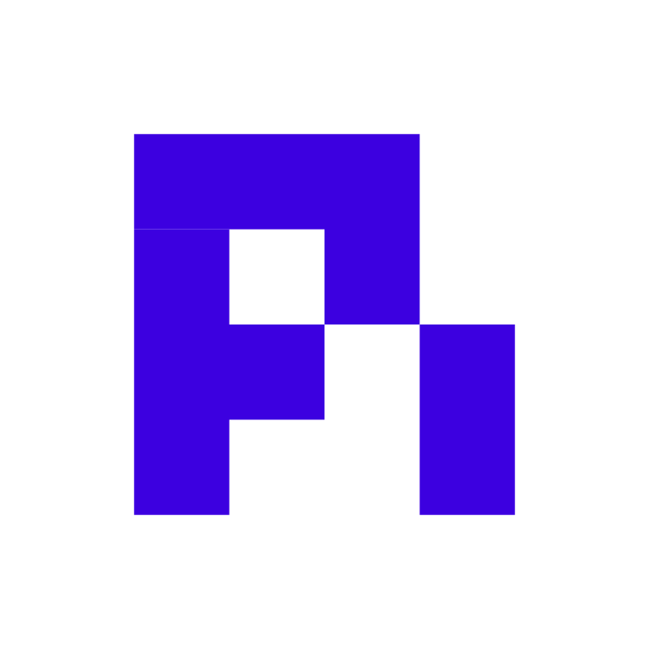

<p align="center">

<a href="https://pi.dev">
  
</a>

</p>
<p align="center">
  <a href="https://discord.com/invite/3cU7Bz4UPx"></a>
  <a href="https://github.com/duggal1/pi-self-recursive"></a>
</p>

# Pi

This is an updated version of Pi that works by itself.

Pi used to need you to stay close and guide every step. This version fixes that. It is built for self-recursive agent loops and automatic agent handoffs.

No human supervision. No babysitting.

## What this is

This is Pi, but with teamwork built in.

Normally you give one helper a task and you have to watch it. You check the work. You pass the result to the next helper. If something breaks, you fix it.

This version does that for you. A small team of helpers can work on a project together. They share work, pass work to each other, and check each other's work.

You give the goal once. They do the rest.

## Why I built this

I was tired of supervising agents all day.

"Done" was not something you could check. You had to read everything to know if it was really finished. Helpers could not coordinate. If two helpers touched the same file, work would break. If a helper got stuck, it would keep trying forever.

This removes me from that loop without losing quality.

## What it will do

Give it a goal and it will plan the work, assign the work, run the work, check the work, and fix the work.

- Work is split into small tasks with clear owners.
- Helpers pass work to each other with short notes.
- Helpers take turns on files so they do not overwrite each other.
- Work only counts as finished when checks pass. A helper saying "done" is not enough.
- If checks fail, the helper tries again with the failure shown.
- If the same failure keeps happening, it stops and asks for help instead of looping forever.
- You can see everything at once: who is working, what they are working on, and what is blocked.
- It can look at screens to check that pages look right.

## Main features

- **It runs itself.** Helpers keep going until checks pass. No babysitting.
- **Automatic handoffs.** One helper finishes a piece and hands it to the next with a clear note.
- **Real checks.** Tests, type checks, and screen comparisons prove the work. No guessing.
- **Safe teamwork.** Only one helper can change a file at a time. It tells you who owns what.
- **Clear messages.** Helpers send short, typed notes: handoff, blocked, question, answer, done.
- **Limits that protect you.** It limits time, tokens, turns, and how deep helpers can spawn helpers.
- **One place to look.** A simple status screen shows helpers, tasks, messages, checks, and problems.
- **Screen checks.** It takes clear screen pictures to catch small layout changes humans would miss.
- **Easy to recover.** If a helper stops or the leader stops, work is saved and can restart with nothing lost.

## Getting started

Install the command-line tool:

```bash
curl -fsSL https://pi.dev/install.sh | sh
```

On Windows:

```shell
powershell -c "irm https://pi.dev/install.ps1 | iex"
```

The installer updates Pi with `pi update`. Alternatively, install directly from GitHub with Bun:

```bash
bun install -g @earendil-works/pi-coding-agent
```

Pi requires Bun (or Node.js 22.19 or newer). The macOS, Linux, and Windows installers can install it if needed.

Start Pi in the directory where you want it to work:

```bash
cd /path/to/project
pi
```

For a built-in AI provider, run `/login` inside Pi to connect a subscription or API key. Then give Pi a task.

See the [documentation](https://pi.dev/docs/latest) for full setup and usage instructions, or [visit pi.dev](https://pi.dev) for demos.

## Run with Nix

```bash
nix run github:earendil-works/pi/stable
```

`stable` points at the latest release. Install it with `nix profile add github:earendil-works/pi/stable` and update with `nix profile upgrade pi`. Use a release tag such as `github:earendil-works/pi/v1.0.0` to pin a version, or `github:earendil-works/pi` for unreleased changes on `main`. Nix builds Pi from source.

Supports ARM64 and x86-64 on Linux and macOS. Use `nix build .` or `nix run .` to build or run your checkout.

Nix builds are offline, so the bundled model data comes from a pi.dev model catalog revision pinned in `nix/model-catalog.json`. At runtime, Pi still overlays newer catalog data from pi.dev as usual. The Nix workflow replaces the pin on `main` when it no longer matches the checkout, for example after a provider is added or gains a new model type. To refresh it by hand:

```bash
npm run update:model-catalog-pin
```

## Packages

This repo contains the main tools that make Pi work.

| Package | What it does |
|---------|-------------|
| **[Chord](packages/chord)** | Shared parts that let apps work together safely across processes |
| **[Telemetry](packages/telemetry)** | Lets the system record what happened |
| **[AI](packages/ai)** | Lets Pi use many AI providers |
| **[Durable](packages/durable)** | Keeps conversations, tasks, and work safe across restarts |
| **[Agent core](packages/agent)** | Makes helpers run, call tools, and keep track of work |
| **[Coding agent](packages/coding-agent)** | The main tool you run on the command line |
| **[Terminal UI](packages/tui)** | The text screen you see in the terminal |

For Slack/chat automation and workflows see [earendil-works/pi-chat](https://github.com/earendil-works/pi-chat).

## Permissions & Containerization

Pi does not include a built-in permission system for restricting filesystem, process, network, or credential access. By default, it runs with the permissions of the user and process that launched it.

If you need stronger boundaries, containerize or sandbox Pi. See [packages/coding-agent/docs/containerization.md](packages/coding-agent/docs/containerization.md) for three patterns:

- **Gondolin extension**: keep `pi` and provider auth on the host while routing built-in tools and `!` commands into a local Linux micro-VM.
- **Plain Docker**: run the whole `pi` process in a local container for simple isolation.
- **OpenShell**: run the whole `pi` process in a policy-controlled sandbox.

## Contributing

See [CONTRIBUTING.md](CONTRIBUTING.md) for contribution guidelines and [AGENTS.md](AGENTS.md) for project-specific rules (for both humans and agents).  Longer term plans for Pi can also be found in [RFCs](https://rfc.earendil.com/keyword/pi).

## Development

```bash
bun install           # Install all dependencies
bun run build         # Refresh model data, then build all packages
bun run check         # Lint, format, and type check
./test.sh            # Run tests (skips LLM-dependent tests without API keys)
./pi-test.sh         # Run pi from sources (can be run from any directory)
```

### Using local packages outside the monorepo

Build every public package into one coherent local artifact set:

```bash
bun run pack:packages -- --out .artifacts/pi-packages
```

This refreshes model data before building `pi-ai`. To avoid network access when
model data is already hydrated, pass `--offline-model-data`.

Then configure an external project to consume one package and resolve all of
its Pi dependencies from the same artifact set:

```bash
node scripts/use-local-packages.mjs \
  --manifest .artifacts/pi-packages/manifest.json \
  --consumer ../my-project \
  --package @earendil-works/pi-durable \
  --package @earendil-works/pi-agent-core
cd ../my-project
bun install
```

For a pnpm project, point `--consumer` at the workspace root:

```bash
node scripts/use-local-packages.mjs \
  --manifest .artifacts/pi-packages/manifest.json \
  --consumer ../my-project \
  --package @earendil-works/pi-durable \
  --package @earendil-works/pi-agent-core \
  --package-manager pnpm
cd ../my-project
pnpm install --ignore-scripts
```

Repeat `--package` for each direct dependency. The command updates the
consumer's `package.json` with content-addressed local `file:` references. It
writes transitive overrides to `package.json` for npm or `pnpm-workspace.yaml`
for pnpm. Keep the artifact directory available while installing or updating
the consumer. Re-run both commands after changing Pi source.

## Building standalone binaries from release source

GitHub releases include a versioned source archive covered by the release's `SHA256SUMS` file. Extract it and run the same build script used for the official standalone binaries:

```bash
VERSION="<release-version>"
tar -xzf "pi-${VERSION}-source.tar.gz"
cd "pi-${VERSION}"
./scripts/build-binaries.sh --offline-model-data --platform linux-x64 --out "$PWD/out"
```

The archive includes release model data and native prebuilds. `--offline-model-data` uses that model data without refreshing provider catalogs. The script installs dependencies and builds the executable with its runtime assets; pass `--skip-install` if dependencies are already provided.

## Supply-chain hardening

We treat npm dependency changes as reviewed code changes.

- Direct external dependencies are pinned to exact versions. Internal workspace packages remain version-ranged.
- `.npmrc` sets `save-exact=true` and `min-release-age=2` to avoid same-day dependency releases during npm resolution.
- `package-lock.json` is the dependency ground truth. Pre-commit blocks accidental lockfile commits unless `PI_ALLOW_LOCKFILE_CHANGE=1` is set.
- `npm run check` verifies pinned direct deps, native TypeScript import compatibility, and the generated coding-agent install lock.
- The pi.dev installer installs from `packages/coding-agent/install-lock/`, generated from the root lockfile, to pin transitive deps. The npm package does not pin transitive deps.
- Local release smoke tests and npm publication use the same tarball packer; npm publishes the validated tarballs rather than repacking workspace directories.
- Local release installs, documented npm installs, and `pi update --self` use `--ignore-scripts` where supported.
- CI installs with `npm ci --ignore-scripts`, and a scheduled GitHub workflow runs `npm audit --omit=dev` plus `npm audit signatures --omit=dev`.
- Install lock generation has an explicit allowlist for dependency lifecycle scripts; new lifecycle-script deps fail checks until reviewed.

## License

MIT
