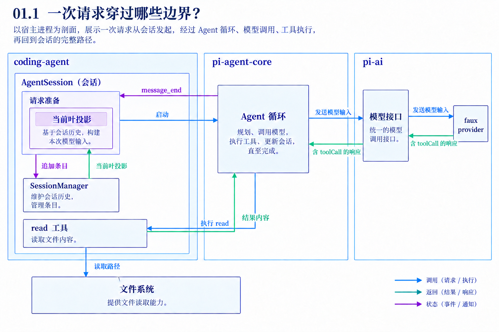
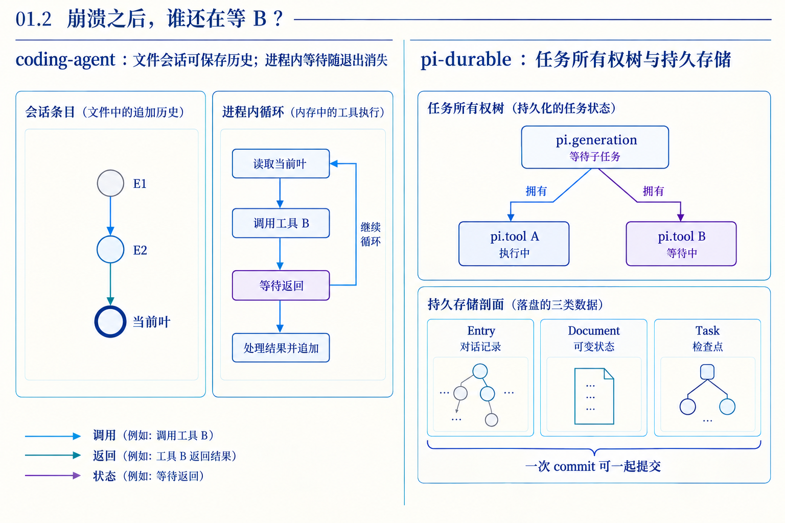

# 第 01 章　一次配置比较，怎样看见 pi 的架构

源码基线为 `56cae782341c339d3bb820081f0f9425d8c5b1ec`。编号、时长及预算示意在各例中说明，A/B实测入口见[离线实验](replay.md)。

用户输入“比较 A.json 和 B.json 的超时值”。A 里是30秒，B里是60秒。假设模型第一次响应提出两次读取，第二次响应才回答差值。我们先追问四件事：谁知道文件在哪，谁决定读取，谁保存结果，进程消失以后谁知道尚欠哪一步？

本章先建立整套课程的对象与边界。A/B请求有[可复现实验](replay.md)，使用真实read与faux provider。后者是可编程的模型替身，固定“第一次提出调用、第二次从结果计算”的路径。远端真实模型可能选择其他动作，实验只证明宿主执行链。

## 1　一个模型响应还缺少哪些工作？

模型收到输入后返回文本或工具调用。返回read的名字和路径并不会自动读取本地文件。宿主需要持有工具实现，检查参数，执行读取，再把内容组织成模型能理解的消息。模型的第二次请求还必须带上已有上下文，否则它不知道结果回答哪个问题。

随着运行变长，宿主还要处理取消、新输入、窗口预算、错误恢复和历史分支。这里把这些围绕模型运行的程序称为harness。要理解它的架构，重点看这些决定分别由谁作出，以及结果写到哪份状态。

## 2　先看三个包之间的依赖



coding-agent负责具体应用，AgentSession组织输入、工具、扩展和会话。SessionManager拥有会话条目与当前叶。read实现也在该包内，它知道如何解析路径和读取文件。

pi-agent-core负责通用循环。Agent管理活动运行和队列，runLoop推进模型响应与工具批次。它处理AgentMessage序列，不拥有coding-agent的会话树。

pi-ai负责模型接口、规范消息和响应流。循环交给它的是系统状态、工具声明及对话组成的规范输入，具体provider再适配对应模型API。实验使用faux provider，因此这张图里的provider也运行在本地进程内。

按这三个边界看，读取调用会从应用进入循环、穿过模型接口，再由循环回调应用提供的工具。包依赖和运行调用的方向不总是相同。源码中的可复用性，正来自循环接收工具与流函数这些接口。[sdk.ts L403](https://github.com/earendil-works/pi/blob/56cae782341c339d3bb820081f0f9425d8c5b1ec/packages/coding-agent/src/core/sdk.ts#L403) [types.ts L1](https://github.com/earendil-works/pi/blob/56cae782341c339d3bb820081f0f9425d8c5b1ec/packages/agent/src/types.ts#L1)

## 3　五个消息，怎样完成第一次比较？

本例第一次请求包含system、user。system提供系统状态和read声明；user给出比较任务。第一次响应是一条assistant，content含调用A与B：

```text
A  name=read  arguments={path:"A.json"}
B  name=read  arguments={path:"B.json"}
```

循环执行两个工具后，各构造一条toolResult，toolCallId分别为A、B。第二次请求因而有system、user、assistant、toolResult、toolResult五条消息。模型从结果中得到30与60，再输出最终assistant。

这里有三个不同数量：一次用户输入、两次模型请求、两次工具调用。两个调用可以放在一条assistant里，所以不能用工具数推断消息数，也不能用消息数推断用户操作次数。[agent-loop.ts L250](https://github.com/earendil-works/pi/blob/56cae782341c339d3bb820081f0f9425d8c5b1ec/packages/agent/src/agent-loop.ts#L250)

## 4　谁保存了什么，谁只看一个视图？

AgentMessage是循环的消息。SessionEntry为历史增加id、parentId、条目类型，也可以表达编辑和压缩。模型Message是在请求边界转换得到的规范消息。AgentEvent则描述运行过程，例如文字更新和工具结束。

coding-agent在message_end上追加普通消息条目。下次请求前，它从当前叶取路径、应用压缩与编辑，形成投影，再给循环使用。transformContext和convertToLlm之后才得到模型接口的输入。

假设用户隐藏一条失败响应，原始条目还在，投影贡献可为空。假设用户从旧节点改问C，兄弟分支的答案还在文件里，但不在当前路径。历史保存和下一次输入因此可以分别满足追溯与有效上下文的需求。代价是调用方必须清楚自己展示的是历史还是投影。[agent-session.ts L1163](https://github.com/earendil-works/pi/blob/56cae782341c339d3bb820081f0f9425d8c5b1ec/packages/coding-agent/src/core/agent-session.ts#L1163) [session-manager.ts L543](https://github.com/earendil-works/pi/blob/56cae782341c339d3bb820081f0f9425d8c5b1ec/packages/coding-agent/src/core/session-manager.ts#L543)

## 5　工具“稳定”具体指什么？

第一层是执行前判断。未知工具、错误参数和被钩子阻止的调用形成错误结果。响应若因长度限制被截断，即使修复出的JSON合法，也禁止这一条响应里的工具实际执行。

第二层是身份和顺序。结果通过toolCallId配对；并行执行可以让B先完成，但当前循环按A、B的调用位置发结果消息。执行事件服务进度，结果排列服务下一次模型请求，两套顺序分别保留。

第三层是故障后的判断。执行后报错可能已有副作用；取消信号也不能撤回已经完成的外部动作。普通循环把错误组织好，并没有自动给每个工具提供跨进程幂等。我们要读的是每一层实际提供的保证，而不是从“捕获异常”推导“不会重复修改”。[agent-loop.ts L481](https://github.com/earendil-works/pi/blob/56cae782341c339d3bb820081f0f9425d8c5b1ec/packages/agent/src/agent-loop.ts#L481) [agent-loop.ts L596](https://github.com/earendil-works/pi/blob/56cae782341c339d3bb820081f0f9425d8c5b1ec/packages/agent/src/agent-loop.ts#L596)

## 6　进程退出把哪份状态带走了？



普通coding-agent的文件会话可以重新读回历史、选择分支和重建模型上下文。但当工具B正运行时，内存中的Promise、等待栈和活动队列不会因为JSONL存在就继续执行。

Durable额外把工作表达成Task。pi.generation拥有pi.tool子任务，保存等待集合和检查点；Entry记录对话事实，Document保存可变状态。一次存储提交可以同时保存响应、子任务和父任务等待状态。重开后，调度器依据这些数据推进工作。

这提供了明确的恢复依据，同时引入任务定义、迁移、存储提交、重放策略和副作用判断等成本。对只读比较，重读可能只是多付一次I/O；对外部支付，重放还要业务幂等身份。第11–14章沿这些差异展开。[generation.ts L1003](https://github.com/earendil-works/pi/blob/56cae782341c339d3bb820081f0f9425d8c5b1ec/packages/durable/src/harness/generation.ts#L1003) [tool.ts L193](https://github.com/earendil-works/pi/blob/56cae782341c339d3bb820081f0f9425d8c5b1ec/packages/durable/src/harness/tool.ts#L193)

## 7　为什么这几处设计值得逐章学习？

如果只保存模型消息，省略一次失败尝试时就难以同时保留诊断。条目与投影分开提供可追溯的输入构造。

如果循环直接依赖read文件实现，换成数据库工具就要改主循环。声明与执行接口让模型选择能力，宿主仍掌握执行边界。

如果每项并行结束就立即成为下一请求的一部分，运行输入会受异步完成顺序影响。整批归序增加等待，却让对应关系稳定。

如果恢复只看最后一句话，无法知道尚未创建和正在执行的B有何差别。持久任务把这个区别变成可检查的状态。

以上是从实现推导的设计收益。第二遍读源码时，应为每项收益同时找出它付出的存储、计算、延迟或约束成本。

## 8　源码阅读路线

先看sdk如何把Agent、转换函数、会话与工具装起来，再看Agent.prompt如何进入runAgentLoop。沿一次read追到toolResult后，回看AgentSession的message_end持久化，再读SessionManager的投影。最后用Durable的generation工具阶段作对照。不要先把全仓库目录背下来，再寻找每个名字的用处。[sdk.ts L403](https://github.com/earendil-works/pi/blob/56cae782341c339d3bb820081f0f9425d8c5b1ec/packages/coding-agent/src/core/sdk.ts#L403) [agent.ts L382](https://github.com/earendil-works/pi/blob/56cae782341c339d3bb820081f0f9425d8c5b1ec/packages/agent/src/agent.ts#L382) [agent-loop.ts L111](https://github.com/earendil-works/pi/blob/56cae782341c339d3bb820081f0f9425d8c5b1ec/packages/agent/src/agent-loop.ts#L111) [session-manager.ts L543](https://github.com/earendil-works/pi/blob/56cae782341c339d3bb820081f0f9425d8c5b1ec/packages/coding-agent/src/core/session-manager.ts#L543)

## 对照关键源码

这里把通用循环与应用消息转换接起来。沿构造参数找工具与请求行为，沿后续AgentSession装配找会话归属。

[coding-agent/src/core/sdk.ts L403](https://github.com/earendil-works/pi/blob/56cae782341c339d3bb820081f0f9425d8c5b1ec/packages/coding-agent/src/core/sdk.ts#L403)

下面是实现节选，代码块边界不表示完整函数。

```typescript
	const agent = new Agent({
		initialState: {
			systemPrompt: "",
			model,
			thinkingLevel,
			tools: [],
			messages: existingSession.messages,
		},
		convertToLlm: convertToLlmWithBlockImages,
		streamFn: async (model, context, options) => {
			const requestOptions = buildRequestOptions(options);
			// Compaction and summaries use their own routing ids; only session requests
```

## Q&A与推导答案

### Q1　第一轮模型知道30和60吗？

**答案**　本例第一份输入只有问题与工具声明，文件内容尚未交付。名字中带A或B也不会让模型获得磁盘字节。两条read结果进入第二份请求后才有计算依据。[read.ts L102](https://github.com/earendil-works/pi/blob/56cae782341c339d3bb820081f0f9425d8c5b1ec/packages/coding-agent/src/core/tools/read.ts#L102)

### Q2　两个read为什么只产生一条调用响应？

**答案**　assistant.content是内容块数组，A与B各占一个toolCall块。两条toolResult则各自拥有toolCallId。先数容器，再数块。

### Q3　条目parentId能替代toolCallId吗？

**答案**　不能。B的结果条目可能追加在A结果之后，但它对应的是调用B。前者组织历史路径，后者解释工具结果。

### Q4　用户切回旧问题，B文件会恢复旧值吗？

**答案**　改叶只改变后续追加关系与投影，文件系统已发生的动作要另行处理。下一次read读取当前文件，不读取旧会话里记录的版本。[session-manager.ts L1589](https://github.com/earendil-works/pi/blob/56cae782341c339d3bb820081f0f9425d8c5b1ec/packages/coding-agent/src/core/session-manager.ts#L1589)

### Q5　工具执行事件都出现了，能证明工具体运行过吗？

**答案**　截断保护也发start和end来结束每个调用的生命周期，但不调用execute。要证明实际动作，检查执行分支或工具体计数。[agent-loop.ts L481](https://github.com/earendil-works/pi/blob/56cae782341c339d3bb820081f0f9425d8c5b1ec/packages/agent/src/agent-loop.ts#L481)

### Q6　Durable是不是只要多保存聊天就行？

**答案**　还要保存最终参数、工作阶段、父子归属与等待对象。对话回答“发生过什么”，检查点回答“继续哪一步”，外部效果仍需重放策略。[tool.ts L193](https://github.com/earendil-works/pi/blob/56cae782341c339d3bb820081f0f9425d8c5b1ec/packages/durable/src/harness/tool.ts#L193)

[返回全书目录](README.md)

