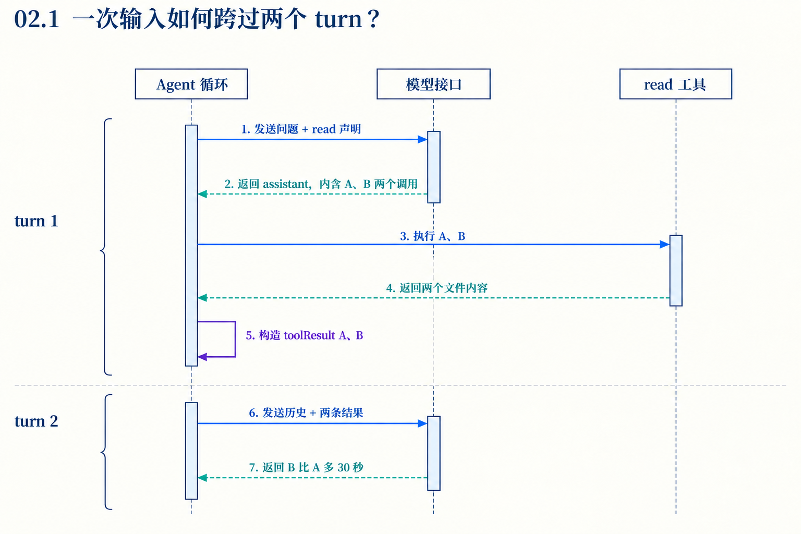

# 第02章　一次输入怎样变成多轮可控执行

源码基线为 `56cae782341c339d3bb820081f0f9425d8c5b1ec`。编号、时长及预算示意在各例中说明，A/B实测入口见[离线实验](replay.md)。

沿用A/B比较。用户只发一次输入，模型却要先提调用、再看结果。现在把终端显示去掉，只观察循环变量与事件。目标是能在任一边界判断下一次模型请求会不会发生，以及它会拿到哪些消息。

本章run指一次循环运行，turn指一次模型响应及其工具调用。第06章压缩算法中由用户类输入开始的长段工作也使用turn一词，具体定义随模块辨认。

## 1　为什么prompt与continue需要不同入口？

prompt接收新消息，进入runAgentLoop时把它追加到工作上下文并发出生命周期事件。continue从现有消息继续，不重复追加用户输入。假设一次模型请求失败前已经保存user，若重新prompt同一句话，会多出第二条user；continue才能表达“对已有输入再回答”。

Agent的continue检查末条消息。空上下文或只有system不够；末条只要是assistant，无论stopReason为stop、error或aborted，都不能直接原样继续。存在队列消息时可以先启动这些新消息，否则会拒绝。这个限制让“继续回答”需要明确的输入依据。[agent.ts L382](https://github.com/earendil-works/pi/blob/56cae782341c339d3bb820081f0f9425d8c5b1ec/packages/agent/src/agent.ts#L382)

## 2　运行开始以前，Agent保存什么？

createContextSnapshot复制消息数组和工具数组，形成这次调用的上下文快照。runWithLifecycle创建AbortController、活动Promise，设置isStreaming，并在finally里清理运行状态。数组快照不意味着每个消息对象都被深复制，不能从slice推出消息内容彼此隔离。

已有activeRun时直接prompt会被拒绝。并发输入必须通过队列交付，避免两个循环共同追加和消费一份消息。活动边界包括等待回调的过程，agent_end事件出现不立即等于Agent已经空闲；等待监听者结束、finishRun清理后才释放这次运行。[agent.ts L471](https://github.com/earendil-works/pi/blob/56cae782341c339d3bb820081f0f9425d8c5b1ec/packages/agent/src/agent.ts#L471) [agent.ts L516](https://github.com/earendil-works/pi/blob/56cae782341c339d3bb820081f0f9425d8c5b1ec/packages/agent/src/agent.ts#L516)

## 3　三个变量怎样分开维护过去、现在和下一步？

runAgentLoop得到初始声明与prompt消息，创建currentContext与newMessages。runLoop另有lastCompletedTurn和explicitContinuation。

| 状态 | 回答的问题 |
|---|---|
| currentContext | 当前循环准备使用哪些消息和工具 |
| newMessages | 本次调用新增了什么，结束时返回哪些记录 |
| lastCompletedTurn | 上轮哪条assistant与哪些结果已经完成 |
| pendingMessages | 下轮以前还要追加哪些准备或排队消息 |
| explicitContinuation | 是否还欠一次明确要求的后续请求 |

首轮system/user进入currentContext与newMessages。模型响应结束后assistant加入，工具结果再追加。lastCompletedTurn保存此刻的消息、结果和上下文。下一轮的准备回调因此拿得到上轮实物，而不必从全量历史猜“刚完成的是哪一条”。[agent-loop.ts L111](https://github.com/earendil-works/pi/blob/56cae782341c339d3bb820081f0f9425d8c5b1ec/packages/agent/src/agent-loop.ts#L111) [agent-loop.ts L175](https://github.com/earendil-works/pi/blob/56cae782341c339d3bb820081f0f9425d8c5b1ec/packages/agent/src/agent-loop.ts#L175)

## 4　按事件手算两轮运行



首轮先agent_start、turn_start，再为起始消息发message_start/message_end。请求模型时，assistant可能经历多次update；完整响应得到后才抽取toolCall。A、B执行完，每个结果发自己的消息事件，随后调用finishTurn并发turn_end。

正常工具批次允许续轮时，第二轮先prepareNextTurn，再取必要的新输入，发turn_start。准备消息追加后，prepareRequest可再替换请求上下文与模型。第二次模型给出最终文字，无自然工具续轮和其他继续理由后发agent_end。

这一顺序解释了两个断点。message_end表示一条消息结束，turn_end表示这轮响应及结果处理结束，agent_end表示本次循环不会再发后续事件。它们不保证外层AgentSession完全结束业务恢复；应用层还可能决定重试或压缩后继续。[agent-loop.ts L192](https://github.com/earendil-works/pi/blob/56cae782341c339d3bb820081f0f9425d8c5b1ec/packages/agent/src/agent-loop.ts#L192) [agent-session.ts L1920](https://github.com/earendil-works/pi/blob/56cae782341c339d3bb820081f0f9425d8c5b1ec/packages/coding-agent/src/core/agent-session.ts#L1920)

## 5　prepareNextTurn与prepareRequest为何都存在？

prepareNextTurn只在已有完成轮次后执行，适合使用上轮结果更新工具、提示和上下文。prepareRequest在每次对话请求前执行，包括第一次，适合用规范投影或路由结果确定本次输入。再往后才是transformContext与convertToLlm，分别保持应用消息类型和进入模型类型边界。

coding-agent在下一轮回调里检查压缩、更新提示与loadout；在每次请求回调里再读取SessionManager规范投影。这样工具结果引起的应用变化可以在下一请求生效，而通用循环无需知道树、压缩或项目规则的具体类型。[agent-session.ts L805](https://github.com/earendil-works/pi/blob/56cae782341c339d3bb820081f0f9425d8c5b1ec/packages/coding-agent/src/core/agent-session.ts#L805) [agent-session.ts L914](https://github.com/earendil-works/pi/blob/56cae782341c339d3bb820081f0f9425d8c5b1ec/packages/coding-agent/src/core/agent-session.ts#L914) [agent-loop.ts L397](https://github.com/earendil-works/pi/blob/56cae782341c339d3bb820081f0f9425d8c5b1ec/packages/agent/src/agent-loop.ts#L397)

## 6　循环依据什么继续，顺序为什么重要？

error/aborted响应属于硬退出。正常响应先执行工具批次，批次terminate决定自然工具续轮；finishTurn的end可提前结束，continue则要求一次后续请求。

若工具或steering已经选择下一轮，explicitContinuation会清除，不会把两个继续理由相加。内层自然工作结束后才取follow-up，仍无自然下一轮才兑现仅依赖上下文的显式继续。

```text
工具续轮 + finishTurn continue
→ 一次自然下一请求
→ 显式继续意图已被满足
→ 不额外再发一遍
```

因此stopReason只是判断的一部分。看见toolUse也不能忽略整批terminate；看见普通文字也不能忽略队列与显式继续。[agent-loop.ts L250](https://github.com/earendil-works/pi/blob/56cae782341c339d3bb820081f0f9425d8c5b1ec/packages/agent/src/agent-loop.ts#L250) [agent-loop.ts L289](https://github.com/earendil-works/pi/blob/56cae782341c339d3bb820081f0f9425d8c5b1ec/packages/agent/src/agent-loop.ts#L289)

## 7　设计收益、代价与调试方法

循环把策略放在边界回调里，允许应用更新下一步而复用执行骨架。代价是“下一轮输入”由多阶段共同生成，调试时单看初始Agent.state会漏掉请求前变化。

按本章变量逐步记录，最少保存请求前角色列表、响应stopReason、toolResults ID、finishTurn决定、两类队列交付和最后agent_end。随后区分“循环没有再发请求”“应用外层重新继续”“请求发出但provider失败”，才能定位多轮异常。

## 对照关键源码

先完成轮次回调，再发turn_end，随后处理显式继续和自然续轮。把每个分支与第6节的请求次数对应。

[agent/src/agent-loop.ts L295](https://github.com/earendil-works/pi/blob/56cae782341c339d3bb820081f0f9425d8c5b1ec/packages/agent/src/agent-loop.ts#L295)

下面是实现节选，代码块边界不表示完整函数。

```typescript
			const decision = await config.finishTurn?.(lastCompletedTurn, signal);
			await emit({ type: "turn_end", message, toolResults });

			if (decision?.action === "end") {
				await emit({ type: "agent_end", messages: newMessages });
				return;
			}

			explicitContinuation = decision?.action === "continue";
			pendingMessages = (await config.getSteeringMessages?.()) || [];
			if (hasMoreToolCalls || pendingMessages.length > 0) {
				explicitContinuation = false;
			}
		}

```

## Q&A与推导答案

### Q1　finishTurn continue与工具续轮是否各发一次请求？

**答案**　正常路径只产生一次。工具或steering可满足显式继续要求，代码会清除这份意图。第二次是否继续由那次新响应再判断。[agent-loop.ts L303](https://github.com/earendil-works/pi/blob/56cae782341c339d3bb820081f0f9425d8c5b1ec/packages/agent/src/agent-loop.ts#L303)

### Q2　两项工具调用和最终答案共有几条assistant？

**答案**　两条。第一条含两个toolCall块，第二条是最终文字。工具结果各为独立消息。

### Q3　错误响应以后follow-up会立刻被这次run消费吗？

**答案**　error/aborted硬退出先返回，不走自然停止后的follow-up检查。外层应用是否重试或再启动要另查。[agent-loop.ts L254](https://github.com/earendil-works/pi/blob/56cae782341c339d3bb820081f0f9425d8c5b1ec/packages/agent/src/agent-loop.ts#L254)

### Q4　为什么不能从末尾assistant随意continue？

**答案**　Agent按末条role判断，不按stopReason判断。失败assistant原样留下也会被拒绝；它先检查队列能否提供新消息，无队列则拒绝。coding-agent重试要先省略选中的失败尝试，让投影尾部重新具备继续依据。[agent.ts L393](https://github.com/earendil-works/pi/blob/56cae782341c339d3bb820081f0f9425d8c5b1ec/packages/agent/src/agent.ts#L393)

### Q5　收到agent_end后立刻prompt一定可行吗？

**答案**　Agent还在等待事件监听者时activeRun未清理。真正空闲需要runWithLifecycle走完finally。回调里重入要考虑应用提供的排队机制。[agent.ts L516](https://github.com/earendil-works/pi/blob/56cae782341c339d3bb820081f0f9425d8c5b1ec/packages/agent/src/agent.ts#L516)

### Q6　请求前模型为何能与Agent选择的模型不同？

**答案**　prepareRequest可以返回请求专用模型和上下文。虚拟路由或应用策略作用于这一请求，不必等于永久改写用户选择。[types.ts L172](https://github.com/earendil-works/pi/blob/56cae782341c339d3bb820081f0f9425d8c5b1ec/packages/agent/src/types.ts#L172)

[返回目录](README.md)

