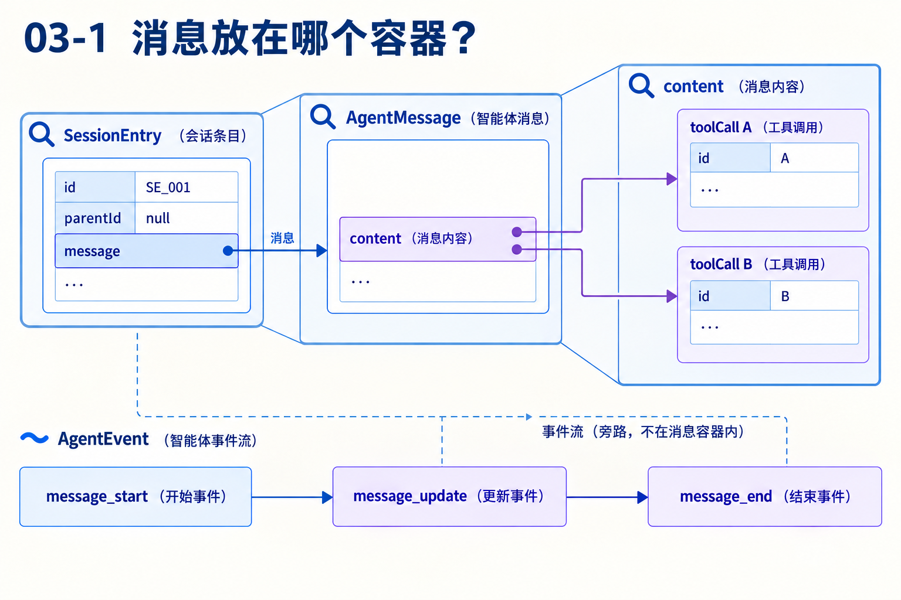
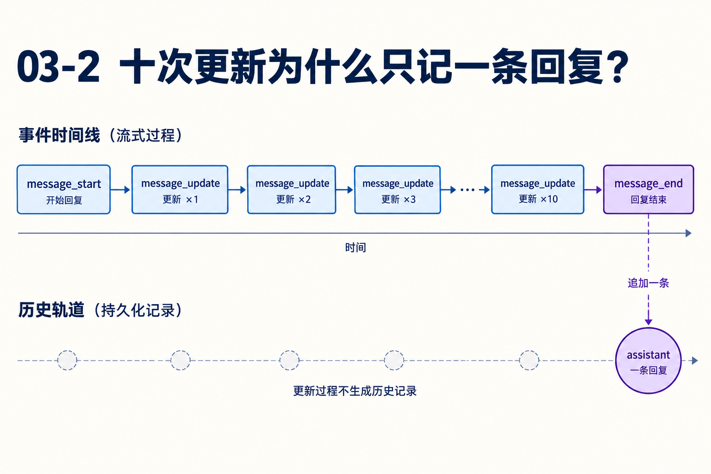

# 第03章　消息、条目和事件怎样共同描述一条回答

源码基线为 `56cae782341c339d3bb820081f0f9425d8c5b1ec`。编号、时长及预算示意在各例中说明，A/B实测入口见[离线实验](replay.md)。

同一条回复分十个增量到达。UI显示了一次，磁盘保存了一条，模型下一次又收到一条。假设加入一条隐藏通知、两项工具调用和一次压缩，这三个数量还会相等吗？

本章从字段和容器出发。读完应能判断某份数据属于历史身份、模型语义还是运行观察，并解释一次过滤为什么不会删除原始记录。

## 1　先在纸上画出容器



SessionEntry的id与parentId表达历史谱系。type=message的条目拥有message，里面可以是assistant等消息。assistant.content是内容块数组，可同时有text、thinking、toolCall。工具结果是另一条role=toolResult的消息。

AgentMessage是循环处理的应用消息联合类型。pi-ai的Message是模型接口支持的规范角色。AgentEvent描述过程，可以引用消息、增量或工具ID。它不是每次都要持久化为一条对话的记录。[types.ts L1](https://github.com/earendil-works/pi/blob/56cae782341c339d3bb820081f0f9425d8c5b1ec/packages/agent/src/types.ts#L1) [session-manager.ts L440](https://github.com/earendil-works/pi/blob/56cae782341c339d3bb820081f0f9425d8c5b1ec/packages/coding-agent/src/core/session-manager.ts#L440)

## 2　三种身份分别解决哪一个问题？

令E3是assistant条目，里面调用A和B；E4是A的toolResult，E5是B的toolResult。E4.parentId=E3，E5.parentId=E4，因为结果按这条路径追加。E4.message.toolCallId=A，E5.message.toolCallId=B，因为它们响应不同动作。

查“B结果怎么画到A下面”，沿调用ID查。查“恢复到了旁支”，沿条目父指针和leaf查。查“更新事件少了一次”，沿事件消费链查。给所有对象加同一个id不能替代这三种语义，反而会让嵌套调用和分支更难区分。

## 3　响应流怎样形成最后那条assistant？

start接入部分assistant。text_delta等响应事件更新内容，并让循环向上发message_update。结束后取得完整响应，后续检查stopReason和toolCall。工具结果不必经过同样的长流，通常直接发start/end。

coding-agent的普通消息追加位于message_end分支。十个增量因此可以对应一条最终条目，而不是十次保存。反过来，观察者看到中途文字也不能推断这条完整消息已经保存。要恢复实时进度与最终历史，需分别检查对应机制。[agent-loop.ts L418](https://github.com/earendil-works/pi/blob/56cae782341c339d3bb820081f0f9425d8c5b1ec/packages/agent/src/agent-loop.ts#L418) [agent-session.ts L1163](https://github.com/earendil-works/pi/blob/56cae782341c339d3bb820081f0f9425d8c5b1ec/packages/coding-agent/src/core/agent-session.ts#L1163)



## 4　为什么应用消息不能直接全部发给provider？

应用需要表示bashExecution、custom、branchSummary、compactionSummary等信息。模型接口接受system、user、assistant、toolResult，转换函数决定每种应用消息如何贡献。

当前convertToLlm把custom变成user，把摘要包裹成说明文本后的user，把被excludeFromContext标记的bashExecution过滤；其余bashExecution转成用户文本。规范四类消息在该层原样通过。之后normalizeContext重放系统状态与工具声明，provider还会转成实际网络格式。[messages.ts L148](https://github.com/earendil-works/pi/blob/56cae782341c339d3bb820081f0f9425d8c5b1ec/packages/coding-agent/src/core/messages.ts#L148) [agent-loop.ts L397](https://github.com/earendil-works/pi/blob/56cae782341c339d3bb820081f0f9425d8c5b1ec/packages/agent/src/agent-loop.ts#L397)

这条边界让扩展能增加应用语义，但也要求作者明确转换契约。给类型联合加一个成员只是开始，还需决定显示、持久化和模型输入三个位置怎样理解它。

## 5　display=false为什么不等于模型看不到？

custom_message条目可以产生custom消息，display描述显示意图，convertToLlm的custom分支仍会产生user。普通custom状态条目则在sessionEntryToContextMessages中贡献空数组。相近名字承载不同目的。

若希望存一条仅供界面或状态用的通知，必须选择合适的存储/贡献机制，不能通过隐藏UI来假定模型输入被过滤。反方向，某些用于模型的隐藏提示可不显示，却仍有上下文贡献。检查权限或数据暴露时尤其要沿真正的转换链判断。

[条目贡献规则](https://github.com/earendil-works/pi/blob/56cae782341c339d3bb820081f0f9425d8c5b1ec/packages/coding-agent/src/core/session-manager.ts#L440)

## 6　一个来源为什么能贡献零条或两条消息？

普通message通常一条，状态条目或被隐藏目标零条。带systemMessage的compaction可贡献系统状态与摘要两条。projection.entries保存sourceEntry与messages数组，flatMap再形成循环使用的消息序列。

因此“最近十条条目”与“最近十条模型消息”不能互换。错误恢复要定位被省略的原始来源，token计量要知道usage来自哪个条目，UI要解释内容为何不再参与请求，都依赖这层来源关系。[session-manager.ts L543](https://github.com/earendil-works/pi/blob/56cae782341c339d3bb820081f0f9425d8c5b1ec/packages/coding-agent/src/core/session-manager.ts#L543)

## 7　事件消费者要维护什么约束？

消费者按事件更新自己的视图，不能在每次update追加新对话。结束事件可能被多个监听者消费，监听者还可能是异步的；Agent按自己的生命周期等待监听者。一个慢消费者能增加运行结束延迟，UI渲染和外部持久化不应无意串成昂贵的热路径。

同一语义回复可以分成一次全文或十次增量。好的消费逻辑最终得到相同文本和同样的完成条目，变化的是进度轨迹。这个输入变式比“枚举所有事件名”更适合验证是否理解事件与数据。

## 对照关键源码

custom的模型贡献不依据display。角色转换与显示分开，使读者可以直接验证第5节的反例。

[coding-agent/src/core/messages.ts L162](https://github.com/earendil-works/pi/blob/56cae782341c339d3bb820081f0f9425d8c5b1ec/packages/coding-agent/src/core/messages.ts#L162)

下面是实现节选，代码块边界不表示完整函数。

```typescript
				case "custom": {
					const content = typeof m.content === "string" ? [{ type: "text" as const, text: m.content }] : m.content;
					return {
						role: "user",
						content,
						timestamp: m.timestamp,
					};
				}
				case "branchSummary":
```

## Q&A与推导答案

### Q1　toolCall A是单独一条消息吗？

**答案**　它是assistant.content里的内容块。一条assistant可有A、B两个块，结果各自是toolResult。

### Q2　为什么E5.parentId=E4，结果却属于B？

**答案**　父指针表示历史追加路径，toolCallId表示动作配对。两种关系允许交叉，不需把结果父节点强行改成调用块。

### Q3　隐藏custom显示会过滤模型输入吗？

**答案**　当前custom转换不依据display过滤。要检查条目贡献和转换规则，而不只检查显示开关。[messages.ts L148](https://github.com/earendil-works/pi/blob/56cae782341c339d3bb820081f0f9425d8c5b1ec/packages/coding-agent/src/core/messages.ts#L148)

### Q4　一个compaction为什么可能贡献两条？

**答案**　它可以同时携带systemMessage和摘要，重建时需要恢复系统状态并提供旧进展。这也是贡献采用数组的原因。[session-manager.ts L460](https://github.com/earendil-works/pi/blob/56cae782341c339d3bb820081f0f9425d8c5b1ec/packages/coding-agent/src/core/session-manager.ts#L460)

### Q5　message_update可以直接作为历史新节点保存吗？

**答案**　若当成独立回答追加，会把一条部分响应重复保存多次。应更新同一进度对象，在正确结束边界记录最终消息。

### Q6　把应用消息转成模型Message后就等于HTTP请求吗？

**答案**　还经过规范化与provider编码。规范role、工具字段如何落到某个供应商协议，要读相应适配器，不能直接复制内部对象假定所有字段都可发送。

[返回目录](README.md)

