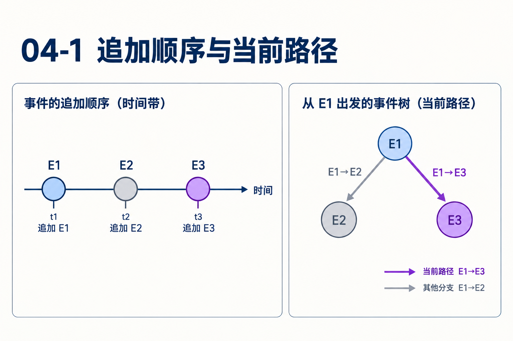
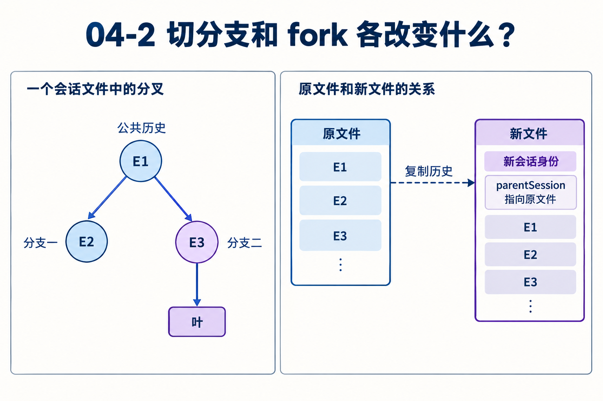

# 第04章　会话为什么保存成树

源码基线为 `56cae782341c339d3bb820081f0f9425d8c5b1ec`。编号、时长及预算示意在各例中说明，A/B实测入口见[离线实验](replay.md)。

完成A/B比较后，用户发现问题问错了，想回到最早的输入，改为比较A/C。已有答案还想留着，文件却只有追加记录。怎样做到共享旧上下文，又让新请求只看一条路径？

本章使用教学条目ID，不把它们当真实UUID。读完应能画出追加顺序、父子关系和当前叶，并判断改叶、分支摘要、复制会话各改变什么。

## 1　线性数组会在哪一步失去表达力？

先有E1用户问题、E2助手调用、E3/E4结果、E5结论。若把“改问A/C”直接追加为E6，模型默认会继承A/B结论。若删E2…E5，用户失去原探索。若复制整个前缀，则每次试不同答案都重复存储和管理公共历史。

树把两种顺序分开。物理顺序回答何时写入；parentId回答从哪个上下文继续；leafId选择当前继续的位置。新分支E6以E1为父，E7再以E6为父，E2…E5继续留在另一条路径。



## 2　条目头有哪些必要字段？

条目有id、parentId、timestamp、type，具体type决定内容。parentId=null表示根。消息、压缩、模型选择、标签和上下文编辑可以共同占据树节点，不能只对role消息建树而忽略其余状态。

当前会话头另有会话身份、工作目录等数据，它与每个条目ID不是同一层。byId索引让父指针查找不必反复扫描整个文件。树视图的孩子排序用于展示，当前上下文路径则依父指针，不能用屏幕上的相邻位置替代关系。[session-manager.ts L390](https://github.com/earendil-works/pi/blob/56cae782341c339d3bb820081f0f9425d8c5b1ec/packages/coding-agent/src/core/session-manager.ts#L390)

## 3　手工执行buildSessionPath

给定物理序列E1…E7，关系为E1→E2→E3→E4→E5，以及E1→E6→E7。leaf=E7：

1. 从索引查E7，放进临时数组。
2. 查它的parentId，依次得到E6、E1。
3. 根的parentId为空，停止。
4. 反转得到E1、E6、E7。

leaf=E5则得到E1…E5。传入null明确得到空路径；未明确给叶时该函数可以回退到末条记录。这些参数含义不同，不能把undefined与null都翻译成“没有历史”。[session-manager.ts L390](https://github.com/earendil-works/pi/blob/56cae782341c339d3bb820081f0f9425d8c5b1ec/packages/coding-agent/src/core/session-manager.ts#L390)

## 4　branch只移动哪一处状态？

SessionManager.branch先验证目标ID存在，再更新leafId。下一次append以新叶为父，已有条目不修改。resetLeaf设null，允许新追加成为新根。

因此分支不是“立即生成另一个模型答案”。它改变后续追加与重建的起点，真正的用户消息和模型响应还要走正常运行。用测试验证时先检查leaf，再追加一条，再断言其parentId和两条路径，避免只检查文件总行数。[session-manager.ts L1589](https://github.com/earendil-works/pi/blob/56cae782341c339d3bb820081f0f9425d8c5b1ec/packages/coding-agent/src/core/session-manager.ts#L1589)

## 5　为什么切回旧叶不会撤销文件修改？

假设E3中工具把B改成75秒，随后切回E1。投影恢复了旧上下文，但文件系统仍是当前75秒。模型可能未在新路径里见到修改记录，下一次read却会得到新内容。

会话树是对话的谱系，不是整个外部世界的快照。若业务需要代码回滚，需结合版本控制或专门的恢复机制。调试分支时应同时记录leaf、cwd和文件状态，不能把它们都归入“回到了旧会话”。

## 6　离开的分支有哪些经验可以带走？

导航时分支摘要先求最深共同祖先。旧叶E5、目标E7的共同祖先是E1，旧分支待摘要为E2…E5，公共E1和新分支E6/E7不应重复总结。

collectEntriesForBranchSummary从旧叶向上收集，再反转为时间顺序。它包含途中压缩记录，后者可贡献已有摘要。此路径与普通compaction的投影规则有自己的目的和细节，不能用一套“最近N条消息”代替。

生成摘要后，branchWithSummary先将叶切到目标，再追加branch_summary，fromId标明离开的位置。摘要成为新路径的一条来源，旧探索仍可回查。是否生成摘要、取消或失败后怎样导航，还要看应用导航选项和调用方，不能认为每次branch都自动付一次模型费用。[branch-summarization.ts L101](https://github.com/earendil-works/pi/blob/56cae782341c339d3bb820081f0f9425d8c5b1ec/packages/coding-agent/src/core/compaction/branch-summarization.ts#L101) [session-manager.ts L1607](https://github.com/earendil-works/pi/blob/56cae782341c339d3bb820081f0f9425d8c5b1ec/packages/coding-agent/src/core/session-manager.ts#L1607)

## 7　fork究竟复制什么？



forkFrom读取原文件，创建新会话身份与新文件，头部parentSession指原文件，复制非头条目。它承接源文件历史而后独立追加。另一种“仅复制到指定叶路径”的操作有不同选择范围，不能因都叫分叉就假设复制集合相同。

共享前缀的同文件分支不必复制旧消息；新文件fork提供独立会话归属、目录和后续生命周期，却付出复制成本。两者都不自动同步外部文件状态。[session-manager.ts L1825](https://github.com/earendil-works/pi/blob/56cae782341c339d3bb820081f0f9425d8c5b1ec/packages/coding-agent/src/core/session-manager.ts#L1825)

## 8　设计成本在哪里，如何检查恢复错误？

保存整棵树提供审计与探索，但所有读取者必须尊重当前叶。压缩要按路径找最新边界，模型选择要按路径还原，编辑也只能作用于被选中的范围。文件里更晚的一条记录，不能仅凭时间戳覆盖当前分支的状态。

恢复错答案时，按顺序查会话文件、当前叶、父链、投影贡献、请求转换。路径错就先修路径解释；路径对但消息少，要检查编辑与压缩。把两种问题混在模型“失忆”里，找不到真正的设计边界。

## 对照关键源码

每一步查的是parentId，反转后才得到从根向叶的消息顺序。追加时间与这段路径计算无关。

[coding-agent/src/core/session-manager.ts L408](https://github.com/earendil-works/pi/blob/56cae782341c339d3bb820081f0f9425d8c5b1ec/packages/coding-agent/src/core/session-manager.ts#L408)

下面是实现节选，代码块边界不表示完整函数。

```typescript
	const path: SessionEntry[] = [];
	let current: SessionEntry | undefined = leaf;
	while (current) {
		path.push(current);
		current = current.parentId ? index.get(current.parentId) : undefined;
	}
	path.reverse();
	return path;
}
```

## Q&A与推导答案

### Q1　E7时间最新，leaf=E5时会看见它吗？

**答案**　父链E5→E4→E3→E2→E1不经过E7，因此不会。时间顺序只说明写入先后。

### Q2　branch(E1)后还没有append，E2被删了吗？

**答案**　没有。只改变leaf，下一条记录才成为E1的新孩子。旧子树继续保留。

### Q3　null与undefined叶为什么可能得到不同结果？

**答案**　null表达显式空路径，未给叶时函数可回退到末条。代码需要保留这种参数差异。[session-manager.ts L390](https://github.com/earendil-works/pi/blob/56cae782341c339d3bb820081f0f9425d8c5b1ec/packages/coding-agent/src/core/session-manager.ts#L390)

### Q4　从E5转到E7应总结哪段？

**答案**　先求共同祖先E1，只收集旧分支E2…E5。重复公共E1会增加摘要噪声，把新分支加入则改变摘要语义。[branch-summarization.ts L101](https://github.com/earendil-works/pi/blob/56cae782341c339d3bb820081f0f9425d8c5b1ec/packages/coding-agent/src/core/compaction/branch-summarization.ts#L101)

### Q5　模型恢复旧上下文后，read B为什么还是75？

**答案**　branch不撤销工具副作用。真实文件仍是75，旧记录中的60只是历史事实。

### Q6　forkFrom后两边会自动共享后续写入吗？

**答案**　新文件以新头独立追加，parentSession是来源关系，不是双向同步协议。

[返回目录](README.md)

