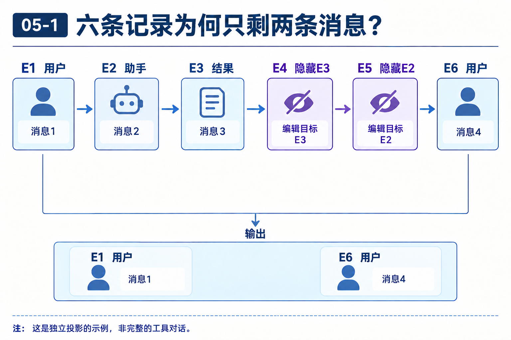
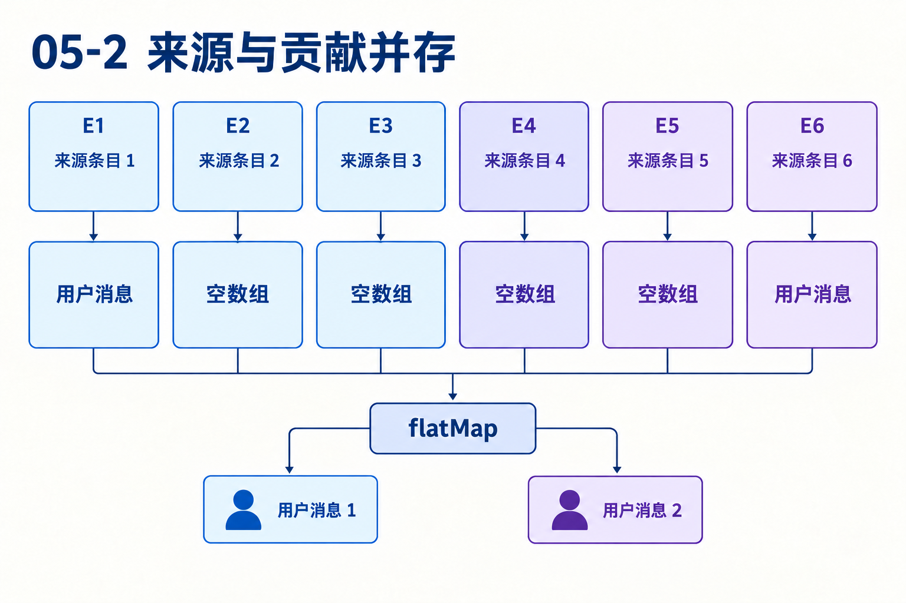

# 第05章　投影怎样把保存的事实变成下一次输入

源码基线为 `56cae782341c339d3bb820081f0f9425d8c5b1ec`。编号、时长及预算示意在各例中说明，A/B实测入口见[离线实验](replay.md)。

同一路径有六条记录：E1用户、E2助手、E3工具结果、E4隐藏E3、E5隐藏E2、E6新用户。原始记录都要保留，下一次模型只应看到两条用户消息。这个过程由谁计算，怎样保证能解释每一次省略？

本章是独立投影演算，不把这六条简写当作完整合法的供应商工具对话。重点在来源选择、编辑优先级和消息贡献。

## 1　把问题写成函数的输入与输出

输入包括全体条目、当前叶，以及可复用的byId索引。先选择路径，随后选择压缩感知的上下文条目，再应用编辑，最后得到两种输出：来源条目与各自贡献，以及摊平的messages。

若只返回Message[]，本例还能算对“模型看见什么”，却解释不了E3为什么不在输入里。若只返回SessionEntry[]，又把模型接口无法直接理解的编辑、标签和状态都混进请求。投影同时保留来源与贡献，服务执行和追溯。[session-manager.ts L543](https://github.com/earendil-works/pi/blob/56cae782341c339d3bb820081f0f9425d8c5b1ec/packages/coding-agent/src/core/session-manager.ts#L543)

## 2　第一次筛选是路径，不是删除

叶E6使六条进入路径。若E5是另一分支的编辑，则它不参与当前投影，即使它的timestamp更晚。路径回答哪些历史与当前工作有关，之后的编辑和压缩才回答这些历史如何贡献内容。

这里的顺序非常重要。先把整个文件所有编辑放进Map，再选择路径，会让旁支编辑污染当前分支。当前实现先buildContextEntries，再从选中条目建编辑索引。[session-manager.ts L476](https://github.com/earendil-works/pi/blob/56cae782341c339d3bb820081f0f9425d8c5b1ec/packages/coding-agent/src/core/session-manager.ts#L476) [session-manager.ts L543](https://github.com/earendil-works/pi/blob/56cae782341c339d3bb820081f0f9425d8c5b1ec/packages/coding-agent/src/core/session-manager.ts#L543)



## 3　为什么编辑要先索引，再回头作用于目标？

E5发生在E2之后，却要求改变E2的贡献。若单遍遇到E2就直接发出，后面还得撤回。当前算法先扫描选中条目，按targetId写入Map，再逐条计算贡献。

```typescript
const edits = new Map<string, ContextEditEntry>();
for (const entry of contextEntries) {
  if (entry.type === "context_edit") edits.set(entry.targetId, entry);
}
```

同一目标多次set会覆盖值，因此当前选择范围中最后出现的编辑生效。这个过程不要求改写原始E2。切叶到早于E5的位置时，E5不参与，原内容就可以重新出现。[session-manager.ts L551](https://github.com/earendil-works/pi/blob/56cae782341c339d3bb820081f0f9425d8c5b1ec/packages/coding-agent/src/core/session-manager.ts#L551)

## 4　逐条手算贡献

| 来源 | 已知编辑 | 本次贡献 |
|---|---|---|
| E1用户 | 无 | 一条user |
| E2助手 | E5的replacement=null | 空数组 |
| E3结果 | E4的replacement=null | 空数组 |
| E4编辑 | 自身不产生消息 | 空数组 |
| E5编辑 | 自身不产生消息 | 空数组 |
| E6用户 | 无 | 一条user |

projection.entries有六项，messages只有两条。将叶改为E4，E5与E6离开路径，E2恢复贡献，最终消息为E1、E2。这个变式可以直接检验是否把后置编辑理解成修改原始数据。



## 5　replacement不是null时具体替换什么？

projectContextEntry先调用sessionEntryToContextMessages。若有非空替换，只对允许的消息角色替换content，其他字段保留；assistant和toolResult的字符串替换会正规化成text数组。

因此替换文本并不重新生成usage、模型身份或结果配对字段。举例，E2的usage来自大上下文，后来编辑移除大量输出，这个usage仍可能出现在消息对象上。第06章计量会检查编辑边界，使旧用量失效；否则刚省掉大段内容又会误触发压缩。[session-manager.ts L519](https://github.com/earendil-works/pi/blob/56cae782341c339d3bb820081f0f9425d8c5b1ec/packages/coding-agent/src/core/session-manager.ts#L519)

## 6　压缩为什么也要在投影阶段解释？

buildContextEntries从当前路径选最新compaction，以它为开头，再取firstKeptEntryId起的较早保留区间，以及压缩后的新条目。区间内旧system被跳过，压缩记录携带恢复系统状态的依据。

若旧compaction落入新保留区间，来源仍可能保留，但buildSessionProjection让index>0的compaction贡献空数组。否则每次压缩都会把已合并的旧摘要再次带给模型，产生重复和额外token。来源保留与摘要是否注入是不同判断。[session-manager.ts L476](https://github.com/earendil-works/pi/blob/56cae782341c339d3bb820081f0f9425d8c5b1ec/packages/coding-agent/src/core/session-manager.ts#L476) [session-manager.ts L562](https://github.com/earendil-works/pi/blob/56cae782341c339d3bb820081f0f9425d8c5b1ec/packages/coding-agent/src/core/session-manager.ts#L562)

## 7　投影之后还有哪些过滤？

Agent循环在请求边界可运行transformContext，再convertToLlm。投影中的custom、bashExecution或摘要仍可能在转换时变成别的角色或被过滤。因此projection.messages是规范应用上下文，不应直接叫供应商最终HTTP正文。

这一分层让会话知道历史与来源，转换知道应用角色怎样进入模型，provider知道具体协议。代价是调试请求必须依次保存这些中间结果，不能从UI截图复原真正输入。[messages.ts L148](https://github.com/earendil-works/pi/blob/56cae782341c339d3bb820081f0f9425d8c5b1ec/packages/coding-agent/src/core/messages.ts#L148) [agent-loop.ts L397](https://github.com/earendil-works/pi/blob/56cae782341c339d3bb820081f0f9425d8c5b1ec/packages/agent/src/agent-loop.ts#L397)

## 8　省略编辑为什么适合错误恢复？

假设失败assistant已保存，还要留下诊断，却不应占据重试上下文。恢复可以定位这条消息的来源ID，追加replacement=null编辑，而不是删除原记录。下次请求按新投影省略它，历史仍可检查失败。

工具调用与结果是否要成对省略，必须由恢复逻辑维护。投影函数只执行输入规则，不自动证明任意用户编辑后仍满足每个provider的工具协议。把低层数据变换与高层合法性策略分开，能防止误读一段简单函数的保证范围。[agent-session.ts L1257](https://github.com/earendil-works/pi/blob/56cae782341c339d3bb820081f0f9425d8c5b1ec/packages/coding-agent/src/core/agent-session.ts#L1257)

## 对照关键源码

先完成全部编辑索引，再逐条贡献。后置编辑可影响早期目标，旧压缩来源保留但贡献为空。

[coding-agent/src/core/session-manager.ts L551](https://github.com/earendil-works/pi/blob/56cae782341c339d3bb820081f0f9425d8c5b1ec/packages/coding-agent/src/core/session-manager.ts#L551)

下面是实现节选，代码块边界不表示完整函数。

```typescript
	const edits = new Map<string, ContextEditEntry>();
	for (const entry of contextEntries) {
		if (entry.type === "context_edit") edits.set(entry.targetId, entry);
	}
	const projectedEntries = contextEntries.map(
		(sourceEntry, index): ProjectedSessionEntry => ({
			sourceEntry,
			// buildContextEntries() may retain an older compaction entry because its
			// raw ID lies inside the newest retained range. Only the newest compaction
			// at index zero contributes a checkpoint and summary.
			messages:
				sourceEntry.type === "compaction" && index > 0
					? []
					: projectContextEntry(sourceEntry, edits.get(sourceEntry.id)),
		}),
	);
	return {
```

## Q&A与推导答案

### Q1　先隐藏E2再恢复成“修订”，最后生效什么？

**答案**　选中范围中最后一条编辑覆盖Map值。若叶在恢复编辑之后，贡献“修订”；若叶只到隐藏编辑，贡献为空。

### Q2　E3贡献零条，原结果还能找吗？

**答案**　可按原条目ID找到来源，projection.entries也保留它。零贡献描述本次输入，不等于原记录不存在。

### Q3　替换assistant.content能让usage同步变正确吗？

**答案**　不能，其他字段可能保留旧值。需要计量模块识别编辑以后旧usage不再对应当前投影。

### Q4　兄弟分支更晚的编辑会覆盖当前目标吗？

**答案**　不会只凭时间晚就生效，先选当前路径，再索引其中编辑。

### Q5　两条compaction来源意味着两份摘要吗？

**答案**　旧压缩在保留区间可只有来源而无贡献。只有本次最新开头压缩提供摘要基线。

### Q6　投影函数是否自动修复任意破坏工具配对的编辑？

**答案**　它按规则投影，不为任意编辑证明供应商对话合法。成对省略等恢复约束要读应用策略。

[返回目录](README.md)

