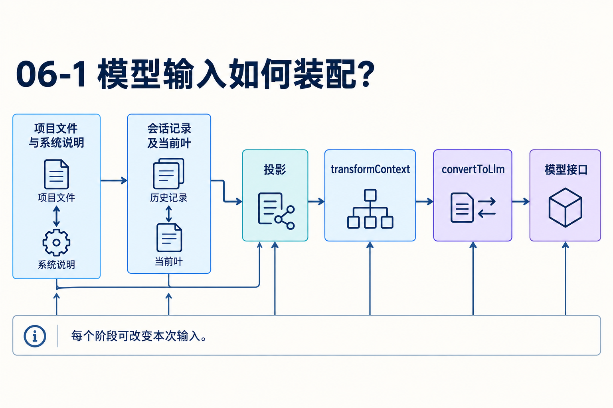
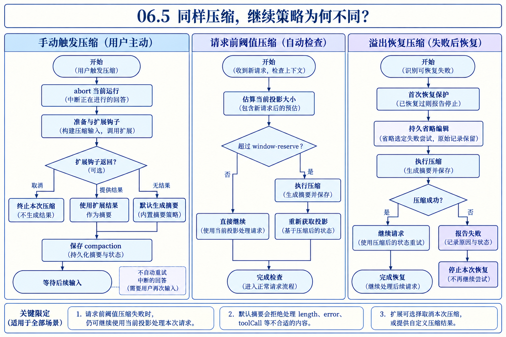
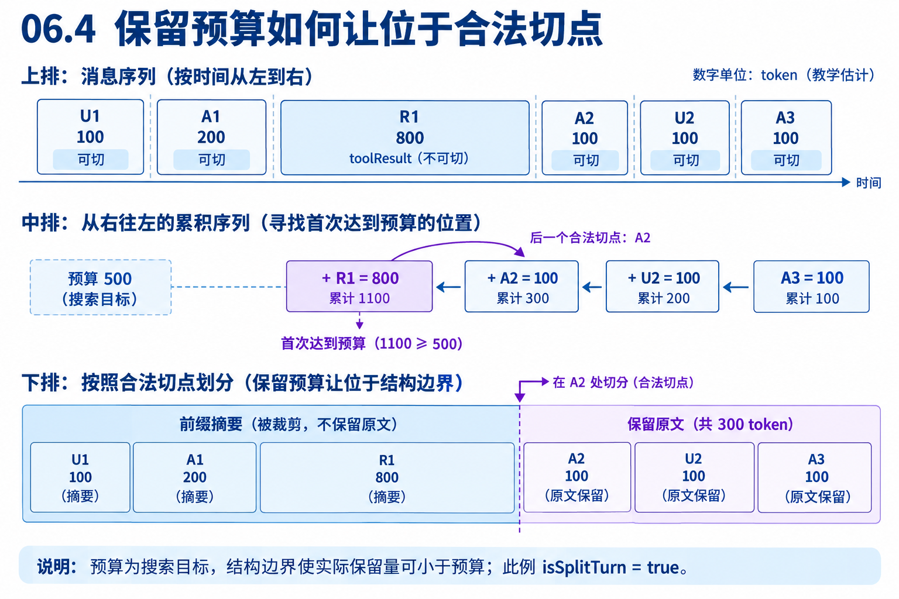
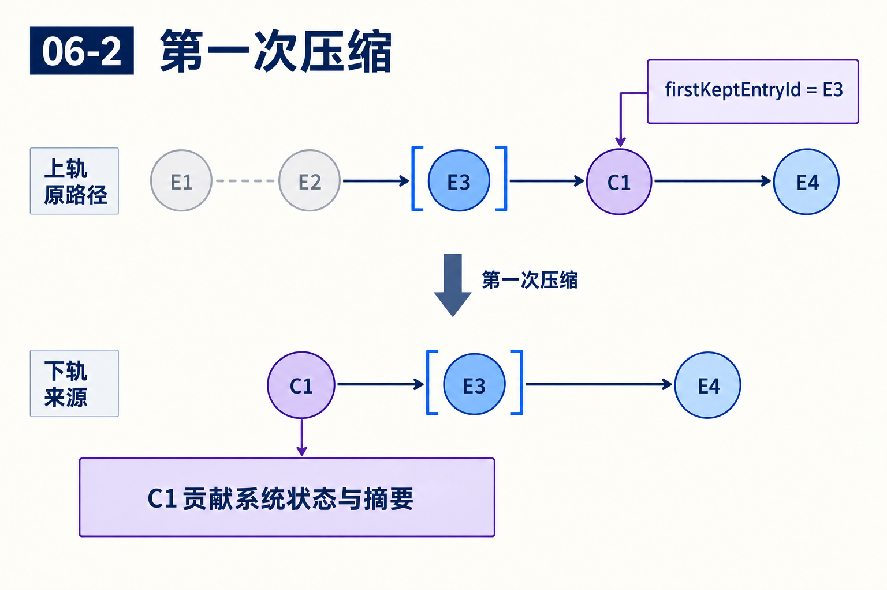
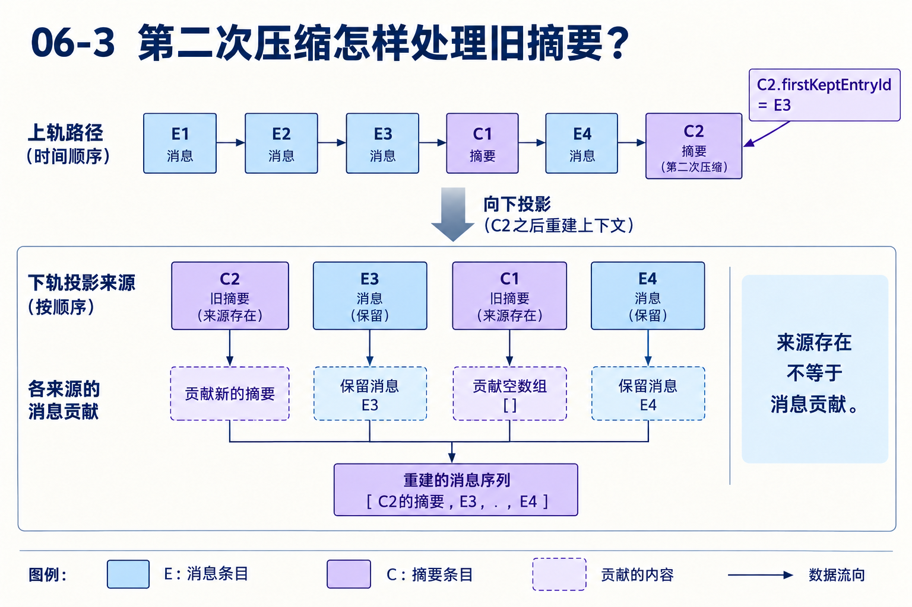

# 第06章　窗口预算、切点与持久摘要怎样共同工作

源码基线为 `56cae782341c339d3bb820081f0f9425d8c5b1ec`。本文数字为教学演算，A/B读取的实测装配见[离线实验](replay.md)。

用户已经比较过A/B，又查了多轮默认值来源。现在要求“保留前面的决策，继续处理B”。会话文件完整，模型却因窗口不足拒绝请求。怎样减少输入，又不把最近工具结果和原始调用拆开？压缩失败后该继续还是停止？

这章从一份准备发送的请求出发，依次计算体积、选择入口、确定保留边界、生成摘要、验收与保存，再把同一问题放进Durable。目标是给定编号和预算，能够写出本次实际保留的消息。

## 1　压缩以前，先找信息是从哪里进入的

下一请求的内容来自系统说明、项目上下文、技能与工具声明、当前历史投影和新输入。工具输出会使历史迅速增长，项目规则和工具schema本身也占窗口。单次结果限长解决一次调用太大，按需读取技能减少初始材料，compaction处理多轮累积，分支摘要传递离开的探索成果。

因此不能把所有“记忆”都归为摘要。文件保存原始事实，投影决定当前路径哪些记录有贡献，转换决定应用消息怎样进入模型。压缩在这个过程中替换旧上下文的贡献，并不把整个外部世界保存成一个检查点。[系统提示构造](https://github.com/earendil-works/pi/blob/56cae782341c339d3bb820081f0f9425d8c5b1ec/packages/coding-agent/src/core/system-prompt.ts#L128) · [消息转换](https://github.com/earendil-works/pi/blob/56cae782341c339d3bb820081f0f9425d8c5b1ec/packages/coding-agent/src/core/messages.ts#L148)



## 2　当前输入多大，先使用哪一份计量？

calculateContextTokens优先采用非零totalTokens，否则计算input+output+cacheRead+cacheWrite。缓存改变计费与复用，不会让内容不再占上下文，因此不能只算新输入token。

estimateContextTokens寻找最后一条有效assistant用量。error、aborted和全零用量不成为锚点，然后对它之后的新消息逐条estimateTokens。设最近有效usage为7200，新增工具文本估计600、新用户200，得到8000，其中usageTokens=7200，trailingTokens=800。

这是一种混合计量：供应商反馈覆盖旧前缀，估计覆盖新尾部。若最近失败的响应给出全零用量，不应把几百轮历史也当作零。找不到锚点时才全量估算消息。[计量与估算](https://github.com/earendil-works/pi/blob/56cae782341c339d3bb820081f0f9425d8c5b1ec/packages/coding-agent/src/core/compaction/compaction.ts#L140)

## 3　编辑和压缩为什么让旧usage失效？

假设新编辑隐藏了大量旧输出，7200描述的是修改以前的请求。继续采用它，会高估当前投影；替换成更大文本则可能低估。

estimateProjectedContextTokens把用量所在消息映射回sourceEntry，在原分支定位它，再找最后一条context_edit或compaction。只有用量来源严格晚于失效边界才继续采用。否则重算当前投影：取重放后的有效system状态，加全部非system消息，而不是把历史每次系统增量都累加。

estimateTokens对文本主要用字符数除4向上取整，图片用固定字符权重，assistant计入可见文本、thinking和工具参数，system还计sections与声明。它不是每个供应商的精确tokenizer，因此窗口预防与实际溢出恢复要同时存在，不能声称估计对所有中文和多模态输入都必然偏大。[投影计量失效](https://github.com/earendil-works/pi/blob/56cae782341c339d3bb820081f0f9425d8c5b1ec/packages/coding-agent/src/core/compaction/compaction.ts#L227) · [各角色估计](https://github.com/earendil-works/pi/blob/56cae782341c339d3bb820081f0f9425d8c5b1ec/packages/coding-agent/src/core/compaction/compaction.ts#L278)

## 4　三个预算与三条入口分别控制什么？

默认reserveTokens=16384，keepRecentTokens=20000。reserve决定何时为后续生成预留空间，keepRecent指导近期原文的切点搜索，摘要生成自己的输出额度又是另一项政策。

```typescript
if (!settings.enabled) return false;
return contextTokens > contextWindow - settings.reserveTokens;
```

用自定义窗口10000、reserve=2000演算，8000不触发，8001触发。不能把默认reserve直接套进这个小窗口示例。当前普通摘要函数保留了reserve形参但已不使用它控制输出上限，不能因变量名字相同就把预留空间等同摘要maxTokens。[默认值与阈值](https://github.com/earendil-works/pi/blob/56cae782341c339d3bb820081f0f9425d8c5b1ec/packages/coding-agent/src/core/compaction/compaction.ts#L120) · [摘要参数](https://github.com/earendil-works/pi/blob/56cae782341c339d3bb820081f0f9425d8c5b1ec/packages/coding-agent/src/core/compaction/compaction.ts#L696)

| 入口 | 前提与动作 | 继续政策 |
|---|---|---|
| 手动compact | 明确请求，先abort现有运行 | 保存后不自动重试被中断回答 |
| threshold | 当前输入超过预留阈值 | 为下一请求重建投影，已完成回答保留 |
| overflow | 同模型的可恢复失败或特定超限情形 | 省略选定失败尝试，受保护地压缩并恢复 |

当前还在下一次助手响应前检查投影，虚拟路由也可按实际模型检查。故“只在agent_end后压缩”不足以解释当前版本。[请求前检查](https://github.com/earendil-works/pi/blob/56cae782341c339d3bb820081f0f9425d8c5b1ec/packages/coding-agent/src/core/agent-session.ts#L782) · [手动入口](https://github.com/earendil-works/pi/blob/56cae782341c339d3bb820081f0f9425d8c5b1ec/packages/coding-agent/src/core/agent-session.ts#L2833) · [自动分派](https://github.com/earendil-works/pi/blob/56cae782341c339d3bb820081f0f9425d8c5b1ec/packages/coding-agent/src/core/agent-session.ts#L3032)



## 5　overflow恢复如何避免重复回答与死循环？

isRecoverableLength使用stopReason=length、model.maxTokens>0、usage.output<model.maxTokens，应用还检查模型匹配和assistant仍在投影。原始maxTokens=1024时，output=1023满足该谓词，1024不满足。这里比较模型原始输出上限，不是本次请求因窗口压力缩小后的输出额度。[长度谓词](https://github.com/earendil-works/pi/blob/56cae782341c339d3bb820081f0f9425d8c5b1ec/packages/ai/src/utils/overflow.ts#L180)

旧模型的错误不应因换到新模型而再触发一次恢复，最近压缩以前的旧响应也不能反复使用。context_edit已经改变输入后，原usage或错误还要经过投影相关检查。

首次恢复先设置_overflowRecoveryAttempted，再持久省略选定失败尝试，随后压缩。这样下一请求不会把失败assistant误当成已完成尾部。恢复继续失败后停止这条compact-and-retry路径，报告原因；成功完成但用量超配置窗口则压缩而不重试已完成回答。[恢复条件与防环](https://github.com/earendil-works/pi/blob/56cae782341c339d3bb820081f0f9425d8c5b1ec/packages/coding-agent/src/core/agent-session.ts#L3058)

这项省略不物理删除原记录，而是改变投影。若后续摘要失败，原始失败记录和已经写下的省略编辑仍可能都在。把失败简化成“状态完全没变化”会漏掉这一步。

## 6　为什么先投影，再选择待摘要材料？

prepareCompaction收到当前路径，先buildSessionProjection，再从投影识别前次有效压缩。旧摘要作为previousSummary，保留尾部中新增内容才作为新的材料。隐藏的失败尝试不应重新进入摘要，被替换的内容按本次贡献解释。

准备结果把工作拆开：

| 字段 | 含义 |
|---|---|
| firstKeptEntryId | 哪条原始来源开始保留 |
| messagesToSummarize | 较早、已结束历史的摘要材料 |
| turnPrefixMessages | 被拆开的长段工作前缀 |
| isSplitTurn | 切点是否位于用户类起点之后 |
| previousSummary | 上次摘要的更新基线 |
| tokensBefore/fileOps | 计量和文件操作追踪 |

路径末尾已经是compaction时返回undefined，防止立即把刚生成的摘要再压一遍；没有任何待摘要材料也不创建空检查点。实际生成以前还经过session_before_compact，扩展可取消或提供自己的结果。[准备入口](https://github.com/earendil-works/pi/blob/56cae782341c339d3bb820081f0f9425d8c5b1ec/packages/coding-agent/src/core/compaction/compaction.ts#L859) · [扩展分支](https://github.com/earendil-works/pi/blob/56cae782341c339d3bb820081f0f9425d8c5b1ec/packages/coding-agent/src/core/agent-session.ts#L3205)

## 7　手算合法切点，为什么500预算会留下300？

独立演算如下，token数为指定估值。

| 下标 | 消息 | 估值 | 合法切点 |
|---|---|---:|---|
| 0 | U1要求比较A/B | 100 | 是 |
| 1 | A1提出读取 | 200 | 是 |
| 2 | R1对应工具结果 | 800 | 否 |
| 3 | A2继续解释与推进 | 100 | 是 |
| 4 | U2追加约束 | 100 | 是 |
| 5 | A3回应约束 | 100 | 是 |

keepRecentTokens=500，倒数累计A3=100，加U2=200，加A2=300，加R1=1100，首次达到预算。R1是toolResult，不能从它切开。算法寻找第一个下标大于等于2的合法切点，选中A2，下标3。

原文保留A2、U2、A3，共300。keepRecentTokens指导搜索，不保证结果恰好或至少500。为了不让结果脱离调用结构，整条消息与合法切点的规则会改变最终保留体积。[切点类型](https://github.com/earendil-works/pi/blob/56cae782341c339d3bb820081f0f9425d8c5b1ec/packages/coding-agent/src/core/compaction/compaction.ts#L351) · [投影切点](https://github.com/earendil-works/pi/blob/56cae782341c339d3bb820081f0f9425d8c5b1ec/packages/coding-agent/src/core/compaction/compaction.ts#L789)



A2是assistant，最近用户类起点为U1，所以isSplitTurn=true。本例没有更早历史，messagesToSummarize=[]，turnPrefixMessages=[U1,A1,R1]，firstKeptEntryId=A2。若切点为U2，则前缀为空，较早内容进入历史摘要。

这里压缩模块的turn是从用户类消息开始的一段工作，可以含多次模型响应；与第02章运行事件中的turn要按模块区分。split也不必意味着两次模型请求：历史材料为空时只生成前缀摘要，历史部分沿用旧摘要或空历史说明。[历史与前缀分离](https://github.com/earendil-works/pi/blob/56cae782341c339d3bb820081f0f9425d8c5b1ec/packages/coding-agent/src/core/compaction/compaction.ts#L889)

## 8　零贡献条目为何还会影响切点处理？

失败assistant被编辑省略后，来源条目仍在。切点代码检查预算已达到、后缀包含被省略assistant、没有影响外部目标的replacement、后缀都不可见等条件，只为封闭的恢复省略尾部调整切点。

随后会向前收纳紧挨切点的零贡献元数据，遇到可见消息或compaction停止。两个方向服务不同边界：处理隐藏失败尾部，同时不让任意标签或编辑把未发送用户输入越过去。

读这一段时，先写出每项的sourceEntry和messages，再判断条件。仅按角色列表倒数，会丢失“原本可见但被省略”和“天生无模型贡献”的区别。[恢复尾部处理](https://github.com/earendil-works/pi/blob/56cae782341c339d3bb820081f0f9425d8c5b1ec/packages/coding-agent/src/core/compaction/compaction.ts#L816)

## 9　默认摘要模型实际拿到哪份材料？

生成器先convertToLlm，再serializeConversation，把历史变成带角色说明的文本，作为独立摘要请求的材料。它不沿原对话直接继续执行任务。thinking不参与序列化，工具调用保留参数，可见文字和工具结果描述发生过什么。

工具结果文本最多保留前2000个字符并标省略。单位是字符，不是token或工具输出的字节限制。如果关键错误在第3000字符，摘要模型可能没有看到它。保存了完整原记录并不保证摘要自动准确。[序列化](https://github.com/earendil-works/pi/blob/56cae782341c339d3bb820081f0f9425d8c5b1ec/packages/coding-agent/src/core/compaction/utils.ts#L100)

首次摘要按目标、约束、进展、决策、下一步和关键上下文组织；再次生成用previousSummary与新增历史更新。split时先更新较早摘要，再生成专门前缀摘要，后者只总结已给前段，禁止补造另存的后段。

以上是默认生成器。扩展直接提供compaction时可以跳过它的序列化、重试和响应校验，因此不能把默认路径的验收当作所有扩展结果都已经经历的保证。[生成材料](https://github.com/earendil-works/pi/blob/56cae782341c339d3bb820081f0f9425d8c5b1ec/packages/coding-agent/src/core/compaction/compaction.ts#L696) · [组合摘要](https://github.com/earendil-works/pi/blob/56cae782341c339d3bb820081f0f9425d8c5b1ec/packages/coding-agent/src/core/compaction/compaction.ts#L952)

## 10　文件列表、失败检查与保存分别解决什么？

默认准备从read/write/edit的path和nestedCalls提取文件集合，也合入符合条件的旧压缩详情。modifiedFiles为write/edit并集，readFiles排除修改过的路径，排序后写入details并附到摘要文本。它补充摘要容易遗漏的文件足迹，但从调用参数提取不等于证明动作成功，也不覆盖任意自定义工具。[文件追踪](https://github.com/earendil-works/pi/blob/56cae782341c339d3bb820081f0f9425d8c5b1ec/packages/coding-agent/src/core/compaction/utils.ts#L15)

默认摘要统一经过completeSummarization与retryAssistantCall。请求关闭提示缓存写入，缺路由sessionId时另建身份；error、length或输出toolCall不能作为成功摘要保存。半份摘要一旦成为下次更新基线，错误会沿后续工作传播。检查仍只覆盖可检测条件，没有逐句证明事实和标题完整。[默认请求与验收](https://github.com/earendil-works/pi/blob/56cae782341c339d3bb820081f0f9425d8c5b1ec/packages/coding-agent/src/core/compaction/compaction.ts#L585)

保存顺序为生成、检查取消、appendCompaction、刷新投影。默认生成前失败不增加成功压缩记录。手动路径抛错；自动路径报告后返回false；请求前阈值路径重取投影继续，并不因该false自动阻止下一次请求；overflow恢复失败则不自动续这次恢复。必须按入口分别诊断。[保存与失败](https://github.com/earendil-works/pi/blob/56cae782341c339d3bb820081f0f9425d8c5b1ec/packages/coding-agent/src/core/agent-session.ts#L2928) [源码](https://github.com/earendil-works/pi/blob/56cae782341c339d3bb820081f0f9425d8c5b1ec/packages/coding-agent/src/core/agent-session.ts#L3178)

## 11　两次压缩怎样重建系统状态与近期原文？

路径E1、E2、E3、C1、E4，C1.firstKeptEntryId=E3，来源重建为C1、E3、E4。保留区间内旧system跳过，C1携带的系统状态与摘要负责恢复基线。

追加C2，若起点E4，来源为C2、E4；若起点E3，来源可为C2、E3、C1、E4，但旧C1贡献空数组。来源仍可追溯，旧摘要不重复注入。最后_refreshFinalizedContext更新Agent消息，并记录消息到来源ID映射，下一请求再经过转换才真正使用新摘要。[重建](https://github.com/earendil-works/pi/blob/56cae782341c339d3bb820081f0f9425d8c5b1ec/packages/coding-agent/src/core/session-manager.ts#L476) · [旧摘要空贡献](https://github.com/earendil-works/pi/blob/56cae782341c339d3bb820081f0f9425d8c5b1ec/packages/coding-agent/src/core/session-manager.ts#L543)





分支摘要有不同任务：从旧叶到与目标的共同祖先收集离开分支的内容，将探索成果带入新路径。它不等于把所有兄弟分支都塞进模型。[分支收集源码](https://github.com/earendil-works/pi/blob/56cae782341c339d3bb820081f0f9425d8c5b1ec/packages/coding-agent/src/core/compaction/branch-summarization.ts#L101)

## 12　Durable怎样把压缩本身也变成可恢复工作？

普通应用在内存等待摘要。Durable有select、summarize、retry阶段。select保存firstKept、tail、模型、思考级别、请求选项、attempt与输出预算；summarize按保存tail读取不可变范围，防止后台期间新消息改变摘要材料。

其摘要maxTokens取reserve的80%向下取整，并受模型maxTokens约束，与当前普通coding-agent不使用reserve控制摘要输出的政策不同。两套实现不能只因都叫compaction就合并解释。[持久摘要选择](https://github.com/earendil-works/pi/blob/56cae782341c339d3bb820081f0f9425d8c5b1ec/packages/durable/src/harness/compaction.ts#L114)

generation超过window-reserve时可blocking；更早的背景阈值再减backgroundTokens。阻塞压缩归generation所有，父持有run并等待，结果可直接追加。conversation拥有的非阻塞压缩通过write submission接入，忙时等边界，范围过时可以stale。

因此后台任务完成不等于摘要已放进当前对话。结果可能先给submissionId，真正放置由接入机制决定。不能在模型忙碌时任意插入一个新摘要头。[阈值](https://github.com/earendil-works/pi/blob/56cae782341c339d3bb820081f0f9425d8c5b1ec/packages/durable/src/harness/generation.ts#L451) · [放置](https://github.com/earendil-works/pi/blob/56cae782341c339d3bb820081f0f9425d8c5b1ec/packages/durable/src/harness/compaction.ts#L425)

摘要失败时，usage和后续决定在提交里保存。符合retry预算则写sleeping与until，下一次调度增加attempt再生成；不可重试则终结失败。它给等待、费用与材料范围提供持久依据，代价是更多状态和存储交互。[重试与费用](https://github.com/earendil-works/pi/blob/56cae782341c339d3bb820081f0f9425d8c5b1ec/packages/durable/src/harness/compaction.ts#L191)

## Q&A与推导答案

### Q1　8000正好等于window-reserve，为什么不压？

**答案**　shouldCompact是严格大于。8001才超过，边界输入可以直接用相邻两个值验证。

### Q2　预算500为何只留300？

**答案**　首次达到预算的R1不是合法切点，向后选A2。预算是搜索目标，结构约束决定结果。

### Q3　预算改250与150会怎样？

**答案**　250在A2达到300，仍切A2且split。150在U2达到200，切U2，前缀为空，较早历史直接摘要。

### Q4　编辑后能把旧usage减去被删文本估值吗？

**答案**　实现失效旧锚点并重算投影。系统状态重放与替换内容都可能变化，直接减法没有同样依据。

### Q5　摘要有几千字但length，为什么不能保存？

**答案**　字数不证明完整。默认验收明确拒绝length，防止半份内容成为后续更新基线。

### Q6　关键错误位于工具结果末尾，会保进摘要吗？

**答案**　默认序列化保留前2000字符，后面可能被省略。要核实事实仍可回原始记录或重读。

### Q7　split一定生成两次摘要吗？

**答案**　只有有较早历史材料时才生成历史部分；为空时沿用旧摘要或空历史说明，再生成前缀。

### Q8　扩展结果也经历默认length/toolCall验收吗？

**答案**　直接提供compaction可绕过默认生成。钩子的契约与保存流程要另看，不能借用默认生成保证。

### Q9　压缩失败为什么仍可能发下一请求？

**答案**　请求前阈值检查等待后会重取当前投影继续，未用返回false阻止；overflow恢复失败则停止该恢复。

### Q10　overflow失败会把原始错误物理删掉吗？

**答案**　通过持久编辑省略，原记录保留。摘要失败时省略编辑也可能已经写下，分别查三类条目。

### Q11　文件列表出现B，证明编辑成功吗？

**答案**　列表来自固定工具名字与参数，只能提供可见调用足迹，不能代替外部状态确认。

### Q12　Durable后台摘要完成为什么可能还没生效？

**答案**　非阻塞摘要走write submission，需要边界放置，也可能stale。生成完成与进入当前上下文是两个决定。

## 第二遍源码阅读

按计量、prepareCompaction、findProjectedCutPoint、摘要序列化、compact、appendCompaction与投影重建的顺序走。每一步写出输入与输出，再对照手算例。Durable则按select保存范围、summarize生成、提交放置或重试来读。

本章的压缩算法、序列化与应用入口已有针对性测试验证；生成摘要的逐句事实准确性仍需原始材料核对。[算法测试](https://github.com/earendil-works/pi/blob/56cae782341c339d3bb820081f0f9425d8c5b1ec/packages/coding-agent/test/compaction.test.ts#L1) · [应用测试](https://github.com/earendil-works/pi/blob/56cae782341c339d3bb820081f0f9425d8c5b1ec/packages/coding-agent/test/suite/agent-session-compaction.test.ts#L1)

[返回目录](README.md)

