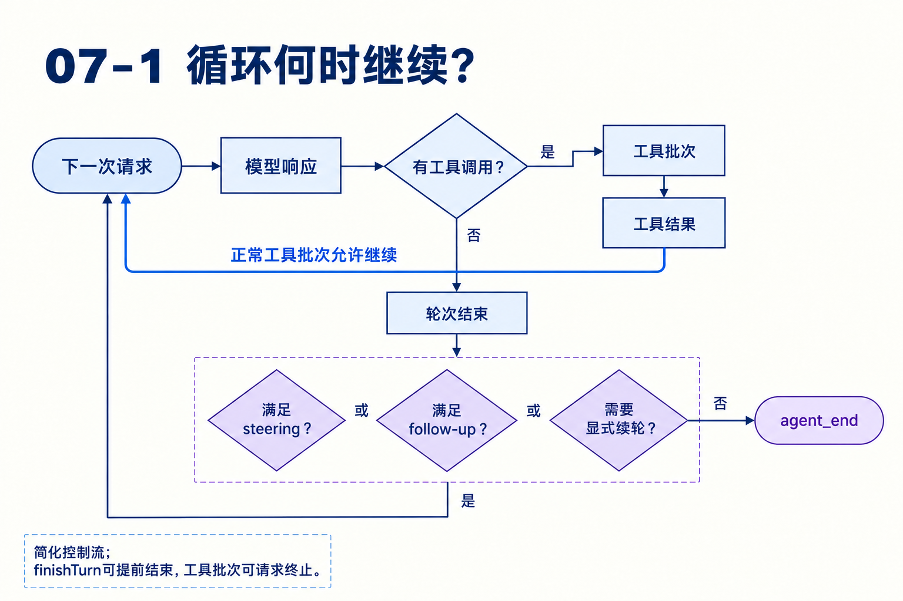
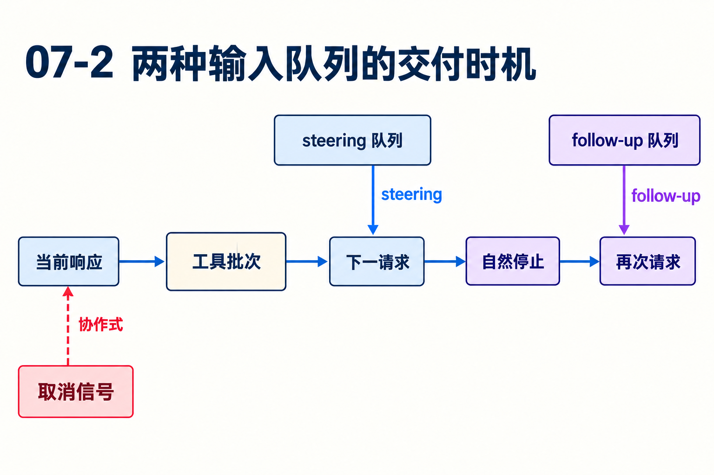

# 第07章　输入、取消和运行边界怎样协作

源码基线为 `56cae782341c339d3bb820081f0f9425d8c5b1ec`。编号、时长及预算示意在各例中说明，A/B实测入口见[离线实验](replay.md)。

模型正在比较A/B，用户连续输入两条消息：“先别改文件”“改为A/C”。第二条是steering还是follow-up，会改变哪一次模型请求？如果此时发生压缩，输入会不会多取一次？

本章把排队看成明确的交付协议。重点是何时取消息、何时发请求、何时真正空闲，而不把“可以中途输入”当作一个笼统功能。

## 1　为什么不直接启动第二个prompt？

Agent拒绝在activeRun存在时直接prompt。两个循环若共享消息状态，一个循环追加工具结果时另一个生成回答，会破坏调用配对与快照边界。输入队列把并发到达变成当前运行内的有序交付。

coding-agent还把准备阶段计入忙碌，例如before_agent_start尚在运行。此时终端可能还没看到模型文字，但会话已经占有运行边界。用“有没有streamMessage”判空闲，会漏掉这段时间。[agent.ts L382](https://github.com/earendil-works/pi/blob/56cae782341c339d3bb820081f0f9425d8c5b1ec/packages/agent/src/agent.ts#L382) [agent-session.ts L1885](https://github.com/earendil-works/pi/blob/56cae782341c339d3bb820081f0f9425d8c5b1ec/packages/coding-agent/src/core/agent-session.ts#L1885)

## 2　两类队列有什么不同？

steer表达正在工作的方向修正，循环在开始和每轮工具结束后检查。followUp表达当前自然工作结束后再接的输入，外层循环在内层准备停止时检查。

队列还有all与one-at-a-time模式。前者一次取边界上所有消息，后者只取最老一条。它控制交付批量，并不是丢弃其余消息，也不是每条都启动一个并发run。[types.ts L34](https://github.com/earendil-works/pi/blob/56cae782341c339d3bb820081f0f9425d8c5b1ec/packages/agent/src/types.ts#L34) [agent-loop.ts L175](https://github.com/earendil-works/pi/blob/56cae782341c339d3bb820081f0f9425d8c5b1ec/packages/agent/src/agent-loop.ts#L175)



## 3　按时间线计算一条晚到的steer

设边界依次是工具结束、首次取队列、prepareNextTurn压缩、准备后复查队列、发下一请求。

若两条输入在首次取队列以前到达，one-at-a-time只取第一条，本轮不再二取，第二条留下。若首次为空，压缩期间才来“改为A/C”，准备后的复查会取到它。条件pendingMessages.length===0避免在一个准备边界取出两条。

这项处理针对准备可能很慢的事实。只在工具结束时取一次，会让压缩期间的新方向再晚一轮；无条件取两次，又破坏单条交付模式。[agent-loop.ts L192](https://github.com/earendil-works/pi/blob/56cae782341c339d3bb820081f0f9425d8c5b1ec/packages/agent/src/agent-loop.ts#L192)

## 4　消息追加以前和以后分别允许改变什么？

prepareNextTurn返回的新消息与队列消息先走正常message事件并加入上下文。declareToolChanges把工具变化并入声明。prepareRequest随后决定本次模型和上下文，再经transformContext和convertToLlm发送。

用户输入进入队列不改变已发出去的网络请求。已经执行的read也不会因下一次输入改为C就被倒回。交付协议保证模型下一次拿到什么，不保证它总是服从该文本意图。需要立即停下，应结合abort，并处理已经发生的外部效果。

## 5　取消如何从一个信号到达多个阶段？

活动运行拥有AbortController，abort使signal.aborted为真。模型流和工具收到相关信号，准备钩子之后也检查取消。工具尚未运行时可以直接形成取消结果；工具体里等待I/O时由实现协作响应。

若取消发生在外部写入完成之后，最终aborted不代表写入回滚。若工具忽略signal，宿主也不能从一个布尔标记推出它已停止。测试应使用可控闸门指定取消点，并分别断言工具进入次数、返回消息和外部状态。



## 6　agent_end为什么还不是空闲瞬间？

Agent.processEvents先归约内部状态，再逐个await监听者。agent_end清除流式展示，但activeRun直到runWithLifecycle的finally才释放。监听者若在agent_end内部直接重入prompt，可能仍遇到忙碌检查。

这维护了可预测的生命周期，同时意味着慢监听者会拖延结束。应用可以提供延后动作和队列接口，而不是要求每个消费者根据终端文字猜何时可再启动。[agent.ts L570](https://github.com/earendil-works/pi/blob/56cae782341c339d3bb820081f0f9425d8c5b1ec/packages/agent/src/agent.ts#L570)

## 7　普通队列与Durable inbox的对应关系

普通Agent队列存在内存中。Durable inbox则把输入交付作为持久状态，prepareBoundary取得当前边界，applyBoundary按postTools或final选择消息。steer可在工具边界放置，follow-up通常等final；reset会影响边界解释。

Durable还区分write与用户输入：选中的write先放置，用户输入后放置，各自尊重顺序与上下文head约束。它让重启后仍能判断哪些提交已进入运行、哪些还排队。两套API相似的用户意图，背后的持久保证不同。[inbox.ts L58](https://github.com/earendil-works/pi/blob/56cae782341c339d3bb820081f0f9425d8c5b1ec/packages/durable/src/harness/inbox.ts#L58)

## 8　如何定位“新指令没有及时生效”？

依次记录输入到达、入哪类队列、首次/二次drain、消息事件、请求前投影和实际provider入口。若provider已经拿到指令却行为不符，是生成行为；若仍在队列，是交付边界；若转换时被过滤，则查应用消息规则。

这条诊断链比把延迟归因于模型缓存更直接。它也提醒扩展作者，任何长耗时准备、压缩或外部确认都会延长边界，必须明确新消息在期间怎么处理。

## 对照关键源码

这一次条件复查对应长准备期间晚到的输入。已取过消息时跳过，维持单条交付模式。

[agent/src/agent-loop.ts L213](https://github.com/earendil-works/pi/blob/56cae782341c339d3bb820081f0f9425d8c5b1ec/packages/agent/src/agent-loop.ts#L213)

下面是实现节选，代码块边界不表示完整函数。

```typescript
				if (pendingMessages.length === 0) {
					pendingMessages = (await config.getSteeringMessages?.()) || [];
				}
				await emit({ type: "turn_start" });
```

## Q&A与推导答案

### Q1　两条steer都在边界前到达，one-at-a-time会取两条吗？

**答案**　首次drain只取一条，pending非空使准备后复查跳过。另一条等待后续交付点。

### Q2　首次队列为空，压缩中来了消息，会晚一轮吗？

**答案**　当前循环准备后会在pending为空时再查，因此有机会在紧接的请求交付。[agent-loop.ts L213](https://github.com/earendil-works/pi/blob/56cae782341c339d3bb820081f0f9425d8c5b1ec/packages/agent/src/agent-loop.ts#L213)

### Q3　follow-up是否保证开启新的并发run？

**答案**　不会。它在自然工作结束边界转为pending，继续受同一串行运行生命周期管理。

### Q4　abort能保证B没有被读取吗？

**答案**　只有取消在实际读取前被检查并阻止执行时才可这样说。已完成I/O不会因取消撤销。

### Q5　为什么agent_end监听者内直接prompt仍可能报忙？

**答案**　监听者尚被await，activeRun还未清理。循环结束事件和Agent空闲是相邻但不同的边界。[agent.ts L516](https://github.com/earendil-works/pi/blob/56cae782341c339d3bb820081f0f9425d8c5b1ec/packages/agent/src/agent.ts#L516)

### Q6　重启能保留普通Agent的steeringQueue吗？

**答案**　不能仅凭会话文件推导这一保证。Durable inbox专门提供持久输入排队，普通队列在运行内存中。

[返回目录](README.md)

