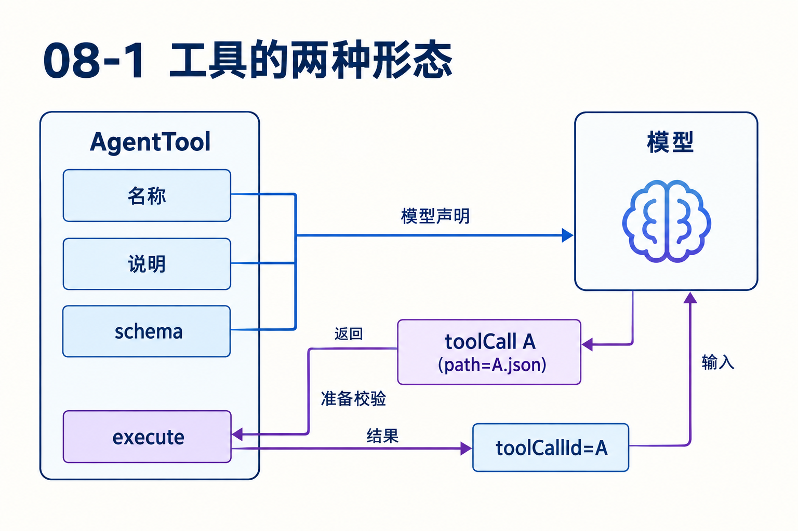
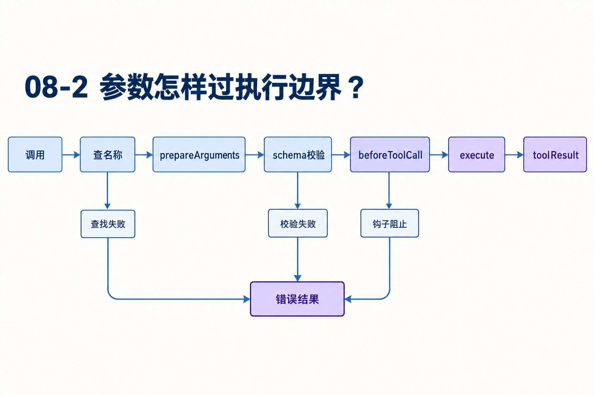

# 第08章　一个工具调用怎样获得执行资格

源码基线为 `56cae782341c339d3bb820081f0f9425d8c5b1ec`。编号、时长及预算示意在各例中说明，A/B实测入口见[离线实验](replay.md)。

模型输出read，参数path却是数值123；另一项调用名称根本没注册。宿主怎样把两项错误返回给模型，又让合法调用沿同一条执行路径运行？

本章追踪声明、准备、执行、后处理和输出边界。工具的可靠性来自这些具体条件，不能只用try/catch概括。

## 1　工具声明和工具实现分别交给谁？

宿主工具含名称、说明、schema和execute等行为；模型需要可选能力的声明，不需要本地函数对象。循环用context.tools找执行实现，模型接口从transcript中的system声明重放可调用工具。

名称相同不代表两份结构相同。一个扩展可调整声明描述、隐藏某工具的模型声明，同时保留内部调用能力。调试“模型看得见但执行失败”时要核对声明集合与本轮实现集合。[types.ts L1](https://github.com/earendil-works/pi/blob/56cae782341c339d3bb820081f0f9425d8c5b1ec/packages/agent/src/types.ts#L1) [agent-loop.ts L337](https://github.com/earendil-works/pi/blob/56cae782341c339d3bb820081f0f9425d8c5b1ec/packages/agent/src/agent-loop.ts#L337)



## 2　为什么工具变化记进系统消息？

第一轮只有read，第二轮启用validate_config，第三轮移除read。toolsAdded/toolsRemoved记录这些差量，使历史能够解释当时的能力边界。declareToolChanges比较已有transcript的有效集合与当前可执行工具，pending system中的字段被解释为意图再求差。

每轮把最早的toolsAdded照抄一遍，可能错误复活已移除工具。当前工具状态由有序重放决定，不能只搜最后一条assistant附近有没有工具描述。[agent-loop.ts L337](https://github.com/earendil-works/pi/blob/56cae782341c339d3bb820081f0f9425d8c5b1ec/packages/agent/src/agent-loop.ts#L337)

## 3　prepareToolCall逐步拒绝什么？

流程是找名称、prepareArguments、validateToolArguments、beforeToolCall、取消检查，然后形成prepared或immediate结果。未知工具直接返回错误；准备或校验抛错转成错误；钩子block可给理由，并可为结果设置terminate。

prepareArguments可能正规化输入，所以判断path=123是否执行不能只看原JSON。准备后仍不符schema才拒绝。成功校验的args传给工具，原始toolCall仍保留作身份与诊断。[agent-loop.ts L719](https://github.com/earendil-works/pi/blob/56cae782341c339d3bb820081f0f9425d8c5b1ec/packages/agent/src/agent-loop.ts#L719)



## 4　执行阶段怎样收束进度回调？

executePreparedToolCall调用execute，给它signal与onUpdate。每次更新收集为待完成的事件Promise。工具返回后不再接纳新更新，并await已接纳更新，再构造执行结果。执行抛错也走相应收束路径。

这样工具的最终结束不会简单越过已安排的进度交付；晚到回调不会继续污染已结束状态。代价是慢的更新监听者会增加完成延迟。工具作者应把onUpdate当运行生命周期的一部分，而非随意启动不受管理的后台通知。[agent-loop.ts L838](https://github.com/earendil-works/pi/blob/56cae782341c339d3bb820081f0f9425d8c5b1ec/packages/agent/src/agent-loop.ts#L838)

## 5　afterToolCall怎样修改结果，为什么不是深合并？

成功进入执行路径后，finalize调用afterToolCall。content、details、usage等提供时分别替换，未提供保留。若改了content却没有一起提供structuredContent，旧结构化内容会被丢弃，避免可读文本已经变了而机器数据还表达原结果。

钩子抛错会把最终结果变成错误。准备阶段的立即拒绝在当前runToolCall实现中直接返回，不要假定它与执行后的结果都会经过完全相同的after路径。读扩展测试时要检查对应分支，而不是只背“所有工具都有前后钩子”。[agent-loop.ts L822](https://github.com/earendil-works/pi/blob/56cae782341c339d3bb820081f0f9425d8c5b1ec/packages/agent/src/agent-loop.ts#L822) [agent-loop.ts L882](https://github.com/earendil-works/pi/blob/56cae782341c339d3bb820081f0f9425d8c5b1ec/packages/agent/src/agent-loop.ts#L882)

## 6　嵌套工具如何复用同一套约束？

runToolCall提供单次调用的准备、校验、执行与后处理，不发顶层事件，也不自行追加消息。上层编排工具可以用它调用其他工具，再决定怎样组织外层结果。

orchestration测试中run_tools调用helper和echo，父toolResult保存nestedCalls。模型得到的是父工具最终内容，不会自动出现两条同级内部结果。exposure与loadout还决定哪些名字仅模型可见、哪些内部可调。试图内部调用model-only的自身，会得到不可用结果。[agent-session-tool-orchestration.test.ts L1](https://github.com/earendil-works/pi/blob/56cae782341c339d3bb820081f0f9425d8c5b1ec/packages/coding-agent/test/suite/agent-session-tool-orchestration.test.ts#L1)

## 7　文本输出如何控制体积？

read先应用一基offset和limit，再truncateHead，默认2000行或50×1024字节，先触发者生效。文件3000条短行时保留前2000行并给继续offset；若首行单独超字节限制，不返回半条head行，而是说明首行超限并提示其他取法。

bash面向日志保留尾部，截断时提供完整输出临时路径。末行单独超字节限制时允许部分尾行，并确保UTF-8字符边界。truncateMiddle又适合保留开始与末尾的场景，因此不能把所有工具都描述成统一截头。[truncate.ts L1](https://github.com/earendil-works/pi/blob/56cae782341c339d3bb820081f0f9425d8c5b1ec/packages/coding-agent/src/core/tools/truncate.ts#L1) [read.ts L155](https://github.com/earendil-works/pi/blob/56cae782341c339d3bb820081f0f9425d8c5b1ec/packages/coding-agent/src/core/tools/read.ts#L155) [bash.ts L255](https://github.com/earendil-works/pi/blob/56cae782341c339d3bb820081f0f9425d8c5b1ec/packages/coding-agent/src/core/tools/bash.ts#L255)

这与长期压缩分工不同。工具先限制一次结果的行/字节，窗口计量使用token，摘要材料又有2000字符工具文本限制。一个结果“工具已完整返回”也不能保证它在以后的摘要里完整保留。

## 8　Durable为何把最终参数先存起来？

Durable call阶段在beforeTool修改参数后再次校验，将严格JSON的最终参数与replay保存为execute检查点，再运行工具体。恢复execute时使用保存参数，避免热更新和准备钩子重新产生另一份动作。

这给恢复提供明确意图，外部副作用仍要由双safe策略与业务幂等支撑。工具参数是否合法、工具是否获准执行、执行中断能否重做，是三道不同判断。[tool.ts L154](https://github.com/earendil-works/pi/blob/56cae782341c339d3bb820081f0f9425d8c5b1ec/packages/durable/src/harness/tool.ts#L154)

## 对照关键源码

改content却不更新structuredContent时，旧结构会被移除。不是对所有输出字段任意深合并。

[agent/src/agent-loop.ts L895](https://github.com/earendil-works/pi/blob/56cae782341c339d3bb820081f0f9425d8c5b1ec/packages/agent/src/agent-loop.ts#L895)

下面是实现节选，代码块边界不表示完整函数。

```typescript
				const structuredContent =
					afterResult.structuredContent ?? (afterResult.content ? undefined : result.structuredContent);
				result = {
					...result,
					content: afterResult.content ?? result.content,
					details: afterResult.details ?? result.details,
					usage: afterResult.usage ?? result.usage,
					terminate: afterResult.terminate ?? result.terminate,
				};
				if (structuredContent === undefined) delete result.structuredContent;
				else result.structuredContent = structuredContent;
				isError = afterResult.isError ?? isError;
```

## Q&A与推导答案

### Q1　prepareArguments把path改成字符串后能执行吗？

**答案**　还要经过schema、钩子和取消检查。准备函数只改变输入，不自动授予执行资格。

### Q2　start事件是否说明schema已通过？

**答案**　批次调度在准备前发start，因此不说明。需看prepared与immediate分支。

### Q3　afterToolCall只改content，旧structuredContent还留着吗？

**答案**　当前后处理会丢弃未同步替换的旧结构化内容，避免文本与机器结果不一致。[agent-loop.ts L896](https://github.com/earendil-works/pi/blob/56cae782341c339d3bb820081f0f9425d8c5b1ec/packages/agent/src/agent-loop.ts#L896)

### Q4　内部工具结果会自动发成顶层toolResult吗？

**答案**　单次runToolCall不发消息。父编排工具负责把内部结果整合到外层输出和审计记录。

### Q5　首行100KB文件和3000条短行为什么处理不同？

**答案**　前者可能触发firstLineExceedsLimit，不交付半条head行；后者按行限返回前缀并给下一offset。

### Q6　Durable为什么在钩子修改参数后再校验？

**答案**　第一次合法不代表被改写后仍合法。最终复验后的参数还要先持久化，才可成为重放依据。[tool.ts L177](https://github.com/earendil-works/pi/blob/56cae782341c339d3bb820081f0f9425d8c5b1ec/packages/durable/src/harness/tool.ts#L177)

[返回目录](README.md)

