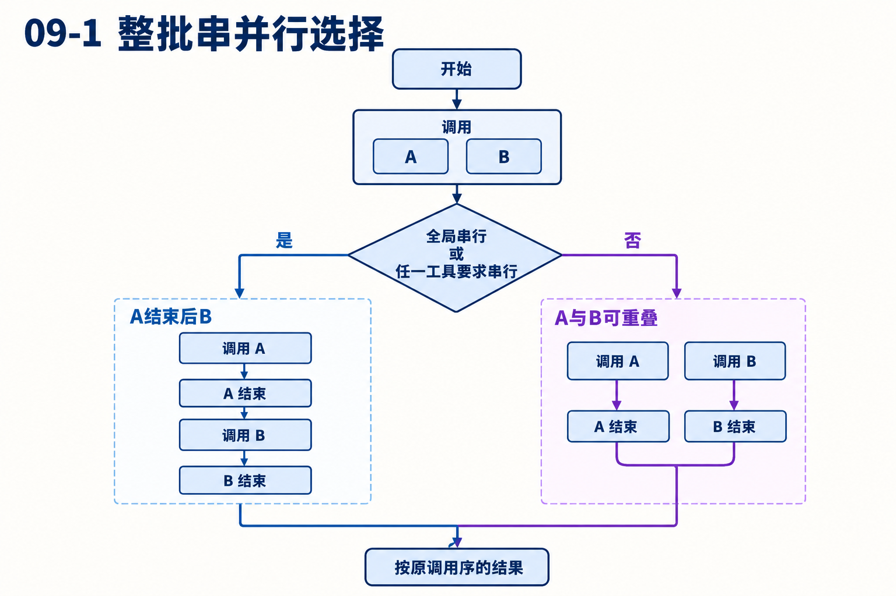
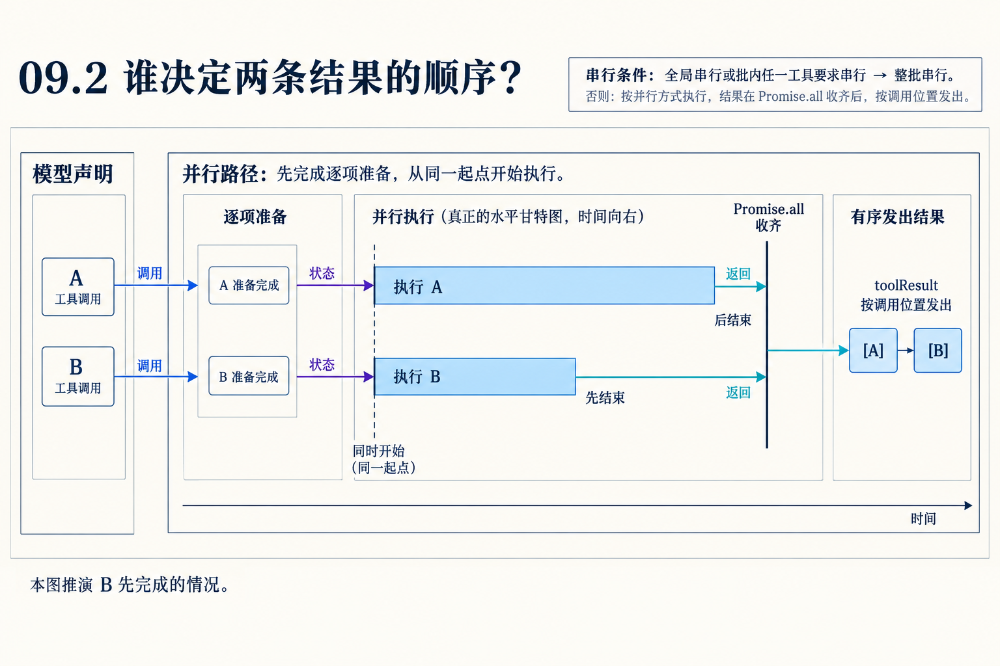

# 第09章　并行、串行与消息归序怎样同时成立

源码基线为 `56cae782341c339d3bb820081f0f9425d8c5b1ec`。编号、时长及预算示意在各例中说明，A/B实测入口见[离线实验](replay.md)。

A读大文件、B读小文件、C参数错误。模型声明顺序A、B、C，观察者先看到C失败、再看到B成功。下一请求会不会把结果按C、B、A排列？

本章区分准备、工具执行、事件完成、结果发出四个顺序。贯穿数字与时长均是条件推演，原始A/B实验只断言消息结果顺序。

## 1　批次的边界是哪里？

一次assistant.content中的全部toolCall组成这次调度批次。executeToolCalls检查全局toolExecution，或批内任一工具executionMode=sequential。满足即整批串行，否则走并行。

它没有分析A/B读哪份路径来自动推导冲突。执行模式是工具作者与应用给出的契约。若一个有共享状态的工具误声明可并发，循环不会通过阅读其函数实现自动发现竞态。[agent-loop.ts L520](https://github.com/earendil-works/pi/blob/56cae782341c339d3bb820081f0f9425d8c5b1ec/packages/agent/src/agent-loop.ts#L520)



## 2　串行究竟串哪些步骤？

串行对A先发start、准备、执行、后处理、发end、构造并发出结果消息，再进入B。准备也在这个顺序里。A的before钩子较慢会推迟B全部生命周期，A失败则以错误结果结束该项，之后是否继续还要看取消等条件。

加入一个sequential工具使read A、edit B、read C整批有序，即使A/C彼此独立。规则易预测，但牺牲一部分可并发性。这个成本应在工具粒度和批次组织时判断。[agent-loop.ts L540](https://github.com/earendil-works/pi/blob/56cae782341c339d3bb820081f0f9425d8c5b1ec/packages/agent/src/agent-loop.ts#L540)

## 3　并行路径为什么先逐项准备？

循环逐项发start并await prepare。立即失败项直接存已完成结果；允许执行项存一个待运行函数。准备遍历结束后，才map执行这些函数，进入Promise.all。

因此“允许并行”并不意味着一见A就马上运行它。A的慢准备会推迟B实际execute，但B的慢I/O可以与A重叠。这是性能诊断最容易漏掉的阶段边界。[agent-loop.ts L596](https://github.com/earendil-works/pi/blob/56cae782341c339d3bb820081f0f9425d8c5b1ec/packages/agent/src/agent-loop.ts#L596)

## 4　手算混合失败批次

假设A/B准备成功，C校验失败。准备C时先发错误end，列表保留C的立即结果。随后A/B启动，B先结束发end，A后结束发end。

Promise.all按输入位置得到[A结果,B结果,C错误]。之后for循环才构造并发送A、B、C三条toolResult。事件顺序可能C、B、A，消息顺序仍A、B、C。立即失败也占原调用位置，因此顺序稳定并不代表每项成功。



## 5　为什么要等待最慢项？

下一模型请求需要解释完整批次。按声明位置发消息提供稳定对应，调用ID同时提供精确身份。快工具先报告进度，使界面不必装作还没完成；请求等待整批，则不会在A仍执行时提前让模型依据B结果再改变工作方向。

代价是长尾项阻塞下一请求。若业务想流式消费部分结果并尽早生成，需要重新定义剩余工具的生命周期、模型输入与取消策略。当前实现没有提供“只改成Promise.race就等价”的保证。[agent-loop.ts L656](https://github.com/earendil-works/pi/blob/56cae782341c339d3bb820081f0f9425d8c5b1ec/packages/agent/src/agent-loop.ts#L656)

## 6　取消怎样影响还没执行的项？

准备后仍会检查signal，启动待运行函数时也检查。某些项已准备、未执行就遇到取消，可以形成Operation aborted结果。已进入工具体的项按协作取消处理。

取消还可能让准备遍历提前停止，所以不能在任何中断条件下都断言“模型声明几个，就必定产生完全一样数量的实际execute”。测试要分别数start、执行体和结果消息，三者在异常路径可不同。

## 7　后处理与监听者也是调度成本

工具I/O完成后，finalize还可能等待afterToolCall，end也等待事件接收方。因此end时间包括后处理后的边界，不能完全等同于底层磁盘读取的结束时刻。进度update交付也可能需要等待。

用一条很快的工具配一个很慢的after钩子，UI仍会晚看到完成。先测execute耗时，再测后处理和监听者，才能判断瓶颈属于工具还是编排。[agent-loop.ts L838](https://github.com/earendil-works/pi/blob/56cae782341c339d3bb820081f0f9425d8c5b1ec/packages/agent/src/agent-loop.ts#L838) [agent-loop.ts L882](https://github.com/earendil-works/pi/blob/56cae782341c339d3bb820081f0f9425d8c5b1ec/packages/agent/src/agent-loop.ts#L882)

## 8　Durable怎样保留同类规则又改变执行模型？

Durable同样可以按批次要求串行，但它为工具创建持久任务。串行时先创建TA，pending保存B/C调用身份；A终结后才由generation创建TB。并行则一次创建全部子任务，父任务保存等待集合。

普通循环的Promise.all顺序是内存执行安排；Durable还要在提交、工具槽位与上下文重建处维护可恢复的顺序。两者可以提供相近观察结果，但不能用一个Promise对象解释跨进程恢复。[generation.ts L1003](https://github.com/earendil-works/pi/blob/56cae782341c339d3bb820081f0f9425d8c5b1ec/packages/durable/src/harness/generation.ts#L1003)

## 对照关键源码

Promise.all输出按输入位置，后面的for才发送结果消息。与各执行函数自己发end的时刻分别观察。

[agent/src/agent-loop.ts L656](https://github.com/earendil-works/pi/blob/56cae782341c339d3bb820081f0f9425d8c5b1ec/packages/agent/src/agent-loop.ts#L656)

下面是实现节选，代码块边界不表示完整函数。

```typescript
	const orderedFinalizedCalls = await Promise.all(
		finalizedCalls.map((entry) => (typeof entry === "function" ? entry() : Promise.resolve(entry))),
	);
	const messages: ToolResultMessage[] = [];
	for (const finalized of orderedFinalizedCalls) {
		const toolResultMessage = createToolResultMessage(finalized);
		await emitToolResultMessage(toolResultMessage, emit);
		messages.push(toolResultMessage);
	}

```

## Q&A与推导答案

### Q1　C参数错误为何可能最先end？

**答案**　准备阶段就得到立即错误，A/B的工具体还没启动。end不必等其他项执行。

### Q2　A有慢prepare，B能提前execute吗？

**答案**　当前并行分支先串行准备完整批次，再启动可执行函数。因此不能越过A准备。

### Q3　C先失败会让结果顺序变成C/A/B吗？

**答案**　列表保留原位置，Promise.all后按A/B/C发消息。失败改变内容，不改变该项位置。

### Q4　任一工具sequential时只串那一项吗？

**答案**　整批走串行路径，不做自动冲突拆组。[agent-loop.ts L526](https://github.com/earendil-works/pi/blob/56cae782341c339d3bb820081f0f9425d8c5b1ec/packages/agent/src/agent-loop.ts#L526)

### Q5　为什么end很晚但duration看起来不长？

**答案**　要检查duration测量边界、after钩子和事件监听者。不同计时位置覆盖的阶段不同。

### Q6　想缩短等待，直接Promise.race可行吗？

**答案**　会改变尚未完成工具与下一模型请求的关系，必须重新设计剩余任务归属、结果交付和取消，不能当作等价性能优化。

[返回目录](README.md)

