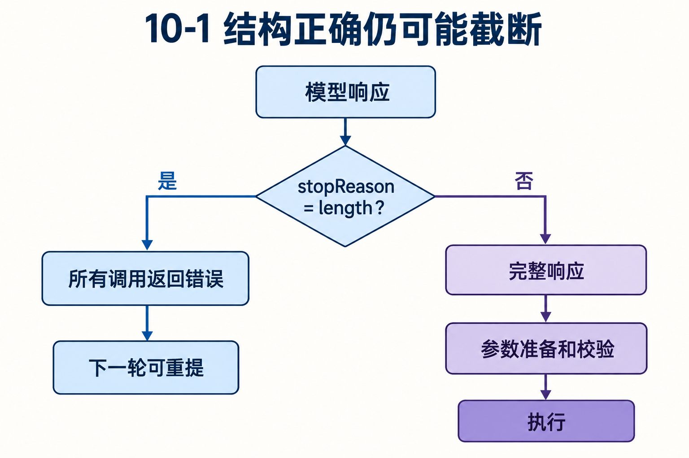
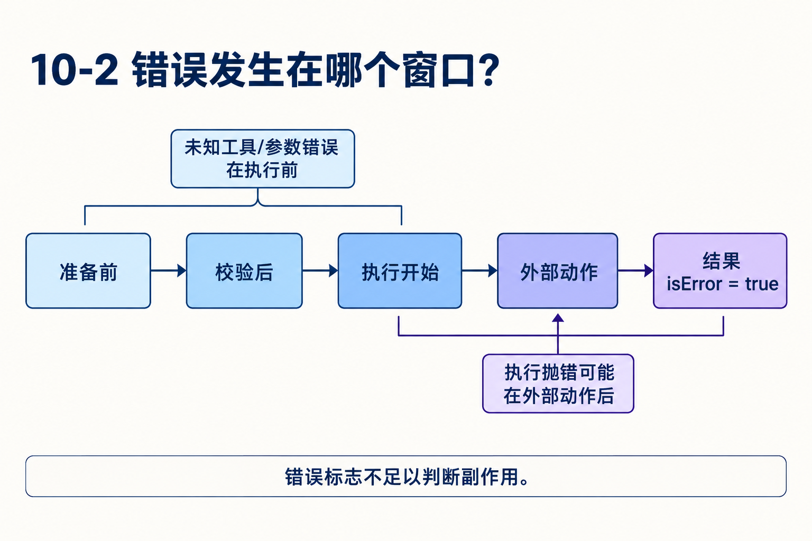

# 第10章　失败怎样被限制在正确边界

源码基线为 `56cae782341c339d3bb820081f0f9425d8c5b1ec`。编号、时长及预算示意在各例中说明，A/B实测入口见[离线实验](replay.md)。

write参数有path和content，两者都是字符串。模型原想写十行，输出截断后只剩三行，修复后的JSON却能通过schema。宿主该执行吗？若执行后才抛错，下一轮该怎样理解它？

本章用同一个动作的不同失败时刻解释校验、错误结果、取消和重试。稳定性需要明确“已经执行到哪一步”，而不是只检查最终isError。

## 1　三类失败先分清

生成失败发生在模型请求与响应，工具尚未进入执行；准备失败发生在名称、参数或执行资格判断；执行失败发生在工具体或后处理。它们可以都表现为用户看到错误，但对副作用与重试的含义不同。

StreamFn契约要求请求/模型/运行时失败编码进响应流，最终assistant.stopReason为error或aborted，而非把普通请求失败直接reject给低层循环。Agent外层另有兜底生命周期处理，不能据此忽略适配器契约。[types.ts L1](https://github.com/earendil-works/pi/blob/56cae782341c339d3bb820081f0f9425d8c5b1ec/packages/agent/src/types.ts#L1) [agent.ts L516](https://github.com/earendil-works/pi/blob/56cae782341c339d3bb820081f0f9425d8c5b1ec/packages/agent/src/agent.ts#L516)

## 2　为什么length优先于schema？

schema只检查收到的参数结构与类型。它不知道原指令还欠七行。流式JSON修复也只能把残缺数据变得可解析，不能还原用户意图。

runLoop看到length后，对这一assistant中所有调用走failToolCallsFromTruncatedMessage，发明确未执行错误。即便A看起来完整，也不从一个截断批次中猜哪一项安全。模型下一轮可重新提出完整调用。[agent-loop.ts L270](https://github.com/earendil-works/pi/blob/56cae782341c339d3bb820081f0f9425d8c5b1ec/packages/agent/src/agent-loop.ts#L270) [agent-loop.ts L481](https://github.com/earendil-works/pi/blob/56cae782341c339d3bb820081f0f9425d8c5b1ec/packages/agent/src/agent-loop.ts#L481)



## 3　为什么拒绝执行也要发start/end？

每项已出现的toolCall需要有可观察结果，UI和上层不能永远留在等待状态。截断保护为它发执行生命周期事件和toolResult，但工具体不运行。

因此start不是“有副作用”的证明，end也不等于“成功”。需要证明未执行的回归测试应检查execute调用计数为零，同时检查错误结果的调用ID。测试只断言isError会漏掉“先执行再报错”的严重回归。

## 4　准备阶段如何形成立即错误？

找不到工具，返回not found；prepareArguments或validateToolArguments抛错，转换成错误结果；beforeToolCall返回block，提供原因并跳过execute；取消在准备后被发现，也形成取消结果。

这些结果保留调用身份，使模型知道要改哪个名字、参数或前置条件。只有成功prepared才运行工具体。错误文本可帮助下一轮纠正，但不会保证模型不再重复同样错误，应用仍需预算与结束策略。[agent-loop.ts L719](https://github.com/earendil-works/pi/blob/56cae782341c339d3bb820081f0f9425d8c5b1ec/packages/agent/src/agent-loop.ts#L719)

## 5　执行抛错以后，哪些信息还能相信？

execute抛错后会收束已接纳的更新，再生成错误结果。此时工具可能已写文件、发请求或打印一部分输出。afterToolCall也可能抛错，让原来成功执行的工具最终呈现错误。

所以isError=true描述最终交付结果，不证明外部世界未改变。先定位错误发生在准备、工具体还是后处理，再读取外部状态，决定是否可重做。对外部写操作，操作身份与幂等是另外的设计问题。[agent-loop.ts L838](https://github.com/earendil-works/pi/blob/56cae782341c339d3bb820081f0f9425d8c5b1ec/packages/agent/src/agent-loop.ts#L838) [agent-loop.ts L882](https://github.com/earendil-works/pi/blob/56cae782341c339d3bb820081f0f9425d8c5b1ec/packages/agent/src/agent-loop.ts#L882)



## 6　错误消息为什么仍带结构？

toolResult保留toolCallId、toolName、content、details、usage、isError与可用duration。模型需要文本，宿主可能需要结构化诊断和成本记录。改结果的钩子还能替换这些内容，但不同provider实际如何编码内部字段另有适配。

同名调用A成功、B失败时，只有名称不能解释哪份文件缺失；ID提供可重提的目标。将错误变成消息，可以让一个业务失败留在当前推理回路里；将所有异常直接抛出，则会击穿这一批次的正常交付。[agent-loop.ts L940](https://github.com/earendil-works/pi/blob/56cae782341c339d3bb820081f0f9425d8c5b1ec/packages/agent/src/agent-loop.ts#L940)

## 7　取消为什么不构成回滚？

取消前没执行，可以跳过；取消时正在可取消I/O等待，要靠工具协作；外部操作已完成，signal不能撤回它。取消后迟到进度还要受生命周期约束，避免结束后的UI重新跳回运行中。

验证取消时应把过程分成闸门。先阻塞在execute前，取消后检查没有进入；再阻塞在外部动作之后，取消后检查结果和动作分别是什么。两种测试回答不同保证，不能互相替代。

## 8　三种重试为什么不能共用一条口号？

生成网络失败重试的是模型请求；业务工具重做可能重复外部动作；上下文溢出原样重发通常仍超限，先要改变投影与预算。length的工具执行保护和应用层可恢复长度判断也属于不同层次。

Durable把执行意图先保存，并要求检查点保存的replay与当前工具replay都为safe才重跑。它避免在策略热更新后轻率执行旧动作，却仍需要工具自身幂等。普通循环没有这份持久意图，不能靠错误文本补出跨进程执行语义。[tool.ts L193](https://github.com/earendil-works/pi/blob/56cae782341c339d3bb820081f0f9425d8c5b1ec/packages/durable/src/harness/tool.ts#L193)

## 对照关键源码

生成截断在真正批次执行入口以前判断，参数修复或schema通过都不会越过这条保护。

[agent/src/agent-loop.ts L277](https://github.com/earendil-works/pi/blob/56cae782341c339d3bb820081f0f9425d8c5b1ec/packages/agent/src/agent-loop.ts#L277)

下面是实现节选，代码块边界不表示完整函数。

```typescript
					message.stopReason === "length"
						? await failToolCallsFromTruncatedMessage(toolCalls, emit)
						: await executeToolCalls(currentContext, message, config, signal, emit);
				toolResults.push(...executedToolBatch.messages);
```

## Q&A与推导答案

### Q1　参数合法但响应length，为何仍不执行？

**答案**　结构合法不能证明指令完整。生成截断提供更强的风险证据，批次入口拒绝实际execute。

### Q2　start/end都齐了能断言写过文件吗？

**答案**　截断保护也产生这些事件。需检查实际执行分支与文件状态。

### Q3　after钩子抛错后重做工具安全吗？

**答案**　工具体可能早已成功。先确认副作用，不能因为最终isError就重复动作。

### Q4　为什么需要error而不是让适配器一律throw？

**答案**　流契约让调用方获得规范的失败消息与生命周期。任意throw会改变低层事件顺序，外层兜底不能替代契约。[types.ts L1](https://github.com/earendil-works/pi/blob/56cae782341c339d3bb820081f0f9425d8c5b1ec/packages/agent/src/types.ts#L1)

### Q5　模型下一轮改正参数，旧错误要删吗？

**答案**　通常错误是对话证据；是否省略由上下文与恢复政策决定。删除原记录也会丢失诊断，持久编辑可保留来源同时改投影。

### Q6　给工具标replay=safe是否自动保证恰好执行一次？

**答案**　它是允许重跑的声明。外部副作用需要稳定操作身份或幂等协议，重复只读也可能读到后来内容。

[返回目录](README.md)

