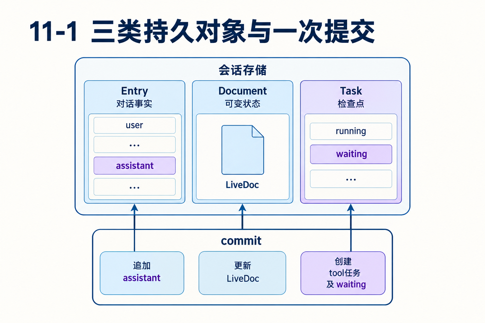
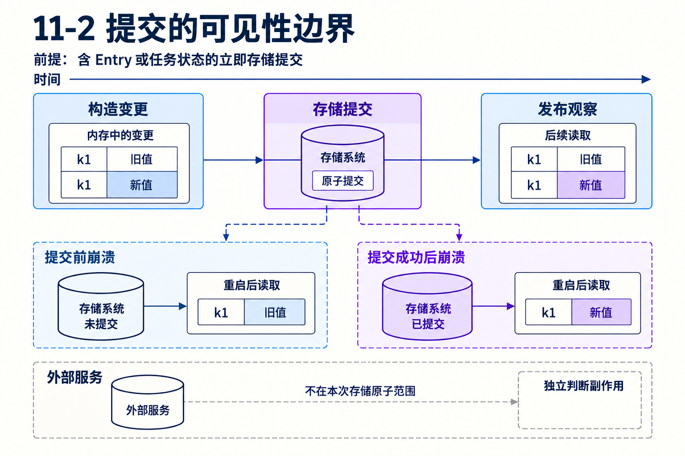

# 第11章　一次提交怎样保存一份可恢复的运行状态

源码基线为 `56cae782341c339d3bb820081f0f9425d8c5b1ec`。编号、时长及预算示意在各例中说明，A/B实测入口见[离线实验](replay.md)。

模型已经提出read A和read B。假设宿主保存了assistant，却只创建A任务就退出。重启后能从一句“我要读B”判断B没创建、正在执行还是已经完成吗？

本章从这个不完整状态出发，解释Durable为什么把Entry、Document、Task放在同一存储协议下，以及原子提交和观察发布各保证什么。

## 1　三类对象分别保存哪一种事实？

Entry是不可变对话记录，例如输入、模型响应、结果或系统变更。Document是按定义管理的可变JSON状态，例如pi.inbox、pi.live、pi.agent。Task是有输入、检查点、状态和owner的可推进工作。

把它们放在一起观察：Entry回答模型说过什么，LiveDoc展示当前哪些调用在跑，Task说明工作从哪一步继续。模型生成文本不能代替任务状态，覆盖最新进度也不能独立提供每次对话事实。[README.md L93](https://github.com/earendil-works/pi/blob/56cae782341c339d3bb820081f0f9425d8c5b1ec/packages/durable/README.md#L93)



## 2　工具启动需要保存哪几份数据？

startToolRound从实际请求声明判断offered工具，决定串行或并行。随后在runtime.commit里追加assistant条目，创建工具任务，写LiveDoc工具槽位，保存父任务waiting检查点。

并行两项时，checkpoint含assistant条目ID和两个工具任务ID；串行时先建A任务，pending保存B调用ID。工具任务归生成任务所有，父任务on列出正在等的任务。

任一份缺失都有实际后果。只有assistant没有任务，调用永远得不到执行；只有任务没有对应响应，历史难以解释结果；只有子任务没有父等待，下一步可能丢失或重复。一次提交把这些关系一起变为有效状态。[generation.ts L1003](https://github.com/earendil-works/pi/blob/56cae782341c339d3bb820081f0f9425d8c5b1ec/packages/durable/src/harness/generation.ts#L1003)

## 3　原子性不等于把所有异步代码包进事务

commit回调可以追加条目、修改文档和创建任务，后端保存一个有序原子批次。外部文件、支付与HTTP请求不在该存储原子范围。即使把外部调用写进回调，也不能因此保证它随存储失败回滚。

因此真正的工具I/O在持久意图之后执行。提交定义“动作可能开始”的边界，外部幂等定义“再执行是否产生重复”的边界。把二者拆清，才能解释为什么Task还需要replay策略。[tool.ts L193](https://github.com/earendil-works/pi/blob/56cae782341c339d3bb820081f0f9425d8c5b1ec/packages/durable/src/harness/tool.ts#L193)

## 4　提交顺序怎样变成观察顺序？

Session维护有序提交与发布。后端可以合并多个批次减少往返，但每批有自己的确认和顺序。receive回执表达哪些批次已经持久化，Session再按序发布，避免把半份日志展示成已提交事实。

如果连接在确认前断开，异常不总能证明存储完全未发生。调用方需要用稳定身份和重新读取状态处理不确定结果，不能简单重发一次全新请求。提交协议约束存储适配器，真正的后端实现必须满足这些约定。[session.ts L198](https://github.com/earendil-works/pi/blob/56cae782341c339d3bb820081f0f9425d8c5b1ec/packages/durable/src/session/session.ts#L198)



## 5　为什么进度可以先显示、后存储？

若每个输出字符都立即写存储，工具和模型流会承担大量I/O。符合条件的deferred提交可先在内存提交并发布，之后在读写相关文档、关闭、期限等边界刷入存储。

条件很具体：只改变已有文档，且对应history=latest、fork=initial；新Entry、新Document、Task状态等会要求立即存储。于是“用户看见80%”不自动代表“崩溃后恢复80%”。允许进度损失一小段，不等于允许执行意图丢失。[README.md L818](https://github.com/earendil-works/pi/blob/56cae782341c339d3bb820081f0f9425d8c5b1ec/packages/durable/README.md#L818)

## 6　为什么工具状态展示与execute检查点分两步？

ToolTask.call先可延迟更新LiveDoc槽位为running，再立即提交phase=execute的最终参数与replay。前者服务观察，后者决定动作恢复。即使展示更新因崩溃丢失，恢复也能依据检查点判断工具是否可能已经运行。

这种设计按信息重要性分配持久成本。所有进度一律立即写会昂贵，所有状态一律延期又会重复副作用。检查事务代码时，应对每个字段问：丢这一项只是界面倒退，还是会让业务动作多执行一次？[tool.ts L181](https://github.com/earendil-works/pi/blob/56cae782341c339d3bb820081f0f9425d8c5b1ec/packages/durable/src/harness/tool.ts#L181)

## 7　宿主状态与提交输入怎样一起判断？

34-submit-in-commit例先在文档检查用户是否被禁言，再在同一提交里submit steer，并记录发送历史。如果会话空闲而whenIdle=reject，输入接入失败，宿主记录也不能单独留下“已发送”。

这说明原子提交不仅服务框架内部。应用可以把资格判断、自己的可变状态和输入接入放在同一存储决定中，避免先检查后提交之间状态变化。它仍不自动包含外部身份服务，需要清楚哪些前提已经成为本存储内的事实。[34-submit-in-commit.ts L1](https://github.com/earendil-works/pi/blob/56cae782341c339d3bb820081f0f9425d8c5b1ec/packages/durable/test/examples/34-submit-in-commit.ts#L1)

## 8　设计代价如何衡量？

存储需要表达版本化文档、任务状态和批次确认，适配器比纯JSONL追加更复杂。运行代码要遵守提交前后边界，观察者又要理解即时与延期的差别。

收益是可以明确指出一次工作何时从“内存决定”成为“可恢复事实”，错误恢复不用猜最后一条聊天的含义。对长任务，提交延迟与批次大小会影响吞吐，粒度则影响重放窗口。它们是可测量的架构成本。

## 对照关键源码

waiting决定与新任务写入共享同一次提交。这里提交的是任务状态，不能延期为纯展示文档。

[durable/src/harness/generation.ts L1053](https://github.com/earendil-works/pi/blob/56cae782341c339d3bb820081f0f9425d8c5b1ec/packages/durable/src/harness/generation.ts#L1053)

下面是实现节选，代码块边界不表示完整函数。

```typescript
		const checkpoint = { phase: "tools", assistant: entry.id, tools, pending } as const;
		return { status: "waiting", checkpoint, on: tools, policy: "allSettled" };
	}, context);
```

## Q&A与推导答案

### Q1　assistant与A任务保存成功，B没保存，会出现吗？

**答案**　在本章同一次原子提交内不会成为一份成功保存的半状态。若拆成不同提交，就失去这项整体保证。

### Q2　观察者看见Document变化，能证明已落盘吗？

**答案**　符合条件的deferred提交先发布。要查持久策略和确认边界，不能仅凭UI变化判断。

### Q3　创建新Task还能延期吗？

**答案**　Task状态属于需要立即存储的变更，不能套用仅已有文档更新的延期条件。

### Q4　为什么不把支付写在commit回调里就算事务？

**答案**　存储只原子保存自身批次，无法撤回另一个系统已完成的支付。需要独立的业务幂等与确认协议。

### Q5　网络报错后直接再submit一个新ID安全吗？

**答案**　若先前提交结果未知，可能产生第二份工作。使用原身份查询或去重比盲目新建更可控，具体requestId见下一章。

### Q6　进度丢几百字符会改变工具是否重做吗？

**答案**　正确设计应由持久执行检查点决定重放，进度只影响展示。若拿进度文本推断执行阶段，就混淆了两类数据。

[返回目录](README.md)

