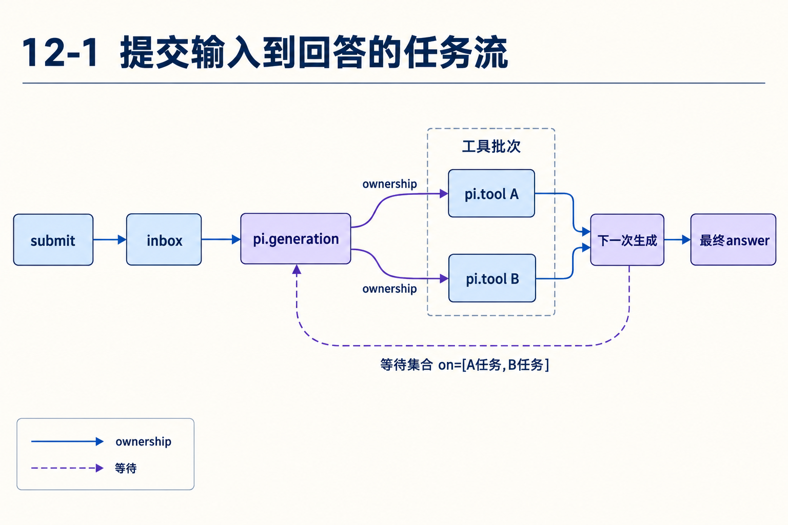
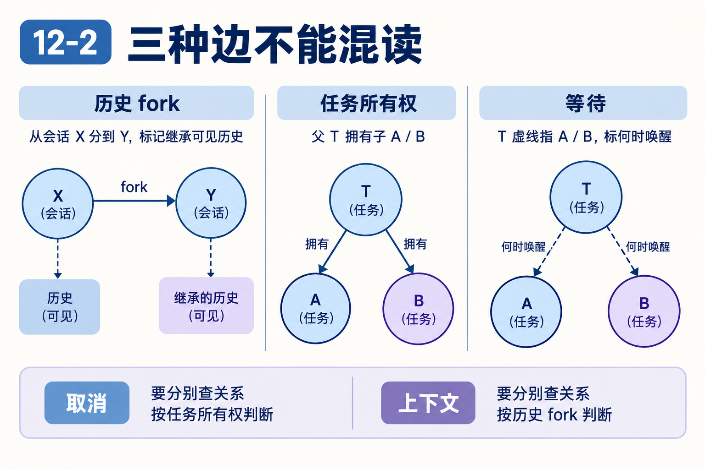

# 第12章　一次回答怎样成为可以恢复的任务图

源码基线为 `56cae782341c339d3bb820081f0f9425d8c5b1ec`。编号、时长及预算示意在各例中说明，A/B实测入口见[离线实验](replay.md)。

用户提交比较A/B后，两项读取还没结束。进程没有在执行模型生成，却仍处于忙碌。它究竟在等谁，重开后又由谁启动下一项？

本章为同一对象保留不同编号：assistant条目EA，模型调用A/B，工具任务TA/TB，结果条目RA/RB。编号仅为教学别名，用于防止把调用身份与任务身份混成一条边。

## 1　输入接入为什么也需要身份？

submit形成Submission。它跟踪输入已接入、被放入历史以及最终结算等状态；requestId允许重复接入识别为原提交，而非每次都启动新工作。Conversation忙时，输入可进入inbox等待边界。

模型最终回答与“提交成功返回一个ID”不是同一时刻。调用者若只需确认接入，等待ID即可；若需要答案，还要等待submission结算并读取相应记录。重启后也可以重新取得原submission继续观察。[submissions.ts L34](https://github.com/earendil-works/pi/blob/56cae782341c339d3bb820081f0f9425d8c5b1ec/packages/durable/src/harness/submissions.ts#L34)

## 2　generation拥有哪份工作？

generation准备当前模型和上下文，调用模型。响应包含工具调用时，startToolRound追加EA，创建ToolTask，其输入关联EA与callId。任务owner指向当前generation。

这提供两种可追溯关系：TA知道执行EA里的A，父任务知道TA属于自己。模型后续结果通过toolCallId=A配对，而父任务等待的是TA的终态。entry ID、call ID、task ID服务不同问题。[generation.ts L432](https://github.com/earendil-works/pi/blob/56cae782341c339d3bb820081f0f9425d8c5b1ec/packages/durable/src/harness/generation.ts#L432)



## 3　并行批次的检查点长什么样？

两个工具都能并行时，一次提交创建TA、TB，父任务保存：

```text
checkpoint = { phase:"tools", assistant:EA, tools:[TA,TB], pending:[] }
state = waiting
on = [TA,TB]
policy = allSettled
```

allSettled要求等待终结，不只等待成功。工具错误结果也可以终结，因此父任务能处理一成一败。缺少定义等阻塞则是另外的状态，需要inspect定位，不能把所有等待都叫“工具慢”。[generation.ts L1028](https://github.com/earendil-works/pi/blob/56cae782341c339d3bb820081f0f9425d8c5b1ec/packages/durable/src/harness/generation.ts#L1028)

## 4　串行A完成后，谁创建B？

串行第一份提交只创建TA，checkpoint.tools=[TA]，pending=[B]，on=[TA]。A终结后，调度器重新推进generation的tools阶段，此阶段读取pending，创建TB。

新checkpoint.tools=[TA,TB]，pending=[]，on=[TB]。tools累积整批任务供最终结果处理，on只等待当前新项。不是A工具主动调用B，也不是恢复后重新请求模型才产生B，B的调用意图早已在EA中。[generation.ts L341](https://github.com/earendil-works/pi/blob/56cae782341c339d3bb820081f0f9425d8c5b1ec/packages/durable/src/harness/generation.ts#L341)

## 5　结果收齐以后为什么还不能直接生成？

finishToolRound读取任务outcome与工具槽位，再运行afterTools。按原调用顺序处理control：全体terminate才终止，addTools汇集，handoff使用最后一个相关决定。之后还要处理输入边界、reset、maxTurns和新generation。

如果maxTurns=1，第一批工具仍会执行，再在没有更高优先级terminate等结束决定时触发turn_limit。直接答案自然结束。运行计数在live.run里持久化，但新run获得新预算，因此外部自动反复continue仍需总预算约束。[generation.ts L1064](https://github.com/earendil-works/pi/blob/56cae782341c339d3bb820081f0f9425d8c5b1ec/packages/durable/src/harness/generation.ts#L1064)

## 6　所有权、等待和fork怎样分别读？



所有权决定谁管理子工作的生命周期；等待集合决定父任务何时可推进；fork决定新对话继承哪些可见历史。三者可以同时出现在一个子代理场景，却不能互相推出。

例如后台子代理可以由长期anchor任务拥有，使父对话暂时空闲或取消当前调用时不直接结束它。前台子代理则可能归当前工具调用所有。需要根据具体owner设计解释取消范围，不能仅凭“这是子对话”下结论。[03-owned-conversations.ts L1](https://github.com/earendil-works/pi/blob/56cae782341c339d3bb820081f0f9425d8c5b1ec/packages/durable/test/examples/03-owned-conversations.ts#L1)

## 7　inbox怎样在工具边界加入新指令？

prepareBoundary取得当前head与队列策略。applyBoundary在postTools选择write和steer，在final还可选择follow-up；reset会改变边界处理。write先放置，用户输入后放置，各自保留相关顺序。

旧head之前的写入可能已过时，按stale结算而非强行插入新上下文。这使运行能在重启和并发提交之后仍判断输入属于哪个有效范围。队列的持久性来自Document与提交协议，不来自内存Promise。[inbox.ts L58](https://github.com/earendil-works/pi/blob/56cae782341c339d3bb820081f0f9425d8c5b1ec/packages/durable/src/harness/inbox.ts#L58)

## 8　任务图为何值得付出额外复杂度？

普通异步调用已经能在一个进程里等待两个工具。Durable增加任务身份与检查点，是为了让“还欠TA/TB”和“已经完成哪个阶段”能在新进程重建。

代价是业务代码需要显式阶段、提交、定义版本和终态处理。收益在失败时最明显：可以观察父任务为何等待、子任务是否阻塞、哪项结果已保存，而不是只发现最后一条消息停在“正在处理”。

## 对照关键源码

tools累积旧任务，on只等新建这一项。两个集合看似相近，却分别服务批次结算与当前唤醒。

[durable/src/harness/generation.ts L353](https://github.com/earendil-works/pi/blob/56cae782341c339d3bb820081f0f9425d8c5b1ec/packages/durable/src/harness/generation.ts#L353)

下面是实现节选，代码块边界不表示完整函数。

```typescript
					tools: [...tools, taskId],
					pending: rest,
				};
				return { status: "waiting", checkpoint, on: [taskId], policy: "allSettled" };
			}, context);
		},
```

## Q&A与推导答案

### Q1　串行第二步on为什么不再含TA？

**答案**　TA已终结，当前只欠TB。checkpoint.tools仍保留TA供批次处理，等待集合则只含未满足条件。

### Q2　B工具失败会让allSettled永远等吗？

**答案**　失败也是终结。父任务可读取其outcome继续判断，阻塞或丢定义要另查。

### Q3　A完成是A主动启动B吗？

**答案**　调度器唤醒generation，由tools阶段按保存的pending创建B，工具本身无需知道兄弟调用。

### Q4　requestId相同与对话文本相同是否等价？

**答案**　身份用于去重接入，文本相同可以是用户确实要求再执行一次。不能只按内容猜重复。

### Q5　fork能推断取消会传播吗？

**答案**　不能。fork解释历史继承，取消沿实际生命周期归属，需查owner。

### Q6　maxTurns=1时工具全terminate会报turn_limit吗？

**答案**　全体terminate有更高优先级，按正常终止处理；否则执行工具后才考虑turn_limit。[generation.ts L1109](https://github.com/earendil-works/pi/blob/56cae782341c339d3bb820081f0f9425d8c5b1ec/packages/durable/src/harness/generation.ts#L1109)

[返回目录](README.md)

