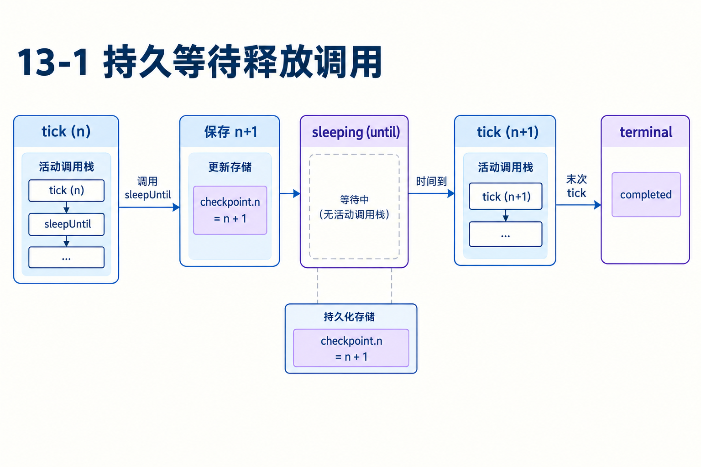
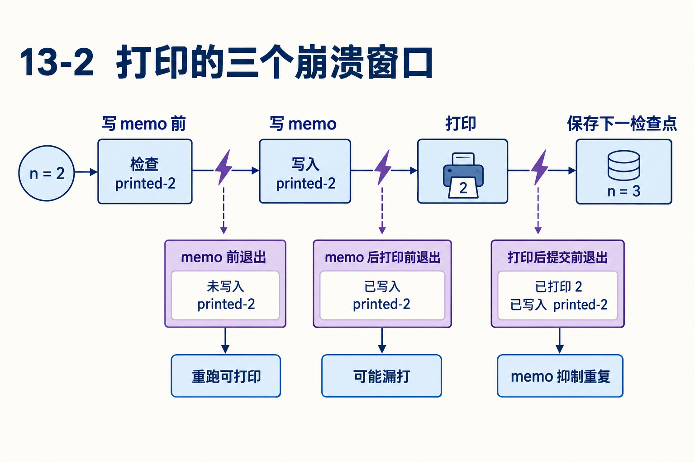
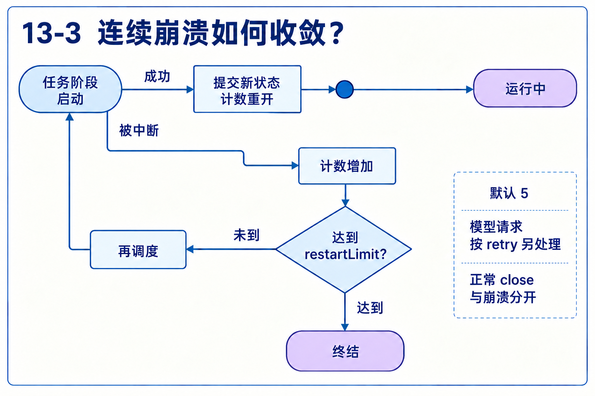

# 第13章　检查点之间发生的事，怎样在重启后判断

源码基线为 `56cae782341c339d3bb820081f0f9425d8c5b1ec`。编号、时长及预算示意在各例中说明，A/B实测入口见[离线实验](replay.md)。

ticker任务要打印1到5。它先写printed-2=true，再打印tick 2，最后保存n=3。若进程分别在这三步之间消失，会漏打、重打还是继续到3？

恢复不是保存任意JavaScript调用栈。本章先推演一个几十行示例，再把同样的窗口分析用于模型请求和工具副作用。

## 1　阶段入口需要哪些可恢复输入？

Ticker有input.to和checkpoint={phase:"tick",n}。每次调度都从tick函数开头进入，读取n；等待用sleepUntil保存until和下一检查点，最后一次提交terminal/completed。

当前阶段结束以后不需要保留悬挂调用。新进程从存储取得input和checkpoint即可决定下一段代码，因此一个阶段内不能依靠只在旧闭包里的局部变量继续。[12-recovery.ts L1](https://github.com/earendil-works/pi/blob/56cae782341c339d3bb820081f0f9425d8c5b1ec/packages/durable/test/examples/12-recovery.ts#L1)



## 2　实际代码为什么先写memo？

阶段检查printed-n是否存在，不存在则写true，再console.log。打印后若下一检查点尚未保存，重开会从同一n再进入。memo使它跳过重复打印，随后继续推进。

本轮实际运行仓库示例，在tick 2打印后关闭。读回state为pending、checkpoint.n=2，memo包含printed-1和printed-2。重开后输出3、4、5，最后completed/count to 5。这份实测只覆盖打印后退出窗口。[12-recovery.ts L26](https://github.com/earendil-works/pi/blob/56cae782341c339d3bb820081f0f9425d8c5b1ec/packages/durable/test/examples/12-recovery.ts#L26)

## 3　把两个相邻退出点放大

| 退出点 | 已保存 | 重跑同一n的结果 |
|---|---|---|
| memo以前 | 旧checkpoint | 再写memo并打印 |
| memo以后、打印以前 | printed-n=true | 跳过打印，可能漏打 |
| 打印以后、下一checkpoint以前 | memo和已发生打印 | 跳过打印，避免重复 |
| 下一checkpoint以后 | n+1 | 从下一阶段继续 |

memo与console.log没有一个共同原子提交。先记意图抑制重复，也留下漏打窗口。换顺序先打印再记memo，则会在两者之间引入重复窗口。要保证外部动作恰好一次，需外部系统支持同一身份的幂等与确认，单靠本地memo不能解决。[12-recovery.ts L32](https://github.com/earendil-works/pi/blob/56cae782341c339d3bb820081f0f9425d8c5b1ec/packages/durable/test/examples/12-recovery.ts#L32)



## 4　工具为何有call和execute两种检查点？

call阶段解析工具、准备参数、校验、运行beforeTool，再复验最终参数。通过后先持久化execute检查点，包含严格JSON参数与当时的replay，随后运行工具体。

如果还在call就退出，可以重新准备；已保存execute则意味着动作可能开始。恢复时不能把“没有最终结果”当作“没有执行”。这个阶段划分把不确定窗口显式记录下来。[tool.ts L154](https://github.com/earendil-works/pi/blob/56cae782341c339d3bb820081f0f9425d8c5b1ec/packages/durable/src/harness/tool.ts#L154)

## 5　为什么要两个safe同时成立？

恢复execute用保存参数，并要求旧checkpoint.replay与当前工具replay都为safe才重跑。保存时unsafe、后来代码改safe，旧意图仍不自动获准；保存时safe、后来改unsafe，当前实现也不会被旧设置强迫重做。

不满足时形成interrupted，说明可能部分运行，并用已有输出结束相应调用。参数与策略都是执行意图的一部分，不能只持久化工具名。[tool.ts L202](https://github.com/earendil-works/pi/blob/56cae782341c339d3bb820081f0f9425d8c5b1ec/packages/durable/src/harness/tool.ts#L202)

## 6　模型请求崩溃、正常关闭与业务抛错有什么不同？

业务工具抛错可形成有结果的终态。进程崩溃没机会执行正常收尾，新进程要识别被中断阶段。模型请求在崩溃中断时按retry预算和退避处理，部分回答按已保存信息处理；正常close与崩溃有不同恢复政策。

这里成本也不同。重复模型请求可能产生额外费用，重复写工具可能改变外部业务状态。不能给所有“未完成await”套同一重试政策。诊断应保存中断类型、任务种类、phase、attempt和持久输出边界。[generation.ts L501](https://github.com/earendil-works/pi/blob/56cae782341c339d3bb820081f0f9425d8c5b1ec/packages/durable/src/harness/generation.ts#L501)

## 7　确定性崩溃怎样避免永远重启？

任务可能每次在下一检查点前耗尽内存，重启就重现。restartLimit计连续被截断的工作，默认5，新状态成功提交后才重新开始对应计数。达到上限后，内建任务按其类型产生失败或错误结果，自定义任务等有各自fault处理。

“又调度一次”不会自动清零。否则永远无法到上限。模型请求重试还有自己的预算，不能把它与整个进程重启次数混为一谈。[README.md L216](https://github.com/earendil-works/pi/blob/56cae782341c339d3bb820081f0f9425d8c5b1ec/packages/durable/README.md#L216)



## 8　检查点越细越好吗？

细阶段缩小重跑窗口，增加提交延迟；粗阶段减少I/O，却让更多计算和副作用需要重放判断。可重算纯计算与不可重复外部动作要分开设计。

对一段代码画“读状态→外部动作→保存新状态”，分别标谁确认、哪里可重复、哪里可能未知。若无法解释这三个边界，先不要把它声明replay=safe。读例子最重要的收获是这一分析方法，而非复制一个memo模式到所有业务。

## 对照关键源码

旧意图和当前定义双重许可。进度可重新发布，实际重跑使用检查点参数。

[durable/src/harness/tool.ts L207](https://github.com/earendil-works/pi/blob/56cae782341c339d3bb820081f0f9425d8c5b1ec/packages/durable/src/harness/tool.ts#L207)

下面是实现节选，代码块边界不表示完整函数。

```typescript
			if (replay === "safe" && tool?.replay === "safe") {
				// The rerun reports from scratch: clear what the interrupted attempt published, and show the slot running with
				// the arguments it runs with again, as the deferred commit that showed them may have been lost with the crash.
				await runtime.commit(async (tx) => {
					const slot = toolSlot(await tx.doc(LiveDoc, runtime.conversationId), runtime.taskId);
					if (slot !== undefined) {
						clearProgress(slot);
						slot.status = "running";
						if ("parentTaskId" in slot) slot.arguments = args;
					}
					return undefined;
				}, context);
				return run(runtime, task.input, call, tool, args, context);
```

## Q&A与推导答案

### Q1　printed-2=true是否证明tick 2实际打印？

**答案**　可能尚在memo之后、打印之前退出。它是保存的标记，不能替外部效果作确认。

### Q2　sleepUntil能跨重启的依据是什么？

**答案**　until与checkpoint存储，后续调度从阶段入口继续，不依赖旧进程定时器对象。

### Q3　工具没有最终结果，为什么不直接重做？

**答案**　可能已经执行但结果未保存。execute阶段和双safe策略专门处理这种不确定性。

### Q4　当前版本改safe就能恢复旧unsafe调用吗？

**答案**　旧检查点也必须safe，两项同时成立才重跑。

### Q5　第5次进程启动一定停止服务吗？

**答案**　限制按具体任务连续中断及其状态提交计数，不是服务全局启动次数。其他任务可以有不同状态。

### Q6　把memo移到打印后能解决漏打吗？

**答案**　会改变失败窗口，却引入打印后memo前重复。没有共同事务就不能同时消除两个窗口。

[返回目录](README.md)

