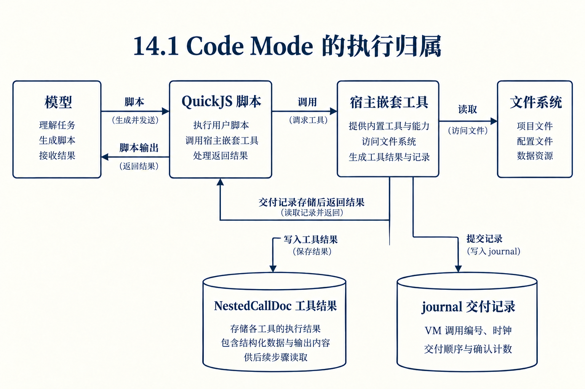
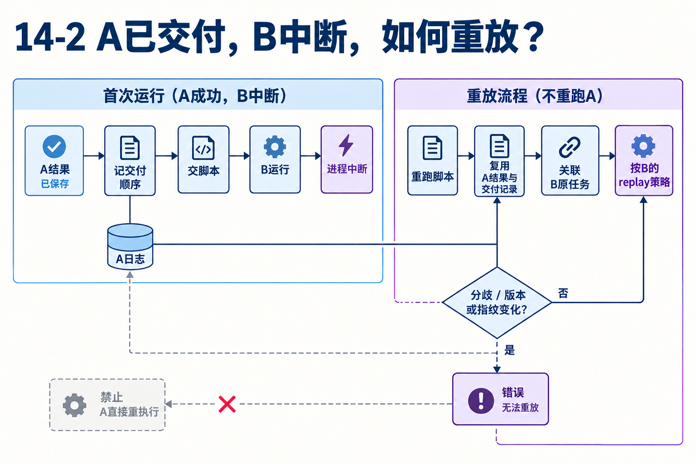

# 第14章　Code Mode怎样重跑脚本而复用已完成工作

源码基线为 `56cae782341c339d3bb820081f0f9425d8c5b1ec`。编号、时长及预算示意在各例中说明，A/B实测入口见[离线实验](replay.md)。

脚本先await tools.read(A)，再await tools.read(B)。A结果已交给脚本，B执行中进程消失。恢复时脚本从哪里开始，A是否重新读取，B按谁的策略决定？

本章讨论Durable Code Mode。它运行模型写的JavaScript，用宿主工具完成外部动作，并以确定性重放恢复脚本。这里的VM调用ID、工具任务ID和模型调用ID需要分别解释。

## 1　为什么把多项工具组合写进脚本？

模型可以用JavaScript循环、条件和局部变量处理许多工具结果，只把所需输出返回模型，减少每个中间结果都进主对话的成本。QuickJS负责执行脚本，宿主负责真实工具、参数限制和持久任务。

脚本不直接拥有文件系统。tools.read跨沙箱边界回到宿主，创建嵌套工具任务，按工具自己的校验、输出与重放规则执行。编排能力增强了，控制边界仍要明确。[codemode.ts L1](https://github.com/earendil-works/pi/blob/56cae782341c339d3bb820081f0f9425d8c5b1ec/packages/durable/src/codemode/codemode.ts#L1)



## 2　为什么不能只保存脚本文本？

只有代码而没有已交付结果，重跑可能读到新的A；只有最终结果而没有交付顺序，原来并发工具返回的顺序可能改变脚本分支。开始时的时钟、随机数等也会影响后续调用参数。

当前方案保存开始数据，使用虚拟时钟、种子随机和固定时区等条件，再记录结果怎样交给VM。它不通过序列化整个VM堆实现恢复，而是从脚本入口重跑并验证过程一致性。[codemode.ts L10](https://github.com/earendil-works/pi/blob/56cae782341c339d3bb820081f0f9425d8c5b1ec/packages/durable/src/codemode/codemode.ts#L10)

## 3　NestedCallDoc与journal各保存什么？

普通嵌套工具的结果在NestedCallDoc。journal记录VM调用ID、时钟、交付顺序、已确认的调用数量等；global调用在其中保存自己的outcome。两种存储共同支持重放。

因此“工具结果都存在journal”不准确。普通工具结果有自己的任务与结果生命周期，journal解释脚本在什么顺序看到它们。它们都正确但若交付顺序不同，脚本仍可能走另一条路径。[codemode.ts L17](https://github.com/earendil-works/pi/blob/56cae782341c339d3bb820081f0f9425d8c5b1ec/packages/durable/src/codemode/codemode.ts#L17)

## 4　怎样关联回原来的A任务？

Code Mode宿主把VM调用编号变成key，例如c加call.id，再通过executeTool关联嵌套任务。脚本重跑产生同样调用时，可以找到原任务和已保存结果，不需新建一份A。

earlier还会检查原任务里的目标、名称和参数是否与当前调用相符。相同编号却请求另一工具或另一参数，属于分歧，不能把旧A结果交给新的动作。这里key由宿主协议产生，不是本段脚本随意指定。[codemode.ts L780](https://github.com/earendil-works/pi/blob/56cae782341c339d3bb820081f0f9425d8c5b1ec/packages/durable/src/codemode/codemode.ts#L780)



## 5　A已交付、B中断，逐步重演

重启先验证开始数据、版本、指纹和期限，再从脚本入口运行。遇到A，关联已有任务，按原journal顺序交回保存结果。脚本计算出下一次调用B，关联B的原任务。

B若当时结果已持久化，就可使用；若中断在execute，按B自身策略恢复，保存与当前策略均safe才重跑，否则形成interrupted。外层Code Mode可重放不代表每个嵌套写动作都safe。[tool.ts L202](https://github.com/earendil-works/pi/blob/56cae782341c339d3bb820081f0f9425d8c5b1ec/packages/durable/src/harness/tool.ts#L202)

## 6　为什么还记录已发起调用的数量？

脚本拿到A结果以后可能立即派生一百次新调用。若已记录结果交付，却没有记录它产生多少调用，崩溃后难以确认旧尝试到底允许启动过哪些任务。

当前协议在对应调用可启动前持久化已发起数量，重放检查已记录计数。顺序脚本因而为每个结果承担journal提交和计数提交，此外还有子任务自身提交。这是检测常见中断点的具体I/O成本。[codemode.ts L23](https://github.com/earendil-works/pi/blob/56cae782341c339d3bb820081f0f9425d8c5b1ec/packages/durable/src/codemode/codemode.ts#L23)

## 7　嵌套isError如何变成脚本resolve或reject？

outcomeOf根据工具是否有结构化schema和structuredOutput决定脚本拿到什么。带结构化值的错误结果可以resolve，例如bash非零exitCode仍作为可检查值；没有可用结构化值的错误通常reject，脚本可以catch。

模型最后只看到外层Code Mode结果。脚本可以捕获内部失败后输出诊断，也可以让外层失败。不能把嵌套interrupted直接当成模型主对话多了一条同级toolResult。[codemode.ts L275](https://github.com/earendil-works/pi/blob/56cae782341c339d3bb820081f0f9425d8c5b1ec/packages/durable/src/codemode/codemode.ts#L275)

## 8　什么时候明确拒绝重放？

脚本走了不同调用路径，版本或沙箱指纹改变，deadline已到等条件都会导致错误，而不是猜测怎样拼接继续。先前已接入的嵌套任务还需按各自生命周期清理，不能从“拒绝新重放”推出外部工作瞬间消失。

这些限制使恢复保证可以检查。代价是代码升级、外部非确定输入和超时要显式处理，不能把它当任意JavaScript都可以透明跨进程继续的通用承诺。[codemode.ts L31](https://github.com/earendil-works/pi/blob/56cae782341c339d3bb820081f0f9425d8c5b1ec/packages/durable/src/codemode/codemode.ts#L31)

## 对照关键源码

错误是否拒绝脚本Promise取决于结构化值。最终模型结果还隔着脚本自己的控制流。

[durable/src/codemode/codemode.ts L280](https://github.com/earendil-works/pi/blob/56cae782341c339d3bb820081f0f9425d8c5b1ec/packages/durable/src/codemode/codemode.ts#L280)

下面是实现节选，代码块边界不表示完整函数。

```typescript
function outcomeOf(name: string, structured: boolean, result: NestedToolExecutionResult): CodemodeOutcome {
	const value = structured ? result.structuredOutput : textOf(result.structuredOutput);
	if (!result.isError || (structured && value !== undefined)) return { ok: true, value };
	const message = structured ? "" : (value as string);
	const diagnostics = result.diagnostics
		.filter((diagnostic) => diagnostic.severity === "error")
		.map((diagnostic) => diagnostic.message)
		.join("\n");
	return {
		ok: false,
		message: message || diagnostics || `Tool ${name} failed`,
		...(value === undefined ? {} : { properties: { structuredOutput: value } }),
	};
}

```

## Q&A与推导答案

### Q1　恢复从原来的await指令地址继续吗？

**答案**　从脚本入口重跑，以已保存的开始数据与交付顺序驱动相同过程。

### Q2　A的文件内容已改变，恢复会读到新版A吗？

**答案**　若A结果已完成并作为既有调用复用，脚本得到保存结果。新发一次独立调用才会读取当前文件，身份决定行为。

### Q3　journal是否保存所有普通工具结果正文？

**答案**　普通结果在NestedCallDoc，journal主要记录交付过程；global另有outcome。

### Q4　B不是safe，外层safe能强迫B重做吗？

**答案**　不能。B遵守自己的执行检查点与双safe判断，可能以interrupted返回脚本。

### Q5　isError=true一定让脚本throw吗？

**答案**　结构化工具有可用structuredOutput时可以resolve，脚本再看exitCode等字段。需读outcomeOf的实际映射。

### Q6　为什么要付两类日志提交成本？

**答案**　既要知道交付过哪些结果，也要知道VM基于它们允许发起多少调用，防止崩溃重放改变已接入工作集合。

[返回目录](README.md)

