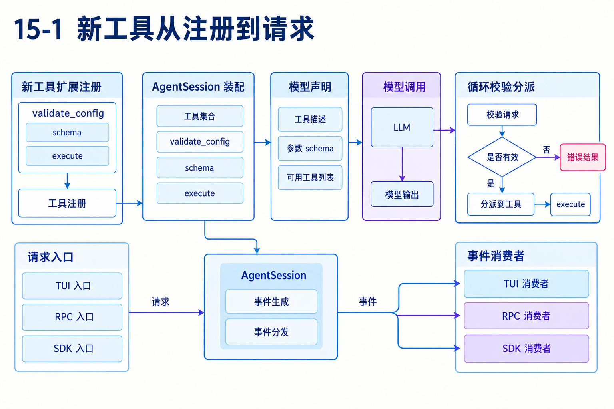
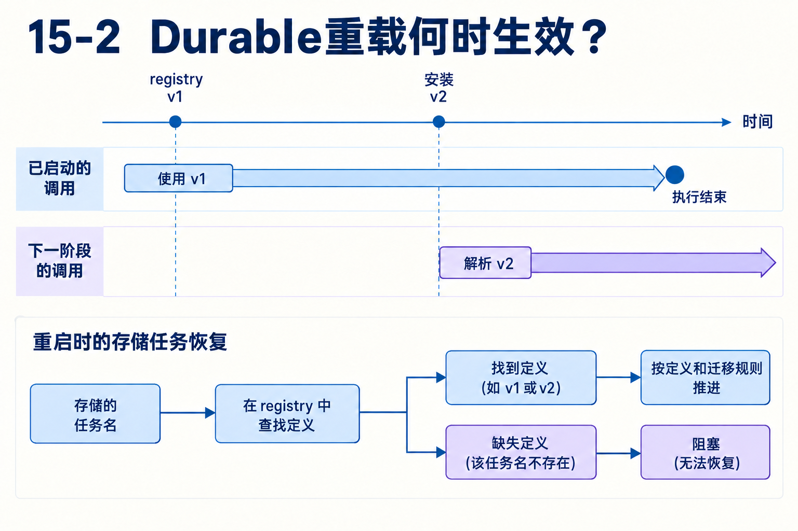

# 第15章　怎样扩展pi，又怎样判断该采用哪一种harness

源码基线为 `56cae782341c339d3bb820081f0f9425d8c5b1ec`。编号、时长及预算示意在各例中说明，A/B实测入口见[离线实验](replay.md)。

现在要给A/B比较增加validate_config，并同时服务终端用户与程序调用。未来还可能要求任务重启后继续。应该改循环、写扩展，还是换一种运行状态设计？

本章把前面机制收束到一个具体扩展设计，分别检查能力声明、实际执行、上下文、事件与生命周期。架构取舍必须能落到一个中断点或输入变式上。

## 1　先为新工具写完整契约

validate_config接收路径还是JSON内容？路径方案自己读取文件，JSON方案复用调用者提供的数据，两者在I/O、权限、输入体积和版本一致性上不同。

schema写明允许字段，execute返回模型可读内容与必要结构化诊断。若自动修复文件，就要考虑串行要求与外部副作用；若只检查，仍要审查共享缓存或cwd等状态。注册一个名字只是契约开始，不足以说明工具稳定。[types.ts L1](https://github.com/earendil-works/pi/blob/56cae782341c339d3bb820081f0f9425d8c5b1ec/packages/coding-agent/src/core/extensions/types.ts#L1)

## 2　工具怎样接入已有执行管线？

扩展registerTool把schema、描述与execute交给应用装配。下一次有效loadout决定模型声明，返回toolCall后沿通用查找、参数准备、校验、执行和后处理。若现有机制已经表达所需行为，不必为了新业务分支修改runLoop。

需要改变调度或结果语义时，先检查现有hook的具体输入输出。before与after并不都覆盖每一种立即拒绝分支，不能按名字猜调用时机。业务正确性应由实际机制承担，不能依赖“通常会先执行这个监听者”。[agent-loop.ts L719](https://github.com/earendil-works/pi/blob/56cae782341c339d3bb820081f0f9425d8c5b1ec/packages/agent/src/agent-loop.ts#L719) [agent-loop.ts L882](https://github.com/earendil-works/pi/blob/56cae782341c339d3bb820081f0f9425d8c5b1ec/packages/agent/src/agent-loop.ts#L882)



## 3　声明可见性与内部调用为何要分开设计？

一个编排工具只让模型选择run_tools，内部仍能调用echo与helper，模型未必要看见每个低层细节。prepareLoadout可调整描述或隐藏声明，exposure与可调用集合控制内部路径。

orchestration测试明确验证隐藏echo声明后仍能内部执行，并在父结果保存nestedCalls。模型看到的是父工具整合结果，审计还可看到内部调用。设计越复杂，越需要说明哪个边界负责校验与权限，避免只在顶层检查而内部绕开。[agent-session-tool-orchestration.test.ts L1](https://github.com/earendil-works/pi/blob/56cae782341c339d3bb820081f0f9425d8c5b1ec/packages/coding-agent/test/suite/agent-session-tool-orchestration.test.ts#L1)

## 4　扩展怎样影响模型下一次看到的内容？

before_agent_start可改变提示选项和起始消息，context可调整上下文，工具执行结果又进入历史。会话按轮次更新提示、工具loadout和投影，模型请求前再转换。一次能力更新不能只改UI列表，必须确认本次有效声明与可执行集合一致。

同样，隐藏消息显示不代表过滤模型内容。扩展作者要逐一决定持久化、显示、转换与交付时机。第03与05章的对象边界，在这里直接影响数据是否被送到模型。[agent-session.ts L914](https://github.com/earendil-works/pi/blob/56cae782341c339d3bb820081f0f9425d8c5b1ec/packages/coding-agent/src/core/agent-session.ts#L914) [messages.ts L148](https://github.com/earendil-works/pi/blob/56cae782341c339d3bb820081f0f9425d8c5b1ec/packages/coding-agent/src/core/messages.ts#L148)

## 5　TUI、RPC、SDK共用什么，又各自承担什么？

三种入口可共用AgentSession和循环。事件消费者按自身展示更新消息和工具进度：TUI管理终端渲染，RPC管理协议传输，SDK调用方维护自己的视图和业务请求身份。

共享运行语义不等于共享全部交互能力。扩展若要求弹窗询问，调用方必须有对应UI上下文；无人值守SDK不能凭空等待终端确认。服务还要明确并发输入、断开连接和取消，是取消客户端观察还是取消真实工作。[sdk.ts L403](https://github.com/earendil-works/pi/blob/56cae782341c339d3bb820081f0f9425d8c5b1ec/packages/coding-agent/src/core/sdk.ts#L403) [types.ts L1](https://github.com/earendil-works/pi/blob/56cae782341c339d3bb820081f0f9425d8c5b1ec/packages/coding-agent/src/core/extensions/types.ts#L1)

## 6　Durable注册表如何与存储中的名字配合？

conversation持久配置保存模型、扩展与工具选择等名字，当前registry提供实现。已启动调用使用取得的实现，下一阶段、请求或调用再解析当前定义。因此安装v2不会把一个正运行的v1函数从中间换掉。

重启后要重新安装实现。缺少任务种类定义会阻塞相关任务；工具不可用则还要检查tool_unavailable结果路径。定义迁移与版本判断决定旧检查点如何推进，存储本身不会自动下载旧代码。[tool.ts L135](https://github.com/earendil-works/pi/blob/56cae782341c339d3bb820081f0f9425d8c5b1ec/packages/durable/src/harness/tool.ts#L135) [30-reload-and-restart.ts L1](https://github.com/earendil-works/pi/blob/56cae782341c339d3bb820081f0f9425d8c5b1ec/packages/durable/test/examples/30-reload-and-restart.ts#L1)



## 7　用一个中断点选择架构

要求一：用户想保留昨天的分支、工具记录并继续交互。coding-agent的文件会话、投影和循环已经提供主要机制。要求二：B外部任务要等待几小时，进程随时重开，还要取消关联子任务。持久Task、inbox、所有权和提交边界开始成为业务正确性的条件。

用同一个故障题检查：A结果已保存，B请求已发，模型尚未再次生成。系统能否指出B执行参数、是否允许重做、谁等待它、下一步由哪份检查点决定？若答案依赖旧进程Promise，当前方案没有跨进程继续的依据。

## 8　额外能力也增加哪些成本？

普通循环的策略接点多，请求输入需要沿阶段调试。Durable再增加存储适配、任务定义版本、迁移、重放政策、提交延迟和故障观察。Code Mode降低主对话中间结果数量，又增加沙箱与日志协议成本。

选型应写出必须满足的恢复与交互场景，再核对实际保证。既不要因为包名多就认为架构强，也不要因为最小循环只有几十行就忽略生产边界。最有价值的源码理解，是知道一个新需求会触及哪份状态、哪条契约和哪次提交。

## 对照关键源码

同一工具集合可在声明处隐藏echo，在内部仍调用它。查看测试后续requestTools与nestedCalls断言验证两条路径。

[coding-agent/test/suite/agent-session-tool-orchestration.test.ts L36](https://github.com/earendil-works/pi/blob/56cae782341c339d3bb820081f0f9425d8c5b1ec/packages/coding-agent/test/suite/agent-session-tool-orchestration.test.ts#L36)

下面是实现节选，代码块边界不表示完整函数。

```typescript
		prepareLoadout: (loadout) => ({
			descriptions: {
				run_tools: `Runs tools: ${loadout.callable.map((tool) => tool.name).join(", ")}`,
				echo: "Echo text (also callable from run_tools).",
			},
			hiddenDeclarations: ["echo"],
		}),
		execute: async (_id, _params, _signal, _onUpdate, ctx) => {
```

## Q&A与推导答案

### Q1　新增validate_config必须改runLoop吗？

**答案**　schema、execute、模式与hook能表达需求时可扩展接入。只有真实调度语义变化才需要审查循环。

### Q2　隐藏工具声明是否阻止所有内部调用？

**答案**　声明集合与内部可调用性可以分开，需查loadout与exposure。不能只查UI是否显示。

### Q3　RPC客户端断开是否必然终止工具？

**答案**　取决于宿主如何映射连接生命周期与运行取消。事件传输结束不自动撤销工具副作用。

### Q4　安装v2能修改v1调用执行到一半的逻辑吗？

**答案**　当前已启动调用沿用取得实现，后续解析边界才采用新定义。[30-reload-and-restart.ts L1](https://github.com/earendil-works/pi/blob/56cae782341c339d3bb820081f0f9425d8c5b1ec/packages/durable/test/examples/30-reload-and-restart.ts#L1)

### Q5　只有持久工具名，重开后没有代码能跑吗？

**答案**　还需当前registry解析定义；缺任务定义可能阻塞，缺工具则可能形成不可用结果。

### Q6　怎样证明架构满足“可恢复”？

**答案**　给出明确中断点，列出存储中已有输入、意图、结果、等待与重放政策，再推导新进程的第一步。只说聊天记录还在不够。

[返回目录](README.md)

