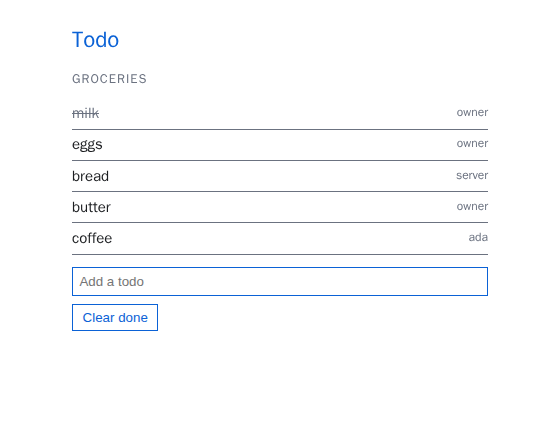
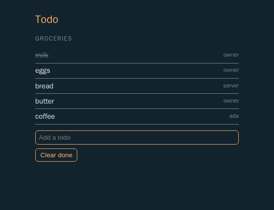
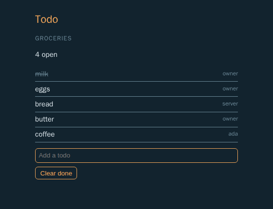
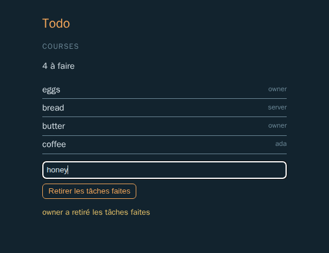
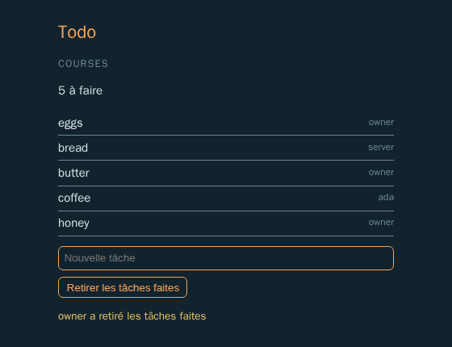
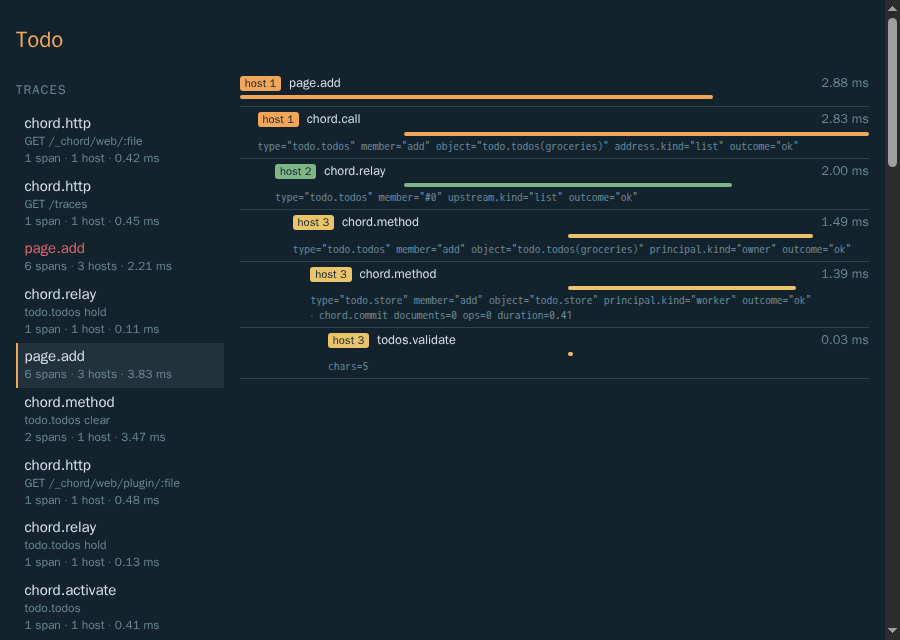
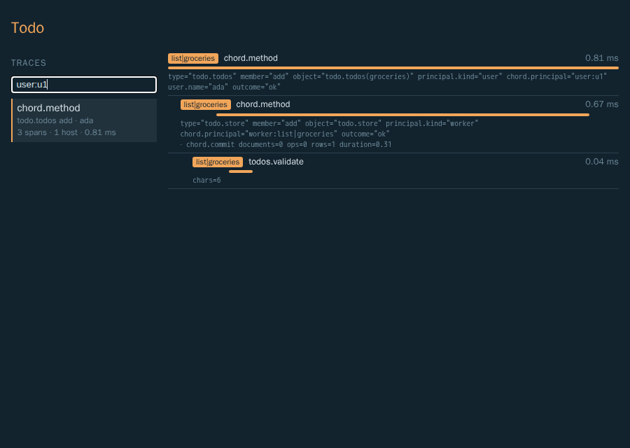

# Before we begin {.preface}

Mara keeps the household's shopping list on her laptop. She wants it in a browser tab and in a terminal, live in both.
Ada, her flatmate, should be able to add coffee from her phone without an account: pick a name and go. And Mara wants
to change the app while it runs: add a dark theme in the evening, fix a small annoyance in how todos are added, without
anyone being thrown out.

That is four kinds of program (a server, a process per list, a page, a terminal client) and three kinds of change (new
data, a new person, new code) in one small app. Wiring that by hand means a web server, a socket protocol, a way to
start and stop processes, sessions, a bundler for the page and a reload story for each. Chord does the wiring, and its
**app kit** (`@earendil-works/chord/app`) makes the decisions an app would otherwise make itself: where data lives,
how people sign in, how plugins are found and rolled out.

This tutorial builds that app. Each chapter adds one thing, shows the code, shows what happens when it runs, and
states the rule behind it. The app is one directory, `test/examples/61-tutorial/`; run every step at once from
`packages/chord`:

```sh
node --conditions=source --experimental-strip-types test/examples/61-tutorial/main.ts
```

With Node 26.5.1 or later the terminal client of chapter V runs too (its sandbox needs that Node); with an older one,
that step says so and the rest runs.

## Ten things to know

:::findings
1. **An app is its API, its plugins and a start script.** `startServer` makes the data directory, the store, the
   server host, HTTP with sign-in, the workers and the plugin roots; `startWorker` does a worker's half.
2. **A host is one participant.** The server, each list's worker, each browser tab and each terminal are hosts,
   connected by links. Tabs and terminals are clients: they connect and ask, nobody asks them.
3. **An object is reached by its contract.** A contract names an object type, its params and its members; a `remote`
   contract also says which host serves it. Any host asks for `Todos { list: "groceries" }`, and Chord routes the
   request to that list's worker.
4. **Who calls is stamped, never sent.** Every call carries a principal the link stamped from the sign-in. A factory
   picks a variant per principal; a todo records who added it from the principal, not from its arguments.
5. **A plugin has one file per host kind.** `server.ts`, `worker.ts`, `web.ts`, `tui.ts`: each declares what that kind
   of host serves and contributes. Plugins import only the app's API.
6. **Plugins meet in registries.** The page shows `Panels`, the terminal `Screens`, the kit's `Themes` restyle both;
   plugins contribute, one plugin (or the entry) composes.
7. **Changes apply when you say so.** Saving a file marks its plugin dirty; `applyChanges` builds and rolls out to the
   server, the workers, the pages and the terminals, in place.
8. **Text is rendered per viewer.** A plugin's messages are typed code, a translation is a plugin, each user picks a
   language, and servers store keys, never sentences.
9. **One click is one trace.** The server writes the telemetry store (here one SQLite file in the data directory); the
   page and the workers send it their spans; carriers in the calls' headers join the page's click, the server's relay
   and the worker's method into one trace, which `TelemetryStore` reads back. `ctx.trace` adds spans of your own.
10. **Six traps:** load before use; a reference acts as whoever made it; await what you start; a watch starts at the
   current value; the plain `t` has no language of its own; a trace starts where a span starts.
:::

## Words used throughout

A **host** is one participant of the app, with an **address** if others can reach it (the server, `List({ id })`) or
without one (a **client**: a page, a terminal). A **link** connects two hosts. A **principal** is who calls, typed by
the app and stamped by links. An **object** is state and methods at one identity; its **contract** (`local` for its own
host only, `remote` for any host) names its **params** (which instance) and members. A remote contract's **variants**
are the member sets different principals get. A **factory** declares an object's parts: **documents** and **tables**
(stored data, changed in **transactions**), **live queries** (a table's rows Chord keeps current), **derives**
(values computed from others), **natives** (things opened and closed, such as a file or a database cursor). A **reference** is what asking for an object returns. A **facet** is a
plugin's code for one host kind; a **registry** is an extension point plugins **contribute** to. A **message** is a
text with a key, a **catalog** a plugin's messages in one language, a **locale** a language tag (`de`, `pt-BR`). A **rollout** applies
new plugin code to the hosts in order. A **span** is one timed piece of work a host recorded, a **trace** the spans of
one request across hosts, joined by the **carriers** calls carry.

# One Server {#server lede="The API, the principals and a start script: the smallest app the kit runs, and who may come in."}

An app built with the kit has a fixed shape: its API in `src/api/v<n>/`, its built-in plugins in `plugins/`, a start
script and a worker entry (design §23, "The app kit"). Everything else is a plugin. This chapter writes the three
pieces of base code and starts the server.

## The principals

A **principal** says who is calling. The app defines the type; the kit needs a principal for the server, one for each of
its workers (an app without worker kinds leaves it out) and one for the owner, whom the owner's sign-in names. The todo
app gives the owner a variant of its own, `{ kind: "owner" }`; another app could make the owner one of its users:

<!-- quote: src/principals.ts -->
```ts
// The todo app's principals: its server and list workers, its owner, and the users who signed in with a name.

/** Who someone is in the todo app. */
export type TodoPrincipal =
	| { readonly kind: "server" }
	| { readonly kind: "worker"; readonly list: string }
	| { readonly kind: "owner" }
	| { readonly kind: "user"; readonly id: string; readonly name: string };
```

The user variant is for chapter VII. A principal travels with every call and is part of objects' identities, so it
stays small: a kind and an id. A user's profile, if the app had one, would be data in an object keyed by the id.

## The API

Plugins never import Chord. They import the app's **API**, a module the app names with a version in its path
(`@todo/app/v1`). It re-exports the part of Chord the app supports and adds what is the app's own:

<!-- quote: src/api/v1/index.ts -->
```ts
export { BACKGROUND_CONTEXT } from "../../../../../../src/context/index.ts";
export {
	arr,
	bool,
	type Ctx,
	defineMessages,
	defineState,
	defineTable,
	eq,
	forbidden,
	int,
	invalid,
	local,
	MessageSchema,
	type MessagesOf,
	method,
	nul,
	num,
	obj,
	PluginError,
	query,
	remote,
	type Static,
	str,
	type Theme,
	Themes,
	type Translation,
	Translations,
	union,
} from "../../../../../../src/index.ts";
export type { TodoPrincipal } from "../../principals.ts";
```

`defineMessages`, `Translations` and the message schema are chapter VIII's. `invalid` and `forbidden` make Chord's own errors: a plugin refusing arguments throws `invalid("args", message)`,
one refusing a caller `forbidden(message)`, and the caller gets the same `{ code, reason }` Chord's built-in checks
give (chapter IX). `PluginError` is for codes of the plugin's own.

and a `defineFacet` bound to the principal type, so every factory sees a `TodoPrincipal`:

<!-- quote: src/api/v1/index.ts -->
```ts
/** Defines a facet of the todo app: its factories get the app's principals. */
export function defineFacet(setup: (host: FacetHost<TodoPrincipal>, self: FacetSelf) => void) {
	return chordFacet<TodoPrincipal>(setup);
}
```

The API is a **host package**: a plugin's build leaves it out, and each process hands the plugin its own instance when
it evaluates it. The plugin sees the very `Themes` registry and `List` host kind the process has, not a copy. A
version in the path lets the app ship `v2` beside `v1` later; one facet uses one version (design §21, "The plugin
model").

The API is also a real package: a **workspace package** of the app's repository, named in its `package.json` with an
`exports` entry per module:

<!-- quote: package.json -->
```json
{
	"name": "@todo/app",
	"version": "0.0.1",
	"private": true,
	"description": "The tutorial's todo app: its API (v1 and its per-kind modules), base code and built-in plugins",
	"type": "module",
	"exports": {
		"./v1": "./src/api/v1/index.ts",
		"./v1/server": "./src/api/v1/server.ts",
		"./v1/web": "./src/api/v1/web.ts",
		"./v1/tui": "./src/api/v1/tui.ts"
	}
}
```

The repository's root `package.json` lists it in `workspaces` (here Chord's repository lists
`packages/chord/test/examples/61-tutorial`), so `npm install` links `node_modules/@todo/app` to it. Then Node,
TypeScript, the tests and esbuild resolve `@todo/app/v1` alike, from base code, from a plugin's files and from a test
importing a plugin's `contract.ts`; plugin builds still leave it out and pass the process's instance.

## The start script

`startServer` takes what the app decides and does the rest. `start.ts` names the API with this process's modules, the
facet kinds (which files a plugin may have), and the principals:

<!-- quote: start.ts -->
```ts
export const API = {
	name: "@todo/app",
	versions: ["v1"],
	modules: { "@todo/app/v1": v1, "@todo/app/v1/server": v1server },
};

/** The app's facet kinds: a plugin has one file per kind it runs on (`server.ts`, `worker.ts`, `web.ts`, `tui.ts`). */
export const KINDS = {
	server: { platform: "node" },
	worker: { platform: "node" },
	web: { platform: "browser", packages: { react: {}, "react/jsx-runtime": {} } },
	tui: { platform: "node" },
} as const;
```

<!-- quote: start.ts -->
```ts
export function startTodo(
	dataDir: string,
	root: string,
	telemetry: TodoTelemetry,
	context: Context,
): Promise<App<TodoPrincipal>> {
	return startServer<TodoPrincipal>(
		{
			name: "todo",
			dataDir,
			root,
			listen: { host: "127.0.0.1", port: 0 },
			api: API,
			kinds: KINDS,
			principal: {
				server: { kind: "server" },
				worker: (address) => ({ kind: "worker", list: address.key }),
				owner: { kind: "owner" },
			},
			// The store the server writes: its own spans and metrics, and what the workers and recording pages send.
			telemetry: telemetry.store,
			// Who a span was for: a short key and a user's name (each worker's `startWorker` gets the same hook).
			principalAttributes,
			workers: [
				{
					kind: v1.List,
					entry: fileURLToPath(new URL("./worker.ts", import.meta.url)),
					execArgv: ["--conditions=source", "--experimental-strip-types", "--no-warnings"],
					start: () => ({}),
					// Who may reach a list's worker: everyone signed in, and the server itself.
					authorize: (principal) => principal.kind !== "worker",
				},
			],
			// The page, and the owner's trace viewer: the same page, which shows the viewer at `/traces`.
			web: { entry: fileURLToPath(new URL("./src/web/main.ts", import.meta.url)), page, paths: ["/", "/traces"] },
			tui: { entry: fileURLToPath(new URL("./src/tui/main.ts", import.meta.url)) },
			onError: (error) => console.error("todo:", error.kind, error.error),
		},
		context,
	);
}
```

`workers` is chapter II, `web` chapter IV (its second path, `/traces`, chapter XI), `tui` chapter V, `telemetry` and
`principalAttributes` chapter XI. `listen` asks for a free port on loopback, as the example does; a real app picks a
port. The worker entry is a few lines (its `principalAttributes` is chapter XI's too):

<!-- quote: worker.ts -->
```ts
// The todo app's worker entry: one process per list. `startWorker` opens the list's store in its directory, connects
// to the server and loads the plugins' worker facets. The worker records its spans in memory and sends them to the
// server, which stores them: its methods called through the server continue the caller's trace.

import { startWorker } from "../../../src/node/app/index.ts";
import { principalAttributes } from "./src/principals.ts";
import { API, KINDS } from "./start.ts";

startWorker({ api: API, kinds: KINDS, principalAttributes, onError: (error) => console.error("list:", error) });
```

## Running it

Step 1 of `main.ts` starts the app, tries the page without signing in, then does what a browser does with the owner
link:

<!-- quote: main.ts -->
```ts
const telemetry = await openTelemetry(telemetryFile(dataDir));
const app = await startTodo(dataDir, root, telemetry, context);
const link = new URL(app.ownerLink());
const url = link.origin;
console.log("1. owner link:", `http://127.0.0.1:<port>${link.pathname}#<token>`);
console.log("   data directory:", (await readdir(dataDir)).sort().join(", "));
console.log("   GET / signed out:", (await fetch(url)).status);
const signIn = await fetch(`${url}/_chord/owner`, {
	method: "POST",
	headers: { "content-type": "application/json" },
	body: JSON.stringify({ token: link.hash.slice(1) }),
});
const cookie = signIn.headers.get("set-cookie")!.split(";")[0]!;
console.log("   the owner signs in:", signIn.status, cookie.replace(/=.*/, "=…"));
console.log("   GET / signed in:", (await fetch(url, { headers: { cookie } })).status);
```

<!-- output: main -->
```text
1. owner link: http://127.0.0.1:<port>/_chord/owner#<token>
   data directory: logs, owner-token, plugins, server, telemetry.sqlite, telemetry.sqlite-shm, telemetry.sqlite-wal, workers
   GET / signed out: 401
   the owner signs in: 200 chord-session=…
   GET / signed in: 200
```

`startServer` made the data directory: `server/` (its store, the cookie secret, its files), `workers/` (one directory
per worker), `plugins/` (the user's plugin root, beside the app's built-in one), `logs/` and `owner-token`;
`telemetry.sqlite` (with SQLite's `-shm` and `-wal` files) is the app's own, opened before the server starts
(chapter XI). The page
answered 401: HTTP **denies by default**, before any plugin code runs, unless a route says `public: true`.

The **owner link** (`/_chord/owner#<token>`) is how the owner gets in: a single-use token, valid ten minutes, made at
each start. It sits in the URL's fragment, which browsers never send, so it never reaches a log; the link's page posts
it and receives a session cookie. A command-line client on the same machine reads `owner-token` instead (mode 0600,
chapter III). Nothing is the owner because it comes from loopback: any local process could.

# A List on Its Own Worker {#worker lede="A host kind, a remote contract, a worker facet with a table and a live query, and the principal that adds a todo."}

Each list gets its own process, a **worker**, with its own store: a list that misbehaves cannot take the others down,
and an idle list costs nothing. This chapter declares where lists live, what a list offers, and the worker code that
keeps its todos.

## Where a list lives

A **host kind** declares addressable hosts with params; `List({ id: "groceries" })` is an **address**. The app's
host kinds are base code, in the API:

<!-- quote: src/api/v1/index.ts -->
```ts
/** A todo list: a worker process of its own, with its own store. */
export const List = hostKind("list", { id: str() });
```

A `remote` contract says, with `hostAddress`, at which address its objects live. The contract for a list's todos is
the lists plugin's, in its `contract.ts`, which its facets of every kind import, and so do the steps and its test:

<!-- quote: plugins/lists/contract.ts -->
```ts
import {
	arr,
	bool,
	int,
	List,
	MessageSchema,
	method,
	nul,
	num,
	obj,
	remote,
	type Static,
	str,
	union,
} from "@todo/app/v1";

/** A todo: its number in the list, its text, whether it is done, who added it and when. */
export const Item = obj({ id: int(), text: str(), done: bool(), by: str(), at: num() });

/** A todo (see `Item`). */
export type Item = Static<typeof Item>;

/** The list's latest notice, as data each viewer renders in its own language; `null` before the first. */
export const Notice = union([MessageSchema, nul()]);

/**
 * A list's todos as one principal sees them: the newest 50 (live) and the list's notice, adding one and ticking one off
 * (or on again); the owner also clears the done ones.
 */
export const Todos = remote("todo.todos", {
	version: 1,
	params: { list: str() },
	hostAddress: ({ list }) => List({ id: list }),
	variants: {
		member: {
			state: { items: arr(Item), notice: Notice },
			methods: { add: method(str()), tick: method(obj({ id: int(), done: bool() })) },
		},
		owner: {
			state: { items: arr(Item), notice: Notice },
			methods: { add: method(str()), tick: method(obj({ id: int(), done: bool() })), clear: method() },
		},
	},
});
```

Its `notice` is a message as data, which chapter VIII renders in each viewer's language. `params` select the
instance: `Todos { list: "groceries" }` is one object per principal. Nobody who asks names a
host: the caller computes the address from the params and sends the request there; a host that cannot serve it passes
it on to its parent or to a route (design §3, "Host kinds and addresses"). The kit's `workers` option is that route:

<!-- quote: start.ts -->
```ts
			workers: [
				{
					kind: v1.List,
					entry: fileURLToPath(new URL("./worker.ts", import.meta.url)),
					execArgv: ["--conditions=source", "--experimental-strip-types", "--no-warnings"],
					start: () => ({}),
					// Who may reach a list's worker: everyone signed in, and the server itself.
					authorize: (principal) => principal.kind !== "worker",
				},
			],
```

`authorize` runs for every request routed to a
list before anything starts; the first request for an address starts
its worker, and a worker idle for five minutes (the default `idleMs`) stops. **Variants** are the member sets a
contract offers: the owner's `Todos` has `clear`, a member's does not. The factory picks one per principal.

## The worker facet

The lists plugin is a directory with a `package.json` (its name is the plugin's name) and one file per host kind it
runs on. `worker.ts` is its **worker facet**: what every list's worker serves. It keeps the todos in a **table** of the
worker's store:

<!-- quote: plugins/lists/worker.ts -->
```ts
/** Every todo of the list, by its number. */
const Items = defineTable("todo.items", {
	version: 1,
	columns: { id: int(), text: str(), done: bool(), by: str(), at: num() },
	key: ["id"],
});

/** The newest todos first. */
const NEWEST = query(Items).orderBy((item) => item.id, "desc");

/** How many todos the live query holds. */
const WINDOW = 50;
```

A table holds many records with queries and pages; it lives in an object, never in a facet. Persisted data lives only
in `local` objects with empty params (one per host and type), so its address never depends on who asked (design §9,
"Lifetime, persistence"). That object is the plugin's store, `Store`, a local contract of its own file:

<!-- quote: plugins/lists/worker.ts -->
```ts
/** The list's todos, once per worker: empty params, so it lives as long as the worker and may keep data in its store. */
const Store = local("todo.store", {
	version: 1,
	params: {},
	members: {
		items: arr(Item),
		notice: Notice,
		add: method(obj({ text: str(), by: str() })),
		tick: method(obj({ id: int(), done: bool() })),
		clear: method(obj({ by: str() })),
	},
});
```

A `local` object with empty params lives as long as its host: it starts with the worker and is never ended by a count
of references. Its factory declares its parts and returns its members:

<!-- quote: plugins/lists/worker.ts -->
```ts
	host.serve(Store, (_params, self) => {
		const items = self.table(Items);
		// The newest todos, live: read before the store goes live, read again after every commit writing the table.
		const newest = self.query(items, NEWEST, WINDOW);
		const notices = self.state(Notices);
		return {
			// Oldest first, as the list shows them.
			items: self.derive([newest], ([rows]) => [...rows].reverse()),
			notice: self.derive([notices], ([value]) => value.notice),
```

A **factory** is synchronous and only declares; Chord activates the object afterwards. `self.table` declares the
table. `self.query(items, NEWEST, WINDOW)` declares a **live query** over it: the rows of `NEWEST`, at most 50, as a
value the object can expose or derive from. Chord runs it before the store goes live, and again after every commit
of the store that writes `items`, and sends watchers only what changed. The store's derive turns the rows around,
oldest first, for the list.

A live query reads only its own object's tables: only the store writes them, so its own commits are exactly the
moments the rows can change, and a commit that writes no table with a query costs nothing. The limit is required:
each such commit runs the query once more, at most `WINDOW` rows. That is cheap for a list a person edits and wrong
for a table written hundreds of times a second (design §11, "there may be dragons").

Writes go through **transactions**: `self.tx(fn, ctx)` runs `fn` with `tx`, and what it stages is committed at once
when `fn` returns, or not at all if it throws. The live query follows in the same commit; the store keeps nothing
else in memory, not even the next todo's number, which it reads in the transaction:

<!-- quote: plugins/lists/worker.ts -->
```ts
			add: async ({ text, by }, ctx) => {
				// A span of its own under the method's: a trace shows the check, and why it refused.
				await ctx.trace("todos.validate", { chars: text.length }, async () => {
					// Refused as Chord refuses arguments that fail their schema: the caller gets `invalid/args`.
					if (text === "") throw invalid("args", "a todo needs text");
				});
				await self.tx(async (tx) => {
					// The number after the newest todo's: the store's transactions run one after another.
					const { items: last } = await tx.page(items, NEWEST, 1);
					tx.put(items, { id: (last[0]?.id ?? 0) + 1, text, done: false, by, at: Date.now() });
				}, ctx);
				return null;
```

A todo without text is refused with `invalid("args", …)`, from the API: the error crosses every link as it is, so a
caller on a page or in a terminal gets `{ code: "invalid", reason: "args" }`, as for arguments that fail the
contract's schema. The check runs in a span of its own (`ctx.trace`), which chapter XI shows in a trace.

## The view per principal

`Todos` is the remote face of the store, one object per principal. Its factory gets the principal the link stamped:

<!-- quote: plugins/lists/worker.ts -->
```ts
	host.serve(Todos, (_params, principal, self) => {
		const store = self.get(Store, {});
		// Who adds a todo comes from the principal the link stamped, never from the arguments.
		const by = principal.kind === "user" ? principal.name : principal.kind;
		const members = {
			items: self.derive([store.items], ([items]) => items),
			notice: self.derive([store.notice], ([notice]) => notice),
			add: (text: string, ctx: Ctx) => store.add({ text, by }, ctx),
			tick: (tick: { id: number; done: boolean }, ctx: Ctx) => store.tick(tick, ctx),
		};
		if (principal.kind !== "owner") return { variant: "member", members };
		return { variant: "owner", members: { ...members, clear: (ctx: Ctx) => store.clear({ by }, ctx) } };
	});
```

`self.get(Store, {})` declares a dependency: the view goes live once the store is, and holds a **reference** to it
for its whole life. `by` comes from the principal. A client could put anything in the arguments of `add`; it cannot
change what its link stamped. That is the rule for every plugin: identity from the principal, never from arguments.

## Running it

Step 2 asks for the groceries list twice, from a root acting as the owner and from a root of the server itself:

<!-- quote: main.ts -->
```ts
const OWNER = { kind: "owner" } as const;
await app.host.root(
	async (ctx) => {
		const todos = await ctx.get(Todos, { list: "groceries" });
		await todos.add("milk", ctx);
		await todos.add("eggs", ctx);
		await todos.tick({ id: 1, done: true }, ctx);
		await until(() => todos.items.value[0]?.done === true);
		console.log("2. as the owner:", todos.variant, "|", show(todos.items.value));
	},
	context,
	{ principal: OWNER },
);
await app.host.root(async (ctx) => {
	const todos = await ctx.get(Todos, { list: "groceries" });
	await todos.add("bread", ctx);
	await until(() => todos.items.value.length === 3);
	console.log("   as the server:", todos.variant, "|", show(todos.items.value.slice(-1)));
}, context);
```

<!-- output: main -->
```text
2. as the owner: owner | [x] milk (owner), [ ] eggs (owner)
   as the server: member | [ ] bread (server)
   workers: list|groceries
   workers/list/list%7Cgroceries: store.sqlite, store.sqlite-shm, store.sqlite-wal
```

A **root** (`host.root(fn, ctx, { principal })`) is a call scope for code outside objects; its `ctx` carries the
principal and cancellation, and the references `ctx.get` takes end when `fn` settles. The first request started the
list's worker, `list|groceries`, with its own store in `workers/list/list%7Cgroceries/`.

## Trap: who a reference acts as

The two roots made the same call and got different todos: `milk (owner)` and `bread (server)`. **A reference acts as
whoever made it.** `ctx.get` in a root or a method acts as that context's principal; `host.get`, and `self.get` in a
`local` object, act as the host; `self.get` in a remote object acts as that object's principal (design §4). So a route
whose request came from the owner reaches the worker as the owner (chapter III), and a guest's call cannot borrow the
server's authority. The surprise is the reverse case: a server method that wants to act as the server towards a worker
must not use its caller's `ctx.get`; it takes the reference with `self.get` in a local server object, or in a root of
the server's own.

## Trap: await what you start

Every write above is awaited, and that is not style. What is started with a context ends with it: a root's scope seals
when `fn` settles, a method's context ends with its call. A `void todos.add(text, ctx)` inside a root that returns at
once is cancelled before it commits; Chord rejects it and reports `transaction_cancelled` through `onError`, so an
empty `catch` cannot hide a write that never happened (design §8). Fire and forget only with a context that does not
end, as the page does with `BACKGROUND_CONTEXT` in chapter IV.

# Routes {#routes lede="A server facet: a JSON API for command-line clients, running as whoever sent the request."}

The page will talk Chord over a WebSocket. A script on Mara's machine is happier with HTTP. A **server facet**
contributes routes to the kit's `Http` registry, which the API's server module re-exports:

<!-- quote: src/api/v1/server.ts -->
```ts
export { Http } from "../../../../../../src/node/http/index.ts";
```

<!-- quote: plugins/lists/server.ts -->
```ts
// The lists plugin on the server: a JSON API for command-line clients. A route runs as whoever sent the request (the
// kit answered 401 before this code runs when nobody signed in), so its `ctx.get` reaches the list's worker as them.

import { defineFacet } from "@todo/app/v1";
import { Http } from "@todo/app/v1/server";
import { Todos } from "./contract.ts";

export default defineFacet((_host, self) => {
	self.contribute(Http, {
		routes: {
			"GET /api/lists/:list": async (request, ctx) => {
				const todos = await ctx.get(Todos, { list: request.params.list! });
				return { kind: "json", value: todos.items.value };
			},
			"POST /api/lists/:list": async (request, ctx) => {
				const todos = await ctx.get(Todos, { list: request.params.list! });
				await todos.add(String(await request.json()), ctx);
				return { kind: "json", value: "added" };
			},
		},
	});
});
```

A **registry** is an extension point: one owner declares how contributions combine (here the kit's HTTP component
builds a router), plugins contribute one value each. `self.contribute` in a facet adds the plugin's routes while the
plugin is loaded. A route runs in a root with the request's principal, so `ctx.get(Todos, …)` reaches the list's
worker as whoever signed in, and gets their variant.

Step 3 is a command-line client with the owner token file:

<!-- quote: main.ts -->
```ts
const token = (await readFile(app.ownerTokenFile, "utf8")).trim();
const cli = { authorization: `Bearer ${token}` };
const posted = await fetch(`${url}/api/lists/groceries`, {
	method: "POST",
	headers: { ...cli, "content-type": "application/json" },
	body: JSON.stringify("butter"),
});
console.log("3. POST /api/lists/groceries:", await posted.json());
const listed = (await (await fetch(`${url}/api/lists/groceries`, { headers: cli })).json()) as Item[];
console.log("   GET /api/lists/groceries:", show(listed));
console.log("   GET without a token:", (await fetch(`${url}/api/lists/groceries`)).status);
```

<!-- output: main -->
```text
3. POST /api/lists/groceries: added
   GET /api/lists/groceries: [x] milk (owner), [ ] eggs (owner), [ ] bread (server), [ ] butter (owner)
   GET without a token: 401
```

`butter` is the owner's: the route acted as the request's principal. Without a token the kit answered 401 before the
route ran. Another machine has no token file; it **pairs** instead: it asks `POST /_chord/pair` for a code, the owner
approves the code in a signed-in browser, and the client's next poll returns its token (example 54).

# A Page {#page lede="A web entry, a web facet with React, the panels registry, and why a watch starts at the current value."}

A page is a client host in the browser. The kit builds its **base bundle** from the app's web entry at start (Chord,
React, the app's web modules), serves the plugins' web facets as small scripts beside it, and serves the page through
the app's template (design §23, "Web and TUI").

## The page's registry

Plugins put panels on the page through a registry the API's web module declares, with Chord's React hooks re-exported
for them:

<!-- quote: src/api/v1/web.ts -->
```ts
import type { ComponentType } from "react";
import { defineRegistry } from "../../../../../../src/index.ts";

export { useHold, useHost, useMessages, usePageState, useWatch } from "../../../../../../src/react/index.ts";

/** A panel of the page: its name (a key, never shown) and its React component, which shows its own title. */
export type Panel = { readonly name: string; readonly Component: ComponentType };

/** The page's panels, one per contributing plugin, in plugin-name order. */
export const Panels = defineRegistry<Panel, readonly Panel[]>("todo.panels", { version: 1 });
```

A panel shows its own title, in the page's language; its `name` is only a key. The web entry serves `Panels` (its
`compose` keeps the contributions in plugin-name order), renders every panel, and starts the page's connection:

<!-- quote: src/web/main.ts -->
```ts
/** The page's own facet: it serves `Panels`, composing the contributions in plugin-name order. */
const core = defineFacet((host) => host.serve(v1web.Panels, { compose: (table) => table.map(({ value }) => value) }));

function Page() {
	const panels = useRegistry(v1web.Panels) ?? [];
	// The page's one other path (`start.ts` serves the page at `/` and `/traces`).
	if (location.pathname === "/traces") return h("main", { className: "wide" }, h("h1", null, "Todo"), h(TraceViewer));
	return h(
		"main",
		null,
		h("h1", null, "Todo"),
		...panels.map(({ name, Component }) => h("section", { key: name }, h(Component))),
	);
}

void startPage({
	connect: () => new WebSocket(`${location.origin.replace(/^http/, "ws")}/chord`),
	modules: { "@todo/app/v1": v1, "@todo/app/v1/web": v1web, react: React, "react/jsx-runtime": jsx },
	core: [{ name: "@todo/web", facet: core }],
	// The page records its clicks and the calls under them, and sends them to the server every few seconds.
	telemetry: true,
	render: (host) => createRoot(document.getElementById("root")!).render(h(HostProvider, { host }, h(Page))),
});
```

The path `/traces` is the owner's trace viewer, and `telemetry` what it shows (chapter XI). `startPage` makes the page's host, connects it to `/chord`
(reconnecting after drops), loads the current plugin scripts with the entry's core facets, and keeps them current.
`HostProvider` gives the React tree that host.

## The web facet

`plugins/lists/web.ts` contributes a panel. Its component holds the list's `Todos` while it is mounted and re-renders
when its items change:

<!-- quote: plugins/lists/web.ts -->
```ts
function TodoList() {
	const { t } = useMessages(messages);
	const host = useHost();
	const list = location.hash.slice(1) || "groceries";
	const todos = useHold(Todos, { list });
	const items = useWatch(todos?.items) ?? [];
	const notice = useWatch(todos?.notice);
	// Kept by the page, not the component: the new code's component finds the half-typed todo.
	const [text, setText] = usePageState(`lists.draft.${list}`, "");
	const add = (event: { preventDefault(): void }) => {
		event.preventDefault();
		// An empty todo too: the list's store refuses it, and the click's trace shows where.
		if (todos === undefined) return;
		// The click is a trace of its own: a root span of the page, the call to the list's worker under it.
		const trace = { name: "page.add", attributes: { chars: text.length } };
		void host.root((ctx) => todos.add(text, ctx), context, { trace }).catch(() => {});
		setText("");
	};
	return h(
		"div",
		{ className: "lists-panel" },
		h("h2", null, t("title")),
		h(
			"ul",
			null,
			...items.map((item) =>
				h(
					"li",
					{
						key: item.id,
						className: item.done ? "lists-done" : undefined,
						onClick: () => void todos?.tick({ id: item.id, done: !item.done }, context),
					},
					item.text,
					h("span", { className: "lists-by" }, item.by),
				),
			),
		),
		h(
			"form",
			{ onSubmit: add },
			h("input", {
				value: text,
				placeholder: t("placeholder"),
				onChange: (event: { target: { value: string } }) => setText(event.target.value),
			}),
		),
		todos?.variant === "owner"
			? h("button", { type: "button", onClick: () => void todos.clear(context) }, t("clearDone"))
			: null,
		notice === undefined || notice === null ? null : h("p", { className: "lists-notice" }, t.render(notice)),
	);
}

export default defineFacet((_host, self) => {
	self.contribute(Translations, messages.translations);
	self.contribute(Panels, { name: "groceries", Component: TodoList });
});
```

`useMessages(messages)` gives the plugin's texts in the page's language (chapter VIII; `messages` is the plugin's
`messages.ts`, and the facet contributes its catalogs to the page's `Translations`). `useHold` holds a reference while
the component is mounted and releases it on unmount; it is `undefined` on the first render. `useWatch` follows a member. `usePageState` is `useState` whose value the page keeps under a key instead of the
component: chapter IX shows why the half-typed todo needs it. Clicks call methods with `BACKGROUND_CONTEXT`, which never ends, so a click's call
is not cancelled when the handler returns; adding a todo runs in `host.root` (`useHost` gives the page's host), which
makes the click a trace of its own (chapter XI). `todos?.variant === "owner"` narrows the reference: only the owner's has
`clear`, and TypeScript knows it. The panel's look reads the active theme's CSS variables, with class names prefixed
by the plugin's name (a `*.module.css` file would scope them instead):

<!-- quote: plugins/lists/lists.css -->
```css
.lists-panel input { width: 100%; box-sizing: border-box; padding: 0.4rem; background: var(--bg); color: var(--fg);
	border: 1px solid var(--accent); border-radius: var(--radius, 0); }
```

The template in `start.ts` puts the assets the kit made into the app's own HTML:

<!-- quote: start.ts -->
```ts
function page(request: { readonly nonce: string }, assets: PageAssets): string {
	return `<!doctype html><html lang="en"><head><meta charset="utf-8"><title>Todo</title>${pageScripts(assets, request.nonce)}</head><body><div id="root"></div></body></html>`;
}
```

## Running it

Step 4 reads the page as a browser gets it and watches the list from the server:

<!-- quote: main.ts -->
```ts
const html = await (await fetch(url, { headers: cli })).text();
console.log("4. the page loads:");
for (const [, asset] of html.matchAll(/(?:src|href)="([^"]+)"/g)) console.log(`   ${hashless(asset!)}`);
const groceries = await app.host.get(Todos, { list: "groceries" }, context);
const watch = await groceries.items.watch(context);
console.log("   watch.value:", done(watch.value), "done");
const changed = Promise.withResolvers<readonly Item[]>();
watch.start(async (call) => {
	if (call.kind === "value") changed.resolve(call.value);
});
await groceries.tick({ id: 2, done: true }, context);
console.log("   the listener's first call:", done(await changed.promise), "done");
await watch.stop();
```

<!-- output: main -->
```text
4. the page loads:
   /_chord/web/base.<hash>.css
   /_chord/web/plugin/@todo~lists.<hash>.<hash>.css
   /_chord/web/plugins.<hash>.js
   /_chord/web/base.<hash>.js
   watch.value: 1 done
   the listener's first call: 2 done
```

The page is the template, the base bundle (`base.<hash>.js` and `.css`), one combined file with every plugin's web
script and one stylesheet per plugin with CSS: two scripts on a cold load, cacheable forever by their hashes. After the
owner opened the owner link in Chromium, the page shows the list:

:::figure | The page after the owner signed in: the groceries list, live, each todo with who added it; the owner's variant shows "Clear done".

:::

## Trap: a watch starts at the current value

`watch.value` was the value when the watch was taken (one todo done); the listener's first call was the change after
it (two done). **A watch's listener gets only changes.** Code that renders from a listener alone draws nothing until
the first change. Read `handle.value` first, then `start` (design §11, "Watchables"). `useWatch` and the terminal's
`TuiScope.watch` do this for you; `self.on`, an object's routine, is the one consumer whose first call is the current
value.

# A Terminal {#terminal lede="The same plugin in a terminal: a terminal facet with TuiScope, run in the launcher's sandbox."}

The terminal client is a client host too, run by a **launcher**: a trusted Node program that signs in, downloads the
terminal's base bundle and the plugins' terminal scripts, and runs them in a **sandbox**, a child process with no file
system, network, processes or terminal of its own. The launcher relays its link and draws its frames. Code from the
server never touches Mara's machine directly (decision "The terminal's sandbox is a child process").

The API's terminal module declares the parts of the screen:

<!-- quote: src/api/v1/tui.ts -->
```ts
export type Screen = {
	readonly name: string;
	readonly open: (scope: TuiScope, theme: TerminalTheme) => () => readonly string[];
};

/** The terminal's parts, in plugin-name order. */
export const Screens = defineRegistry<Screen, readonly Screen[]>("todo.screens", { version: 1 });
```

The terminal entry serves `Screens` and redraws on every change. A **`TuiScope`** holds references, follows values and
registries, calls one callback on every change, and releases everything when disposed; it is the terminal's
counterpart of the React hooks, for any terminal library:

<!-- quote: src/tui/main.ts -->
```ts
/** The terminal's own facet: it serves `Screens`, composing the contributions in plugin-name order. */
const core = defineFacet((host) => host.serve(v1tui.Screens, { compose: (table) => table.map(({ value }) => value) }));

void startTerminalRuntime({
	modules: { "@todo/app/v1": v1, "@todo/app/v1/tui": v1tui },
	core: [{ name: "@todo/tui", facet: core }],
	render: (runtime) => {
		const { terminal, theme } = runtime;
		const screens = new TuiScope(runtime.host, () => draw()).registry(v1tui.Screens);
		let opened: { screens: readonly v1tui.Screen[]; scope: TuiScope; lines: (() => readonly string[])[] } | undefined;
		const draw = (): void => {
			const current = screens() ?? [];
			if (opened?.screens !== current) {
				opened?.scope.dispose();
				const scope = new TuiScope(runtime.host, () => draw());
				opened = { screens: current, scope, lines: current.map((screen) => screen.open(scope, theme)) };
			}
			const lines = opened.lines.flatMap((read) => read());
			terminal.write(`\x1b[2J\x1b[H${lines.join("\r\n")}\r\n`);
		};
		theme.onChange(draw);
		terminal.onInput((data) => {
			if (data === "q") runtime.exit(0);
		});
		draw();
	},
});
```

When a reload changes `Screens`, the entry disposes the old scope and opens the screens again. The lists plugin's
terminal facet draws its title, the todos and the list's notice; `scope.messages(messages)` is the terminal's
`useMessages` (chapter VIII):

<!-- quote: plugins/lists/tui.ts -->
```ts
export default defineFacet((_host, self) => {
	self.contribute(Translations, messages.translations);
	self.contribute(Screens, {
		name: "groceries",
		open: (scope, theme) => {
			const t = scope.messages(messages);
			const todos = scope.hold(Todos, { list: "groceries" });
			const items = scope.watch(todos.items);
			const notice = scope.watch(todos.notice);
			return () => {
				const shown = notice();
				return [
					theme.fg("accent", t("title")),
					...(items() ?? []).map((item) =>
						item.done ? theme.fg("muted", `[x] ${item.text}`) : `[ ] ${item.text} ${theme.fg("muted", item.by)}`,
					),
					...(shown === undefined || shown === null ? [] : [theme.fg("warning", t.render(shown))]),
				];
			};
		},
	});
});
```

`theme.fg("muted", …)` colours by role, never by a fixed colour. Step 5 runs the launcher on a scripted terminal, its
languages fixed (by default they are the machine's system locale):

<!-- quote: main.ts -->
```ts
if (sandboxAvailable()) {
	const output = Object.assign(new PassThrough(), { columns: 60, rows: 12 });
	output.on("data", (chunk: Buffer) => frames.push(chunk.toString()));
	terminal = await startTerminal({
		url,
		credentials: { kind: "file", path: app.ownerTokenFile },
		input: new PassThrough(),
		output,
		colors: "truecolor",
		// The machine's languages (its system locale by default), here fixed for the book's output.
		locales: ["en-US"],
	});
	await until(() => screen(frames).includes("butter"));
	console.log("5. the terminal shows:");
	for (const line of screen(frames).trim().split("\r\n")) console.log(`   ${line}`);
} else console.log("5. (the terminal client needs Node 26.5.1 or later for its sandbox)");
```

<!-- output: tui -->
```text
5. the terminal shows:
   Groceries
   [x] milk
   [x] eggs
   [ ] bread server
   [ ] butter owner
```

# A Theme {#theme lede="A theme is data in a registry; a plugin added while the app runs restyles the page and the terminal in place."}

Mara wants the evening look. A theme is data: colours by role, a few web extras, terminal overrides. The kit's `Themes`
registry collects them; each user picks one dark and one light theme, the system preference chooses (decision "Looks
and themes"). The Harbor theme is a plugin with its data in one file:

<!-- quote: later/harbor/theme.ts -->
```ts
export const harbor: Theme = {
	id: "harbor",
	name: "Harbor",
	mode: "dark",
	colors: {
		accent: "#f2a65a",
		bg: "#12232e",
		fg: "#d8e2e8",
		muted: "#6b8796",
		error: "#e5676b",
		warning: "#e9c46a",
		success: "#7fb685",
	},
	web: { radius: "6px" },
	tui: { muted: "66" },
};
```

and two facets contributing it, one for pages and one for terminals (registries are per host, so each kind gets its
own contribution):

<!-- quote: later/harbor/web.ts -->
```ts
import { defineFacet, Themes } from "@todo/app/v1";
import { harbor } from "./theme.ts";

export default defineFacet((_host, self) => self.contribute(Themes, harbor));
```

The plugin is not in the app's root at start. Step 6 copies it in while everything runs and applies the change:

<!-- quote: main.ts -->
```ts
await cp(fileURLToPath(new URL("./later/harbor/", import.meta.url)), join(root, "harbor"), { recursive: true });
await until(() => app.plugins.state.value.set);
const added = await app.applyChanges(context);
console.log("6. harbor added, rolled out to:", added.steps.map(({ name }) => name).join(", "));
const scripts = await app.host.get(WebScripts, {}, context);
console.log("   the page's plugins:", scripts.set.value.plugins.map(({ name }) => name).join(", "));
scripts.release();
```

<!-- output: main -->
```text
6. harbor added, rolled out to: server, list, web, tui
   the page's plugins: @todo/french, @todo/harbor, @todo/lists
```

<!-- output: tui -->
```text
   the terminal redraws its title in Harbor's accent: "\u001b[38;2;242;166;90mGroceries"
```

A directory appearing in a plugin root marks the plugin set changed (`app.plugins.state.value.set`); nothing happens
until `applyChanges`, which builds the new plugin and rolls it out: the server, the list workers, then the page and
terminal surfaces. The page's host learned of the new script set through Chord, fetched Harbor's web script and loaded
it in place; the terminal did the same with its terminal script and redrew in Harbor's accent. With the browser
preferring dark:

:::figure | The same page after the Harbor plugin was added and applied: no reload, the CSS variables on `:root` changed.

:::

# A Second User {#user lede="A one-line login plugin, a client host of Ada's, and why a host must load before it asks."}

Ada joins with a name. The kit ships an ephemeral login as a facet (`POST /_chord/login { name }` signs in as `{ kind:
"user", id, name }`, no account stored); the API's server module exports it for the app's principal type:

<!-- quote: src/api/v1/server.ts -->
```ts
/** The kit's ephemeral login: `POST /_chord/login { name }` signs in as `{ kind: "user", id, name }`. */
export const login = ephemeralLoginFacet<TodoPrincipal>();
```

and the app adds it as a **single-file plugin**, a file named `<name>.<kind>.ts` at the root's top:

<!-- quote: plugins/login.server.ts -->
```ts
// The kit's pick-a-name login, added to the app as a single-file plugin: a server facet, one line.

import { login } from "@todo/app/v1/server";

export default login;
```

Step 7 does what Ada's page does: logs in, then connects a client host of her own over the links endpoint with her
cookie:

<!-- quote: main.ts -->
```ts
const login = await fetch(`${url}/_chord/login`, {
	method: "POST",
	headers: { "content-type": "application/json" },
	body: JSON.stringify({ name: "ada" }),
});
const adaCookie = login.headers.get("set-cookie")!.split(";")[0]!;
const ada = createHost<TodoPrincipal>({ onError: (error) => console.error("ada:", error.kind) });
try {
	ada.hold(Todos, { list: "groceries" }, context);
} catch (error) {
	console.log("7. ada's hold before load:", (error as Error).message);
}
await ada.load([], context);
const socket = new WebSocket(`${url.replace(/^http/, "ws")}/chord`, { headers: { cookie: adaCookie } });
ada.connect(webSocketLink(socket as unknown as WebSocketLike), { principal: { kind: "server" } }, context);
const adas = await ada.get(Todos, { list: "groceries" }, context);
await adas.add("coffee", context);
console.log("   ada's variant:", adas.variant);
if (adas.variant === "member") {
	// @ts-expect-error `clear` is the owner's: TypeScript refuses it, and so does the worker.
	const clearing: Promise<null> = adas.clear(context);
	await clearing.catch((error: ChordError) => console.log("   ada's clear:", `${error.code}/${error.reason}`));
}
await until(() => groceries.items.value.some(({ by }) => by === "ada"));
console.log("   the server's reference sees:", show(groceries.items.value.slice(-1)));
```

<!-- output: main -->
```text
7. ada's hold before load: todo.todos: the host has not loaded; call host.load first (a host with nothing to load calls load([]))
   ada's variant: member
   ada's clear: invalid/member
   the server's reference sees: [ ] coffee (ada)
```

## Trap: load before use

Ada's first `hold` threw at once: **a host serves and binds nothing before `load`.** Requests made before it would wait
for a publication nobody started, so Chord refuses them with `not_ready` ("call `host.load` first"); a client with no
plugins of its own calls `load([])` (design §3). `startPage`, the launcher and the kit do it for you; code that makes
a host itself must not forget.

Ada got the `member` variant; her `clear` is refused twice, by TypeScript (the `@ts-expect-error`) and by the worker
(`invalid/member`), because what a reference offers is decided by the provider's variant, not by the caller's code.
Her todo is hers: `coffee (ada)`.

# Languages {#languages lede="Messages in code, a French plugin, a language chosen live, and a notice each viewer reads in its own language."}

Mara reads German; Ada would rather read French. Both look at the same list, served by the same worker, so its text
cannot be formatted once for everyone: **text people read is rendered per viewer, never by a server** (decision
"Messages and languages in the app kit"). A plugin writes its texts once, in code; languages are contributions; the
language is a preference of each user.

## Messages in code

The lists plugin keeps its texts in one file, `messages.ts`, which every facet that renders imports (and the worker,
below):

<!-- quote: plugins/lists/messages.ts -->
```ts
export const messages = defineMessages("todo.lists", {
	en: {
		title: "Groceries",
		placeholder: "Add a todo",
		clearDone: "Clear done",
		open: (n: number) => (n === 1 ? "1 open" : `${n} open`),
		cleared: (by: string) => `${by} cleared the done todos`,
	},
	de: {
		title: "Einkäufe",
		placeholder: "Neues Todo",
		clearDone: "Erledigte entfernen",
		open: (n) => `${n} offen`,
		cleared: (by) => `${by} hat die erledigten Todos entfernt`,
	},
});
```

The first catalog defines the keys and their argument types, and the English catalog is the source of truth; the
German one gets its functions' parameter types from it, and a missing key, an unknown one or a wrong argument
(`t("open", "3")`) is a type error, not a blank in production. The namespace (`todo.lists`) keeps two plugins' `title`
apart. Functions cover plurals and word order; dates and numbers inside them go through `formatTime` and
`formatNumber`, which use the locale being rendered.

The panel renders with `useMessages(messages)` and the terminal screen with `scope.messages(messages)` (chapters IV
and V): both give a `t` bound to their host's language, and re-render or redraw when it changes. Each facet that
renders also contributes the plugin's own catalogs to its host's `Translations`:

<!-- quote: plugins/lists/web.ts -->
```ts
export default defineFacet((_host, self) => {
	self.contribute(Translations, messages.translations);
	self.contribute(Panels, { name: "groceries", Component: TodoList });
});
```

Registries are per host, and a host learns from them which languages its plugins offer: the page matches the
browser's languages against them before it picks one.

## A translation plugin

French comes from a plugin of its own, written by someone who never touches the lists plugin. Its catalog is typed by
the lists plugin's messages, a type-only import erased at build:

<!-- quote: plugins/french/fr.ts -->
```ts
import type { MessagesOf, Translation } from "@todo/app/v1";
import type { messages } from "../lists/messages.ts";

const lists: MessagesOf<typeof messages> = {
	title: "Courses",
	placeholder: "Nouvelle tâche",
	clearDone: "Retirer les tâches faites",
	open: (n) => `${n} à faire`,
	cleared: (by) => `${by} a retiré les tâches faites`,
};

export const french: readonly Translation[] = [{ namespace: "todo.lists", locale: "fr", messages: lists }];
```

and its web and terminal facets contribute that list, the same line in each:

<!-- quote: plugins/french/web.ts -->
```ts
export default defineFacet((_host, self) => self.contribute(Translations, french));
```

A contribution is a list, so one plugin can translate the app and every plugin at once. A catalog may be partial: a
missing key falls back to the locale's base (`pt-BR` to `pt`), then to the namespace's first catalog, key by key, and
each fallback is reported once (the page's `onError`, kind `messages`). Two catalogs for one namespace and locale: the
first by plugin name wins and the other is reported; a translation contributed with `override: true` replaces the
plugin's own (a better German).

## Choosing a language

The language is a preference each user keeps on the server, `LocaleChoice`, one per principal like the theme choice of
chapter VI. Until a user chooses, the device decides: the browser's `navigator.languages` on a page, the system locale
in a terminal (the launcher's `locales`), matched against the languages the catalogs offer, else English. Step 8 has
the owner choose German while the terminal runs:

<!-- quote: main.ts -->
```ts
const ownerChooses = (locale: string) =>
	app.host.root(async (ctx) => (await ctx.get(LocaleChoice, {})).choose(locale, ctx), context, { principal: OWNER });
await ownerChooses("de");
```

<!-- output: main -->
```text
8. the owner chooses German
   ada's pick: fr
```

<!-- output: tui -->
```text
   the terminal shows:
   Einkäufe
   [x] milk
   [x] eggs
   [ ] bread server
   [ ] butter owner
   [ ] coffee ada
```

Every client of the owner holds the owner's `LocaleChoice`, so the terminal redrew in German at once; nothing
restarted. Ada's pick (French) is hers and changes nothing for the owner. A page does the same and also sets `lang`
and `dir` on its root element (right to left for Arabic or Hebrew, through the app's logical CSS properties).

## Text from the server

Clearing the done todos should tell everyone who cleared them. If the worker wrote "owner hat die erledigten Todos
entfernt", Ada would read German too. So the list's state carries a **message as data**, a key and its parameters,
declared with the kit's generic schema:

<!-- quote: plugins/lists/contract.ts -->
```ts
/** The list's latest notice, as data each viewer renders in its own language; `null` before the first. */
export const Notice = union([MessageSchema, nul()]);
```

The store writes it with `messages.message`, typed against the English catalog like `t` (`messages.message("cleared",
42)` does not compile), and each viewer renders it with `t.render`:

<!-- quote: plugins/lists/worker.ts -->
```ts
			clear: async ({ by }, ctx) => {
				await self.tx(async (tx) => tx.deleteWhere(items, (item) => eq(item.done, true)), ctx);
				// The key and its parameters, typed against the English catalog: every viewer renders its own text.
				await notices.change((draft) => {
					draft.notice = messages.message("cleared", by);
				}, ctx);
				return null;
			},
```

<!-- output: main -->
```text
   the notice: { namespace: 'todo.lists', key: 'cleared', params: [ 'owner' ] }
   the server renders it: owner cleared the done todos
```

<!-- output: tui -->
```text
   the terminal renders it: owner hat die erledigten Todos entfernt
```

Parameters are plain data (strings, numbers, ISO dates), so a message crosses links like any state. Across a link
the member is the generic schema, so `t.render` checks the namespace and the key at runtime: a message of another
namespace or a key the catalogs no longer have shows the key, reported. Never translated: the model's prompts and
answers, log lines, error codes.

## Trap: the plain `t`

The server's `messages.render(…)` printed English. **The plain `t` has no language of its own:** inside a render it
uses the language being rendered (a message function calling another plugin's `t`, `formatTime`), outside one the
first catalog. That is right for a server, a test or a log line, and wrong in a component: a page or a terminal
renders with `useMessages(t)` or `scope.messages(t)`, bound to its host's language. There is no module-wide current
language, because one process runs many hosts and a server renders for many people.

On the page, `screenshots.ts` has the owner choose French and clear the done todos while a todo is half typed:

<!-- quote: screenshots.ts -->
```ts
	await app.host.root(
		async (ctx) => {
			await (await ctx.get(LocaleChoice, {})).choose("fr", ctx);
			const todos = await ctx.get(Todos, { list: "groceries" });
			if (todos.variant === "owner") await todos.clear(ctx);
		},
		context,
		{ principal: { kind: "owner" } },
	);
```

<!-- output: screenshots -->
```text
wrote docs/tutorial/screens/french.png
after choosing French: lang="fr", "oat mi" still typed
the page did not reload: true
```

:::figure | The page after the owner chose French: the lists plugin's texts from the French plugin, the notice rendered from its key, the half-typed "oat mi" kept; no reload.

:::

# Changing Code {#reload lede="An edit while Ada is connected: the watcher marks, applyChanges rolls out, every object takes its fate."}

Ada typed "  tea  " with spaces, and a blank todo should be refused like an empty one. The fix is one line of the lists
plugin's worker facet: the view trims the text before the store sees it. Step 9 makes the edit in the running app's
copy of the plugins, as an editor or an agent would, and applies it:

<!-- quote: main.ts -->
```ts
const BEFORE = "add: (text: string, ctx: Ctx) => store.add({ text, by }, ctx),";
const AFTER = "add: (text: string, ctx: Ctx) => store.add({ text: text.trim(), by }, ctx),";
const workerFile = join(root, "lists", "worker.ts");
await writeFile(workerFile, (await readFile(workerFile, "utf8")).replace(BEFORE, AFTER));
await until(() => app.plugins.state.value.dirty.includes("@todo/lists"));
const applied = await app.applyChanges(context);
console.log("9. lists changed, rolled out to:", applied.steps.map(({ name }) => name).join(", "));
for (const host of applied.steps.find(({ name }) => name === "list")!.hosts) {
	const fates = "report" in host ? host.report.objects.map(({ object, kind }) => `${object} ${kind}`) : [];
	console.log(`   on ${host.host}:`, [...new Set(fates)].join(", "));
}
await adas.add("  tea  ", context);
await until(() => groceries.items.value.at(-1)?.text === "tea");
console.log("   ada adds '  tea  ':", show(groceries.items.value.slice(-1)));
const refused = await adas.add(" ", context).then(
	() => "added",
	(error: ChordError) => ({ code: error.code, reason: error.reason }),
);
console.log("   ada adds ' ':", refused);
```

<!-- output: main -->
```text
9. lists changed, rolled out to: server, list, web, tui
   on list|groceries: todo.store restarted, todo.todos(groceries) restarted
   ada adds '  tea  ': [ ] tea (ada)
   ada adds ' ': { code: 'invalid', reason: 'args' }
```

The watcher marked `@todo/lists` dirty when the file changed; `applyChanges` rebuilt it (one esbuild call per facet)
and rolled it out host by host. On each host Chord stages the new code (it runs the new factories against a recording
`self` to see what they declare), commits it in one step, and gives each object of the changed plugin its **fate**
(design §21):

| The object | Fate |
| --- | --- |
| live | **restarted**: running calls finish on the old code, new calls wait for the new code, the same documents and tables |
| not live (failed, parked, activating) | **retried** on the new code |
| its new code waits for a dependency | **parked** until the dependency is live |
| its type was removed | **ended**; its holders wait until something serves it again |

Both the store and the view were live, so both **restarted**. The sequence on the list's worker:

1. The old attempts stay open: calls already running finish on the old code, and so does every call they make with
   their `ctx` (**old work**: the view's running `add` reaches the store's old attempt, never waiting for the new
   one). Calls arriving now are new work: they wait at a gate.
2. Each old attempt is sealed once its calls drained and the requests its new factory made in staging are ready (the
   view's new code needs the store, whose old attempt still serves it). That takes as long as the running calls, at
   most `reloadDrainTimeout` (5 s); a call still running then is cut.
3. The new attempt runs its factory, its live query runs again (the same read as at the first activation), and it
   goes live: the gate opens, and references move to its members by name, each with one frame from its last value.

Ada's reference stayed `live` while the old code drained, showed `loading` for a moment, then the new code's values;
her next add was trimmed. Long work does not belong in a method: a call longer than the drain bound is cut at a
reload, so it goes into a job.

Ada's blank todo is now empty after trimming, so the store refused it with
`invalid("args", …)` (chapter II): her client got `{ code: "invalid", reason: "args" }`, Chord's own error, which
crossed the worker's link and the server's as it was. Had the edit broken the plugin, that plugin alone would have kept its old code
and the report would name the error.

A contract that changes shape needs a new `version`; old consumers keep working when the provider maps their version
(`accepts`), otherwise they wait with `contract_mismatch` until they reload. A stored document or table that changes
shape bumps its own version with a migration. Contract versions protect callers, storage versions protect data.

## On the page

An edit of a web facet applies in place too: the page fetches the one changed script and reloads its host, with no
page reload. `screenshots.ts` adds a count of open todos to the panel (`t("open", n)`, in the page's language) while half a
todo is typed:

<!-- quote: screenshots.ts -->
```ts
const BEFORE = `h(
			"ul",`;
```

<!-- output: screenshots -->
```text
wrote docs/tutorial/screens/page.png
wrote docs/tutorial/screens/harbor.png
wrote docs/tutorial/screens/edited.png
typed "oat mi"; after the edit: "oat mi"
the page did not reload: true
```

:::figure | After the edit of the web facet, applied in place: the count appears, and the half-typed "oat mi" is still in the box: the page kept it under its key while React mounted the new component.

:::

The page did not reload, and everything outside the changed plugin's components kept its state. The changed panel
itself is new code: its component is a new function, which React mounts anew, so its own `useState` would start over
(design §21). What must survive a plugin update (a half-typed todo, a scroll position) is **page state**:
`usePageState(key, initial)` keeps the value in the page's host under the key, not in the component, so the new
component finds it; a terminal's `TuiScope` has the same store as `scope.pageState(key, initial)`. Page state is any
value, never sent anywhere, and gone with the page.

# Moving a List {#export lede="Export a worker's data while it runs, import it under another address."}

A list's data is what its worker created: its store and its files. Step 10 exports the groceries list while its worker
runs and imports it as a new list:

<!-- quote: main.ts -->
```ts
const archive = join(base, "groceries.tar");
await app.exportData(List({ id: "groceries" }), archive, context);
console.log("10. exported groceries:", (await readFile(archive)).length > 0 ? "an archive" : "nothing");
await app.importData(archive, List({ id: "picnic" }), context);
const picnic = await app.host.get(Todos, { list: "picnic" }, context);
console.log("   imported as picnic:", show(picnic.items.value));
picnic.release();
await app.importData(archive, List({ id: "groceries" }), context).catch((error: Error) => {
	console.log("   importing over groceries:", error.message.replace(base, "…"));
});
```

<!-- output: main -->
```text
10. exported groceries: an archive
   imported as picnic: [ ] bread (server), [ ] butter (owner), [ ] coffee (ada), [ ] tea (ada)
   importing over groceries: importData: list|groceries has data (its worker runs)
```

`exportData` stops nothing: the running worker writes its own store at one consistent point (the store's export holds
its commit queue while it reads) and its files, as one archive with a manifest naming the app. With no worker running,
the server takes the worker's process lock and reads the store itself. `importData` refuses an address that has data;
replacing a list is a delete, then an import (decision "App kit naming and export"). Registering an imported list in
an index of the app's, if it had one, is the app's.

# Seeing What Happened {#telemetry lede="One telemetry store on the server, one trace from a click in the browser to a commit on a worker, a span of your own, whom each span was for, and a small viewer for the owner."}

Ada says that adding a todo from her phone feels slow some evenings. Her todo crosses three processes: her page, the
server's relay and the list's worker. A log line per process would say what each one did, but not which lines belong
to her click, or where the time went. Chord records **telemetry** through pi-telemetry: **spans** (a named, timed
piece of work with attributes), **events** on spans, and **metrics** (counters and histograms). Each host has one
**adapter**, given to `createHost({ telemetry })` and NOOP by default, which decides where they go. A **carrier** in
each call's header names the caller's span, so the spans of one request, recorded by different processes, form one
**trace** (design §29). Mara wants to see them without reading SQL: a small trace viewer would be nice. This chapter
stores telemetry in one place, follows a click from the browser to the worker, adds a span, names whom each span was
for, reads the store from a script, and ends with the viewer.

## One store, on the server

The app keeps its telemetry in one SQLite file in the data directory, through Chord's store
(`@earendil-works/chord/telemetry-sqlite`), and the server is the only process that writes it. The app's base code opens
it for the server:

<!-- quote: src/telemetry.ts -->
```ts
/** The telemetry store's file in the data directory `dataDir`. */
export function telemetryFile(dataDir: string): string {
	return join(dataDir, "telemetry.sqlite");
}

/** Opens the telemetry store at `file` for this process (its directory made, private, when missing). */
export async function openTelemetry(file: string): Promise<TodoTelemetry> {
	// Spans carry who called what: the data directory is private before the store's first file appears in it.
	await mkdir(dirname(file), { recursive: true, mode: 0o700 });
	const db = await openNodeSqliteDatabase(file);
	const store = await createSqliteTelemetry(db);
	return {
		store,
		close: async () => {
			await store.close();
			await db.close();
		},
	};
}
```

`createSqliteTelemetry` returns a **recorder**: an adapter that keeps each settled span in memory and writes them in
one batch a second, one row per span with its events and links inline and its start and end in microseconds (a
monotonic clock anchored to the wall clock, so spans of one process keep their order and spacing); metrics are summed
per series and 10 seconds; rows older than seven days are deleted in the same batch, and when 10,000 spans wait, new
ones are dropped and counted. Recording never runs SQL. The same object is the store's **read interface**,
`TelemetryStore` (below).

Step 1 opened the store before the server (chapter I), and `startTodo` gives it to `startServer`:

<!-- quote: start.ts -->
```ts
			// The store the server writes: its own spans and metrics, and what the workers and recording pages send.
			telemetry: telemetry.store,
```

With a store, the kit does the rest. Every list's worker records in memory and sends its finished spans and metrics to
the server once a second, over the link it already has; nothing tells a worker where the file is, and the worker's
entry has no telemetry of its own to set up:

<!-- quote: worker.ts -->
```ts
startWorker({ api: API, kinds: KINDS, principalAttributes, onError: (error) => console.error("list:", error) });
```

A page records when the app asks it to, in its web entry:

<!-- quote: src/web/main.ts -->
```ts
	// The page records its clicks and the calls under them, and sends them to the server every few seconds.
	telemetry: true,
```

The page keeps its finished spans in memory and sends them every three seconds, and at once when it is hidden (a tab
switched away may not come back). Both send to an object the kit serves on the server, `WorkerTelemetry` and
`PageTelemetry`, whose `ingest(batch)` hands the spans to the store; its calls record no span of their own, or every
batch would write a span about itself. A worker is the server's own child: its batches are written as they are,
marked with its host. A page is anyone's: sign-in and the link's limits apply as for any call, and the server checks
everything (next section).

## One trace from the browser

The lists plugin's panel starts a trace where Ada's click starts: in its form's `submit`, a root span of the page's host
with the call under it:

<!-- quote: plugins/lists/web.ts -->
```ts
		// The click is a trace of its own: a root span of the page, the call to the list's worker under it.
		const trace = { name: "page.add", attributes: { chars: text.length } };
		void host.root((ctx) => todos.add(text, ctx), context, { trace }).catch(() => {});
```

`host.root(fn, context, { trace })` runs `fn` in a new root span of the host's adapter, `ctx.telemetry` that span, so
the call of `add` starts its `chord.call` under it and puts that span's carrier in the call's header (`useHost` gives a
component its page's host). Without a recording adapter it starts nothing. `screenshots.ts` has the owner signed in
to the real page in Chromium (the app's page from chapter IV, by now in Harbor and French), types honey and submits,
then submits again with nothing typed:

<!-- quote: screenshots.ts -->
```ts
	await browser.type("honey");
	await shoot("click-before.png");
	const submit = "document.querySelector('.lists-panel form').requestSubmit()";
	await browser.evaluate(submit);
```

<!-- output: screenshots -->
```text
wrote docs/tutorial/screens/click-before.png
wrote docs/tutorial/screens/click-after.png
```

:::figure wide | The click, on the real page: honey typed (left), then submitted (right). The list shows honey once the worker's store committed it and its live query reached the page; the page has recorded `page.add` and the `chord.call` under it, and sends them to the server within three seconds.
<div style="display: flex; gap: 1rem; align-items: flex-start"></div>
:::

It then reads the store until the worker's spans of both clicks are there and prints honey's trace with pi-telemetry's
`renderTrace` (ids and lengths of time masked, which differ at every run), and opens the owner's trace viewer (the last
section builds it) on the same trace:

<!-- output: screenshots -->
```text
adding honey from the page:
   page.add chord.host="browser" chars=5 chord.principal="owner"
     chord.call chord.host="browser" type="todo.todos" member="add" object="todo.todos(groceries)" address.kind="list" outcome="ok" chord.principal="owner"
       chord.relay chord.host="server" type="todo.todos" member="#0" upstream.kind="list" outcome="ok"
         chord.method chord.host="list|groceries" type="todo.todos" member="add" object="todo.todos(groceries)" principal.kind="owner" chord.principal="owner" outcome="ok"
           chord.method chord.host="list|groceries" type="todo.store" member="add" object="todo.store" principal.kind="worker" chord.principal="worker:list|groceries" outcome="ok"
             · chord.commit documents=0 ops=0 rows=1 duration=<ms>
             todos.validate chord.host="list|groceries" chars=5
```

:::figure wide | The same trace in the owner's trace viewer at `/traces`, in the Harbor theme: the tree `renderTrace` printed above, each span with the host that recorded it (`browser`, `server`, `list|groceries`) and its length as a bar on the trace's time line, all written by the server. Starts are stored to the microsecond, so even bars of a fraction of a millisecond line up. On the left the newest traces: the refused click in red, each with whom it was for; the rest the app's own work (relays, activations, HTTP requests).

:::

Three processes recorded these six spans, and the server wrote them all. Each span says which host recorded it:
`chord.host` is the host's address key (`server`, `list|groceries`), and `browser` for what a page sent. The page
recorded `page.add` and `chord.call`, the consumer's call until its reply. The server recorded `chord.relay`: it
forwarded the call to the list's worker without knowing member names (`#0` is the method's index). The worker recorded
the rest: `chord.method` for the owner's `Todos` view, then the view's call of the store, which is a method span too,
by `worker`, because the store acts as its host (chapter II). The commit is an event on the span its transaction ran
under, and the renderer prints a span's events before its children. It counts the documents it changed, their ops and
the table rows its writes changed: the store keeps todos in a table, so one row and no documents. `chord.principal`
says whom a span was for (below).

:::sequence animate | One click, one trace: each process starts its spans with its own adapter, the carrier in each call's header names the parent span on the other side, and the page and the worker send their spans to the server, which writes them.
actor page "page" "browser"
actor server "server" "the store"
actor worker "list|groceries" "worker"
page -> page: page.add, chord.call
page => server: call add, carrier of chord.call
server -> server: chord.relay
server => worker: call #0, carrier of chord.relay
worker -> worker: chord.method ×2, todos.validate, commit
worker --> server: reply
server --> page: reply
worker => server: ingest: its spans (every second)
page => server: ingest: its spans (every 3 s, or hidden)
:::

The carrier is a field of the `call` and `hold` headers, at most 8 keys of at most 256 characters each. The receiver
reads it with its own adapter; an absent or malformed one gives a new root, never an error. With the NOOP adapter
nothing is injected and no span starts: a span site costs one check (§30).

What a page sends, the server treats as untrusted. A batch is checked by its schema: at most 100 spans, every field
bounded (names 128 characters, 32 attributes of at most 256 characters, 16 events, 8 links, a 500-character error
message), ids printable ASCII and no control characters anywhere; a batch outside it is refused whole. A page's span
ids are `browser:<its host's incarnation>:<n>`, and the server takes only spans whose id, trace and parent carry the
calling page's own prefix: a page can neither write into another sender's trace nor pose as a server span, and the
store never replaces a stored span. A page may send 1,200 spans a minute; past that they are dropped and counted in
`ingest`'s answer. The server marks each span `chord.host: browser` and stamps it with the principal of the link it came
over, dropping the page's own `chord.*` attributes: what a page says about itself counts for nothing.

The trace holds the click and nothing else. Work that serves many requests is its own trace, **linked** to the span that
first needed it: a worker's start (`chord.resolve`), an object's activation (`chord.activate`). A link is a reference to
a span of another trace; the renderer prints it and never follows it.

## Trap: a trace starts where a span starts

The panel took its reference to `Todos` before the click (`useHold`), under `BACKGROUND_CONTEXT`, and that hold is in no
trace of the page: **a context without a recording span records nothing.** A host gives such work no span of its own,
so its calls start no `chord.call` and send no carrier, and the provider's `chord.method` becomes a root of its own trace
(the server's relay of the page's hold is one: `chord.relay` with `member="hold"`). So were the server's calls in step 2:
on the worker each is a root `chord.method`. Start a span where the work begins, a click handler or a job
(`host.root(fn, context, { trace })`), and pass its `ctx` down. The kit's HTTP component does this for every request: a
`chord.http` span (method, route pattern, status), with the route's `ctx` under it. Step 11 adds honey from the command
line, as step 3 did; the request is the trace's root, the server's call to the worker under it:

<!-- output: main -->
```text
11. adding honey from the command line:
   chord.http chord.host="server" method="POST" route="POST /api/lists/:list" status=200
     chord.hold chord.host="server" type="todo.todos" object="todo.todos(groceries)" address.kind="list" outcome="bound"
     chord.call chord.host="server" type="todo.todos" member="add" object="todo.todos(groceries)" address.kind="list" chord.principal="owner" outcome="ok"
       chord.method chord.host="list|groceries" type="todo.todos" member="add" object="todo.todos(groceries)" principal.kind="owner" chord.principal="owner" outcome="ok"
         chord.method chord.host="list|groceries" type="todo.store" member="add" object="todo.store" principal.kind="worker" chord.principal="worker:list|groceries" outcome="ok"
           · chord.commit documents=0 ops=0 rows=1 duration=<ms>
           todos.validate chord.host="list|groceries" chars=5
```

## A span of your own

The store's `add` checks the text in a span of its own:

<!-- quote: plugins/lists/worker.ts -->
```ts
				await ctx.trace("todos.validate", { chars: text.length }, async () => {
					// Refused as Chord refuses arguments that fail their schema: the caller gets `invalid/args`.
					if (text === "") throw invalid("args", "a todo needs text");
				});
```

`ctx.trace(name, attributes, fn)` starts a child of the method's span and gives `fn` a child `ctx` with the same
principal and `get`, so calls made inside are parented under it, and names its host as Chord's spans do. It is the last
line of both traces above: `todos.validate chord.host="list|groceries" chars=5`. Its attributes are small, flat values;
the todo's text is data and stays out of telemetry, its length is enough. When `fn` throws, the span fails and the error
passes through as it was: the caller still gets `invalid/args`. A check this small does not need a span of its own; a
lookup, a model request or a file read does.

## Whom a span was for

Method and call spans record whom they were for: by default `chord.principal`, the principal's key (its canonical
JSON). An app may record other attributes instead, through a hook each host takes (`principalAttributes`): the todo
app's records a short key and, for a user, the name she signed in with:

<!-- quote: src/principals.ts -->
```ts
export function principalAttributes(principal: TodoPrincipal): Readonly<Record<string, string>> {
	let attributes = recorded.get(principal);
	if (attributes === undefined) {
		attributes =
			principal.kind === "user"
				? { "chord.principal": `user:${principal.id}`, "user.name": principal.name }
				: { "chord.principal": principal.kind === "worker" ? `worker:${principal.list}` : principal.kind };
		recorded.set(principal, attributes);
	}
	return attributes;
}
```

Chord calls the hook for every span it records with a principal, so it must be synchronous and cheap; any caching is
the hook's own (here a `WeakMap` by principal: a link stamps one principal object on all its calls). `startTodo` gives
it to the server (`principalAttributes` beside `telemetry`) and the worker's entry to `startWorker` (above): each host
has its own, the same function. The server also stamps a page's spans with it, for the principal of the link the batch
came over: `page.add` above was the owner's. Only what the hook returns is recorded, never other app data, and the
attributes are for the owner's eyes: the store, like the viewer below, is the owner's.

## Reading

The store is read through `TelemetryStore`, pi-telemetry's read interface modeled on Jaeger's: `findTraces` (complete
traces, newest first, filtered by their first span's name, attributes, errors or a time window, paged by a cursor),
`getTrace(id)` and `findMetrics` (a metric's rows, one per series and 10 seconds, with count, sum, min and max).
`trace.ts` is a script for a data directory, the app running or not. It opens the file with Chord's read-only store,
`openTelemetryStore` (`@earendil-works/chord/telemetry-sqlite/node`), which implements only the read interface and
opens SQLite read-only: it never writes the file the server writes, never creates or migrates it, and refuses a file
without a store or with a store of another version.

<!-- quote: trace.ts -->
```ts
// The shared file, read-only: the app's processes may be writing it meanwhile.
const store = await openTelemetryStore(telemetryFile(dataDir));
try {
	if (id !== undefined) {
		const trace = await store.getTrace(id);
		console.log(trace === undefined ? `no trace ${id}` : renderTrace(trace.spans));
	} else {
		// Complete traces, newest first; a trace's first span (its root, by start time) names it, and the app's
		// `principalAttributes` hook named whom each span was for.
		const attributes = values.principal === undefined ? undefined : { "chord.principal": values.principal };
		const { traces } = await store.findTraces({ name: values.name, attributes, limit: 10 });
		for (const { traceId, spans } of traces) {
			const start = Math.min(...spans.map((span) => span.startedMs));
			const length = Math.max(...spans.map((span) => span.endedMs)) - start;
			const failed = spans.some((span) => span.status.status === "error") ? "  error" : "";
			console.log(`${traceId}  ${spans[0]!.name}  ${spans.length} spans  ${length.toFixed(2)} ms${failed}`);
		}
		// Metrics are stored per series and 10 s: a series is one set of attributes, here the direction.
		for (const direction of ["sent", "received"]) {
			const rows = await store.findMetrics({ name: "chord.link.bytes", attributes: { direction } });
			const bytes = rows.reduce((sum, row) => sum + row.sum, 0);
			const messages = rows.reduce((sum, row) => sum + row.count, 0);
			console.log(`chord.link.bytes ${direction}: ${bytes} bytes in ${messages} messages`);
		}
	}
```

`screenshots.ts` runs it twice from a process of its own while the app runs: the newest `page.add` traces with a span
for the owner, then the refused click by its id (ids, lengths and counts masked):

<!-- output: screenshots -->
```text
trace.ts <data directory> --name page.add --principal owner:
   <id>  page.add  6 spans  <ms>  error
   <id>  page.add  6 spans  <ms>
   chord.link.bytes sent: <n> bytes in <n> messages
   chord.link.bytes received: <n> bytes in <n> messages
trace.ts <data directory> <the refused one's id>:
   page.add chord.host="browser" chars=0 chord.principal="owner" error trace_failed: a todo needs text
     chord.call chord.host="browser" type="todo.todos" member="add" object="todo.todos(groceries)" address.kind="list" outcome="error" chord.principal="owner" error call_failed: a todo needs text
       chord.relay chord.host="server" type="todo.todos" member="#0" upstream.kind="list" outcome="error" error relay_failed: a todo needs text
         chord.method chord.host="list|groceries" type="todo.todos" member="add" object="todo.todos(groceries)" principal.kind="owner" chord.principal="owner" outcome="error" error method_failed: a todo needs text
           chord.method chord.host="list|groceries" type="todo.store" member="add" object="todo.store" principal.kind="worker" chord.principal="worker:list|groceries" outcome="error" error method_failed: a todo needs text
             todos.validate chord.host="list|groceries" chars=0 error trace_failed: a todo needs text
```

A trace's id is its root span's. The refused add failed on every span of its path, each with a fixed category
(`trace_failed`, `call_failed`, `relay_failed`, `method_failed`) and the message cut at 500 characters; a cancelled call
is not an error. It has no commit: nothing was written. `chord.link.bytes` counts the encoded messages of the server's
and the workers' links (a page sends no metrics), each message once where it was sent and once where it was received.
A metric carries no ids, only attributes with few values (`direction`), so its series stay few. A metric's current 10
seconds are sent and written only once they are over, or when a process closes.

## A trace viewer

Two halves make the viewer: routes on the server that read the store, and a page that shows what they answer. Server
code of an app is either the start script or a plugin, and routes come from plugins (chapter III), so the routes are a
small plugin, `plugins/traces/`. Its server facet serves one host-lifetime object, which opens the store's file
read-only as a native and contributes the routes while it is live:

<!-- quote: plugins/traces/server.ts -->
```ts
	host.serve(Traces, (_params, self) => {
		const info = self.get(AppInfo, {});
		// The server records to the same file with its own recorder; this object only reads it.
		const telemetry = self.open(
			async () => openTelemetryStore(telemetryFile(info.dataDir.value)),
			(store) => store.close(),
		);
		self.contribute(Http, {
			routes: {
				"GET /api/traces": async (request, ctx) => {
					ownerOnly(ctx);
					// `?principal=user:u1`: the traces with a span for that principal (`principalAttributes`).
					const principal = request.query.get("principal");
					const attributes = principal === null ? undefined : { "chord.principal": principal };
					const { traces } = await telemetry.value.findTraces({ limit: RECENT, attributes });
					return { kind: "json", value: traces.map(({ traceId, spans }) => summaryOf(traceId, spans)) };
				},
				"GET /api/traces/:id": async (request, ctx) => {
					ownerOnly(ctx);
					const trace = await telemetry.value.getTrace(request.params.id!);
					if (trace === undefined) return { kind: "error", status: 404 };
					return { kind: "json", value: { id: trace.traceId, spans: rowsOf(clamped(trace.spans)) } };
				},
			},
		});
		return {};
	});
```

The kit gives a plugin the server's process values as objects: `AppInfo` names the data directory, and the API's server
module re-exports it with `telemetryFile` and Chord's `openTelemetryStore`. `self.open` declares a native, opened once
`AppInfo` is live and closed when the object ends; a reload of the plugin restarts the object and opens the file anew.
An object may contribute when it lives as long as its host (`local`, empty params; decision R21). Spans name who called
what, so only the owner reads them:

<!-- quote: plugins/traces/server.ts -->
```ts
function ownerOnly(ctx: Ctx): void {
	if (ctx.principal?.kind !== "owner") throw forbidden("the traces are the owner's");
}
```

A route's principal is `undefined` only on a public route, which these are not; a signed-in member gets 403. The list
filters by whom the traces were for (`?principal=`), and shows each with its user's name or principal key. `rowsOf`
orders a trace's spans as a tree, parents before their children, each row's host its span's `chord.host`, and turns
attributes, events and links into text. A page's spans carry the page's clock, which may be off by seconds against the
server's, so a span of the page could show starting after the server span under it. Before drawing, `clamped` moves
the page's spans of the trace by the least amount that puts every server span under a page span inside it
(`plugins/traces/clock.ts`, with its own test):

<!-- quote: plugins/traces/clock.ts -->
```ts
export function clamped(spans: readonly StoredSpan[]): readonly StoredSpan[] {
	const skew = skewOf(spans);
	if (skew === 0) return spans;
	return spans.map((span) =>
		hostOf(span) === "browser" ? { ...span, startedMs: span.startedMs + skew, endedMs: span.endedMs + skew } : span,
	);
}
```

The page is the app's own page at a second path: `start.ts` serves it at `/` and `/traces` (chapter I), and the web
entry picks the viewer by the path:

<!-- quote: src/web/main.ts -->
```ts
	// The page's one other path (`start.ts` serves the page at `/` and `/traces`).
	if (location.pathname === "/traces") return h("main", { className: "wide" }, h("h1", null, "Todo"), h(TraceViewer));
```

`TraceViewer` (`src/web/traces.ts`) fetches the list and the trace chosen in the URL's fragment, and draws each span
with its host's name, its length as a bar on the trace's time line, its attributes and events, a failed span in the
theme's error colour, and each link as the ids it refers to, never fetched. The bars are positioned with inline
styles, which the page's CSP allows only because React sets them through the DOM:

<!-- quote: src/web/traces.ts -->
```ts
	const bar = {
		left: `${(row.offsetMs / total) * 100}%`,
		width: `${Math.max((row.durationMs / total) * 100, 0.5)}%`,
	};
```

After the two clicks, `screenshots.ts` opened the viewer on honey's trace (the figure in "One trace from the browser"),
then types `user:u1` into its filter:

<!-- quote: screenshots.ts -->
```ts
	await browser.open(`${origin}/traces#${encodeURIComponent(trace.traceId)}`);
	await browser.wait("document.querySelectorAll('.traces-tree li').length === 6");
	await shoot("traces.png");
```

<!-- output: screenshots -->
```text
wrote docs/tutorial/screens/traces.png
the viewer shows page.add: 6 spans on 3 hosts
wrote docs/tutorial/screens/traces-ada.png
the viewer for user:u1 lists chord.method for ada
```

:::figure wide | The traces for Ada (`user:u1`): the coffee `screenshots.ts` adds at its start as her (a root of the server acting as her), recorded by the list's worker; the app's hook named her `ada`.

:::

The list is mostly the app's own work: each HTTP request, relayed hold and activation is a trace of its own, as the
trap above says. A real viewer would filter by name too (`findTraces({ name })`) or by error (`errors: true`), both of
which the read interface has; this one is about 330 lines of TypeScript in three files and 20 of CSS, on Chord's
read-only store.

# Testing One Plugin {#testing lede="testPlugin builds a plugin as production does and loads it alone on a host of its own."}

The steps above test the whole app. Most rules are checked faster on one plugin. `testPlugin` builds the plugin as
production builds it (the same esbuild call, the API's imports checked), evaluates it with the app's real API module and
loads it on a new host with an in-memory store, here at a list's address so it may serve `Todos`:

<!-- quote: plugins/lists/worker.test.ts -->
```ts
	let t: TestedPlugin<v1.TodoPrincipal>;
	beforeEach(async () => {
		t = await testPlugin<v1.TodoPrincipal>(
			fileURLToPath(new URL("./", import.meta.url)),
			{
				kind: "worker",
				api: { name: "@todo/app", versions: ["v1"] },
				modules: { "@todo/app/v1": v1 },
				address: v1.List({ id: "groceries" }),
				principal: { kind: "worker", list: "list|groceries" },
			},
			context,
		);
	});
	afterEach(() => t.close(context));
```

Each test runs code as a principal of its choice with `t.root`:

<!-- quote: plugins/lists/worker.test.ts -->
```ts
	it("lets the owner clear the done todos", async () => {
		await t.root(
			async (ctx) => {
				const todos = await ctx.get(Todos, { list: "groceries" });
				if (todos.variant !== "owner") throw new Error(`the owner got ${todos.variant}`);
				await todos.add("milk", ctx);
				await todos.add("eggs", ctx);
				await todos.tick({ id: 1, done: true }, ctx);
				await todos.clear(ctx);
				expect(todos.items.value.map(({ text }) => text)).toEqual(["eggs"]);
				expect(todos.notice.value).toEqual({ namespace: "todo.lists", key: "cleared", params: ["owner"] });
			},
			context,
			{ principal: OWNER },
		);
		expect(t.unserved()).toEqual([]);
```

What the plugin uses and no plugin of the test serves would wait unbound; `t.unserved()` lists those names, so a test
knows which stub facets to add. Registries it contributes to that nobody serves are collected (`t.contributions(R)`).
Run it like any test:

```sh
node ../../node_modules/vitest/dist/cli.js --run test/examples/61-tutorial/plugins/lists/worker.test.ts
```

The test imports the API by its package name and `Todos` from the plugin's own `contract.ts`, as the facets do:

<!-- quote: plugins/lists/worker.test.ts -->
```ts
import * as v1 from "@todo/app/v1";
```

<!-- quote: plugins/lists/worker.test.ts -->
```ts
import { Todos } from "./contract.ts";
```

Both resolve because the API is a workspace package npm linked (chapter I); the plugin's build bundles its own copy of
`contract.ts`, and the two bind, since contracts are data (the same name, version and schema). A third test checks
the refusal of chapter II:

<!-- quote: plugins/lists/worker.test.ts -->
```ts
				const refused = await todos.add("", ctx).catch((error: ChordError) => error);
				expect(refused).toMatchObject({ code: "invalid", reason: "args" });
```

# Writing a p2 Plugin {#p2 lede="What is different in p2, and one small plugin: a tool for the agent and a chip for the people."}

p2, the coding agent's server with its web page and terminal, runs on Chord v2 but not on the app kit. It is older than
the kit and keeps its own decisions: its own data directory and SQLite files, its own sign-in, devices and sharing,
its own page and terminal bundles. It uses Chord's components directly: `createHost` with p2's principals,
`createWorkers` for one worker per session, `createPlugins` to find, build, watch and roll out its plugins. What a
plugin author sees is the same model: contracts, factories, registries, facets per host kind.

| | The todo app (kit) | p2 |
| --- | --- | --- |
| host kinds | `Server`, `List({ id })` | `Server`, `Session({ id })` (`serverHost`, `sessionHost`) |
| principals | server, worker, owner, user | `owner` (with `access`), `guest` (with `sessions` and `revision`), `worker`, `server`, `host` |
| API | `@todo/app/v1`, `/server`, `/web`, `/tui` | `@p2/app/v1` (browser-safe), `/node` (server and worker), `/server`, `/worker`, `/web`, `/tui` |
| other host packages | React for the web | pi-ai, pi-durable, pi-schema, pi-env, pi-tui, `ws`, `yaml`: plugins import them directly |
| plugins | `plugins/<name>/`, `package.json` named `@todo/<name>` | `apps/p2/plugins/<name>/`, `package.json` named `<name>` |
| a Chord store | the kit's, per host: persisted documents and tables | none: durable data is Durable's (documents with a conversation) or p2's own files |
| page and terminal | kit surfaces, `Panels` and `Screens` | p2's bundles; the page's `Slots` registry, `useObject`, `useReadable` |
| applying changes | `app.applyChanges` | the owner's Reload button, `npm run reload` in `apps/p2`, the `reload_plugins` tool |

## The scratchpad plugin

The example gives the agent a `scratch_note` tool and shows the session's notes to everyone who may see the session.
Its contract places one object per session on the session's worker:

<!-- p2: apps/p2/plugins/scratchpad/contract.ts -->
```ts
export const Scratchpad = remote("p2.scratchpad", {
	version: 1,
	params: { session: param.str() },
	hostAddress: sessionHost,
	variants: { reader: { state: { notes: arr(str()) } } },
});
```

The worker facet holds the notes in a worker-wide store (a local object with empty params, as in chapter II). It gives
the agent its tool through p2's `Extensions` registry, a keyed registry of Durable extensions, and serves the view to
whoever `canView` the session:

<!-- p2: apps/p2/plugins/scratchpad/worker.ts -->
```ts
const Notes = defineState("p2.scratchpad.notes", {
	schema: obj({ items: arr(str()) }),
	version: 1,
	initial: () => ({ items: [] }),
});
```
<!-- p2: apps/p2/plugins/scratchpad/worker.ts -->
```ts
export default defineFacet((host) => {
	host.serve(ScratchpadStore, (_params, self) => {
		const notes = self.state(Notes);
		self.contribute(Extensions, {
			scratchpad: defineExtension({
				name: "scratchpad",
				tools: [
					defineTool({
						name: "scratch_note",
						description:
							"Keep a short note for this session (a decision, an open question). Everyone viewing the session sees the notes.",
						parameters: obj({ text: str({ minLength: 1, maxLength: 500 }) }),
						replay: "unsafe",
						execute: async ({ text }, _api, context) => {
							await notes.change((draft) => {
								draft.items.push(text);
							}, context);
							return {
								output: [{ type: "text" as const, text: `Noted (${notes.value.items.length} in all).` }],
							};
						},
					}),
				],
			}),
		});
		return { notes: self.derive([notes], ([value]) => value.items) };
	});
	host.serve(Scratchpad, ({ session }, principal, self) => {
		if (!canView(principal, session)) throw forbidden("viewers only");
		const store = self.get(ScratchpadStore, {});
		return { variant: "reader", members: { notes: self.derive([store.notes], ([notes]) => notes) } };
	});
});
```

The notes are an in-memory document: p2 opens no Chord store, so `persist: true` is not available, and the notes last
as long as the session's worker. Data that must outlive it goes into a Durable document (p2's chat-mode keeps its switch
that way). The tool runs inside Durable with a Durable `Context`, which is Chord's own context type, so the store's
handle takes it and the write is awaited. The page gets a chip in the composer's bar through `Slots`:

<!-- p2: apps/p2/plugins/scratchpad/web.tsx -->
```tsx
function NotesChip() {
	const { session } = useRoute();
	const pad = useObject(Scratchpad, session === undefined ? undefined : { session });
	const notes = useReadable(pad?.notes) ?? [];
	if (notes.length === 0) return null;
	return (
		<span className="chip" title={notes.join("\n")}>
			Notes · {notes.length}
		</span>
	);
}

export default defineFacet((_host, self) => self.contribute(Slots, { "composer:scratchpad": NotesChip }));
```

## Testing it in p2

p2's tests load facets on a bare host with `testHost` (`test/p2/helpers.ts`), stub what they need, and reach the host
as any principal over a memory link with `fixture.client(principal)`:

<!-- p2: apps/p2/test/p2/scratchpad.test.ts -->
```ts
	it("keeps the agent's notes and shows them to the session's viewers", async () => {
		const extensions = await fixture.host.registry(Extensions, BACKGROUND_CONTEXT);
		const tool = extensions.value.get("scratchpad")!.tools![0]!;
		await tool.execute({ text: "ship on friday" }, undefined as never, BACKGROUND_CONTEXT);
		const pad = await fixture.client(OWNER).get(Scratchpad, { session: "s1" }, BACKGROUND_CONTEXT);
		assert.deepEqual(await until(pad.notes, (notes) => notes?.length === 1), ["ship on friday"]);
	});
```

Run from `apps/p2` with `node --import ./src/source.ts --test test/p2/scratchpad.test.ts`. Load the plugin into a running
p2 with the owner's Reload button or `npm run reload -- scratchpad`; a new plugin directory is picked up by the same
reload. The trap of chapter II applies with p2's names: a server method that must reach a session's worker as the
server runs in a root of the server's own (`serverOf(self)().root`), not through its caller's `ctx.get`.

# Traps and Open Questions {.epilogue lede="The six traps once more, and what in Chord v2 was hard to explain while writing this."}

**The traps.** Load before use: a host binds nothing before `load`; a client with nothing to load calls `load([])`. A
reference acts as whoever made it: `ctx.get` as the caller, `host.get` and a local object's `self.get` as the host.
Await what you start: a write started with a context that ends is cancelled and reported `transaction_cancelled`. A
watch starts at the current value: read `handle.value`, then `start`; the listener gets changes only. The plain `t`
has no language of its own: components and screens render with `useMessages(t)` and `scope.messages(t)`. A trace
starts where a span starts: work under a context without a recording span records nothing, and its provider's span is
a root of its own.

**Found while writing the example, and fixed in Chord since.** Integer table keys were typed `string` (a leftover
of the switch from TypeBox), so `tx.update(items, { id }, ...)` with a number failed `tsc`; the store now uses it. A
reloaded web plugin lost its own React state (now `usePageState`,
chapter IX), a plugin's `contract.ts` could not be imported outside builds (the API is now a workspace package,
chapter I), plugins could not throw Chord's `invalid` (Chord exports `invalid` and `forbidden`, chapter II), and a
live window over a table needed a one-time read in `self.open`, which made the store restart at every reload of its
plugin (now `self.query`, a live query Chord runs, chapters II and IX).

**Found while writing the telemetry chapter, and fixed in Chord since.** `chord.commit` counted documents and their
ops only, so a commit that wrote table rows reported `documents=0 ops=0` (it counts `rows` now). Spans named no host,
and the viewer told processes apart by the SQLite store's id format (every Chord span carries `chord.host` now). The
store kept a span's start in whole milliseconds, so the viewer's bars shifted by up to one (starts are microseconds
now, the store's version 2, which a recorder migrates its file to). Reading needed a recorder that recorded nothing
(`openTelemetryStore` reads read-only). A page could not record, so the chapter's click was a client host in Node
standing in for the page (`startPage({ telemetry: true })` now, its spans sent to the server). And every process wrote
the one file itself, each worker told its path (the server is the store's only writer now, the workers and pages
sending it their spans), and spans said nothing of whom they were for (`principalAttributes`).

# The App's Files {.appendix}

| File | Kind | What it is |
| --- | --- | --- |
| `src/principals.ts` | base | the principal type, `principalAttributes` (whom a span was for) |
| `package.json` | base | the API as the workspace package `@todo/app`, its `exports` |
| `src/api/v1/index.ts` | base, every kind | `@todo/app/v1`: Chord's part (with `invalid`, `forbidden`, `defineMessages`, `Translations`), `defineFacet`, `List` |
| `src/api/v1/server.ts` | base, server | `Http`, the ephemeral `login`, `AppInfo`, `telemetryFile`, `openTelemetryStore` |
| `src/api/v1/web.ts` | base, web | `Panels`, `useHold`, `useHost`, `useMessages`, `usePageState`, `useWatch` |
| `src/api/v1/tui.ts` | base, tui | `Screens` |
| `start.ts`, `worker.ts` | base | `startServer` with the telemetry store, `startWorker`, each with `principalAttributes` |
| `src/telemetry.ts` | base | the telemetry store's file in the data directory, `openTelemetry` (the server's) |
| `src/web/main.ts`, `src/web/style.css` | base, web entry | `startPage` (recording), the panels, the viewer at `/traces` |
| `src/web/traces.ts` | base, web entry | the owner's trace viewer |
| `src/tui/main.ts` | base, terminal entry | `startTerminalRuntime`, the screens |
| `plugins/lists/` | plugin | contract (`Item`, `Notice`, `Todos`), messages (English, German), worker (table, store, views), server (routes), web (panel), tui (screen), its test |
| `plugins/french/` | plugin | French for the lists plugin, for pages and terminals |
| `plugins/login.server.ts` | single-file plugin | the kit's ephemeral login |
| `plugins/traces/` | plugin | the trace viewer's routes over the telemetry store (server), the owner's only; the page's clock moved onto the server's (`clock.ts`, its test) |
| `later/harbor/` | plugin, added in step 6 | the Harbor theme for pages and terminals |
| `main.ts`, `screenshots.ts`, `tutorial.test.ts` | example | the steps, the screenshots (with the page's traced click), the checks |
| `trace.ts` | example | a data directory's newest traces, one trace, a metric |

# Reference {.appendix}

| Call | Chapter | What it does |
| --- | --- | --- |
| `startServer<P>({ name, dataDir, root, listen, api, kinds, principal, workers, web, tui, onError }, ctx)` | I | the app's server, with the kit |
| `startWorker({ api, kinds, principalAttributes, onError })` | I, XI | a worker's entry |
| `app.ownerLink()`, `app.ownerTokenFile` | I, III | the owner's sign-in, for a browser and for local clients |
| `hostKind(name, params)`, `remote(name, { version, params, hostAddress, variants })`, `local(name, { version, params, members })` | II | host kinds and contracts |
| `host.serve(Type, factory)`; factory `self`: `table`, `query`, `derive`, `tx`, `get`, `contribute` | II | an object's parts |
| `host.root(fn, ctx, { principal })`, `ctx.get(Type, params)` | II | code outside objects, as a principal |
| `invalid(reason, message, details?)`, `forbidden(message, details?)` | II, IX | Chord's errors, thrown by a plugin |
| `self.contribute(Http, { routes })` | III | routes, denied by default |
| `startPage`, `HostProvider`, `useHold`, `useWatch`, `useRegistry` | IV | the page |
| `startTerminalRuntime`, `TuiScope`, `startTerminal` | V | the terminal |
| `usePageState(key, initial)`, `scope.pageState(key, initial)` | IV, IX | state the page keeps across plugin reloads |
| `self.contribute(Themes, theme)` | VI | a theme |
| `ephemeralLoginFacet<P>()`, `host.load([], ctx)`, `host.connect(link, { principal }, ctx)` | VII | a second user's client |
| `defineMessages(namespace, catalogs)`, `t.translations`, `self.contribute(Translations, list)` | IV, V, VIII | a plugin's messages and its catalogs |
| `useMessages(t)`, `scope.messages(t)`, `t.message(key, ...args)`, `t.render(message)`, `MessageSchema` | IV, V, VIII | texts in the viewer's language, messages as data |
| `MessagesOf<typeof t>`, `LocaleChoice` | VIII | a translation plugin, the user's language |
| `app.plugins.state`, `app.applyChanges(ctx)` | VI, IX | marks and rollouts |
| `app.exportData(address, path, ctx)`, `app.importData(path, address, ctx)` | X | moving a worker's data |
| `createSqliteTelemetry(db)`, `startServer({ telemetry, principalAttributes })`, `startPage({ telemetry: true })`, `createHost({ telemetry, principalAttributes })` | XI | the telemetry store on the server, pages and workers sending it their spans |
| `host.root(fn, ctx, { trace })`, `ctx.trace(name, attributes, fn)` | XI | spans of your own |
| `openTelemetryStore(path)`, `store.findTraces({ name, attributes, errors, startMin, startMax, limit, cursor })`, `store.getTrace(id)`, `store.findMetrics({ name, attributes })`, `renderTrace(spans)` | XI | reading traces and metrics |
| `AppInfo`, `self.open(open, close)` | XI | the data directory, a native (the viewer's store) |
| `testPlugin(dir, { kind, api, modules, address, principal, stubs }, ctx)` | XII | one plugin alone |
