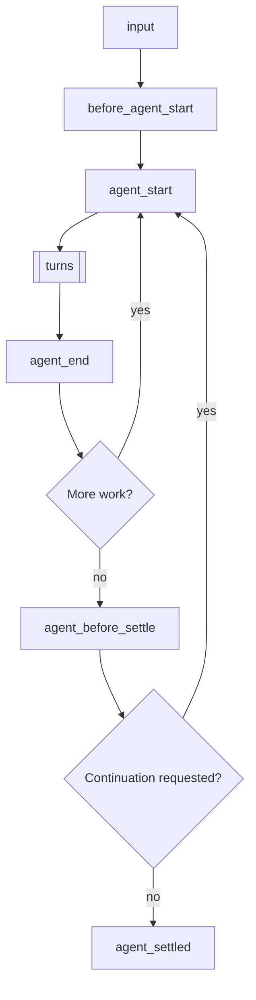
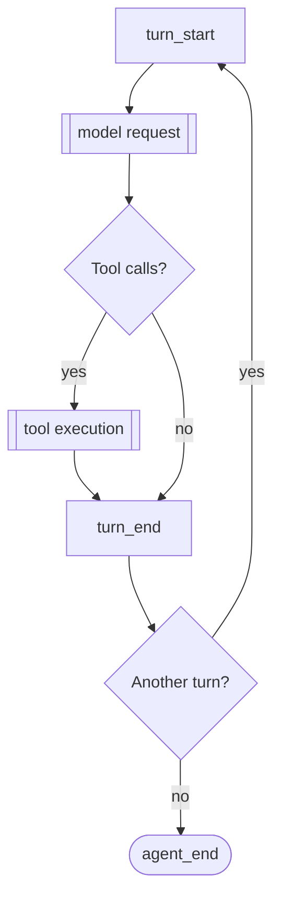
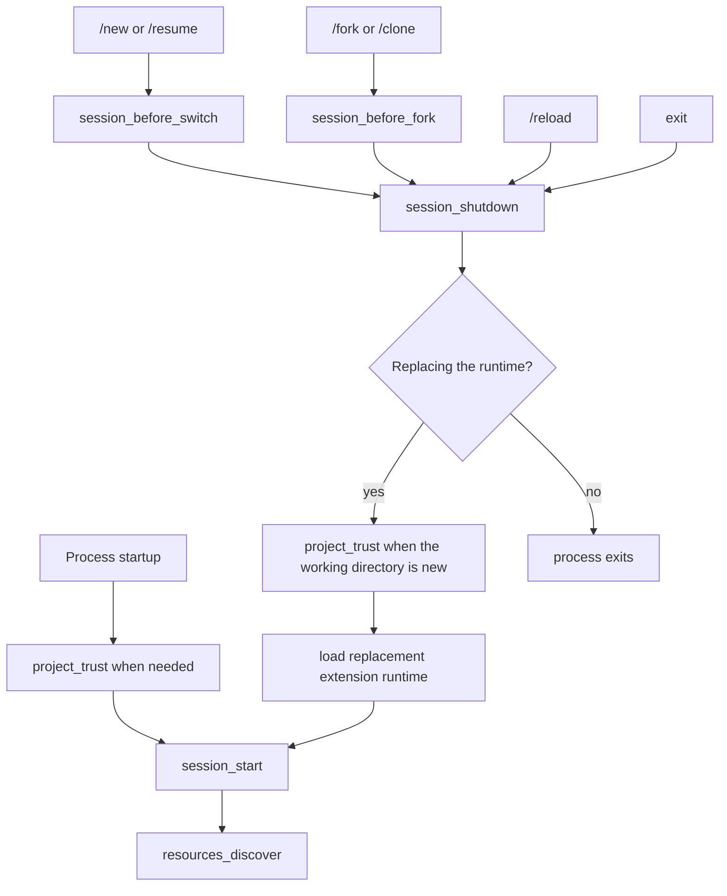

> Pi can create extensions. Ask it to build one for your use case.

# Extensions

Extensions are TypeScript modules that extend Pi's behavior. They can subscribe to lifecycle events, register custom tools callable by the LLM, add commands, and more.

An extension runs inside the Pi process with the same operating-system permissions. It can inspect prompts, tool calls, files, credentials, and session history, so load extensions only from sources you trust.

> **Placement for /reload:** Put extensions in `~/.pi/agent/extensions/` (global) or `.pi/extensions/` (project-local) for auto-discovery. Use `pi -e ./path.ts` only for quick tests. Extensions in auto-discovered locations can be hot-reloaded with `/reload`.

**Key capabilities:**
- **Custom tools** - Register tools the LLM can call via `pi.registerTool()`
- **Event interception** - Block or modify tool calls, inject context, customize compaction
- **User interaction** - Prompt users via `ctx.ui` (select, confirm, input, notify)
- **Custom UI components** - Full TUI components with keyboard input via `ctx.ui.custom()` for complex interactions
- **Custom commands** - Register commands like `/mycommand` via `pi.registerCommand()`
- **Session persistence** - Store state that survives restarts via `pi.appendEntry()`
- **Custom rendering** - Control how tool calls/results and messages appear in TUI
- **Providers and MCP servers** - Register model providers, virtual models, and MCP servers

**Example use cases:**
- Permission gates (confirm before `rm -rf`, `sudo`, etc.)
- Git checkpointing (stash at each turn, restore on branch)
- Path protection (block writes to `.env`, `node_modules/`)
- Custom compaction (summarize conversation your way)
- Conversation summaries (see `summarize.ts` example)
- Interactive tools (questions, wizards, custom dialogs)
- Stateful tools (todo lists, connection pools)
- External integrations (file watchers, webhooks, CI triggers)
- Games while you wait (see `snake.ts` example)

See [examples/extensions/](../examples/extensions/) for working implementations.

## Table of Contents

- [Quick Start](#quick-start)
- [Extension Locations](#extension-locations)
- [Available Imports](#available-imports)
- [Writing an Extension](#writing-an-extension)
  - [Extension Styles](#extension-styles)
- [Events](#events)
  - [Lifecycle Overview](#lifecycle-overview)
  - [Handler Composition](#handler-composition)
  - [Startup Events](#startup-events)
  - [Resource Events](#resource-events)
  - [Session Events](#session-events)
  - [Agent Events](#agent-events)
  - [Model Events](#model-events)
  - [Tool Events](#tool-events)
  - [User Bash Events](#user-bash-events)
  - [Input Events](#input-events)
- [ExtensionContext](#extensioncontext)
- [ExtensionCommandContext](#extensioncommandcontext)
- [ExtensionAPI Methods](#extensionapi-methods)
- [State Management](#state-management)
- [Custom Tools](#custom-tools)
  - [Tool Exposure](#tool-exposure)
  - [Calling Other Tools](#calling-other-tools)
  - [Dynamic Tool Loading](#dynamic-tool-loading)
- [MCP Servers](#mcp-servers)
- [Custom UI](#custom-ui)
- [Error Handling](#error-handling)
- [Mode Behavior](#mode-behavior)
- [Examples Reference](#examples-reference)

<a id="create-an-extension"></a>

## Quick Start

Create `~/.pi/agent/extensions/my-extension.ts`:

```typescript
import { type ExtensionAPI, isToolCallEventType } from "@earendil-works/pi-coding-agent";
import { Type } from "typebox";

export default function (pi: ExtensionAPI) {
  // React to events
  pi.on("session_start", async (_event, ctx) => {
    ctx.ui.notify("Extension loaded!", "info");
  });

  pi.on("tool_call", async (event, ctx) => {
    if (isToolCallEventType("bash", event) && event.input.command.includes("rm -rf")) {
      const ok = await ctx.ui.confirm("Dangerous!", "Allow rm -rf?");
      if (!ok) return { block: true, reason: "Blocked by user" };
    }
  });

  // Register a custom tool
  pi.registerTool({
    name: "greet",
    label: "Greet",
    description: "Greet someone by name",
    parameters: Type.Object({
      name: Type.String({ description: "Name to greet" }),
    }),
    async execute(toolCallId, params, signal, onUpdate, ctx) {
      return {
        content: [{ type: "text", text: `Hello, ${params.name}!` }],
        details: {},
      };
    },
  });

  // Register a command
  pi.registerCommand("hello", {
    description: "Say hello",
    handler: async (args, ctx) => {
      ctx.ui.notify(`Hello ${args || "world"}!`, "info");
    },
  });
}
```

Test with `--extension` (or `-e`) flag:

```bash
pi -e ./my-extension.ts
```

<a id="choose-where-it-loads"></a>

## Extension Locations

> **Security:** Extensions run with your full system permissions and can execute arbitrary code. Only install from sources you trust.

Extensions are auto-discovered from trusted locations. Project-local `.pi/extensions` entries load only after the project is trusted.

| Location | Scope |
|----------|-------|
| `~/.pi/agent/extensions/*.ts` or `*.js` | Global (all projects) |
| `~/.pi/agent/extensions/*/index.ts` or `index.js` | Global (subdirectory) |
| `~/.pi/agent/extensions/*/package.json` with a `pi.extensions` field | Global (subdirectory with manifest) |
| `.pi/extensions/...` | Project-local, same layouts |

Discovery goes one level deep. Larger packages declare their entry points in a `package.json` manifest.

Additional paths via `settings.json`:

```json
{
  "packages": [
    "npm:@foo/bar@1.0.0",
    "git:github.com/user/repo@v1"
  ],
  "extensions": [
    "/path/to/local/extension.ts",
    "/path/to/local/extension/dir"
  ]
}
```

Settings also accept built-in extensions as `builtin:<name>` entries; see [Settings](settings.md#resources). To share extensions via npm or git as Pi packages, see [packages.md](packages.md).

## Available Imports

| Package | Purpose |
|---------|---------|
| `@earendil-works/pi-coding-agent` | Extension types (`ExtensionAPI`, `ExtensionContext`, events) and helpers |
| `@earendil-works/pi-agent-core` | Agent message and tool types |
| `typebox`, `typebox/compile`, `typebox/value` | Schema definitions for tool parameters |
| `@earendil-works/pi-ai` | AI utilities (`StringEnum` for string enums, transcript helpers, model types) |
| `@earendil-works/pi-ai/compat`, `/models`, `/oauth`, `/providers/all` | Provider construction, built-in APIs, and OAuth helpers |
| `@earendil-works/pi-tui` | TUI components for custom rendering |

Pi maps these imports to its own copies, so extensions share Pi's classes and registries. The legacy `@mariozechner/*` and `@sinclair/typebox` names map to the same modules.

npm dependencies work too. Add a `package.json` next to your extension (or in a parent directory), run `npm install`, and imports from `node_modules/` are resolved automatically.

For distributed Pi packages installed with `pi install` (npm or git), runtime deps must be in `dependencies`; `devDependencies` are not installed. Do not list the host-provided packages above in `dependencies`. See [Declare dependencies](packages.md#declare-dependencies).

Node.js built-ins (`node:fs`, `node:path`, etc.) are also available.

## Writing an Extension

An extension exports a default factory function that receives `ExtensionAPI`. The factory can be synchronous or asynchronous:

```typescript
import type { ExtensionAPI } from "@earendil-works/pi-coding-agent";

export default function (pi: ExtensionAPI) {
  // Subscribe to events
  pi.on("event_name", async (event, ctx) => {
    // ctx.ui for user interaction
    const ok = await ctx.ui.confirm("Title", "Are you sure?");
    ctx.ui.notify("Done!", "info");
    ctx.ui.setStatus("my-ext", "Processing...");  // Footer status
    ctx.ui.setWidget("my-ext", ["Line 1", "Line 2"]);  // Widget above editor (default)
  });

  // Register tools, commands, shortcuts, flags
  pi.registerTool({ ... });
  pi.registerCommand("name", { ... });
  pi.registerShortcut("ctrl+x", { ... });
  pi.registerFlag("my-flag", { ... });
}
```

Extensions are loaded via [jiti](https://github.com/unjs/jiti), so TypeScript works without compilation.

If the factory returns a `Promise`, Pi awaits it before continuing startup. That means async initialization completes before `session_start`, before `resources_discover`, and before provider registrations queued via `pi.registerProvider()` are flushed.

### Async factory functions

Use an async factory for one-time startup work such as fetching remote configuration or dynamically discovering available models.

```typescript
import type { ExtensionAPI } from "@earendil-works/pi-coding-agent";

export default async function (pi: ExtensionAPI) {
  const response = await fetch("http://localhost:1234/v1/models");
  const payload = (await response.json()) as {
    data: Array<{
      id: string;
      name?: string;
      context_window?: number;
      max_tokens?: number;
    }>;
  };

  pi.registerProvider("local-openai", {
    baseUrl: "http://localhost:1234/v1",
    apiKey: "$LOCAL_OPENAI_API_KEY",
    api: "openai-completions",
    models: payload.data.map((model) => ({
      id: model.id,
      name: model.name ?? model.id,
      reasoning: false,
      input: ["text"],
      cost: { input: 0, output: 0, cacheRead: 0, cacheWrite: 0 },
      contextWindow: model.context_window ?? 128000,
      maxTokens: model.max_tokens ?? 4096,
    })),
  });
}
```

This pattern makes the fetched models available during normal startup and to `pi --list-models`. For model lists that change while Pi runs, implement `refreshModels` instead; see [pi.registerProvider()](#piregisterprovidername-config).

### Long-lived resources and shutdown

Extension factories may run in invocations that never start a session. Do not start background resources such as processes, sockets, file watchers, or timers from the factory.

Defer background resource startup until `session_start` or the command/tool/event that needs the resource. Register an idempotent `session_shutdown` handler to close any session-scoped resources you start.

### Extension Styles

**Single file** - simplest, for small extensions:

```
~/.pi/agent/extensions/
└── my-extension.ts
```

**Directory with index.ts** - for multi-file extensions:

```
~/.pi/agent/extensions/
└── my-extension/
    ├── index.ts        # Entry point (exports default function)
    ├── tools.ts        # Helper module
    └── utils.ts        # Helper module
```

**Package with dependencies** - for extensions that need npm packages:

```
~/.pi/agent/extensions/
└── my-extension/
    ├── package.json    # Declares dependencies and entry points
    ├── package-lock.json
    ├── node_modules/   # After npm install
    └── src/
        └── index.ts
```

```json
// package.json
{
  "name": "my-extension",
  "dependencies": {
    "zod": "^3.0.0",
    "chalk": "^5.0.0"
  },
  "pi": {
    "extensions": ["./src/index.ts"]
  }
}
```

Run `npm install` in the extension directory, then imports from `node_modules/` work automatically.

<a id="extension-events"></a>

## Events

<a id="understand-the-lifecycle"></a>

### Lifecycle Overview

A prompt starts a run. Input handling comes first:

1. Extension commands (`/name`) run their handler. The `input` event does not fire. Typed and RPC prompts always check for commands; `pi.sendUserMessage()` checks only with `expandPromptTemplates: true`.
2. `input` handlers can intercept, transform, or handle the text.
3. Skill commands (`/skill:name`) and prompt templates (`/template`) expand.
4. `before_agent_start` runs, then the agent loop starts.

The run repeats turns, then checks whether more work starts another low-level agent run:



More work means a retry, final-attempt recovery, a compaction retry, or queued messages. `agent_end` is therefore not a final-idle signal; use `agent_settled` for that. An aborted run skips `agent_before_settle` and goes from `agent_end` to `agent_settled`. Pi counts as busy while a run starts, including the compaction check and `before_agent_start`, so messages sent meanwhile go into the starting run.

Each turn sends one model request and executes the tool calls in the assistant response:



The model request runs these hooks in order:

1. `context` (can modify conversation messages)
2. `context_with_system` (can modify the full transcript)
3. `before_provider_headers` (can mutate headers)
4. `before_provider_request` (can inspect or replace the payload)
5. `after_provider_response` (status and headers, before the stream is consumed)
6. `provider_stream_event` (raw parsed stream events) and `message_start` / `message_update` / `message_end` for the assistant message

A tool call that executes runs these hooks in order:

1. `tool_execution_start`
2. `tool_call` (can block or mutate input)
3. `tool_execution_update` while the tool executes
4. `tool_result` (can modify the result)
5. `tool_execution_end`

Calls that do not execute end early. An unknown tool or invalid arguments skip `tool_call`; a blocked or aborted call skips execution and `tool_result`. Each of these still gets `tool_execution_end` with an error result, so use `tool_execution_end` to observe every finalized call.

`turn_end` can append entries and request a continuation. Threshold compaction runs before a naturally required next turn. Message events also fire for other messages, such as user, tool-result, and custom messages. Provider hooks run only when the transport exposes the corresponding stage.

Session startup and replacement follow a separate lifecycle:



`session_start` carries `reason: "startup" | "reload" | "new" | "resume" | "fork"`, and `session_shutdown` carries `reason: "quit" | "reload" | "new" | "resume" | "fork"`. `resources_discover` uses `reason: "reload"` after a reload and `"startup"` otherwise. Exit covers Ctrl+C, Ctrl+D, SIGHUP, and SIGTERM. `project_trust` runs before trusted project resources load and can run again when session replacement enters a new working directory.

Other operations change the current session without replacing the runtime:

| Operation | Events |
|---|---|
| `/compact` or automatic compaction | `session_before_compact` (can cancel or customize), then `session_compact` or `session_compact_failed` |
| `/tree` navigation | `session_before_tree` (can cancel or customize), then `session_tree` |
| `/name` or `pi.setSessionName()` | `session_info_changed` |
| `/model` or model cycling (`Ctrl+P`) | `thinking_level_select` if the level changes or is clamped, then `model_select` |
| Thinking-level change (settings, keybinding, `pi.setThinkingLevel()`) | `thinking_level_select` |
| `!` or `!!` command | `user_bash` (can intercept) |
| Extension dialog or custom screen waits for the user | `ui_prompt_start`, `ui_prompt_end` |
| Idle prompt-cache refresh | `cache_warming_decision` |
| Extension registers or removes an MCP server after startup | `mcp_servers_change` |

<a id="events-and-concurrency"></a>
<a id="work-with-events"></a>

### Handler Composition

Handlers run in extension load order, then registration order. Some events notify; others transform data, replace results, or cancel an operation:

| Pattern | Behavior |
|---|---|
| Notification | Return values are ignored. Use the event for observation only. |
| In-place mutation | Later handlers see changes to values such as `before_provider_headers.headers`, `before_agent_start.systemPromptOptions`, and `tool_call.input`. |
| Chained transformation | Later handlers receive the value returned by earlier `input`, `context`, `context_with_system`, `message_end`, `tool_result`, and `before_provider_request` handlers. |
| Gate | A handled input, blocked tool call, cancelled session operation, or handled `user_bash` command stops that operation's normal fallback path. |
| Actionable boundary | Each `turn_end` or `agent_before_settle` handler sees the entries and continuation decision proposed so far. |
| Last override | The last `cache_warming_decision` handler that returns an action wins. |

Notification handlers should not perform slow work on a streaming event. Transform handlers should preserve fields they do not intentionally own, and gate handlers should fail closed when their safety decision cannot be made.

### Startup Events

#### project_trust

Fired before Pi decides whether to trust a project with dynamic configs (`.pi` or `.agents/skills`). It runs during startup and when session replacement (for example `/resume`) enters a cwd whose trust has not been resolved in the current process. Only user/global extensions and CLI `-e` extensions participate; project-local extensions are not loaded until after trust is resolved.

```typescript
pi.on("project_trust", async (event, ctx) => {
  // event.cwd - current working directory
  // ctx has a limited trust context: cwd, mode, hasUI, and select/confirm/input/notify UI helpers
  if (await ctx.ui.confirm("Trust project?", event.cwd)) {
    return { trusted: "yes", remember: true };
  }
  return { trusted: "undecided" };
});
```

A `project_trust` handler must return `{ trusted: "yes" | "no" | "undecided" }`. A user/global or CLI extension that returns `"yes"` or `"no"` owns the decision; the first yes/no decision wins and suppresses the built-in trust prompt. Use `remember: true` to persist a yes/no decision; otherwise it applies only to the current process. Return `"undecided"` to let later handlers or the built-in trust flow decide. Check `ctx.hasUI` before prompting. If no handler returns yes/no, normal trust resolution continues: saved `trust.json` decisions apply first, then `defaultProjectTrust` controls whether Pi asks, trusts, or declines by default.

### Resource Events

#### resources_discover

Fired after `session_start` so extensions can contribute additional skill, prompt, and theme paths.
The startup path uses `reason: "startup"`. Reload uses `reason: "reload"`.

```typescript
pi.on("resources_discover", async (event, _ctx) => {
  // event.cwd - current working directory
  // event.reason - "startup" | "reload"
  return {
    skillPaths: ["/path/to/skills"],
    promptPaths: ["/path/to/prompts"],
    themePaths: ["/path/to/themes"],
  };
});
```

#### mcp_servers_change

Fired when an extension registers or unregisters an MCP server after extensions are bound. `event.servers` lists every registered server after the change. Handling this event marks the extension as the one that connects registered servers; see [MCP Servers](#mcp-servers).

### Session Events

See [Session Format](session-format.md) for session storage internals and the SessionManager API.

#### session_start

Fired when a session is started, loaded, or reloaded.

```typescript
pi.on("session_start", async (event, ctx) => {
  // event.reason - "startup" | "reload" | "new" | "resume" | "fork"
  // event.previousSessionFile - present for "new", "resume", and "fork"
  ctx.ui.notify(`Session: ${ctx.sessionManager.getSessionFile() ?? "ephemeral"}`, "info");
});
```

#### session_info_changed

Fired when the current session display name is set via `/name`, RPC, or `pi.setSessionName()`.

```typescript
pi.on("session_info_changed", async (event, ctx) => {
  // event.name - current normalized name, or undefined if cleared
  ctx.ui.notify(`Session renamed: ${event.name ?? "(none)"}`, "info");
});
```

#### session_before_switch

Fired before starting a new session (`/new`) or switching sessions (`/resume`).

```typescript
pi.on("session_before_switch", async (event, ctx) => {
  // event.reason - "new" or "resume"
  // event.targetSessionFile - session we're switching to (only for "resume")

  if (event.reason === "new") {
    const ok = await ctx.ui.confirm("Clear?", "Delete all messages?");
    if (!ok) return { cancel: true };
  }
});
```

After a successful switch or new-session action, Pi emits `session_shutdown` for the old extension instance, reloads and rebinds extensions for the new session, then emits `session_start` with `reason: "new" | "resume"` and `previousSessionFile`.
Do cleanup work in `session_shutdown`, then reestablish any in-memory state in `session_start`.

#### session_before_fork

Fired when forking via `/fork` or cloning via `/clone`.

```typescript
pi.on("session_before_fork", async (event, ctx) => {
  // event.entryId - ID of the selected entry
  // event.position - "before" for /fork, "at" for /clone
  return { cancel: true }; // Cancel fork/clone
  // OR
  return { skipConversationRestore: true }; // Reserved for future conversation restore control
});
```

After a successful fork or clone, Pi emits `session_shutdown` for the old extension instance, reloads and rebinds extensions for the new session, then emits `session_start` with `reason: "fork"` and `previousSessionFile`.
Do cleanup work in `session_shutdown`, then reestablish any in-memory state in `session_start`.

<a id="session_before_compact--session_compact"></a>

#### session_before_compact / session_compact / session_compact_failed

Fired on compaction. See [compaction.md](compaction.md) for details.

```typescript
pi.on("session_before_compact", async (event, ctx) => {
  const { preparation, branchEntries, customInstructions, reason, willRetry, signal } = event;

  // reason - "manual" (/compact), "threshold", or "overflow"
  // willRetry - whether the aborted turn is retried after compaction (overflow recovery)

  // Cancel:
  return { cancel: true };

  // Custom summary:
  return {
    compaction: {
      summary: "...",
      firstKeptEntryId: preparation.firstKeptEntryId,
      tokensBefore: preparation.tokensBefore,
      // usage: summaryResponse.usage, // Optional; included in session totals
    }
  };
});

pi.on("session_compact", async (event, ctx) => {
  // event.compactionEntry - the saved compaction
  // event.fromExtension - whether extension provided it
  // event.reason - "manual" (/compact), "threshold", or "overflow"
  // event.willRetry - whether the aborted turn is retried after compaction (overflow recovery)
});

pi.on("session_compact_failed", async (event, ctx) => {
  // event.reason - "manual" (/compact), "threshold", or "overflow"
  // event.errorMessage - present for non-abort failures
  // event.aborted - true for cancelled/aborted compactions
  // event.willRetry - whether the aborted turn would have retried after compaction
  // event.fromExtension - whether extension-provided compaction content was being used
});
```

#### session_before_tree / session_tree

Fired on `/tree` navigation. See [Sessions](sessions.md) for tree navigation concepts.

```typescript
pi.on("session_before_tree", async (event, ctx) => {
  const { preparation, signal } = event;
  // preparation.targetId, oldLeafId, commonAncestorId, entriesToSummarize,
  // userWantsSummary, customInstructions, replaceInstructions, label
  return { cancel: true };
  // OR provide custom summary (used only when preparation.userWantsSummary is true):
  return {
    summary: {
      summary: "...",
      // usage: summaryResponse.usage, // Optional; included in session totals
      details: {},
    },
  };
  // OR override summarization options: customInstructions, replaceInstructions, label
});

pi.on("session_tree", async (event, ctx) => {
  // event.newLeafId, oldLeafId, summaryEntry, fromExtension
});
```

#### session_shutdown

Fired before a started session runtime is torn down. Use this to clean up resources opened from `session_start` or other session-scoped hooks.

```typescript
pi.on("session_shutdown", async (event, ctx) => {
  // event.reason - "quit" | "reload" | "new" | "resume" | "fork"
  // event.targetSessionFile - destination session for session replacement flows
  // Cleanup, save state, etc.
});
```

### Agent Events

#### before_agent_start

Fired before a run starts, after input handling and expansion. Can inject a message and/or modify the system prompt.

`event.messageType` says what started the run: `"user"` for a prompt or `pi.sendUserMessage()`, with `prompt` and `images`; `"custom"` for `pi.sendMessage(..., { triggerTurn: true })` while idle, with the starting `message` and no `prompt`.

```typescript
pi.on("before_agent_start", async (event, ctx) => {
  // event.messageType - "user" | "custom"
  // event.prompt, event.images - user's prompt text and images (messageType "user")
  // event.message - the custom message that starts the run (messageType "custom")
  // event.systemPrompt - current chained system prompt for this handler
  //   (includes changes from earlier before_agent_start handlers)
  // event.systemPromptOptions - structured options used to build the system prompt
  //   .customPrompt - exact prompt prefix from --system-prompt, SYSTEM.md, or custom templates
  //   .forceSystemPrompt - optional exact replacement for the complete prompt
  //   .selectedTools - tools currently active in the prompt
  //   .hiddenTools - selected tools whose declarations requests leave out
  //   .toolSnippets - one-line descriptions for each tool
  //   .toolGuidelines - rule bullets keyed by tool name
  //   .promptGuidelines - additional custom rule bullets
  //   .sections - custom XML-wrapped sections keyed by tag name
  //   .appendSystemPrompt - text from --append-system-prompt flags
  //   .cwd - working directory
  //   .contextFiles - AGENTS.md files and other loaded context files
  //   .skills - loaded skills

  return {
    // Inject a persistent message (stored in session, sent to LLM)
    message: {
      customType: "my-extension",
      content: "Additional context for the LLM",
      display: true,
    },
    // Replace the system prompt for this turn (chained across extensions)
    systemPrompt: event.systemPrompt + "\n\nExtra instructions for this turn...",
  };
});
```

A returned `message` is added to either kind of run; check `messageType` to skip runs started by custom messages.

The `systemPromptOptions` field gives extensions access to the same structured data Pi uses to build the system prompt. Collections are mutable. Prefer changing `sections`, `selectedTools`, or `promptGuidelines`: Pi diffs the resulting prompt sections against what the model already has and appends one system message patching only the changed sections. Returning `systemPrompt`, or setting `forceSystemPrompt`, replaces the whole prompt for the run: every provider receives the forced text as its leading system prompt (a cache miss when it changes), and the session transcript keeps recording the structured sections. Tool selection changes update both the prompt contributions and executable provider tools; calling `pi.setActiveTools()` inside the handler has the same effect as editing `selectedTools`. Models that accept system messages mid-conversation receive the patch in place and keep their cached prefix; other models get the replayed prompt as their system prompt, which is a cache miss once per change.

Inside `before_agent_start`, `event.systemPrompt` and `ctx.getSystemPrompt()` both reflect the chained system prompt as of the current handler. Later `before_agent_start` handlers can still modify it again.

<a id="agent_start--agent_end--agent_settled"></a>

#### agent_start / agent_end / agent_before_settle / agent_settled

`agent_start` fires when a low-level agent run begins. `agent_end` fires when that run ends, but Pi may still auto-retry, auto-compact and retry, or continue with queued follow-up messages. `agent_before_settle` is the final actionable boundary: it can append session entries and request one continuation. `agent_settled` is final and notification-only; use it for status integrations that need to know Pi will not continue running automatically.

```typescript
pi.on("agent_start", async (_event, ctx) => {});

pi.on("agent_end", async (event, ctx) => {
  // event.messages - messages from this low-level run
});

let addedReviewReminder = false;
pi.on("agent_before_settle", async (event, ctx) => {
  if (addedReviewReminder) return;
  addedReviewReminder = true;
  return {
    entries: [...event.entries, {
      type: "custom_message",
      customType: "review-reminder",
      content: "Review the final diff before replying.",
      display: false,
    }],
    continue: true,
  };
});

pi.on("agent_settled", async (event, ctx) => {
  // event.aborted - true when the run ended because it was aborted, for example with Escape
  // ctx.isIdle() is true; runs requested here start after all settled handlers finish.
});
```

If the run is aborted while `agent_before_settle` handlers are running, valid returned entries are still committed, but requested continuation is suppressed. Work requested from `agent_settled` is deferred until every settled handler completes, so notification dispatch is non-reentrant.

#### ui_prompt_start / ui_prompt_end

Notification-only lifecycle events for blocking user-facing extension UI prompts. They fire around `ctx.ui.select()`, `ctx.ui.confirm()`, `ctx.ui.input()`, `ctx.ui.editor()`, and `ctx.ui.custom()` so host/status integrations can report "waiting for user" instead of just "running".

Nested or overlapping prompts are coalesced into one outer waiting span. Handlers are invoked best-effort and are not awaited before showing or closing the prompt.

```typescript
pi.on("ui_prompt_start", async (event, ctx) => {
  // event.reason === "ui_prompt"
  // event.kind: "select" | "confirm" | "input" | "editor" | "custom"
  // event.title: prompt title when available
});

pi.on("ui_prompt_end", async (event, ctx) => {
  // Pi is no longer waiting on that UI prompt span.
});
```

#### turn_start / turn_end

Fired for each turn (one LLM response + tool calls).

```typescript
pi.on("turn_start", async (event, ctx) => {
  // event.turnIndex, event.timestamp
});

let replacedResponse = false;
pi.on("turn_end", async (event, ctx) => {
  // event.turnIndex, event.message, event.toolResults
  // event.entries contains the structural entries proposed so far.
  if (replacedResponse || event.outcome !== "completed" || event.toolResults.length > 0) return;
  replacedResponse = true;
  return {
    entries: [
      ...event.entries,
      { type: "context_edit", targetId: event.messageEntryId, replacement: null },
      {
        type: "custom_message",
        customType: "replacement-instruction",
        content: "Answer again using the persisted user request.",
        display: false,
      },
    ],
    continue: true,
  };
});
```

`turn_end` runs after the assistant and tool-result messages have been persisted and before the low-level `turn_end` event. Retry backoff and final-attempt recovery still happen after `agent_end`, preserving their existing lifecycle and queue ordering; `agent_before_settle` sees the repaired projection after that work completes. Boundary handlers run in extension load and registration order. Each handler sees prior proposals in `event.entries` and sees `event.context` rebuilt from them. Returning `entries` or `continue` replaces only that field; omitted fields preserve the current proposal. Allowed draft entry types are `custom`, `custom_message`, `context_edit`, and `compaction`. The complete proposal is validated before it is appended in list order after all handlers finish; a handler error is reported and later handlers still run. Validation prevents partially applied semantic errors, but persistence is not transactional.

`continue: true` ensures one next provider request for that boundary invocation. If tool results, steering, or a follow-up already cause that request, they satisfy the decision and no additional request is made; otherwise Pi makes one context-only request. Error and aborted responses remain hard exits. `continue: false` never suppresses natural work. Guard continuation conditions: an unconditional `continue: true` is evaluated again after the next response and can create an endless loop. A `custom_message` draft contributes a user-role model message but is extension-authored: it does not run human input hooks, slash commands, skills, or prompt templates.

Host integrations that construct `TurnEndEvent` values must provide `messageEntryId`, `toolResultEntryIds`, `outcome`, `entries`, `continue`, and `context`. `ExtensionEvent` exhaustive switches must also handle `agent_before_settle`. `ExtensionRunner.emit()` excludes actionable turn boundaries; dispatch `turn_end` and `agent_before_settle` through `emitBoundary(baseEvent, buildContext)` so handlers receive chained previews. Other dedicated runner methods still return results for events such as `session_before_*`.

#### message_start / message_update / message_end

Fired for message lifecycle updates.

- `message_start` and `message_end` fire for every message, including user, assistant, tool-result, and custom messages.
- `message_update` fires for assistant streaming updates.
- `message_end` handlers can return `{ message }` to replace the finalized message. The replacement must keep the same `role`.

```typescript
pi.on("message_start", async (event, ctx) => {
  // event.message
});

pi.on("message_update", async (event, ctx) => {
  // event.message
  // event.assistantMessageEvent (token-by-token stream event)
});

pi.on("message_end", async (event, ctx) => {
  if (event.message.role !== "assistant") return;

  return {
    message: {
      ...event.message,
      usage: {
        ...event.message.usage,
        cost: {
          ...event.message.usage.cost,
          total: 0.123,
        },
      },
    },
  };
});
```

#### tool_execution_start / tool_execution_update / tool_execution_end

Fired for tool execution lifecycle updates.

In parallel tool mode:
- `tool_execution_start` is emitted in assistant source order during the preflight phase
- `tool_execution_update` events may interleave across tools
- `tool_execution_end` is emitted in tool completion order after each tool is finalized
- final `toolResult` message events are still emitted later in assistant source order

```typescript
pi.on("tool_execution_start", async (event, ctx) => {
  // event.toolCallId, event.toolName, event.args
});

pi.on("tool_execution_update", async (event, ctx) => {
  // event.toolCallId, event.toolName, event.args, event.partialResult
});

pi.on("tool_execution_end", async (event, ctx) => {
  // event.toolCallId, event.toolName, event.result, event.isError
  // event.durationMs - milliseconds execute() took; absent when the tool did not run
});
```

All three events, `tool_call`, and `tool_result` carry `parentToolCallId` when another tool made the call; see [Calling Other Tools](#calling-other-tools).

#### context

Fired before each LLM call. Modify messages non-destructively. See [Session Format](session-format.md) for message types.

```typescript
pi.on("context", async (event, ctx) => {
  // event.messages - deep copy without system messages, safe to modify
  const filtered = event.messages.filter(m => !shouldPrune(m));
  return { messages: filtered };
});
```

`event.messages` holds the conversation without system messages. The prompt and tool declarations belong to Pi and are not part of this hook: when the handler returns a changed list, Pi replays the current prompt sections and tool declarations into one leading system message ahead of the returned messages. Filtering, windowing, or slicing from a compaction summary therefore cannot drop the prompt or the tools. An unchanged list keeps mid-conversation system messages in place, so models that accept them retain their cached prefix. System messages a handler adds are kept after Pi's head. To change the prompt or the tool set durably, use [`before_agent_start`](#before_agent_start) or `pi.setActiveTools()`; to edit system messages for one request, use [`context_with_system`](#context_with_system).

#### context_with_system

Fired before each LLM call, after every `context` handler has run and Pi has restored the prompt and tool state. `event.messages` is the full transcript, including the leading system message and any mid-conversation prompt or tool patches (see [Session Format](session-format.md#sessionmessageentry)). The returned messages are sent as they are: this hook owns the prompt and tool declarations for the request.

```typescript
import { getCurrentSystemMessage } from "@earendil-works/pi-ai";

pi.on("context_with_system", async (event, ctx) => {
  const cut = findCutIndex(event.messages);
  // Fold the dropped prefix so its prompt and tool state survives as the new head.
  const head = getCurrentSystemMessage(event.messages.slice(0, cut));
  return { messages: head ? [head, ...event.messages.slice(cut)] : event.messages.slice(cut) };
});
```

Rules: keep a system message at index 0 (providers read the prompt and initial tool declarations there; Pi reports an error if a handler drops it). Removing a system message removes the tool declarations and section patches it carries. Check your output with `getCurrentSystemPrompt()` and `getCurrentTools()` from `@earendil-works/pi-ai`. Handlers run in extension load order; a `systemPrompt` forced from `before_agent_start` is still projected onto the request afterwards.

#### before_provider_headers

Fired after the outgoing HTTP headers are assembled. Use it to add, override, or remove request headers.

Handlers mutate `event.headers` in place. Set a key to a string to add or override it, or to `null` to delete it.

```typescript
pi.on("before_provider_headers", (event, ctx) => {
  // Add or override — e.g. a session id for gateway tracing/attribution
  event.headers["x-session-id"] = ctx.sessionManager.getSessionId();

  // Drop a tracking header pi adds for this call
  event.headers["X-OpenRouter-Title"] = null;
});
```

Runs once per provider request; retries reuse the same headers rather than re-firing the hook.

#### before_provider_request

Fired after the provider-specific payload is built, right before the request is sent. Handlers run in extension load order. Returning `undefined` keeps the payload unchanged. Returning any other value replaces the payload for later handlers and for the actual request.

This hook can rewrite provider-level system instructions or remove them entirely. Those payload-level changes are not reflected by `ctx.getSystemPrompt()`, which reports Pi's system prompt string rather than the final serialized provider payload.

```typescript
pi.on("before_provider_request", (event, ctx) => {
  console.log(JSON.stringify(event.payload, null, 2));

  // Optional: replace payload
  // return { ...event.payload, temperature: 0 };
});
```

This is mainly useful for debugging provider serialization and cache behavior.

#### after_provider_response

Fired after an HTTP response is received and before its stream body is consumed. Handlers run in extension load order.

```typescript
pi.on("after_provider_response", (event, ctx) => {
  // event.status - HTTP status code
  // event.headers - normalized response headers
  if (event.status === 429) {
    console.log("rate limited", event.headers["retry-after"]);
  }
});
```

Header availability depends on provider and transport. Providers that abstract HTTP responses may not expose headers.

#### provider_stream_event

Fired for each parsed provider stream event before Pi normalizes it. Notification-only and not persisted.

```typescript
pi.on("provider_stream_event", (event, ctx) => {
  // event.provider, event.api, event.model
  // event.data - earliest structured value available to Pi (read-only)
});
```

`event.data` is not necessarily the original HTTP bytes or SSE frame. Treat it as read-only because mutation can affect normalization. Handlers are awaited in stream order, so slow handlers delay stream consumption. Handler errors are reported without changing the provider response. See [`debug-provider.ts`](../examples/extensions/debug-provider.ts) for an opt-in viewer that groups raw events by assistant message.

#### cache_warming_decision

Fired before each prompt-cache refresh with Pi's decision filled in. The event carries only Pi's cost estimates; use `ctx.model`, `ctx.isIdle()`, and `ctx.getContextUsage()` for everything else.

```typescript
pi.on("cache_warming_decision", (event, ctx) => {
  // event.warmCost: price of this refresh
  // event.missCost: extra price of the next request if the entry is lost
  // event.continuationProbability: pi's estimate that a request arrives in time
  // event.action: "warm" | "stop", pi's decision

  if (ctx.model?.provider === "my-provider") {
    return { action: "stop" };
  }
});
```

Return `{ action: "warm" }` or `{ action: "stop" }` to override; the last handler that returns an action wins. `"stop"` ends warming until the next real request.

### Model Events

#### model_select

Fired when the model changes via `/model` command, model cycling (`Ctrl+P`), or `pi.setModel()`. Restoring a session does not fire it; read `ctx.model` in `session_start` to initialize model-dependent state.

```typescript
pi.on("model_select", async (event, ctx) => {
  // event.model - newly selected model
  // event.previousModel - previous model (undefined if first selection)
  // event.source - "set" | "cycle"

  const prev = event.previousModel
    ? `${event.previousModel.provider}/${event.previousModel.id}`
    : "none";
  const next = `${event.model.provider}/${event.model.id}`;

  ctx.ui.notify(`Model changed (${event.source}): ${prev} -> ${next}`, "info");
});
```

Use this to update UI elements (status bars, footers) or perform model-specific initialization when the active model changes.

#### thinking_level_select

Fired when the thinking level changes. This is notification-only; handler return values are ignored.

```typescript
pi.on("thinking_level_select", async (event, ctx) => {
  // event.level - newly selected thinking level
  // event.previousLevel - previous thinking level

  ctx.ui.setStatus("thinking", `thinking: ${event.level}`);
});
```

Use this to update extension UI when `pi.setThinkingLevel()`, model changes, or built-in thinking-level controls change the active thinking level.

<a id="tool-call-events"></a>

### Tool Events

#### tool_call

Fired after `tool_execution_start`, before the tool executes. **Can block.** Use `isToolCallEventType` to narrow and get typed inputs.

Before `tool_call` runs, Pi waits for previously emitted Agent events to finish draining through `AgentSession`. This means `ctx.sessionManager` is up to date through the current assistant tool-calling message.

In the default parallel tool execution mode, sibling tool calls from the same assistant message are preflighted sequentially, then executed concurrently. `tool_call` is not guaranteed to see sibling tool results from that same assistant message in `ctx.sessionManager`.

`event.input` is mutable. Mutate it in place to patch tool arguments before execution.

Behavior guarantees:
- Mutations to `event.input` affect the actual tool execution
- Later `tool_call` handlers see mutations made by earlier handlers
- No re-validation is performed after your mutation
- Return values from `tool_call` control blocking via `{ block: true, reason?: string, terminate?: boolean }`
- `terminate` only applies to a blocked call; the agent stops early only when every finalized result in the batch is terminating

```typescript
import { isToolCallEventType } from "@earendil-works/pi-coding-agent";

pi.on("tool_call", async (event, ctx) => {
  // event.toolName - "bash", "read", "write", "edit", etc.
  // event.toolCallId
  // event.input - tool parameters (mutable)

  // Built-in tools: no type params needed
  if (isToolCallEventType("bash", event)) {
    // event.input is { command: string; timeout?: number }
    event.input.command = `source ~/.profile\n${event.input.command}`;

    if (event.input.command.includes("rm -rf")) {
      return { block: true, reason: "Dangerous command", terminate: true };
    }
  }

  if (isToolCallEventType("read", event)) {
    // event.input is { path: string; offset?: number; limit?: number }
    console.log(`Reading: ${event.input.path}`);
  }
});
```

#### Typing custom tool input

Custom tools should export their input type:

```typescript
// my-tool.ts
import { type Static, Type } from "typebox";

export const myToolSchema = Type.Object({ action: Type.String() });
export type MyToolInput = Static<typeof myToolSchema>;
```

Use `isToolCallEventType` with explicit type parameters:

```typescript
import { isToolCallEventType } from "@earendil-works/pi-coding-agent";
import type { MyToolInput } from "./my-tool.ts";

pi.on("tool_call", (event) => {
  if (isToolCallEventType<"my_tool", MyToolInput>("my_tool", event)) {
    event.input.action;  // typed
  }
});
```

#### tool_result

Fired after tool execution finishes and before `tool_execution_end` plus the final tool result message events are emitted. **Can modify result.**

In parallel tool mode, `tool_result` and `tool_execution_end` may interleave in tool completion order, while final `toolResult` message events are still emitted later in assistant source order.

`tool_result` handlers chain like middleware:
- Handlers run in extension load order
- Each handler sees the latest result after previous handler changes
- Handlers can return partial patches (`content`, `details`, `structuredContent`, `isError`, or `usage`); omitted fields keep their current values
- Replacing `content` without returning `structuredContent` drops the structured content, because it may no longer match

Use `ctx.signal` for nested async work inside the handler. This lets Esc cancel model calls, `fetch()`, and other abort-aware operations started by the extension.

```typescript
import { isBashToolResult } from "@earendil-works/pi-coding-agent";

pi.on("tool_result", async (event, ctx) => {
  // event.toolName, event.toolCallId, event.input, event.parentToolCallId
  // event.content, event.details, event.structuredContent, event.isError, event.usage

  if (isBashToolResult(event)) {
    // event.details is typed as BashToolDetails
  }

  const response = await fetch("https://example.com/summarize", {
    method: "POST",
    body: JSON.stringify({ content: event.content }),
    signal: ctx.signal,
  });

  // Modify result:
  return { content: [...], details: {...}, isError: false, usage: nestedModelUsage };
});
```

### User Bash Events

#### user_bash

Fired when user executes `!` or `!!` commands. **Can intercept.**

```typescript
import { createLocalBashOperations } from "@earendil-works/pi-coding-agent";

pi.on("user_bash", (event, ctx) => {
  // event.command - the bash command
  // event.excludeFromContext - true if !! prefix
  // event.cwd - working directory

  // Option 1: Provide custom operations (e.g., SSH)
  return { operations: remoteBashOps };

  // Option 2: Wrap pi's built-in local bash backend
  const local = createLocalBashOperations();
  return {
    operations: {
      exec(command, cwd, options) {
        return local.exec(`source ~/.profile\n${command}`, cwd, options);
      }
    }
  };

  // Option 3: Full replacement - return result directly
  return { result: { output: "...", exitCode: 0, cancelled: false, truncated: false } };
});
```

Returning `undefined` continues to the next handler, then local execution if none handles the event. A valid result stops propagation: `operations` executes the command through the supplied backend, while `result` records the completed command without executing it.

### Input Events

#### input

Fired when user input is received, after extension commands are checked but before skill and template expansion. The event sees the raw input text, so `/skill:foo` and `/template` are not yet expanded.

**Processing order:**
1. Extension commands (`/cmd`) checked first - if found, handler runs and input event is skipped. Messages from `pi.sendUserMessage()` are checked only with `expandPromptTemplates: true`.
2. `input` event fires - can intercept, transform, or handle
3. If not handled: skill commands (`/skill:name`) expanded to skill content
4. If not handled: prompt templates (`/template`) expanded to template content
5. Agent processing begins (`before_agent_start`, etc.)

```typescript
pi.on("input", async (event, ctx) => {
  // event.text - raw input (before skill/template expansion)
  // event.images - attached images, if any
  // event.source - "interactive" (typed), "rpc" (API), or "extension" (via sendUserMessage)
  // event.streamingBehavior - "steer" | "followUp" | undefined
  //   undefined when idle, "steer" for mid-stream interrupts,
  //   "followUp" for messages queued until the agent finishes

  // Transform: rewrite input before expansion
  if (event.text.startsWith("?quick "))
    return { action: "transform", text: `Respond briefly: ${event.text.slice(7)}` };

  // Handle: respond without LLM (extension shows its own feedback)
  if (event.text === "ping") {
    ctx.ui.notify("pong", "info");
    return { action: "handled" };
  }

  // Route by source: skip processing for extension-injected messages
  if (event.source === "extension") return { action: "continue" };

  // Intercept skill commands before expansion
  if (event.text.startsWith("/skill:")) {
    // Could transform, block, or let pass through
  }

  return { action: "continue" };  // Default: pass through to expansion
});
```

**Results:**
- `continue` - pass through unchanged (default if handler returns nothing)
- `transform` - modify text/images, then continue to expansion
- `handled` - skip agent entirely (first handler to return this wins)

Transforms chain across handlers. See [input-transform.ts](../examples/extensions/input-transform.ts) and [input-transform-streaming.ts](../examples/extensions/input-transform-streaming.ts) for `streamingBehavior`-aware routing.

<a id="use-extension-context"></a>

## ExtensionContext

All handlers receive `ctx: ExtensionContext`. Tool `execute()` receives `ExtensionToolContext`, which adds `ctx.tools` and `ctx.executeTool()` (see [Calling Other Tools](#calling-other-tools)). Command handlers receive [`ExtensionCommandContext`](#extensioncommandcontext).

### ctx.ui

UI methods for user interaction. See [Custom UI](#custom-ui) for full details.

### ctx.mode

Current run mode: `"tui"`, `"rpc"`, `"json"`, or `"print"`. Use `ctx.mode === "tui"` to guard terminal-only features such as `custom()`, component factories, terminal input, and direct TUI rendering.

### ctx.hasUI

`true` in TUI and RPC modes. `false` in print mode (`-p`) and JSON mode. Use this to guard dialog methods (`select`, `confirm`, `input`, `editor`) and fire-and-forget methods (`notify`, `setStatus`, `setWidget`, `setTitle`, `setEditorText`) that work in both TUI and RPC modes. In RPC mode, some TUI-specific methods are no-ops or return defaults (see [RPC Extension UI](rpc-extension-ui.md)).

### ctx.cwd

Current working directory.

Use `CONFIG_DIR_NAME` instead of hardcoding `.pi` when constructing project-local config paths. Rebranded distributions can use a different config directory name.

```typescript
import { CONFIG_DIR_NAME, type ExtensionAPI } from "@earendil-works/pi-coding-agent";
import { join } from "node:path";

export default function (pi: ExtensionAPI) {
  pi.on("session_start", (_event, ctx) => {
    const projectConfigPath = join(ctx.cwd, CONFIG_DIR_NAME, "my-extension.json");
    // ...
  });
}
```

### ctx.isProjectTrusted()

Returns whether project-local trust is active for the current session context. This includes temporary trust decisions and CLI trust overrides, not just saved decisions in the global trust store.

Use this before reading project-local extension configuration that should only be honored for trusted projects.

### ctx.sessionManager

Read-only access to session state: `getCwd()`, `getSessionDir()`, `getSessionId()`, `getSessionFile()`, `getSessionName()`, `getHeader()`, `getEntries()`, `getEntry()`, `getBranch()`, `getTree()`, `getLeafId()`, `getLeafEntry()`, `getLabel()`, `buildContextEntries()`, and `buildSessionProjection()`. See [Session Format](session-format.md) for entry types.

For `tool_call`, this state is synchronized through the current assistant message before handlers run. In parallel tool execution mode it is still not guaranteed to include sibling tool results from the same assistant message.

```typescript
ctx.sessionManager.getEntries()             // All entries
ctx.sessionManager.getBranch()              // Current branch
ctx.sessionManager.buildContextEntries()    // Active branch entries with compaction applied
ctx.sessionManager.getLeafId()              // Current leaf entry ID
```

### ctx.modelRegistry / ctx.model / ctx.thinkingLevel / ctx.scopedModels

Access to models, providers, and resolved authentication. `ctx.modelRegistry.getProvider(id)` returns the effective pi-ai provider, while `getProviderAuth(id)` resolves its current API key, headers, base URL, and provider-scoped environment without requiring a loaded model. `ctx.model` is the active model, and `ctx.thinkingLevel` is its current effective thinking level.

`ctx.scopedModels` is the read-only list of models scoped to the current session — the same set the `/scoped-models` command shows. It is resolved at session start from the `--models` CLI flag and the `enabledModels` setting (matched against the available catalogue with minimatch on `provider/modelId` or a bare `modelId`). It is empty when no scoping is configured, meaning every available model is usable. Each entry is `{ model, thinkingLevel? }`, where `thinkingLevel` is set only when a pattern pinned it (e.g. `anthropic/*:high`). Use it to populate a model picker that mirrors the built-in one instead of enumerating the whole catalogue via `ctx.modelRegistry.getAvailable()`.

#### Streaming model calls

Use `ctx.modelRegistry.streamSimple(model, context, options)` for provider-neutral options such as `reasoning`, or `complete(model, context, options)` to await the final assistant message with API-specific options. Both use configured providers and resolve authentication, including for providers registered with `pi.registerProvider()`. Use these instead of `pi-ai/compat` streaming functions, which cannot see extension provider registrations.

`streamSimple()` returns an `AssistantMessageEventStream`. Iterate it for response events and await `.result()` for the final message. Setup failures produce error events and error results.

For non-chat models, `findOfType()`, `getModelsOfType()`, `getAvailableOfType()`, and `getModelOfType()` look up image and classifier models, and `classify()` and `generateImages()` call them. See [Use classifier models](models.md#use-classifier-models) and [Use image models](models.md#use-image-models).

### ctx.signal

The current agent abort signal, or `undefined` when no agent turn is active.

Use this for abort-aware nested work started by extension handlers, for example:
- `fetch(..., { signal: ctx.signal })`
- model calls that accept `signal`
- file or process helpers that accept `AbortSignal`

`ctx.signal` is typically defined during active turn events such as `tool_call`, `tool_result`, `message_update`, and `turn_end`.
It is usually `undefined` in idle or non-turn contexts such as session events, extension commands, and shortcuts fired while Pi is idle.

```typescript
pi.on("tool_result", async (event, ctx) => {
  const response = await fetch("https://example.com/api", {
    method: "POST",
    body: JSON.stringify(event),
    signal: ctx.signal,
  });

  const data = await response.json();
  return { details: data };
});
```

### ctx.isIdle() / ctx.abort() / ctx.hasPendingMessages()

Control flow helpers. `ctx.isIdle()` is false while Pi is processing an agent run, automatic retry, auto-compaction retry, or queued continuation.

### ctx.shutdown()

Request a graceful shutdown of pi.

- **Interactive mode:** Deferred until the agent becomes idle (after processing all queued steering and follow-up messages).
- **RPC mode:** Deferred until the next idle state (after completing the current command response, when waiting for the next command).
- **Print mode:** No-op. The process exits automatically when all prompts are processed.

Emits `session_shutdown` event to all extensions before exiting. Available in all contexts (event handlers, tools, commands, shortcuts).

```typescript
pi.on("tool_call", (event, ctx) => {
  if (isFatal(event.input)) {
    ctx.shutdown();
  }
});
```

### ctx.getContextUsage()

Returns current context usage for the active model. Uses last assistant usage when available, then estimates tokens for trailing messages.

```typescript
const usage = ctx.getContextUsage();
if (usage?.tokens != null && usage.tokens > 100_000) {
  // ...
}
```

### ctx.compact()

Trigger compaction without awaiting completion. Use `onComplete` and `onError` for follow-up actions.

```typescript
ctx.compact({
  customInstructions: "Focus on recent changes",
  onComplete: (result) => {
    ctx.ui.notify("Compaction completed", "info");
  },
  onError: (error) => {
    ctx.ui.notify(`Compaction failed: ${error.message}`, "error");
  },
});
```

### ctx.getSystemPrompt()

Returns Pi's current system prompt string.

- During `before_agent_start`, this reflects chained system-prompt changes made so far for the current turn.
- It does not include later `context` message mutations.
- It does not include `before_provider_request` payload rewrites.
- If later-loaded extensions run after yours, they can still change what is ultimately sent.

```typescript
pi.on("before_agent_start", (event, ctx) => {
  const prompt = ctx.getSystemPrompt();
  console.log(`System prompt length: ${prompt.length}`);
});
```

## ExtensionCommandContext

Command handlers receive `ExtensionCommandContext`, which extends `ExtensionContext` with session control methods. These are only available in commands because they can deadlock if called from event handlers.

### ctx.getSystemPromptOptions()

Returns the base inputs Pi currently uses to build the system prompt.

```typescript
const options = ctx.getSystemPromptOptions();
const contextPaths = options.contextFiles?.map((file) => file.path) ?? [];
```

This has the same shape and mutability as `before_agent_start` `event.systemPromptOptions`: custom or forced prompt, active tools, tool snippets, per-tool and custom rules, custom sections, appended prompt text, cwd, loaded context files, and loaded skills. It may include full context file contents, so treat it as sensitive extension-local data and avoid exposing it through command lists, logs, or autocomplete metadata.

This reports the current base prompt inputs. It does not include per-turn `before_agent_start` chained system-prompt changes, later `context` event message mutations, or `before_provider_request` payload rewrites.

### ctx.waitForIdle()

Wait for the agent to fully settle, including automatic retries, auto-compaction retries, and queued continuations:

```typescript
pi.registerCommand("my-cmd", {
  handler: async (args, ctx) => {
    await ctx.waitForIdle();
    // Agent is now idle, safe to modify session
  },
});
```

### ctx.newSession(options?)

Create a new session:

```typescript
const parentSession = ctx.sessionManager.getSessionFile();
const kickoff = "Continue in the replacement session";

const result = await ctx.newSession({
  parentSession,
  setup: async (sm) => {
    sm.appendMessage({
      role: "user",
      content: [{ type: "text", text: "Context from previous session..." }],
      timestamp: Date.now(),
    });
  },
  withSession: async (ctx) => {
    // Use only the replacement-session ctx here.
    await ctx.sendUserMessage(kickoff);
  },
});

if (result.cancelled) {
  // An extension cancelled the new session
}
```

Options:
- `parentSession`: parent session file to record in the new session header
- `setup`: mutate the new session's `SessionManager` before `withSession` runs
- `withSession`: run post-switch work against a fresh replacement-session context. Do not use captured old `pi` / command `ctx`; see [Session replacement lifecycle and footguns](#session-replacement-lifecycle-and-footguns).

### ctx.fork(entryId, options?)

Fork from a specific entry, creating a new session file:

```typescript
const result = await ctx.fork("entry-id-123", {
  withSession: async (ctx) => {
    // Use only the replacement-session ctx here.
    ctx.ui.notify("Now in the forked session", "info");
  },
});
if (result.cancelled) {
  // An extension cancelled the fork
}

const cloneResult = await ctx.fork("entry-id-456", { position: "at" });
if (cloneResult.cancelled) {
  // An extension cancelled the clone
}
```

Options:
- `position`: `"before"` (default) forks before the selected user message, restoring that prompt into the editor
- `position`: `"at"` duplicates the active path through the selected entry without restoring editor text
- `withSession`: run post-switch work against a fresh replacement-session context. Do not use captured old `pi` / command `ctx`; see [Session replacement lifecycle and footguns](#session-replacement-lifecycle-and-footguns).

### ctx.navigateTree(targetId, options?)

Navigate to a different point in the session tree. Rejects while an agent response, manual or automatic compaction, or another tree navigation is active, even with `summarize: false`. These conflicts leave the active branch unchanged and reject the promise rather than returning `{ cancelled: true }`. Wait for the active operation to finish (for example, with `await ctx.waitForIdle()` in a command handler) and retry. It also rejects when `summarize` is set without an available model, or when the target entry does not exist:

```typescript
const result = await ctx.navigateTree("entry-id-456", {
  summarize: true,
  customInstructions: "Focus on error handling changes",
  replaceInstructions: false, // true = replace default prompt entirely
  label: "review-checkpoint",
});
```

Options:
- `summarize`: Whether to generate a summary of the abandoned branch
- `customInstructions`: Custom instructions for the summarizer
- `replaceInstructions`: If true, `customInstructions` replaces the default prompt instead of being appended
- `label`: Label to attach to the branch summary entry (or target entry if not summarizing)

### ctx.switchSession(sessionPath, options?)

Switch to a different session file:

```typescript
const result = await ctx.switchSession("/path/to/session.jsonl", {
  withSession: async (ctx) => {
    await ctx.sendUserMessage("Resume work in the replacement session");
  },
});
if (result.cancelled) {
  // An extension cancelled the switch via session_before_switch
}
```

Options:
- `withSession`: run post-switch work against a fresh replacement-session context. Do not use captured old `pi` / command `ctx`; see [Session replacement lifecycle and footguns](#session-replacement-lifecycle-and-footguns).

To discover available sessions, use the static `SessionManager.list()` or `SessionManager.listAll()` methods:

```typescript
import { SessionManager } from "@earendil-works/pi-coding-agent";

pi.registerCommand("switch", {
  description: "Switch to another session",
  handler: async (args, ctx) => {
    const sessions = await SessionManager.list(ctx.cwd);
    if (sessions.length === 0) return;
    const choice = await ctx.ui.select(
      "Pick session:",
      sessions.map((s) => s.path),
    );
    if (choice) {
      await ctx.switchSession(choice, {
        withSession: async (ctx) => {
          ctx.ui.notify("Switched session", "info");
        },
      });
    }
  },
});
```

### Session replacement lifecycle and footguns

`withSession` receives a fresh `ReplacedSessionContext`, which extends `ExtensionCommandContext` with async `sendMessage()` and `sendUserMessage()` helpers bound to the replacement session.

Lifecycle and footguns:
- `withSession` runs only after the old session has emitted `session_shutdown`, the old runtime has been torn down, the replacement session has been rebound, and the new extension instance has already received `session_start`.
- The callback still executes in the original closure, not inside the new extension instance. That means your old extension instance may already have run its shutdown cleanup before `withSession` starts.
- Captured old `pi` / old command `ctx` session-bound objects are stale after replacement and will throw if used. Use only the `ctx` passed to `withSession` for session-bound work.
- Previously extracted raw objects are still your responsibility. For example, if you capture `const sm = ctx.sessionManager` before replacement, `sm` is still the old `SessionManager` object. Do not reuse it after replacement.
- Code in `withSession` should assume any state invalidated by your `session_shutdown` handler is already gone. Only capture plain data that survives shutdown cleanly, such as strings, ids, and serialized config.

Safe pattern:

```typescript
pi.registerCommand("handoff", {
  handler: async (_args, ctx) => {
    const kickoff = "Continue from the replacement session";
    await ctx.newSession({
      withSession: async (ctx) => {
        await ctx.sendUserMessage(kickoff);
      },
    });
  },
});
```

Unsafe pattern:

```typescript
pi.registerCommand("handoff", {
  handler: async (_args, ctx) => {
    const oldSessionManager = ctx.sessionManager;
    await ctx.newSession({
      withSession: async (_ctx) => {
        // stale old objects: do not do this
        oldSessionManager.getSessionFile();
        pi.sendUserMessage("wrong");
      },
    });
  },
});
```

### ctx.reload()

Run the same reload flow as `/reload`.

```typescript
pi.registerCommand("reload-runtime", {
  description: "Reload extensions, skills, prompts, themes, and context files",
  handler: async (_args, ctx) => {
    await ctx.reload();
    return;
  },
});
```

Important behavior:
- `await ctx.reload()` emits `session_shutdown` for the current extension runtime
- It then reloads resources and emits `session_start` with `reason: "reload"` and `resources_discover` with reason `"reload"`
- The currently running command handler still continues in the old call frame
- Code after `await ctx.reload()` still runs from the pre-reload version
- Code after `await ctx.reload()` must not assume old in-memory extension state is still valid
- After the handler returns, future commands/events/tool calls use the new extension version

For predictable behavior, treat reload as terminal for that handler (`await ctx.reload(); return;`).

Tools run with `ExtensionToolContext`, not `ExtensionCommandContext`, so they cannot call `ctx.reload()`, and Pi cannot reload while the agent is running. To let the LLM trigger a reload, have the tool record the request and run the command from `agent_settled`, where messages sent by handlers are processed after all settled handlers finish:

```typescript
let reloadRequested = false;

pi.registerTool({
  name: "reload_runtime",
  label: "Reload Runtime",
  description: "Reload extensions, skills, prompts, themes, and context files",
  parameters: Type.Object({}),
  async execute() {
    reloadRequested = true;
    return {
      content: [{ type: "text", text: "Reload requested. Pi reloads after this response." }],
      details: {},
      terminate: true,
    };
  },
});

pi.on("agent_settled", () => {
  if (!reloadRequested) return;
  reloadRequested = false;
  pi.sendUserMessage("/reload-runtime", { expandPromptTemplates: true });
});
```

`expandPromptTemplates: true` dispatches the text as a command. Without it, or when queued with `deliverAs`, the text reaches the model as a plain user message. See [reload-runtime.ts](../examples/extensions/reload-runtime.ts).

## ExtensionAPI Methods

### pi.on(event, handler)

Subscribe to events. Returns an unsubscribe function that removes only that registration. See [Events](#events) for event types and return values.

```typescript
const unsubscribe = pi.on("agent_end", async (event) => {
  unsubscribe();
  await updateIntegration(event.messages);
});
```

Handlers run in extension load order, then registration order within each extension. Adding or removing a handler does not affect a dispatch already in progress.

### pi.registerTool(definition)

Register a custom tool callable by the LLM. See [Custom Tools](#custom-tools) for full details.

`pi.registerTool()` works both during extension load and after startup. You can call it inside `session_start`, command handlers, or other event handlers. New tools are refreshed immediately in the same session, so they appear in `pi.getAllTools()` without `/reload`. Registering a tool activates it unless it sets `defaultActive: false` or an [exposure](#tool-exposure) other than `direct` or `model-only`.

Use `pi.setActiveTools()` to enable or disable tools (including dynamically added tools) at runtime.

Use `promptSnippet` to opt a custom tool into a one-line entry in the `<tools>` section of the default system prompt, and `promptGuidelines` to append tool-specific bullets to its `<rules>` section when the tool is active.

**Important:** `promptGuidelines` bullets are appended flat to the `<rules>` section with no tool name prefix. Each guideline must name the tool it refers to — avoid "Use this tool when..." because the LLM cannot tell which tool "this" means. Write "Use my_tool when..." instead.

See [dynamic-tools.ts](../examples/extensions/dynamic-tools.ts) for a full example.

```typescript
import { Type } from "typebox";
import { StringEnum } from "@earendil-works/pi-ai";

pi.registerTool({
  name: "my_tool",
  label: "My Tool",
  description: "What this tool does",
  promptSnippet: "Summarize or transform text according to action",
  promptGuidelines: ["Use my_tool when the user asks to summarize previously generated text."],
  parameters: Type.Object({
    action: StringEnum(["list", "add"] as const),
    text: Type.Optional(Type.String()),
  }),

  async execute(toolCallId, params, signal, onUpdate, ctx) {
    // Stream progress; partial results also need details
    onUpdate?.({ content: [{ type: "text", text: "Working..." }], details: { result: "pending" } });

    return {
      content: [{ type: "text", text: "Done" }],
      details: { result: "..." },
    };
  },

  // Optional: Custom rendering
  renderCall(args, theme, context) { ... },
  renderResult(result, options, theme, context) { ... },
});
```

### pi.sendMessage(message, options?)

Inject a custom message into the session. Custom messages participate in LLM context. For durable TUI-only content that should not be sent to the LLM, use [`pi.appendEntry()`](#piappendentrycustomtype-data) with [`pi.registerEntryRenderer()`](#piregisterentryrenderercustomtype-renderer).

```typescript
pi.sendMessage({
  customType: "my-extension",
  content: "Message text",
  display: true,
  details: { ... },
}, {
  triggerTurn: true,
  deliverAs: "steer",
});
```

**Options:**
- `deliverAs` - Delivery mode:
  - `"steer"` (default) - Queues the message while streaming. Delivered after the current assistant turn finishes executing its tool calls, before the next LLM call.
  - `"followUp"` - Waits for agent to finish. Delivered only when agent has no more tool calls.
  - `"nextTurn"` - Queued for next user prompt. Does not interrupt or trigger anything.
- `triggerTurn: true` - If agent is idle, trigger an LLM response immediately. Only applies to `"steer"` and `"followUp"` modes (ignored for `"nextTurn"`). Without it, an idle session stores the message without starting a turn.
- `triggerTurn: false` while streaming - The message is not steered or queued as a follow-up; it is appended after the current turn ends.

### pi.sendUserMessage(content, options?)

Send a user message to the agent. Unlike `sendMessage()` which sends custom messages, this sends an actual user message that appears as if typed by the user. It starts or queues a turn unless an `input` handler handles it or, with `expandPromptTemplates: true`, it runs an extension command.

```typescript
// Simple text message
pi.sendUserMessage("What is 2+2?");

// With content array (text + images)
pi.sendUserMessage([
  { type: "text", text: "Describe this image:" },
  { type: "image", data: "...", mimeType: "image/png" },
]);

// During streaming - must specify delivery mode
pi.sendUserMessage("Focus on error handling", { deliverAs: "steer" });
pi.sendUserMessage("And then summarize", { deliverAs: "followUp" });

// Opt in to extension command dispatch and skill/prompt template expansion
pi.sendUserMessage("/review src/index.ts", { expandPromptTemplates: true });
```

**Options:**
- `deliverAs` - Required when agent is streaming:
  - `"steer"` - Queues the message for delivery after the current assistant turn finishes executing its tool calls
  - `"followUp"` - Waits for agent to finish all tools
- `expandPromptTemplates` - Dispatch extension commands and expand skill commands and prompt templates. Defaults to `false`.

When not streaming, the message is sent immediately and triggers a new turn. When streaming without `deliverAs`, the message is rejected and Pi reports an extension error.

See [send-user-message.ts](../examples/extensions/send-user-message.ts) for a complete example.

### pi.appendEntry(customType, data?)

Persist extension data. Custom entries do NOT participate in LLM context. In interactive mode, they can also render inside the chat transcript when paired with `pi.registerEntryRenderer()`.

```typescript
pi.appendEntry("my-state", { count: 42 });
pi.appendEntry("status-card", { title: "Indexed files", count: 17 });

// Restore on reload
pi.on("session_start", async (_event, ctx) => {
  for (const entry of ctx.sessionManager.getEntries()) {
    if (entry.type === "custom" && entry.customType === "my-state") {
      // Reconstruct from entry.data
    }
  }
});
```

### pi.setSessionName(name)

Set the session display name (shown in session selector instead of first message).

```typescript
pi.setSessionName("Refactor auth module");
```

### pi.getSessionName()

Get the current session name, if set.

```typescript
const name = pi.getSessionName();
if (name) {
  console.log(`Session: ${name}`);
}
```

### pi.setLabel(entryId, label)

Set or clear a label on an entry. Labels are user-defined markers for bookmarking and navigation (shown in `/tree` selector).

```typescript
// Set a label
pi.setLabel(entryId, "checkpoint-before-refactor");

// Clear a label
pi.setLabel(entryId, undefined);

// Read labels via sessionManager
const label = ctx.sessionManager.getLabel(entryId);
```

Labels persist in the session and survive restarts. Use them to mark important points (turns, checkpoints) in the conversation tree.

### pi.registerCommand(name, options)

Register a command.

If multiple extensions register the same command name, Pi keeps them all and assigns numeric invocation suffixes in load order, for example `/review:1` and `/review:2`.

```typescript
pi.registerCommand("stats", {
  description: "Show session statistics",
  handler: async (args, ctx) => {
    const count = ctx.sessionManager.getEntries().length;
    ctx.ui.notify(`${count} entries`, "info");
  }
});
```

Optional: add argument auto-completion for `/command ...`. `getArgumentCompletions` can also return a `Promise`:

```typescript
import type { AutocompleteItem } from "@earendil-works/pi-tui";

pi.registerCommand("deploy", {
  description: "Deploy to an environment",
  getArgumentCompletions: (prefix: string): AutocompleteItem[] | null => {
    const envs = ["dev", "staging", "prod"];
    const items = envs.map((e) => ({ value: e, label: e }));
    const filtered = items.filter((i) => i.value.startsWith(prefix));
    return filtered.length > 0 ? filtered : null;
  },
  handler: async (args, ctx) => {
    ctx.ui.notify(`Deploying: ${args}`, "info");
  },
});
```

### pi.getCommands()

Get the slash commands available for invocation via `prompt` in the current session. Includes extension commands, prompt templates, and skill commands.
The list matches the RPC `get_commands` ordering: extensions first, then templates, then skills. Skill commands are named `skill:<name>`.

```typescript
const commands = pi.getCommands();
const bySource = commands.filter((command) => command.source === "extension");
const userScoped = commands.filter((command) => command.sourceInfo.scope === "user");
```

Each entry has this shape:

```typescript
{
  name: string; // Invokable command name without the leading slash. May be suffixed like "review:1"
  description?: string;
  source: "extension" | "prompt" | "skill";
  sourceInfo: {
    path: string;
    source: string;
    scope: "user" | "project" | "temporary";
    origin: "package" | "top-level";
    baseDir?: string;
  };
}
```

Use `sourceInfo` as the canonical provenance field. Do not infer ownership from command names or from ad hoc path parsing.

Built-in interactive commands (like `/model` and `/settings`) are not included here. They are handled only in interactive
mode and would not execute if sent via `prompt`.

### pi.registerMessageRenderer(customType, renderer)

Register a custom TUI renderer for custom messages with your `customType`. Custom messages are created with `pi.sendMessage()` and participate in LLM context. See [Custom UI](#custom-ui).

### pi.registerMarkdownTransformer(transformer)

Register a transformer for the Markdown in normal user text, assistant text, and thinking blocks. Transformers run in extension load order, and each transformer receives the Markdown returned by the previous transformer. After the chain finishes, Pi renders the transformed content with its built-in renderer.

The transformer receives the Markdown string and a context with:

- `messageType` — `"user"`, `"assistant"`, or `"assistant-thinking"`
- `isStreaming` — `true` for partial assistant updates; `false` for user, finalized assistant, and restored messages
- `availableWidth` — exact terminal columns available for the transformed Markdown content
- `messageId`, `timestamp` — session-entry ID and ISO timestamp when rendering from persisted session entries; `undefined` for live messages

Return the transformed Markdown:

```typescript
pi.registerMarkdownTransformer((markdown, { messageType, isStreaming }) => {
  if (isStreaming || messageType === "assistant-thinking") return markdown;
  return markdown.replaceAll("-->", "→");
});
```

If a transformer throws, Pi keeps the Markdown produced so far and continues with the next transformer. The hook is display-only: the original message remains unchanged in the session and model context. It runs for new user messages, assistant streaming updates, restored session messages, and terminal width changes, so transformers should remain synchronous and inexpensive.

### pi.registerEntryRenderer(customType, renderer)

Register a custom TUI renderer for custom entries with your `customType`. Custom entries are created with `pi.appendEntry()` and do not participate in LLM context.

```typescript
import { Box, Text } from "@earendil-works/pi-tui";

pi.registerEntryRenderer("status-card", (entry, { expanded }, theme) => {
  const data = entry.data as { title: string; count: number };
  const box = new Box(1, 1, (text) => theme.bg("customMessageBg", text));
  box.addChild(new Text(`${theme.bold(data.title)}: ${data.count}`));
  if (expanded) {
    box.addChild(new Text(theme.fg("dim", JSON.stringify(data, null, 2))));
  }
  return box;
});

pi.appendEntry("status-card", { title: "Indexed files", count: 17 });
```

### pi.registerShortcut(shortcut, options)

Register a keyboard shortcut. See [keybindings.md](keybindings.md) for the shortcut format and built-in keybindings.

```typescript
pi.registerShortcut("ctrl+shift+p", {
  description: "Toggle plan mode",
  handler: async (ctx) => {
    ctx.ui.notify("Toggled!");
  },
});
```

### pi.registerFlag(name, options)

Register a CLI flag.

```typescript
pi.registerFlag("plan", {
  description: "Start in plan mode",
  type: "boolean",
  default: false,
});

// Check the value after loading; in the factory, getFlag() returns the default
pi.on("session_start", () => {
  if (pi.getFlag("plan")) {
    // Plan mode enabled
  }
});
```

### pi.exec(command, args, options?)

Execute a command without a shell.

```typescript
const result = await pi.exec("git", ["status"], { signal, timeout: 5000 });
// result.stdout, result.stderr, result.code, result.killed, result.truncated
```

Options: `signal` and `timeout` terminate the command, `cwd` sets the working directory, and `maxBuffer` limits stdout and stderr combined (default 256 MiB). When output exceeds `maxBuffer`, pi terminates the command and returns the output up to the limit with `truncated: true`, `killed: true`, and a nonzero `code`. `killed` is true whenever pi terminated the command: timeout, abort, or `maxBuffer`. A command that ignores SIGTERM gets SIGKILL after 5 seconds.

### pi.getActiveTools() / pi.getAllTools() / pi.setActiveTools(names)

Manage active tools. This works for both built-in tools and dynamically registered tools. `pi.getActiveTools()` returns the active tool names as `string[]`; `pi.getAllTools()` returns metadata for all configured tools.

```typescript
const active = pi.getActiveTools(); // ["read", "bash", ...]
const all = pi.getAllTools();
// all = [{
//   name: "read",
//   description: "Read file contents...",
//   parameters: ...,
//   promptGuidelines: ["Use read to examine files instead of cat or sed."],
//   exposure: "direct",
//   sourceInfo: { path: "builtin:read", source: "builtin", scope: "temporary", origin: "top-level" }
// }, ...]
// Tools shipped with Pi: core tools and tools from built-in extensions such as builtin:mcp
const shippedTools = all.filter((t) => t.sourceInfo.source === "builtin");
// Tools from installed or local extensions
const extensionTools = all.filter((t) => t.sourceInfo.source !== "builtin" && t.sourceInfo.source !== "sdk");
pi.setActiveTools([...new Set([...active, "my_custom_tool"])]); // Keep current tools and enable my_custom_tool
pi.setActiveTools(["read", "bash"]); // Only read and bash
```

`pi.getAllTools()` returns `name`, `description`, `parameters`, `promptGuidelines`, `exposure`, `sourceInfo`, and, when set, `namespace`, `annotations`, and `reachesTools`.

Typical `sourceInfo` values:
- `source: "builtin"` for tools shipped with Pi: core tools (`path: "builtin:<tool>"`) and tools registered by built-in extensions such as `builtin:mcp` (`path: "builtin:<extension>"`)
- `source: "sdk"` for tools passed via `createAgentSession({ customTools })`
- extension source metadata for tools registered by extensions

`pi.setActiveTools()` ignores unknown and `hidden` tools. Tools with `codemode` or `deferred` exposure stay callable from codemode scripts whether active or not.

### pi.setModel(model)

Set the model for the current session. The change is recorded in session history and restored when that session is resumed, but it does not change the configured `defaultProvider` or `defaultModel` used by new sessions. Returns `false` if authentication is not configured for the model's provider. See [models.md](models.md) for configuring custom models.

```typescript
const model = ctx.modelRegistry.find("anthropic", "claude-sonnet-4-5");
if (model) {
  const success = await pi.setModel(model);
  if (!success) {
    ctx.ui.notify("No API key for this model", "error");
  }
}
```

### pi.getThinkingLevel() / pi.setThinkingLevel(level)

Get the current thinking level. Level is clamped to model capabilities (non-reasoning models always use "off"). Changes emit `thinking_level_select`.

`pi.setThinkingLevel()` changes the thinking level for the current session. The change is recorded in session history and restored when that session is resumed, but it does not change the configured default used by new sessions.

```typescript
const current = pi.getThinkingLevel();  // "off" | "minimal" | "low" | "medium" | "high" | "xhigh" | "max"
pi.setThinkingLevel("high");
```

### pi.events

Shared event bus for communication between extensions:

```typescript
pi.events.on("my:event", (data) => { ... });
pi.events.emit("my:event", { ... });
```

### pi.registerProvider(name, config)

Register or override a model provider dynamically. Useful for proxies, custom endpoints, or team-wide model configurations.

Calls made during the extension factory function are queued and applied once the runner initialises. Calls made after that — for example from a command handler following a user setup flow — take effect immediately without requiring a `/reload`.

Dynamic providers can implement `refreshModels`. Pi calls it during model refresh, publishes the returned list synchronously through the provider, and passes the canonical credential/stored-catalog/network/signal context. The extension decides whether to persist catalog metadata through generation-checked `context.publish({ persist: entry })`; live servers such as llama.cpp can return models without persisting them.

`context.signal` is always a concrete signal and provider callbacks must pass it to blocking I/O. Public `ModelRuntime.refresh()` and `ModelRegistry.refresh()` calls accept an optional signal and are unbounded when it is omitted; extensions and applications choose their own deadlines. Cancellation stops the caller waiting even if a provider ignores the signal, but cooperation is still required to stop the underlying work.

Extensions that need native provider auth, filtering, refresh, or stream behavior can register a complete `Provider` from `@earendil-works/pi-ai`. The provider becomes the composition base and `models.json` overrides still apply above it.

```typescript
import { createProvider, openAICompletionsApi } from "@earendil-works/pi-ai/compat";

const provider = createProvider({
  id: "local-server",
  name: "Local Server",
  baseUrl: "http://localhost:8080/v1",
  auth: {
    apiKey: {
      name: "Local server setup",
      async login(interaction) {
        return {
          type: "api_key",
          key: await interaction.prompt({ type: "secret", message: "API key" }),
        };
      },
      async resolve({ credential }) {
        return credential?.key
          ? { auth: { apiKey: credential.key }, source: "stored API key" }
          : undefined;
      },
    },
  },
  models: [],
  api: openAICompletionsApi(),
});

pi.registerProvider(provider);

// Register a new provider with custom models
pi.registerProvider("my-proxy", {
  name: "My Proxy",
  baseUrl: "https://proxy.example.com",
  apiKey: "$PROXY_API_KEY",  // env var reference
  api: "anthropic-messages",
  models: [
    {
      id: "claude-sonnet-4-20250514",
      name: "Claude 4 Sonnet (proxy)",
      reasoning: false,
      input: ["text", "image"],
      cost: { input: 0, output: 0, cacheRead: 0, cacheWrite: 0 },
      contextWindow: 200000,
      maxTokens: 16384
    }
  ]
});

// Register a live llama.cpp catalog without persisting discovered models
pi.registerProvider("llama.cpp", {
  baseUrl: "http://localhost:8080/v1",
  apiKey: "local",
  api: "openai-completions",
  async refreshModels({ signal }) {
    const response = await fetch("http://localhost:8080/v1/models", { signal });
    const { data } = (await response.json()) as { data: Array<{ id: string }> };
    return data.map(({ id }) => ({
      id,
      name: id,
      reasoning: false,
      input: ["text"],
      cost: { input: 0, output: 0, cacheRead: 0, cacheWrite: 0 },
      contextWindow: 128000,
      maxTokens: 16384
    }));
  }
});

// Override baseUrl for an existing provider (keeps all models)
pi.registerProvider("anthropic", {
  baseUrl: "https://proxy.example.com"
});

// Register provider with OAuth support for /login
pi.registerProvider("corporate-ai", {
  baseUrl: "https://ai.corp.com",
  api: "openai-responses",
  models: [...],
  oauth: {
    name: "Corporate AI (SSO)",
    async login(callbacks) {
      // Custom OAuth flow
      callbacks.onAuth({ url: "https://sso.corp.com/..." });
      const code = await callbacks.onPrompt({ message: "Enter code:" });
      return { refresh: code, access: code, expires: Date.now() + 3600000 };
    },
    async refreshToken(credentials, signal) {
      signal.throwIfAborted();
      // Refresh logic
      return credentials;
    },
    getApiKey(credentials) {
      return credentials.access;
    }
  }
});
```

The object form accepts a complete pi-ai `Provider`, including native `auth`, `getModels`, `refreshModels`, `filterModels`, `stream`, and `streamSimple` behavior.

**Legacy config options:**
- `name` - Display name for the provider in UI such as `/login`.
- `baseUrl` - API endpoint URL. Each defined model needs one, from the model definition or the provider.
- `apiKey` - API key literal, environment interpolation (`$ENV_VAR` or `${ENV_VAR}`), or leading `!command`. Optional: without it, users store a key with `/login`. `$$` escapes `$`, and `$!` escapes a literal `!` without triggering command execution.
- `api` - API type: `"anthropic-messages"`, `"openai-completions"`, `"openai-responses"`, etc.
- `headers` - Custom headers to include in requests.
- `authHeader` - If true, adds `Authorization: Bearer` header automatically.
- `models` - Array of model definitions. If provided, replaces all existing models for this provider. Model definitions can set `baseUrl` to override the provider endpoint for that model.
- `refreshModels` - Async dynamic discovery callback. Its returned models replace extension-provided models. `context.stored` contains the persisted provider snapshot; use generation-checked `context.publish({ persist: entry })` only when updated catalog data should persist. Use `persist: null` to delete that snapshot.
- `oauth` - OAuth provider config for `/login` support. When provided, the provider appears in the login menu.
- `streamSimple` - Custom streaming implementation for non-standard APIs.

See [custom-provider.md](custom-provider.md) for advanced topics: custom streaming APIs, OAuth details, model definition reference.

### pi.unregisterProvider(name)

Remove a previously registered provider and its models. Built-in models that were overridden by the provider are restored. Has no effect if the provider was not registered.

Like `registerProvider`, this takes effect immediately when called after the initial load phase, so a `/reload` is not required.

```typescript
pi.registerCommand("my-setup-teardown", {
  description: "Remove the custom proxy provider",
  handler: async (_args, _ctx) => {
    pi.unregisterProvider("my-proxy");
  },
});
```

### pi.registerVirtualModel(model) / pi.unregisterVirtualModel(provider, id)

Register a selectable catalog entry that routes each request to a physical model. `ctx.model` and the session's model selection name the virtual model; assistant messages record the physical model and thinking level the router picked. Registering the same provider and ID again replaces the virtual model. See [Virtual Models](virtual-models.md).

### pi.registerMcpServer(name, config) / pi.unregisterMcpServer(name) / pi.getMcpServers()

Register an MCP server for the current session. See [MCP Servers](#mcp-servers).

### pi.registerToolRenderer(resolver)

Choose how calls to any tool are drawn, including tools that are not registered yet, such as MCP tools in a resumed session before their server connected. The resolver receives the tool name and `next()`, which returns what the remaining resolvers (in extension load order), then the registered tool, would use, so `next() ?? mine` only fills in.

```typescript
pi.registerToolRenderer((toolName, next) => {
  if (!toolName.startsWith("mcp__")) return next();
  return next() ?? { renderCall: (args, theme) => new Text(theme.fg("toolTitle", toolName), 0, 0) };
});
```

### pi.getSettings()

Return a copy of the effective settings, with global and project settings merged and overrides applied.

<a id="persist-state"></a>

## State Management

Extensions with state should store it in tool result `details` for proper branching support:

```typescript
export default function (pi: ExtensionAPI) {
  let items: string[] = [];

  // Reconstruct state from the active branch
  const reconstruct = (ctx: ExtensionContext) => {
    items = [];
    for (const entry of ctx.sessionManager.getBranch()) {
      if (entry.type === "message" && entry.message.role === "toolResult") {
        if (entry.message.toolName === "my_tool") {
          items = (entry.message.details as { items?: string[] } | undefined)?.items ?? [];
        }
      }
    }
  };
  pi.on("session_start", async (_event, ctx) => reconstruct(ctx));
  pi.on("session_tree", async (_event, ctx) => reconstruct(ctx)); // /tree changes the branch

  pi.registerTool({
    name: "my_tool",
    // ...
    async execute(toolCallId, params, signal, onUpdate, ctx) {
      items.push("new item");
      return {
        content: [{ type: "text", text: "Added" }],
        details: { items: [...items] },  // Store for reconstruction
      };
    },
  });
}
```

Rebuild from `getBranch()`, not from every entry: abandoned branches represent alternative histories. Use [`pi.appendEntry()`](#piappendentrycustomtype-data) for durable data that should not reach the model.

<a id="register-tools"></a>

## Custom Tools

Register tools the LLM can call via `pi.registerTool()`. Tools appear in the system prompt and can have custom rendering.

Use `promptSnippet` for a short one-line entry in the `<tools>` section of the default system prompt. If omitted, custom tools are left out of that section.

Use `promptGuidelines` to add tool-specific bullets to the `<rules>` section of the default system prompt. These bullets are included only while the tool is active (for example, after `pi.setActiveTools([...])`).

**Important:** `promptGuidelines` bullets are appended flat to the `<rules>` section with no tool name prefix or grouping. Each guideline must name the tool it refers to — avoid "Use this tool when..." because the LLM cannot tell which tool "this" means. Write "Use my_tool when..." instead.

Note: Some models include the @ prefix in tool path arguments. Built-in tools strip a leading @ before resolving paths. If your custom tool accepts a path, normalize a leading @ as well.

If your custom tool mutates files, use `withFileMutationQueue()` so it participates in the same per-file queue as built-in `edit` and `write`. This matters because tool calls run in parallel by default. Without the queue, two tools can read the same old file contents, compute different updates, and then whichever write lands last overwrites the other.

Example failure case: your custom tool edits `foo.ts` while built-in `edit` also changes `foo.ts` in the same assistant turn. If your tool does not participate in the queue, both can read the original `foo.ts`, apply separate changes, and one of those changes is lost.

Pass the real target file path to `withFileMutationQueue()`, not the raw user argument. Resolve it to an absolute path first, relative to `ctx.cwd` or your tool's working directory. For existing files, the helper canonicalizes through `realpath()`, so symlink aliases for the same file share one queue. For new files, it falls back to the resolved absolute path because there is nothing to `realpath()` yet.

Queue the entire mutation window on that target path. That includes read-modify-write logic, not just the final write.

```typescript
import { withFileMutationQueue } from "@earendil-works/pi-coding-agent";
import { mkdir, readFile, writeFile } from "node:fs/promises";
import { dirname, resolve } from "node:path";

async execute(_toolCallId, params, _signal, _onUpdate, ctx) {
  const absolutePath = resolve(ctx.cwd, params.path);

  return withFileMutationQueue(absolutePath, async () => {
    await mkdir(dirname(absolutePath), { recursive: true });
    const current = await readFile(absolutePath, "utf8");
    const next = current.replace(params.oldText, params.newText);
    await writeFile(absolutePath, next, "utf8");

    return {
      content: [{ type: "text", text: `Updated ${params.path}` }],
      details: {},
    };
  });
}
```

### Tool Definition

```typescript
import { type Static, Type } from "typebox";
import { StringEnum } from "@earendil-works/pi-ai";

const myToolSchema = Type.Object({
  action: StringEnum(["list", "add"] as const),
  text: Type.Optional(Type.String()),
});

pi.registerTool({
  name: "my_tool",
  label: "My Tool",
  description: "What this tool does (shown to LLM)",
  promptSnippet: "List or add items in the project todo list",
  promptGuidelines: [
    "Use my_tool for todo planning instead of direct file edits when the user asks for a task list."
  ],
  parameters: myToolSchema,
  prepareArguments(args) {
    // Fold a legacy `oldAction` field into `action`. Schema validation still runs afterwards.
    const input = (args ?? {}) as { action?: unknown; oldAction?: unknown };
    if (input.action === undefined && input.oldAction !== undefined) {
      return { ...input, action: input.oldAction } as Static<typeof myToolSchema>;
    }
    return args as Static<typeof myToolSchema>;
  },

  async execute(toolCallId, params, signal, onUpdate, ctx) {
    // Check for cancellation
    if (signal?.aborted) {
      return { content: [{ type: "text", text: "Cancelled" }], details: {} };
    }

    // Stream progress updates; partial results also need details
    onUpdate?.({
      content: [{ type: "text", text: "Working..." }],
      details: {},
    });

    // Run commands via pi.exec (captured from extension closure)
    const result = await pi.exec("some-command", [], { signal });

    // Return result
    return {
      content: [{ type: "text", text: "Done" }],  // Sent to LLM
      details: { data: result },                   // For rendering & state
      // usage: nestedModelResponse.usage,          // Optional nested LLM usage
      // Optional: stop after this tool batch when every finalized tool result
      // in the batch also returns terminate: true.
      terminate: true,
    };
  },

  // Optional: Custom rendering
  renderCall(args, theme, context) { ... },
  renderResult(result, options, theme, context) { ... },
});
```

**Result fields:** Every result, including partial results passed to `onUpdate`, needs model-facing `content` and a `details` value. Use `details: undefined` when there is nothing to store; the type of `details` must match across all results of the tool.

**Usage accounting:** If a tool makes nested LLM calls, return their combined `Usage` as `usage`. Pi persists it on the tool result and includes it in footer, `/session`, and RPC session totals. `tool_result` handlers can inspect or replace this value.

**Signaling errors:** To mark a tool execution as failed, throw an error from `execute`, or return a result with `isError: true`. Both report an error result to the LLM; a returned result also keeps `details` and `structuredContent` for rendering and scripts. Other returned values never set the error flag.

**Early termination:** Return `terminate: true` from `execute()` to hint that the automatic follow-up LLM call should be skipped after the current tool batch. This only takes effect when every finalized tool result in that batch is terminating. See [examples/extensions/structured-output.ts](../examples/extensions/structured-output.ts) for a minimal example where the agent ends on a final structured-output tool call.

```typescript
// Correct: throw to signal an error
async execute(toolCallId, params) {
  if (!isValid(params.input)) {
    throw new Error(`Invalid input: ${params.input}`);
  }
  return { content: [{ type: "text", text: "OK" }], details: {} };
}
```

**String enums:** Prefer `StringEnum` from `@earendil-works/pi-ai`. It produces a plain `enum` schema that every provider accepts.

**Structured output:** Declare `outputSchema` and return a matching `structuredContent` when the result is data. The model still receives `content`; programmatic callers such as codemode scripts receive `structuredContent` instead of the text. Tools without `outputSchema` are passed to scripts as their text content. To report a failure that still carries data, return the result with `isError: true` instead of throwing: the model sees an error, and scripts still receive `structuredContent`.

**Execution mode:** Tool calls from one assistant message run in parallel by default. Set `executionMode: "sequential"` when a tool must not run concurrently with other calls, for example because it shares mutable in-memory state.

**Other definition fields:**

| Field | Purpose |
|---|---|
| `defaultActive` | Set `false` to register the tool inactive; `--tools`, the `defaultTools` setting, or `pi.setActiveTools()` activates it |
| `exposure`, `namespace`, `annotations`, `reachesTools`, `prepareLoadout` | Control how the model and other tools reach the tool; see [Tool Exposure](#tool-exposure) |
| `renderShell`, `renderCall`, `renderResult` | Custom rendering; see [Custom Rendering](#custom-rendering) |
| `constrainedSampling` | Optional provider-side constrained sampling request for the tool's arguments |

Use `defineTool()` to keep parameter type inference when you assign a tool definition to a variable before registering it.

**Argument preparation:** `prepareArguments(args)` is optional. If defined, it runs before schema validation and before `execute()`. Use it to mimic an older accepted input shape when Pi resumes an older session whose stored tool call arguments no longer match the current schema. Return the object you want validated against `parameters`. Keep the public schema strict. Do not add deprecated compatibility fields to `parameters` just to keep old resumed sessions working.

Example: an older session may contain an `edit` tool call with top-level `oldText` and `newText`, while the current schema only accepts `edits: [{ oldText, newText }]`.

```typescript
const editSchema = Type.Object({
  path: Type.String(),
  edits: Type.Array(
    Type.Object({
      oldText: Type.String(),
      newText: Type.String(),
    }),
  ),
});
type EditInput = Static<typeof editSchema>;

pi.registerTool({
  name: "edit",
  label: "Edit",
  description: "Edit a single file using exact text replacement",
  parameters: editSchema,
  prepareArguments(args) {
    const input = (args ?? {}) as Partial<EditInput> & { oldText?: unknown; newText?: unknown };
    if (typeof input.oldText !== "string" || typeof input.newText !== "string") {
      return args as EditInput; // validation reports anything still invalid
    }

    const { oldText, newText, ...rest } = input;
    return { ...rest, edits: [...(input.edits ?? []), { oldText, newText }] } as EditInput;
  },
  async execute(toolCallId, params, signal, onUpdate, ctx) {
    // params now matches the current schema
    return {
      content: [{ type: "text", text: `Applying ${params.edits.length} edit block(s)` }],
      details: {},
    };
  },
});
```

### Overriding Built-in Tools

Extensions can override built-in tools (`read`, `bash`, `powershell`, `edit`, `write`, `grep`, `find`, `ls`) by registering a tool with the same name. The extension tool replaces the built-in without a warning.

```bash
# Extension's read tool replaces built-in read
pi -e ./tool-override.ts
```

Alternatively, use `--no-builtin-tools` to start without any built-in tools while keeping extension tools enabled:
```bash
# No built-in tools, only extension tools
pi --no-builtin-tools -e ./my-extension.ts
```

See [examples/extensions/tool-override.ts](../examples/extensions/tool-override.ts) for a complete example that overrides `read` with logging and access control.

**Rendering:** Built-in renderer inheritance is resolved per slot. Execution override and rendering override are independent. If your override omits `renderCall`, the built-in `renderCall` is used. If your override omits `renderResult`, the built-in `renderResult` is used. If your override omits both, the built-in renderer is used automatically (syntax highlighting, diffs, etc.). This lets you wrap built-in tools for logging or access control without reimplementing the UI.

**Prompt metadata:** `promptSnippet` and `promptGuidelines` are not inherited from the built-in tool. If your override should keep those prompt instructions, define them on the override explicitly.

**Your implementation must match the exact result shape**, including the `details` type. The UI and session logic depend on these shapes for rendering and state tracking.

Built-in tool implementations:
- [read.ts](https://github.com/earendil-works/pi/blob/main/packages/coding-agent/src/core/tools/read.ts) - `ReadToolDetails`
- [bash.ts](https://github.com/earendil-works/pi/blob/main/packages/coding-agent/src/core/tools/bash.ts) - `BashToolDetails`
- [powershell.ts](https://github.com/earendil-works/pi/blob/main/packages/coding-agent/src/core/tools/powershell.ts) - `PowerShellToolDetails`
- [edit.ts](https://github.com/earendil-works/pi/blob/main/packages/coding-agent/src/core/tools/edit.ts)
- [write.ts](https://github.com/earendil-works/pi/blob/main/packages/coding-agent/src/core/tools/write.ts)
- [grep.ts](https://github.com/earendil-works/pi/blob/main/packages/coding-agent/src/core/tools/grep.ts) - `GrepToolDetails`
- [find.ts](https://github.com/earendil-works/pi/blob/main/packages/coding-agent/src/core/tools/find.ts) - `FindToolDetails`
- [ls.ts](https://github.com/earendil-works/pi/blob/main/packages/coding-agent/src/core/tools/ls.ts) - `LsToolDetails`

### Remote Execution

Built-in tools support pluggable operations for delegating to remote systems (SSH, containers, etc.):

```typescript
import { createReadTool, type ReadOperations } from "@earendil-works/pi-coding-agent";

const localRead = createReadTool(cwd);

// Register, checking the remote configuration at execution time
pi.registerTool({
  ...localRead,
  async execute(id, params, signal, onUpdate, _ctx) {
    const ssh = getSshConfig();
    if (ssh) {
      const operations: ReadOperations = {
        readFile: (path) => sshReadBuffer(ssh, path), // must resolve to a Buffer
        access: (path) => sshExec(ssh, `test -r ${path}`).then(() => {}),
      };
      return createReadTool(cwd, { operations }).execute(id, params, signal, onUpdate);
    }
    return localRead.execute(id, params, signal, onUpdate);
  },
});
```

The `create*ToolDefinition()` factories, such as `createReadToolDefinition()`, return complete tool definitions, including the built-in prompt snippet and guidelines, for the same purpose. Rendering does not need copying: a tool registered under a built-in name inherits the built-in renderer for each slot it leaves out (see [Overriding Built-in Tools](#overriding-built-in-tools)).

**Operations interfaces:** `ReadOperations`, `WriteOperations`, `EditOperations`, `BashOperations`, `PowerShellOperations`, `LsOperations`, `GrepOperations`, `FindOperations`

For `user_bash`, extensions can reuse Pi's local shell backend via `createLocalBashOperations()` (or `createLocalPowerShellOperations()`) instead of reimplementing local process spawning, shell resolution, and process-tree termination.

The `bash` and `powershell` tools also support a spawn hook to adjust the command, cwd, or env before execution:

```typescript
import { createBashTool } from "@earendil-works/pi-coding-agent";

const bashTool = createBashTool(cwd, {
  spawnHook: ({ command, cwd, env }) => ({
    command: `source ~/.profile\n${command}`,
    cwd: `/mnt/sandbox${cwd}`,
    env: { ...env, CI: "1" },
  }),
});
```

`createBashTool()` and `createPowerShellTool()` expose the current session to commands through `PI_SESSION_ID`, `PI_SESSION_FILE`, `PI_PROVIDER`, `PI_MODEL`, and `PI_REASONING_LEVEL`. Injection happens before `spawnHook`, so hooks receive these values in `env` and preserve them when they spread the existing environment as above. Set `exposeSessionEnvironment: false` to disable them:

```typescript
const bashTool = createBashTool(cwd, {
  exposeSessionEnvironment: false,
});
```

See [Shell tool session environment](environment-variables.md#shell-tool-session-environment) for variable semantics. See [examples/extensions/ssh.ts](../examples/extensions/ssh.ts) for a complete SSH example with `--ssh` flag.

### Output Truncation

**Tools MUST truncate their output** to avoid overwhelming the LLM context. Large outputs can cause:
- Context overflow errors (prompt too long)
- Compaction failures
- Degraded model performance

The built-in limit is **50KB** (~10k tokens) and **2000 lines**, whichever is hit first. Use the exported truncation utilities:

```typescript
import {
  truncateHead,      // Keep first N lines/bytes (good for file reads, search results)
  truncateTail,      // Keep last N lines/bytes (good for logs, command output)
  truncateLine,      // Truncate a single line to a character count; returns { text, wasTruncated }
  formatSize,        // Human-readable size (e.g., "50KB", "1.5MB")
  DEFAULT_MAX_BYTES, // 50KB
  DEFAULT_MAX_LINES, // 2000
} from "@earendil-works/pi-coding-agent";

async execute(toolCallId, params, signal, onUpdate, ctx) {
  const output = await runCommand();

  // Apply truncation
  const truncation = truncateHead(output, {
    maxLines: DEFAULT_MAX_LINES,
    maxBytes: DEFAULT_MAX_BYTES,
  });

  let result = truncation.content;

  if (truncation.truncated) {
    // Write full output to temp file
    const tempFile = writeTempFile(output);

    // Inform the LLM where to find complete output
    result += `\n\n[Output truncated: ${truncation.outputLines} of ${truncation.totalLines} lines`;
    result += ` (${formatSize(truncation.outputBytes)} of ${formatSize(truncation.totalBytes)}).`;
    result += ` Full output saved to: ${tempFile}]`;
  }

  return { content: [{ type: "text", text: result }], details: { truncation } };
}
```

**Key points:**
- Use `truncateHead` for content where the beginning matters (search results, file reads)
- Use `truncateTail` for content where the end matters (logs, command output)
- Always inform the LLM when output is truncated and where to find the full version
- Document the truncation limits in your tool's description

See [examples/extensions/truncated-tool.ts](../examples/extensions/truncated-tool.ts) for a complete example wrapping `rg` (ripgrep) with proper truncation.

### Multiple Tools

One extension can register multiple tools with shared state:

```typescript
export default function (pi: ExtensionAPI) {
  let connection = null;

  pi.registerTool({ name: "db_connect", ... });
  pi.registerTool({ name: "db_query", ... });
  pi.registerTool({ name: "db_close", ... });

  pi.on("session_shutdown", async () => {
    connection?.close();
  });
}
```

<a id="tool-rendering"></a>

### Custom Rendering

Tools can provide `renderCall` and `renderResult` for custom TUI display. See [tui.md](tui.md) for the full component API and [tool-execution.ts](https://github.com/earendil-works/pi/blob/main/packages/coding-agent/src/modes/interactive/components/tool-execution.ts) for how tool rows are composed.

By default, tool output is wrapped in a `Box` that handles background and horizontal padding from the `outputPad` setting. Tool renderers are also used in HTML exports. A defined `renderCall` or `renderResult` must return a `Component`. If a slot renderer is not defined, `tool-execution.ts` uses fallback rendering for that slot.

Set `renderShell: "self"` when the tool should render its own shell instead of using the default `Box`. This is useful for tools that need complete control over framing or background behavior, for example large previews that must stay visually stable after the tool settles.

```typescript
pi.registerTool({
  name: "my_tool",
  label: "My Tool",
  description: "Custom shell example",
  parameters: Type.Object({}),
  renderShell: "self",
  async execute() {
    return { content: [{ type: "text", text: "ok" }], details: undefined };
  },
  renderCall(args, theme, context) {
    return new Text(theme.fg("accent", "my custom shell"), 0, 0);
  },
});
```

`renderCall` and `renderResult` each receive a `context` object with:
- `args` - the current tool call arguments
- `state` - shared row-local state across `renderCall` and `renderResult`
- `lastComponent` - the previously returned component for that slot, if any
- `invalidate()` - request a rerender of this tool row
- `toolCallId`, `cwd`, `executionStarted`, `argsComplete`, `isPartial`, `expanded`, `showImages`, `isError`
- `durationMs` - how long execution took, from the final result; `undefined` while running
- `outputPad` - horizontal padding from the `outputPad` setting; renderers with `renderShell: "self"` apply it themselves

Use `context.state` for cross-slot shared state. Keep slot-local caches on the returned component instance when you want to reuse and mutate the same component across renders.

#### renderCall

Renders the tool call or header:

```typescript
import { Text } from "@earendil-works/pi-tui";

renderCall(args, theme, context) {
  const text = (context.lastComponent as Text | undefined) ?? new Text("", 0, 0);
  let content = theme.fg("toolTitle", theme.bold("my_tool "));
  content += theme.fg("muted", args.action);
  if (args.text) {
    content += " " + theme.fg("dim", `"${args.text}"`);
  }
  text.setText(content);
  return text;
}
```

#### renderResult

Renders the tool result or output:

```typescript
renderResult(result, { expanded, isPartial }, theme, context) {
  if (isPartial) {
    return new Text(theme.fg("warning", "Processing..."), 0, 0);
  }

  if (result.details?.error) {
    return new Text(theme.fg("error", `Error: ${result.details.error}`), 0, 0);
  }

  let text = theme.fg("success", "✓ Done");
  if (expanded && result.details?.items) {
    for (const item of result.details.items) {
      text += "\n  " + theme.fg("dim", item);
    }
  }
  return new Text(text, 0, 0);
}
```

If a slot intentionally has no visible content, return an empty `Component` such as an empty `Container`.

#### Keybinding Hints

Use `keyHint()` to display keybinding hints that respect the active keybinding configuration:

```typescript
import { keyHint } from "@earendil-works/pi-coding-agent";

renderResult(result, { expanded }, theme, context) {
  let text = theme.fg("success", "✓ Done");
  if (!expanded) {
    text += ` (${keyHint("app.tools.expand", "to expand")})`;
  }
  return new Text(text, 0, 0);
}
```

Available functions:
- `keyHint(keybinding, description)` - Formats a configured keybinding id such as `"app.tools.expand"` or `"tui.select.confirm"`
- `keyText(keybinding)` - Returns the raw configured key text for a keybinding id
- `rawKeyHint(key, description)` - Format a raw key string

Use namespaced keybinding ids:
- Coding-agent ids use the `app.*` namespace, for example `app.tools.expand`, `app.editor.external`, `app.session.rename`
- Shared TUI ids use the `tui.*` namespace, for example `tui.select.confirm`, `tui.select.cancel`, `tui.input.tab`

For the exhaustive list of keybinding ids and defaults, see [keybindings.md](keybindings.md). `keybindings.json` uses those same namespaced ids.

Custom editors and `ctx.ui.custom()` components receive `keybindings: KeybindingsManager` as an injected argument. They should use that injected manager directly instead of calling `getKeybindings()` or `setKeybindings()`.

#### Best Practices

- Use `Text` with padding `(0, 0)`. The default Box handles padding.
- Use `\n` for multi-line content.
- Handle `isPartial` for streaming progress.
- Support `expanded` for detail on demand.
- Keep default view compact.
- Read `context.args` in `renderResult` instead of copying args into `context.state`.
- Use `context.state` only for data that must be shared across call and result slots.
- Reuse `context.lastComponent` when the same component instance can be updated in place.
- Use `renderShell: "self"` only when the default boxed shell gets in the way. In self-shell mode the tool is responsible for its own framing, padding, and background.

#### Fallback

If a slot renderer is not defined or throws:
- `renderCall`: Shows the tool name
- `renderResult`: Shows raw text from `content`

### Dynamic Tool Loading

Extensions can register many tools while keeping only a small initial set active. A tool can then change the active set with `pi.setActiveTools()` during execution. Pi stores the initial prompt and tool loadout in the transcript's first system message, then appends tool and prompt deltas before the next model request. Providers that cannot represent a transition receive a complete transcript checkpoint, which may invalidate the cached prefix.

The lifecycle is:

1. Register every tool with `pi.registerTool()` so it appears in `pi.getAllTools()`. Register searchable tools with `defaultActive: false` so they start inactive.
2. Keep loader tools, such as `search_tools`, active.
3. During loader execution, call `pi.setActiveTools()` with the desired active tool names. Names must already be registered; unknown and `hidden` names are ignored.

Pi also ships a built-in `tool_search` tool. Register tools with `exposure: "deferred"` to make them findable by it instead of writing your own loader; see [Tool Exposure](#tool-exposure).

#### Search tool example

The following extension registers two inactive searchable tools and keeps `search_tools` active as their loader. The example uses simple keyword matching, but the search implementation could use BM25, embeddings, a remote catalog, or project-specific routing.

```typescript
import type { ExtensionAPI } from "@earendil-works/pi-coding-agent";
import { Type } from "typebox";

const SEARCHABLE_TOOL_NAMES = new Set(["lookup_weather", "search_issues"]);

export default function (pi: ExtensionAPI) {
  pi.registerTool({
    name: "lookup_weather",
    label: "Lookup Weather",
    defaultActive: false,
    description: "Look up the current weather for a city",
    parameters: Type.Object({ city: Type.String() }),
    async execute(_toolCallId, params) {
      return {
        content: [{ type: "text", text: `Weather for ${params.city}: sunny` }],
        details: {},
      };
    },
  });

  pi.registerTool({
    name: "search_issues",
    label: "Search Issues",
    defaultActive: false,
    description: "Search project issues by keyword",
    parameters: Type.Object({ query: Type.String() }),
    async execute(_toolCallId, params) {
      return {
        content: [{ type: "text", text: `No open issues matching ${params.query}` }],
        details: {},
      };
    },
  });

  pi.registerTool({
    name: "search_tools",
    label: "Search Tools",
    description: "Search for and enable tools relevant to a task",
    promptSnippet: "Search for additional tools when the active tools cannot perform the task",
    promptGuidelines: [
      "Use search_tools when a task requires a capability that is not currently available.",
    ],
    parameters: Type.Object({
      query: Type.String({ description: "Capability or task to search for" }),
      limit: Type.Optional(Type.Integer({ minimum: 1, maximum: 10 })),
    }),
    async execute(_toolCallId, params) {
      const terms = params.query.toLowerCase().split(/[^a-z0-9]+/).filter(Boolean);
      const matches = pi.getAllTools()
        .filter((tool) => SEARCHABLE_TOOL_NAMES.has(tool.name))
        .map((tool) => ({
          tool,
          score: terms.reduce(
            (score, term) =>
              score + (`${tool.name} ${tool.description}`.toLowerCase().includes(term) ? 1 : 0),
            0,
          ),
        }))
        .filter((match) => match.score > 0)
        .sort((a, b) => b.score - a.score)
        .slice(0, params.limit ?? 3)
        .map((match) => match.tool.name);

      if (matches.length === 0) {
        return {
          content: [{ type: "text", text: `No tools found for: ${params.query}` }],
          details: { matches: [] as string[], added: [] as string[] },
        };
      }

      const active = pi.getActiveTools();
      const added = matches.filter((name) => !active.includes(name));
      pi.setActiveTools([...new Set([...active, ...added])]);

      return {
        content: [{
          type: "text",
          text: added.length > 0
            ? `Loaded tools: ${added.join(", ")}`
            : `Matching tools already active: ${matches.join(", ")}`,
        }],
        details: { matches, added },
      };
    },
  });
}
```

When `search_tools` adds a match, the model receives the complete updated tool list on the immediately following request.

### Tool Exposure

`exposure` controls how the model reaches a tool. "Callable" means callable from other tools through `ctx.executeTool()` (`ctx.tools`), as the `codemode` tool's scripts do:

- `direct` (default): declared to the model while active, and callable while active.
- `model-only`: declared to the model while active, never callable. Use it for tools that orchestrate other tools or ask the user.
- `codemode`: callable whenever registered, and listed by the `codemode` tool. Not declared to the model unless activated explicitly.
- `deferred`: like `codemode`, but codemode tools do not list it; `tool_search` can find and activate it.
- `hidden`: registered but unreachable. Re-register a tool with `exposure: "hidden"` to withdraw it, since tools cannot be unregistered.

`namespace: { name, aliases, description, instructions }` groups related tools, as MCP servers do. Codemode tools list a namespace under one heading with its `description`. `instructions` holds longer usage guidance; it is not listed, and codemode scripts read it with `describeNamespace(name)`. `aliases` are other names scripts may look the namespace up by, for example the server name `docs` for `mcp__docs`; a name and the same name as a script identifier (`my-docs`, `my_docs`) match alike.

Registering a `direct` or `model-only` tool activates it unless it sets `defaultActive: false`; the other exposures are not activated on registration. The active set (`pi.getActiveTools()`, `pi.setActiveTools()`) is the set of tools declared to the model, except active tools whose declarations `prepareLoadout` hides. `pi.getAllTools()` reports each tool's `exposure`, `namespace`, `annotations`, and `reachesTools`.

`annotations` are hints about what a tool does, with the meaning of MCP tool annotations: `readOnlyHint`, `destructiveHint`, `idempotentHint`, and `openWorldHint`. MCP tools carry the hints their server declares. Missing hints take the MCP defaults: a tool is not read-only, and may be destructive and reach an open world. The hints are not verified, but a permission extension can use them to decide which calls to confirm. This confirms the calls Codex asks approval for:

```typescript
pi.on("tool_call", async (event, ctx) => {
  const hints = pi.getAllTools().find((tool) => tool.name === event.toolName)?.annotations;
  const needsApproval =
    hints?.destructiveHint === true ||
    (!hints?.readOnlyHint && ((hints?.destructiveHint ?? true) || (hints?.openWorldHint ?? true)));
  if (needsApproval && !(await ctx.ui.confirm("Allow tool call?", event.toolName))) {
    return { block: true, reason: `${event.toolName} was not approved` };
  }
});
```

A tool that orchestrates other tools can adjust what the model sees while it is active with `prepareLoadout(loadout)`. It runs whenever the active tools change and receives the declared tools, the callable tools, and every registered tool with its exposure, namespace, and prompt guidelines. It returns replacement `descriptions` for declared tools (including its own) and `hiddenDeclarations`: active tools whose declarations requests leave out while they stay active and callable. The default system prompt leaves hidden tools out of its tool list and rules, and names no tool in the skills hint when the file reader is hidden, so the orchestrating tool should present their guidelines itself. `codemode` uses only this hook, `exposure`, `reachesTools`, and `ctx.executeTool()`, so another tool can implement the same behavior under a different name.

A tool that reaches other tools declares which ones a call may reach with `reachesTools(input)`: `"all"`, or the words of the input that may name them, where a word refers to every tool or namespace whose name it contains. `codemode` returns `"all"` for scripts that search or list tools and the words of the script otherwise; `tool_search` always returns `"all"`. Extensions that register tools late use it from their `tool_call` handler to finish registering the tools a call needs before it runs, as the MCP extension does for servers that are still connecting. The MCP extension also activates `codemode` or `tool_search` for MCP tools only when the tool of that name declares `reachesTools`.

### Calling Other Tools

A tool can run other tools with `ctx.executeTool(name, args, { signal, onUpdate })`. `ctx.tools` lists the tools it can call. The call never rejects for tool failures: unknown tools, validation errors, blocked calls, and thrown errors come back as results with `isError: true`.

Nested calls go through argument validation and the `tool_call` and `tool_result` handlers like model-issued calls, and emit `tool_execution_start`, `tool_execution_update`, and `tool_execution_end`. All of these events carry `parentToolCallId`, and their `toolCallId` is assigned by Pi as `<parent id>/<n>`. These IDs do not appear as tool calls or tool results in the transcript.

Nested calls do not add transcript entries: their results only reach the calling tool, which reports them itself, for example through `onUpdate` and `details`. The session keeps a bounded record of them (name, arguments, status, duration, error; never results) as `nestedCalls` on the calling tool's result message. It is used for compaction file lists and shown in HTML exports. Arguments over 8 KiB per call or 32 KiB per tool result are omitted, at most 256 calls are kept, and `complete: false` marks a record that lost anything.

The `usage` of nested results, at every depth, is added to the calling tool's result `usage`, so a tool reports only its own usage, not that of the tools it called.

## MCP Servers

`pi.registerMcpServer(name, config)` adds an MCP server for the current session. `config` has the shape of an `mcpServers` entry in [`mcp.json`](mcp.md): `command`, `args`, `env`, and `cwd` for stdio servers, `url`, `headers`, and `oauth` for HTTP servers, plus `exposure`, `toolExposure`, `description`, `enabled`, and `timeout`.

```typescript
pi.registerMcpServer("jira", { url: "https://mcp.example.com/jira", exposure: "codemode" });
pi.unregisterMcpServer("jira");
```

Servers registered while the extension loads connect when the session starts, together with the `mcp.json` servers; servers registered later connect right away, and `pi.unregisterMcpServer()` closes the connection and makes the server's tools unreachable. Registrations are not saved: register again on every load, for example based on the extension's own settings. A server in `mcp.json` with the same name takes precedence, and `/mcp` shows the override. Registering the same name again replaces the extension's earlier registration; names registered by another extension, invalid names, and invalid configs throw.

The built-in MCP support connects registered servers. When nothing does, because another extension replaced it (see [MCP](mcp.md#replace-the-built-in-mcp-support)), each registration is reported as an extension error. Other MCP extensions can connect registered servers too: read them with `pi.getMcpServers()` on `session_start` and handle the `mcp_servers_change` event for later changes.

<a id="interact-with-the-user"></a>

## Custom UI

Extensions can interact with users via `ctx.ui` methods and customize how messages/tools render.

For custom components, focus, overlays, themes, and rendering performance, see [Terminal UI](tui.md). The examples it lists show selection lists, settings toggles, cancellable loaders, footers, and widgets.

### Dialogs

```typescript
// Select from options
const choice = await ctx.ui.select("Pick one:", ["A", "B", "C"]);

// Confirm dialog
const ok = await ctx.ui.confirm("Delete?", "This cannot be undone");

// Text input
const name = await ctx.ui.input("Name:", "placeholder");

// Multi-line editor
const text = await ctx.ui.editor("Edit:", "prefilled text");

// Notification (non-blocking)
ctx.ui.notify("Done!", "info");  // "info" | "warning" | "error"
```

#### Timed Dialogs with Countdown

Dialogs support a `timeout` option that auto-dismisses with a live countdown display:

```typescript
// Dialog shows "Title (5s)" → "Title (4s)" → ... → auto-dismisses at 0
const confirmed = await ctx.ui.confirm(
  "Timed Confirmation",
  "This dialog will auto-cancel in 5 seconds. Confirm?",
  { timeout: 5000 }
);

if (confirmed) {
  // User confirmed
} else {
  // User cancelled or timed out
}
```

**Return values on timeout:**
- `select()` returns `undefined`
- `confirm()` returns `false`
- `input()` returns `undefined`

#### Manual Dismissal with AbortSignal

For more control (e.g., to distinguish timeout from user cancel), use `AbortSignal`:

```typescript
const controller = new AbortController();
const timeoutId = setTimeout(() => controller.abort(), 5000);

const confirmed = await ctx.ui.confirm(
  "Timed Confirmation",
  "This dialog will auto-cancel in 5 seconds. Confirm?",
  { signal: controller.signal }
);

clearTimeout(timeoutId);

if (confirmed) {
  // User confirmed
} else if (controller.signal.aborted) {
  // Dialog timed out
} else {
  // User cancelled (pressed Escape or selected "No")
}
```

See [examples/extensions/timed-confirm.ts](../examples/extensions/timed-confirm.ts) for complete examples.

### Widgets, Status, and Footer

```typescript
// Status in footer (persistent until cleared)
ctx.ui.setStatus("my-ext", "Processing...");
ctx.ui.setStatus("my-ext", undefined);  // Clear

// Working loader (shown during streaming)
ctx.ui.setWorkingMessage("Thinking deeply...");
ctx.ui.setWorkingMessage();  // Restore default
ctx.ui.setWorkingVisible(false);  // Hide the built-in working loader row entirely
ctx.ui.setWorkingVisible(true);   // Show the built-in working loader row

// Working indicator (shown during streaming)
ctx.ui.setWorkingIndicator({ frames: [ctx.ui.theme.fg("accent", "●")] });  // Static dot
ctx.ui.setWorkingIndicator({
  frames: [
    ctx.ui.theme.fg("dim", "·"),
    ctx.ui.theme.fg("muted", "•"),
    ctx.ui.theme.fg("accent", "●"),
    ctx.ui.theme.fg("muted", "•"),
  ],
  intervalMs: 120,
});
ctx.ui.setWorkingIndicator({ frames: [] });  // Hide indicator
ctx.ui.setWorkingIndicator();  // Restore default spinner

// Widget above editor (default)
ctx.ui.setWidget("my-widget", ["Line 1", "Line 2"]);
// Widget below editor
ctx.ui.setWidget("my-widget", ["Line 1", "Line 2"], { placement: "belowEditor" });
ctx.ui.setWidget("my-widget", (tui, theme) => new Text(theme.fg("accent", "Custom"), 0, 0));
ctx.ui.setWidget("my-widget", undefined);  // Clear

// Custom footer (replaces built-in footer entirely)
// footerData provides the git branch and extension statuses from setStatus()
ctx.ui.setFooter((tui, theme, footerData) => ({
  render(width) { return [theme.fg("dim", "Custom footer")]; },
  invalidate() {},
}));
ctx.ui.setFooter(undefined);  // Restore built-in footer

// Custom header shown at startup above the chat
ctx.ui.setHeader((tui, theme) => new Text(theme.fg("accent", "my-project"), 0, 0));
ctx.ui.setHeader(undefined);  // Restore built-in header

// Label shown for hidden thinking blocks
ctx.ui.setHiddenThinkingLabel("Reasoning...");
ctx.ui.setHiddenThinkingLabel();  // Restore default

// Raw terminal input (interactive mode only); return { consume: true } to swallow it
const unsubscribe = ctx.ui.onTerminalInput((data) => undefined);

// Terminal title
ctx.ui.setTitle("pi - my-project");

// Editor text
ctx.ui.setEditorText("Prefill text");
const current = ctx.ui.getEditorText();

// Paste into editor (triggers paste handling, including collapse for large content)
ctx.ui.pasteToEditor("pasted content");

// Stack custom autocomplete behavior on top of the built-in provider
ctx.ui.addAutocompleteProvider((current) => ({
  triggerCharacters: ["#"],
  async getSuggestions(lines, line, col, options) {
    const beforeCursor = (lines[line] ?? "").slice(0, col);
    const match = beforeCursor.match(/(?:^|[ \t])#([^\s#]*)$/);
    if (!match) {
      return current.getSuggestions(lines, line, col, options);
    }

    return {
      prefix: `#${match[1] ?? ""}`,
      items: [{ value: "#2983", label: "#2983", description: "Extension API for autocomplete" }],
    };
  },
  applyCompletion(lines, line, col, item, prefix) {
    return current.applyCompletion(lines, line, col, item, prefix);
  },
  shouldTriggerFileCompletion(lines, line, col) {
    return current.shouldTriggerFileCompletion?.(lines, line, col) ?? true;
  },
}));

// Tool output expansion
const wasExpanded = ctx.ui.getToolsExpanded();
ctx.ui.setToolsExpanded(true);
ctx.ui.setToolsExpanded(wasExpanded);

// Custom editor (vim mode, emacs mode, etc.)
ctx.ui.setEditorComponent((tui, theme, keybindings) => new VimEditor(tui, theme, keybindings));
const currentEditor = ctx.ui.getEditorComponent();
ctx.ui.setEditorComponent((tui, theme, keybindings) =>
  new WrappedEditor(tui, theme, keybindings, currentEditor?.(tui, theme, keybindings))
);
ctx.ui.setEditorComponent(undefined);  // Restore default editor

// Theme management (see themes.md for creating themes)
const themes = ctx.ui.getAllThemes();  // [{ name: "dark", path: "/..." | undefined }, ...]
const lightTheme = ctx.ui.getTheme("light");  // Load without switching
const result = ctx.ui.setTheme("light");  // Switch by name
if (!result.success) {
  ctx.ui.notify(`Failed: ${result.error}`, "error");
}
ctx.ui.setTheme(lightTheme!);  // Or switch by Theme object
ctx.ui.theme.fg("accent", "styled text");  // Access current theme
```

Custom working-indicator frames are rendered verbatim. If you want colors, add them to the frame strings yourself, for example with `ctx.ui.theme.fg(...)`.

### Autocomplete Providers

Use `ctx.ui.addAutocompleteProvider()` to stack custom autocomplete logic on top of the built-in slash-command and path provider. Set `triggerCharacters` for custom natural triggers such as `$`.

Typical pattern:

- inspect the text before the cursor
- return your own suggestions when your extension-specific syntax matches
- otherwise delegate to `current.getSuggestions(...)`
- delegate `applyCompletion(...)` unless you need custom insertion behavior

```typescript
pi.on("session_start", (_event, ctx) => {
  ctx.ui.addAutocompleteProvider((current) => ({
    triggerCharacters: ["#"],
    async getSuggestions(lines, cursorLine, cursorCol, options) {
      const line = lines[cursorLine] ?? "";
      const beforeCursor = line.slice(0, cursorCol);
      const match = beforeCursor.match(/(?:^|[ \t])#([^\s#]*)$/);
      if (!match) {
        return current.getSuggestions(lines, cursorLine, cursorCol, options);
      }

      return {
        prefix: `#${match[1] ?? ""}`,
        items: [
          { value: "#2983", label: "#2983", description: "Extension API for registering custom @ autocomplete providers" },
          { value: "#2753", label: "#2753", description: "Reload stale resource settings" },
        ],
      };
    },

    applyCompletion(lines, cursorLine, cursorCol, item, prefix) {
      return current.applyCompletion(lines, cursorLine, cursorCol, item, prefix);
    },

    shouldTriggerFileCompletion(lines, cursorLine, cursorCol) {
      return current.shouldTriggerFileCompletion?.(lines, cursorLine, cursorCol) ?? true;
    },
  }));
});
```

See [github-issue-autocomplete.ts](../examples/extensions/github-issue-autocomplete.ts) for a complete example that preloads the latest open GitHub issues with `gh issue list` and filters them locally for fast `#...` completion. It requires GitHub CLI (`gh`) and a GitHub repository checkout.

### Custom Components

For complex UI, use `ctx.ui.custom()`. This temporarily replaces the editor with your component until `done()` is called:

```typescript
import { truncateToWidth } from "@earendil-works/pi-tui";

const result = await ctx.ui.custom<boolean>((tui, theme, keybindings, done) => ({
  render(width: number): string[] {
    return [truncateToWidth(theme.fg("accent", "Press Enter to confirm, Escape to cancel"), width)];
  },
  handleInput(data: string): void {
    if (keybindings.matches(data, "tui.select.confirm")) done(true);
    else if (keybindings.matches(data, "tui.select.cancel")) done(false);
  },
  invalidate() {},
}));

if (result) {
  // User pressed Enter
}
```

The callback receives:
- `tui` - TUI instance (for screen dimensions, focus management)
- `theme` - Current theme for styling
- `keybindings` - App keybinding manager (for checking shortcuts)
- `done(value)` - Call to close component and return value

The factory can also return a `Promise` of a component. See [Terminal UI](tui.md#build-a-minimal-custom-screen) for a complete custom screen with cached rendering.

#### Overlay Mode (Experimental)

Pass `{ overlay: true }` to render the component as a floating modal on top of existing content, without clearing the screen:

```typescript
const result = await ctx.ui.custom<string | null>(
  (tui, theme, keybindings, done) => new MyOverlayComponent({ onClose: done }),
  { overlay: true }
);
```

For advanced positioning (anchors, margins, percentages, responsive visibility), pass `overlayOptions`. Use `onHandle` to control focus or visibility programmatically:

```typescript
const result = await ctx.ui.custom<string | null>(
  (tui, theme, keybindings, done) => new MyOverlayComponent({ onClose: done }),
  {
    overlay: true,
    overlayOptions: { anchor: "top-right", width: "50%", margin: 2 },
    onHandle: (handle) => {
      handle.focus(); // focus this overlay and bring it to the visual front
      // handle.unfocus({ target: editorComponent }); // release input to a specific component
      // handle.setHidden(true/false); // toggle visibility
      // handle.isHidden(), handle.isFocused(), handle.getBounds()
    }
  }
);
```

`overlayOptions` can also be a function, re-evaluated for dynamic positioning. Finish the interaction with `done()`; do not call `handle.hide()` on an overlay created by `ctx.ui.custom()`.

A focused visible overlay can reclaim input after temporary non-overlay custom UI closes. If you intentionally want another component to keep input while the overlay stays visible, call `handle.unfocus({ target })`. Passing `{ target: null }` releases the overlay without focusing another component.

See [`OverlayOptions` and `OverlayHandle`](https://github.com/earendil-works/pi/blob/main/packages/tui/src/tui.ts) for the full API and [overlay-qa-tests.ts](../examples/extensions/overlay-qa-tests.ts) for examples.

### Custom Editor

Replace the main input editor with a custom implementation (vim mode, emacs mode, etc.):

```typescript
import { CustomEditor, type ExtensionAPI } from "@earendil-works/pi-coding-agent";
import { matchesKey } from "@earendil-works/pi-tui";

class VimEditor extends CustomEditor {
  private mode: "normal" | "insert" = "insert";

  handleInput(data: string): void {
    if (matchesKey(data, "escape") && this.mode === "insert") {
      this.mode = "normal";
      return;
    }
    if (this.mode === "normal" && data === "i") {
      this.mode = "insert";
      return;
    }
    super.handleInput(data);  // App keybindings + text editing
  }
}

export default function (pi: ExtensionAPI) {
  pi.on("session_start", (_event, ctx) => {
    ctx.ui.setEditorComponent((tui, theme, keybindings) =>
      new VimEditor(tui, theme, keybindings)
    );
  });
}
```

**Key points:**
- Extend `CustomEditor` (not base `Editor`) to get app keybindings (escape to abort, ctrl+d, model switching)
- Call `super.handleInput(data)` for keys you don't handle
- Custom editors keep the standalone working row by default. Pass `{ embedWorkingStatus: true }` as the fourth `CustomEditor` constructor argument to use the built-in editor-border spinner instead.
- Factory receives `tui`, `theme`, and `keybindings` from the app
- Use `ctx.ui.getEditorComponent()` before `setEditorComponent()` to wrap the previously configured custom editor
- Pass `undefined` to restore default: `ctx.ui.setEditorComponent(undefined)`

To compose with another extension that already replaced the editor, capture the previous factory before setting yours:

```typescript
const previous = ctx.ui.getEditorComponent();
ctx.ui.setEditorComponent((tui, theme, keybindings) =>
  new MyEditor(tui, theme, keybindings, { base: previous?.(tui, theme, keybindings) })
);
```

See [modal-editor.ts](../examples/extensions/modal-editor.ts) for a complete example with a mode indicator.

### Message and Entry Rendering

Register a custom renderer for messages with your `customType`. Use message renderers for content that should participate in LLM context:

```typescript
import { Text } from "@earendil-works/pi-tui";

pi.registerMessageRenderer("my-extension", (message, options, theme) => {
  const { expanded, outputPad } = options;
  let text = theme.fg("accent", `[${message.customType}] `);
  text += message.content;

  if (expanded && message.details) {
    text += "\n" + theme.fg("dim", JSON.stringify(message.details, null, 2));
  }

  return new Text(text, outputPad, 0);
});
```

Messages are sent via `pi.sendMessage()`:

```typescript
pi.sendMessage({
  customType: "my-extension",  // Matches registerMessageRenderer
  content: "Status update",
  display: true,               // Show in TUI
  details: { ... },            // Available in renderer
});
```

For TUI-only content that should not be sent to the LLM, render custom entries instead:

```typescript
pi.registerEntryRenderer("my-card", (entry, options, theme) => {
  return new Text(theme.fg("accent", JSON.stringify(entry.data)));
});

pi.appendEntry("my-card", { status: "done" });
```

### Theme Colors

All render functions receive a `theme` object. See [themes.md](themes.md) for creating custom themes and the full color palette.

```typescript
// Foreground colors
theme.fg("toolTitle", text)   // Tool names
theme.fg("accent", text)      // Highlights
theme.fg("success", text)     // Success (green)
theme.fg("error", text)       // Errors (red)
theme.fg("warning", text)     // Warnings (yellow)
theme.fg("muted", text)       // Secondary text
theme.fg("dim", text)         // Tertiary text

// Text styles
theme.bold(text)
theme.italic(text)
theme.underline(text)
theme.strikethrough(text)

// Combined foreground, background, and attributes
theme.style(text, { fg: "success", bg: "toolSuccessBg", bold: true })
```

`theme.colors` exposes concrete colors and `theme.appearance` is `"dark"` or `"light"`. See [Apply themes correctly](tui.md#apply-themes-correctly).

For syntax highlighting in custom tool renderers:

```typescript
import { highlightCode, getLanguageFromPath } from "@earendil-works/pi-coding-agent";

// Highlight code with an explicit language; returns one string per line
const lines = highlightCode("const x = 1;", "typescript");

// Auto-detect language from file path
const lang = getLanguageFromPath("/path/to/file.rs");  // "rust", or undefined
const highlighted = highlightCode(code, lang);
```

<a id="handle-errors-and-shutdown"></a>

## Error Handling

- Extension errors are logged, agent continues
- `tool_call` errors block the tool (fail-safe)
- `user_bash` errors block the command instead of falling through to local execution
- Tool `execute` errors are signaled by throwing or by returning `isError: true`; a thrown error is caught, reported to the LLM as an error result, and execution continues

<a id="ui-and-modes"></a>
<a id="account-for-each-mode"></a>

## Mode Behavior

| Mode | `ctx.mode` | `ctx.hasUI` | Notes |
|------|------------|-------------|-------|
| Interactive | `"tui"` | `true` | Full TUI with terminal rendering |
| RPC (`--mode rpc`) | `"rpc"` | `true` | Dialogs and notifications via JSON protocol; `custom()` returns `undefined`, component factories are ignored. See [RPC Extension UI](rpc-extension-ui.md) |
| JSON (`--mode json`) | `"json"` | `false` | Event stream to stdout; UI methods are no-ops |
| Print (`-p`) | `"print"` | `false` | Extensions run but can't prompt |

Use `ctx.mode === "tui"` before TUI-specific features (`custom()`, component factories, terminal input). Use `ctx.hasUI` before dialog and notification methods that work in both TUI and RPC modes.

<a id="use-examples-as-the-implementation-reference"></a>

## Examples Reference

All examples in [examples/extensions/](../examples/extensions/).

| Example | Description | Key APIs |
|---------|-------------|----------|
| **Tools** |||
| `hello.ts` | Minimal tool registration | `registerTool` |
| `question.ts` | Tool with user interaction | `registerTool`, `ui.custom`, `renderResult` |
| `questionnaire.ts` | Multi-step wizard tool | `registerTool`, `ui.custom` |
| `todo.ts` | Stateful tool with branch-aware state in `details` | `registerTool`, `renderResult`, `registerCommand`, `on("session_start")`, `on("session_tree")` |
| `dynamic-tools.ts` | Register tools after startup and during commands | `registerTool`, `session_start`, `registerCommand` |
| `structured-output.ts` | Final structured-output tool with `terminate: true` | `registerTool`, terminating tool results |
| `truncated-tool.ts` | Output truncation example | `registerTool`, `truncateHead` |
| `tic-tac-toe.ts` | Tool that must run sequentially | `registerTool`, `executionMode: "sequential"`, `ui.custom` |
| `tool-override.ts` | Override built-in read tool | `registerTool` (same name as built-in) |
| `built-in-tool-renderer.ts` | Custom rendering for built-in tools | `create*ToolDefinition`, `renderCall`, `renderResult`, `renderShell` |
| `minimal-mode.ts` | Collapsed display for built-in tools | Built-in tool overrides, `renderResult` |
| **Commands** |||
| `pirate.ts` | Modify system prompt per-turn | `registerCommand`, `before_agent_start` |
| `summarize.ts` | Conversation summary command | `registerCommand`, `ui.custom` |
| `handoff.ts` | Cross-provider model handoff | `registerCommand`, `ui.editor`, `ui.custom` |
| `qna.ts` | Q&A with custom UI | `registerCommand`, `ui.custom`, `setEditorText` |
| `send-user-message.ts` | Inject user messages | `registerCommand`, `sendUserMessage` |
| `reload-runtime.ts` | Reload command and LLM tool handoff | `registerCommand`, `ctx.reload()`, `on("agent_settled")`, `sendUserMessage` |
| `shutdown-command.ts` | Graceful shutdown command | `registerCommand`, `shutdown()` |
| **Events & Gates** |||
| `permission-gate.ts` | Block dangerous commands | `on("tool_call")`, `ui.select` |
| `project-trust.ts` | Decide or defer project trust from a user/global or CLI extension | `on("project_trust")`, trust UI, required trust result |
| `protected-paths.ts` | Block writes to specific paths | `on("tool_call")` |
| `confirm-destructive.ts` | Confirm session changes | `on("session_before_switch")`, `on("session_before_fork")` |
| `dirty-repo-guard.ts` | Warn on dirty git repo | `on("session_before_*")`, `exec` |
| `input-transform.ts` | Transform user input | `on("input")` |
| `input-transform-streaming.ts` | Streaming-aware input transform | `on("input")`, `streamingBehavior` |
| `model-status.ts` | React to model changes | `on("model_select")`, `setStatus` |
| `provider-payload.ts` | Inspect payloads and provider response headers | `on("before_provider_request")`, `on("after_provider_response")` |
| `debug-provider.ts` | View raw provider stream events | `on("provider_stream_event")`, `appendEntry`, `registerEntryRenderer` |
| `system-prompt-header.ts` | Display system prompt info | `on("agent_start")`, `getSystemPrompt` |
| `claude-rules.ts` | Load rules from files | `on("session_start")`, `on("before_agent_start")` |
| `prompt-customizer.ts` | Add context-aware tool guidance using `systemPromptOptions` | `on("before_agent_start")`, `BuildSystemPromptOptions` |
| `file-trigger.ts` | File watcher triggers messages | `sendMessage` |
| **Compaction & Sessions** |||
| `custom-compaction.ts` | Custom compaction summary | `on("session_before_compact")` |
| `trigger-compact.ts` | Trigger compaction manually | `compact()` |
| `git-checkpoint.ts` | Git stash on turns | `on("turn_start")`, `on("tool_result")`, `on("agent_settled")`, `on("session_before_fork")`, `exec` |
| `git-merge-and-resolve.ts` | Fetch, merge, and resolve conflicts | `on("agent_end")`, `exec`, `sendUserMessage` |
| `auto-commit-on-exit.ts` | Commit on shutdown | `on("session_shutdown")`, `exec` |
| **UI Components** |||
| `status-line.ts` | Footer status indicator | `setStatus`, session events |
| `working-indicator.ts` | Customize the streaming working indicator | `setWorkingIndicator`, `registerCommand` |
| `github-issue-autocomplete.ts` | Add `#1234` issue completions on top of built-in autocomplete by preloading recent open issues from `gh issue list` | `addAutocompleteProvider`, `on("session_start")`, `exec` |
| `custom-footer.ts` | Replace footer entirely | `registerCommand`, `setFooter` |
| `custom-header.ts` | Replace startup header | `on("session_start")`, `setHeader` |
| `modal-editor.ts` | Vim-style modal editor | `setEditorComponent`, `CustomEditor` |
| `rainbow-editor.ts` | Custom editor styling | `setEditorComponent` |
| `widget-placement.ts` | Widget above/below editor | `setWidget` |
| `overlay-test.ts` | Overlay components | `ui.custom` with overlay options |
| `overlay-qa-tests.ts` | Comprehensive overlay tests | `ui.custom`, all overlay options |
| `notify.ts` | Native terminal notification when the agent is done | `on("agent_settled")` |
| `titlebar-spinner.ts` | Spinner in the terminal title while working | `setTitle` |
| `hidden-thinking-label.ts` | Label for hidden thinking blocks | `setHiddenThinkingLabel` |
| `border-status-editor.ts` | Status in the editor border | `setEditorComponent`, `CustomEditor` |
| `rpc-demo.ts` | Every RPC-supported UI method | `ui.*` in RPC mode |
| `timed-confirm.ts` | Dialogs with timeout | `ui.confirm` with timeout/signal |
| `mac-system-theme.ts` | Auto-switch theme | `setTheme`, `exec` |
| **Complex Extensions** |||
| `plan-mode/` | Full plan mode implementation | All event types, `registerCommand`, `registerShortcut`, `registerFlag`, `setStatus`, `setWidget`, `sendMessage`, `setActiveTools` |
| `preset.ts` | Saveable presets (model, tools, thinking) | `registerCommand`, `registerShortcut`, `registerFlag`, `setModel`, `setActiveTools`, `setThinkingLevel`, `appendEntry` |
| `tools.ts` | Toggle tools on/off UI | `registerCommand`, `setActiveTools`, `SettingsList`, session events |
| **Remote & Sandbox** |||
| `ssh.ts` | SSH remote execution | `registerFlag`, `on("user_bash")`, `on("before_agent_start")`, tool operations |
| `interactive-shell.ts` | Persistent shell session | `on("user_bash")` |
| `sandbox/` | Sandboxed tool execution | Tool operations |
| `gondolin/` | Route built-in tools and `!` commands into a Gondolin micro-VM | Tool operations, built-in tool overrides, `on("user_bash")` |
| `subagent/` | Spawn sub-agents | `registerTool`, `exec` |
| **Games** |||
| `snake.ts` | Snake game | `registerCommand`, `ui.custom`, keyboard handling |
| `space-invaders.ts` | Space Invaders game | `registerCommand`, `ui.custom` |
| `doom-overlay/` | Doom in overlay | `ui.custom` with overlay |
| **Providers** |||
| `custom-provider-anthropic/` | Custom Anthropic proxy | `registerProvider` |
| `custom-provider-gitlab-duo/` | GitLab Duo integration | `registerProvider` with OAuth |
| `jev-router.ts` | Virtual model that routes planning and implementation to different models | `registerVirtualModel` |
| **Messages & Communication** |||
| `message-renderer.ts` | Custom message rendering | `registerMessageRenderer`, `sendMessage` |
| `entry-renderer.ts` | TUI-only custom entry rendering | `registerEntryRenderer`, `appendEntry` |
| `event-bus.ts` | Inter-extension events | `pi.events` |
| **Session Metadata** |||
| `session-name.ts` | Name sessions for selector | `setSessionName`, `getSessionName` |
| `bookmark.ts` | Bookmark entries for /tree | `setLabel` |
| **Misc** |||
| `commands.ts` | List available slash commands | `getCommands` |
| `dynamic-resources/` | Add skills, prompts, and themes at runtime | `on("resources_discover")` |
| `inline-bash.ts` | Expand inline `!{command}` in user prompts | `on("input")`, `exec` |
| `bash-spawn-hook.ts` | Adjust bash command, cwd, and env before execution | `createBashTool`, `spawnHook` |
| `with-deps/` | Extension with npm dependencies | Package structure with `package.json` |
