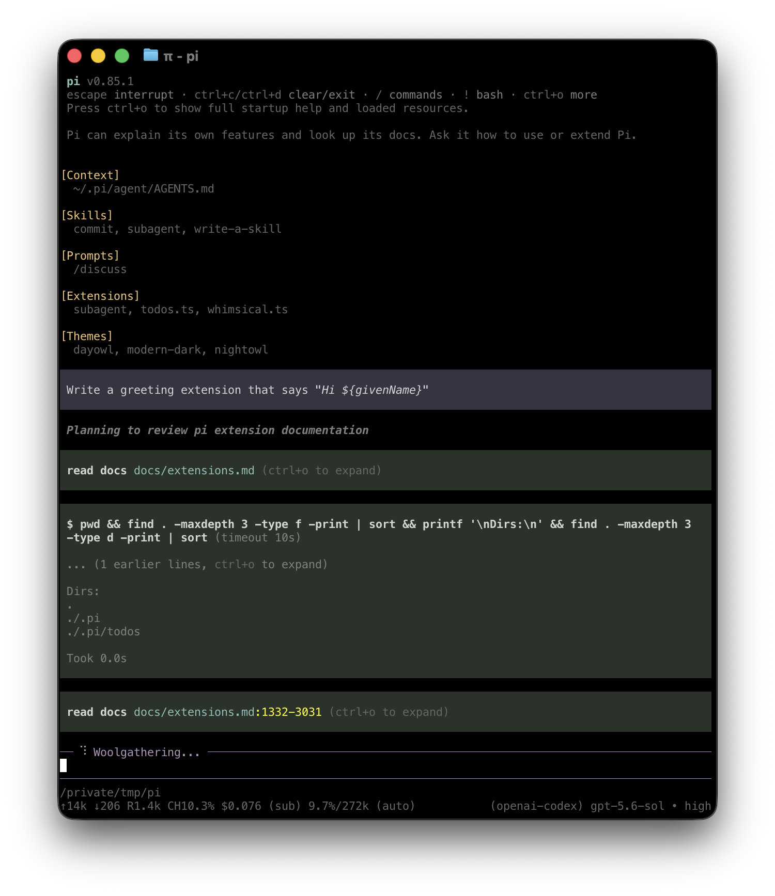

# Use Pi in the terminal

Run `pi` from the folder you want to work in. Pi uses that folder to discover files, instructions, and configuration, and to group saved sessions. If you have not installed Pi or chosen a model yet, follow the [Quickstart](quickstart.md).

Pi may ask whether you trust the working folder before loading its project resources. See [Project trust](security.md#understand-project-trust).

<p align="center"></p>

The transcript shows your prompts, Pi's responses, tool calls, results, and errors. You write prompts and commands in the editor. The footer shows the current folder, session, model, context usage, and accumulated usage and cost.

## Enter a prompt

Type a request and press `Enter` to send it. Use `Shift+Enter` to add a line, or press `Ctrl+G` to work on a longer prompt in your configured external editor.

To include files or images:

- Type `@` to search for a file and add it to your prompt.
- Press `Tab` to complete a path.
- Paste an image or drag it into a compatible terminal.

Pasted text collapses into a compact block at four or more lines or more than 300 characters. Copied or dropped existing local files and images show short filename labels instead of full paths. Ordinary typing, short pastes, URLs, and `@` references stay visible. Shell-mode file arguments keep their original quoting.

Press `F2` to inspect the item at the cursor, or choose an item when several are present elsewhere in the prompt. Pasted text opens for editing: `Enter` applies changes and `Escape` cancels them. Image and file previews are read-only, use the native reader's limits, and close with `Escape`. Previewing does not call the model or add session messages.

Back in the prompt bar, `Enter` still sends the full pasted text and original file paths, never the compact labels. Files are not copied into the prompt merely by previewing them. Remap or disable `app.editor.preview` in [keybindings](keybindings.md).

## Follow Pi's work

Pi shows each tool call and result while it works. Press `Ctrl+O` to expand or collapse tool output. Press `Ctrl+T` to show or hide thinking blocks.

The startup header lists the instructions and resources Pi loaded. The editor border indicates the current thinking level. The footer updates as the model uses context and reports usage.

Pi does not ask before every tool call. Review commands and changed files, and use a sandbox for untrusted or unattended work. See [Security](security.md).

## Answer clarification questions

The built-in `ask` tool lets the interactive main agent present a terminal form above your prompt. Your current draft, compact pastes, attachments, and cursor stay intact. Forms work in both fullscreen and regular mode.

The question header, radio buttons, checkboxes, and submit action use the shared icon preset. Choose **Icons → Nerd** in `/settings` to use Nerd Font glyphs; the Unicode preset remains available.

Use `Up`/`Down` to move among choices and `Space` to toggle them. `Enter` accepts a single choice or advances from an input; `Tab` moves forward and `Shift+Tab` moves back. Textareas use `Shift+Enter` for new lines. Choice groups include an automatic **Other (type your own)** answer. `PageUp`/`PageDown` and the mouse wheel scroll longer context.

The final page reviews your answers. Press `Enter` on **Submit answers**, or use `Ctrl+Enter` from any question, to submit explicitly. Required fields and declared constraints are checked before answers reach the model. There is no timeout or automatic submission. `Escape` or `Ctrl+C` cancels the form and stops the turn, including later tool calls from the same response.

The model supplies one semantic HTML `<form>` with named, labeled controls: radio buttons, checkboxes, selects (including multiple), text/number/date/email/URL inputs, and textareas. Headings, paragraphs, lists, tables, code blocks, and raster images provide context. Numbers return as numbers; checkbox groups and multiple selects return arrays; unchecked optional choices and empty optional numbers are omitted. A single checked checkbox returns its value as a string.

HTML is parsed as data, not opened in a browser. Scripts, CSS, buttons, SVG, password inputs, and file uploads are unsupported. Forms are limited to 64 KiB, 64 fields, 256 options per field, and eight images. Images can use local paths, HTTP(S) URLs, or base64 PNG/JPEG/GIF/WebP data URIs; each image is limited to 8 MiB and 40 megapixels. Remote images have a 20-second loading deadline. Terminals without image support show a text fallback.

`ask` is enabled by default for the interactive main agent, not for print, JSON, RPC, or sub-agent sessions. The model receives guidance to ask only for decisions or missing information it cannot obtain from tools, and to explain tradeoffs before opening a form. Disabling built-in extensions or excluding `ask` from the selected tools disables it. Form shortcuts are [configurable](keybindings.md#clarification-forms).

## Change direction

You can send more input while Pi is working:

| What you want | Action |
|---|---|
| Adjust the current task | Type a message and press `Enter` |
| Add work after the current task | Type a message and press `Alt+Enter` |
| Return queued messages to the editor | Press `Alt+Up` |
| Stop the current task | Press `Escape` |

A message sent with `Enter` waits until the current response and its tool calls finish, then guides the next response. A follow-up sent with `Alt+Enter` waits until Pi finishes the current task. Aborting returns queued messages to the editor.

Windows Terminal reserves some Alt shortcuts. See [Terminal Setup](terminal-setup.md) for the Windows alternatives.

## Change the model or settings

Type `/` to search the available commands. The commands you will use most often are:

- `/model` selects a model. Press `Ctrl+L` to open the same selector.
- `/thinking` or `/effort` selects how much reasoning the current model uses. Both use the same model-supported levels, autocomplete, and picker. `max` is distinct from `xhigh`; unsupported levels report an error rather than silently changing your selection. Press `Shift+Tab` to cycle through supported levels.
- `/login` and `/logout` manage provider access.
- `/settings` changes common preferences.

Prompt templates, skills, and extensions can add more commands to the same menu. See [Choose a Model](models.md), [Configuration](configuration.md), or the complete [Slash Commands reference](slash-commands.md).

### Codex fast mode

`/fast` toggles priority-tier requests for ChatGPT/Codex models (`openai-codex`). Use `/fast on`, `/fast off`, or `/fast status` explicitly. Enabling it can increase usage; it requests `service_tier: "priority"` starting with the next provider request, not a separate model or reasoning level.

The native footer shows `fast (priority)` while active. The choice is saved in the current session and follows resume and branch navigation, including sessions saved by the former local extension. Switching to another provider leaves the preference remembered but inactive and shows `fast (inactive)`; `/fast off` still disables it. New sessions start with fast mode off. The command is supplied by the default built-in `fast` extension.

## Continue or start over

Pi saves sessions automatically unless session persistence is disabled.

- `/new` starts a new session.
- `/resume` opens another saved session.
- `/name` gives the current session a recognizable name.
- `/session` shows its file, ID, message count, token usage, and cost.

Use `/tree`, `/fork`, or `/clone` when you want to explore another approach without losing existing work. Use `/compact` to reduce the conversation history sent to the model. See [Sessions and Context](sessions.md) for these workflows.

After leaving Pi, run `pi --continue` from the same folder to resume its most recent session.

## Run a terminal command

Prefix a command with `!` to run it and include its output in the conversation:

```text
!git status
```

Use `!!` when you want to run a command without sending its output to the model.

## Copy, export, or share results

Press `Ctrl+X` or run `/copy` to choose a code block, quote, or the whole last assistant response from an inline list with a preview. Code blocks copy without fences, quotes without their outer `>` markers, and the whole response as original Markdown. Use `Up`/`Down` to select, `Enter` to copy, and `Escape` to cancel. In fullscreen mode with `fullscreenCopyOnSelect: false`, `Ctrl+X` still copies an active text selection directly. Use `/export` to save the session as HTML or JSONL.

Use `/share` to upload the session and get a viewer link. By default, Radius authentication makes the artifact visible to your Radius organization; otherwise, Pi creates a private GitHub gist through the GitHub CLI. The [`sessionShareDestination`](settings.md#sessions-and-context) setting can force either destination. Review the session first because it can contain prompts, tool output, file contents, and credentials exposed during the conversation.

## Adjust the terminal

Fullscreen mode, the default, keeps the editor and status area fixed while the transcript scrolls within the terminal window. Regular mode uses the terminal's normal scrollback. Choose a mode through `/settings` or `--tui-mode`.

Terminal support for mouse input, keyboard shortcuts, and inline images varies. See [Terminal Setup](terminal-setup.md) for platform-specific configuration and [Keybindings](keybindings.md) for every configurable shortcut. Run `/hotkeys` to inspect the shortcuts active in your current session.

## Collect diagnostic information

When troubleshooting terminal rendering or conversation state, run `/debug`. Pi writes the rendered terminal lines and current session messages to `pi-debug.log` in your [agent directory](configuration.md#agent-directory).

Review this file before sharing it. It can contain prompts, model responses, tool output, file contents, and terminal data.
